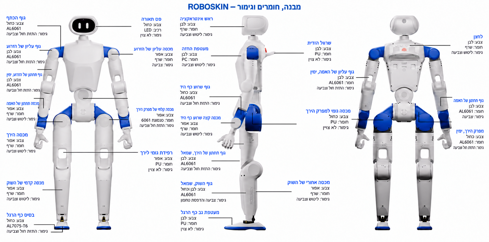

[עברית](README.md) · English

# ROBOSKIN · Electronic skin

[Detailed engineering plan](electronic_skin.en.md)

An independent electronic-skin project for contact location, approximate contact intensity and sparse temperature sensing. The design combines replaceable protected sensor sheets, local acquisition and a segmented CAN FD network.

[](hardware/assets/images/robot-overview.png)

Hebrew-localized visual adaptation of the base robot hardware overview. [Open full-size image](hardware/assets/images/robot-overview.png) · [English translation of all 26 callouts, materials and finishes](docs/robot_overview.en.md) · **[14-board catalogue with direct PCB file links](hardware/02_PCB/README.en.md)**. The illustration introduces the structure; manufacturing dimensions come from the part drawings.

The full reference patch has **28 touch sites and two temperature points**. An optional compact demonstration uses eight controllers with **88 installed touch sites and 16 temperature points**. Panel dimensions and counts are generic examples; they do not prove fit on a particular robot.

| Start here | Contents |
| --- | --- |
| [Robot hardware](hardware/README.en.md) | CNC, 3D printing, rubber, PCBs, harnesses and BOMs, with ROBOSKIN identifiers and Hebrew translation |
| [Robot boards and manufacturing files](hardware/02_PCB/README.en.md) | 14 board families: component BOMs, Gerbers, 3D models, placement coordinates, assembly requirements and drawings |
| [Harnesses and wiring drawings](hardware/03_Harness/README.en.md) | 42 BOM harness types, 43 PDF drawings, assembly specification and direct links to every file |
| [Engineering plan](electronic_skin.en.md) | Materials, circuits, firmware contract, calibration, manufacturing, costs, test phases, competition and Israeli partner research |
| [Electronics](electronics/README.en.md) | Editable pin-level circuits, connection tables, netlists, BOM, isolated 5 V bench supply and wiring |
| [Mechanics](mechanics/README.en.md) | Generic film templates, removable carrier, strain relief and mounting tests |
| [Software](software/README.en.md) | Protocol, event reporting, identity, timing, multi-region observer and synthetic demo |
| [Research register](research/reference_index.en.md) | All 84 requested references with explicit access and review depth |
| [Release status](docs/release_status.en.md) | What exists, what was checked and what still requires physical evidence |

Run the software without any hardware or additional Python packages:

```bash
python3 -m unittest discover -s tests -v
python3 -m software --demo
python3 engineering/models.py
```

The demo uses synthetic packets through the actual protocol gates: available coverage expires when measurements become stale. It opens no device and sends no actuator command. Live use requires independently commissioned identities, calibration and dedicated sensor interfaces.

The cost model uses a **$34.78 good-patch manufacturing allowance at 1,000 patches** and separately priced laboratory gateways. This is not a retail prototype quotation. The complete 80-patch laboratory-interface scenario is $7,852.40 before spare patches, tax, freight and engineering. See the detailed assumptions before using any number in a budget.

This repository combines original electronic-skin implementations with an [adapted hardware package](hardware/README.en.md), using independent Git history and no submodules. The sensor software has no robot SDK dependency. Filenames remain English; primary Markdown documents are Hebrew with English `.en.md` companions. Published research and imported hardware retain their [attribution and licences](NOTICE.en.md).

**Current state:** engineering prototype specification and tested host software. Sensor performance, routed skin PCBs, compiled skin-controller firmware, installed fit, durability and commercial readiness have not been demonstrated by the offline tests.
