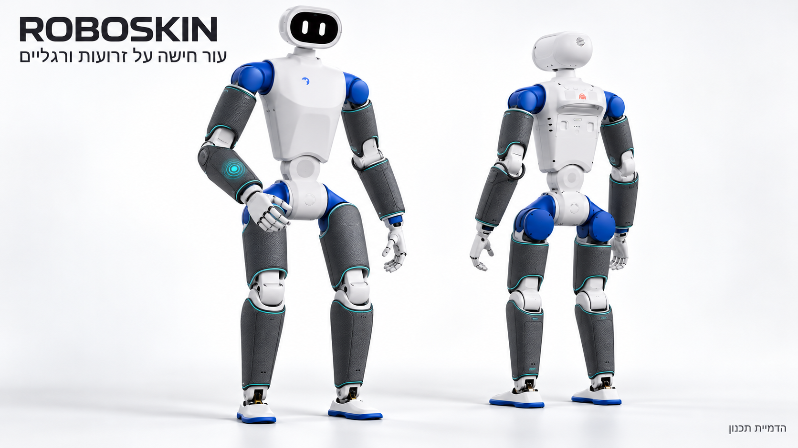
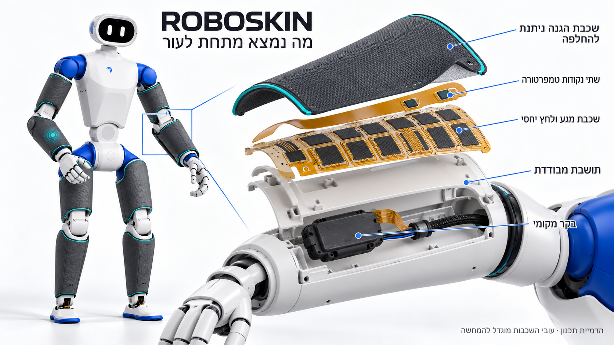
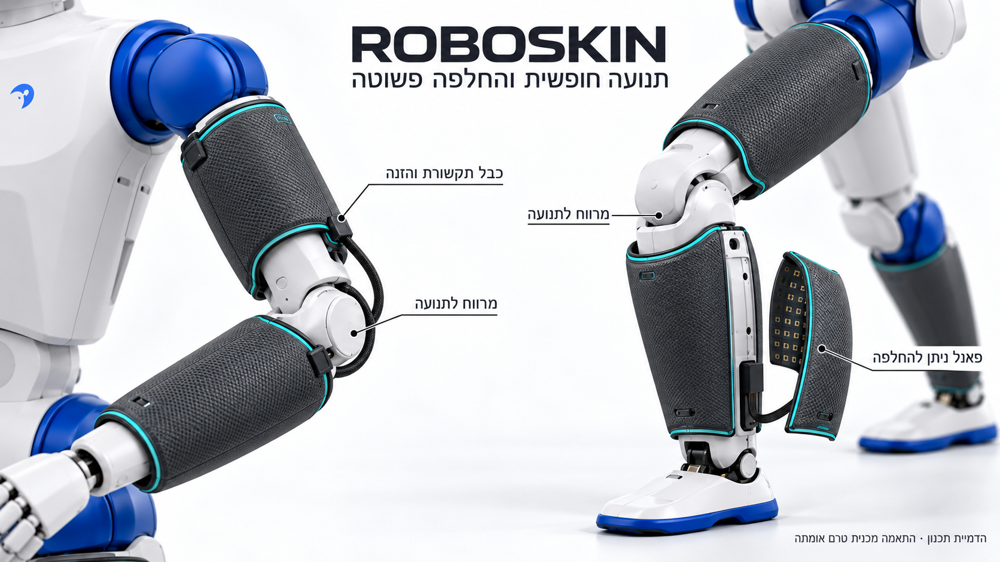
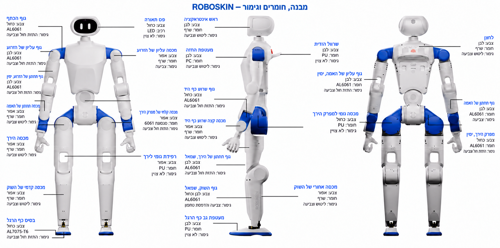

<div dir="rtl" lang="he">

עברית · [English](README.en.md)

# ROBOSKIN · עור אלקטרוני

[התוכנית ההנדסית המפורטת](electronic_skin.md)

פרויקט עצמאי לעור אלקטרוני, המאפשר לזהות את מיקום המגע, להעריך את עוצמתו ולמדוד טמפרטורה בנקודות נבחרות. התכנון משלב יריעות חישה מוגנות וניתנות להחלפה, איסוף נתונים מקומי ורשת תקשורת CAN FD המחולקת לאזורים.

[](hardware/assets/images/skin-application-overview.he.png)

**עור החישה על הרובוט:** פאנלים מוגנים ונשלפים על המקטעים הקשיחים של הזרועות והרגליים, עם רווחים לתנועת המפרקים. אלו הדמיות תכנון; הצבעים, הכיסוי ומסלולי הכבלים ממחישים את הרעיון ואינם תוצאת בדיקת התאמה פיזית.

**מה נמצא מתחת לעור:** שכבת הגנה נשלפת, שתי נקודות טמפרטורה, יריעת חישה למגע, תושבת מבודדת ובקר מקומי. עובי השכבות מוגדל להמחשה.

[](hardware/assets/images/skin-layers-cutaway.he.png)

**תנועה והחלפת פאנלים:** הפרדה בין יריעות החישה משני צדי המפרק, כבל עם מרווח לתנועה ופאנל נשלף לתחזוקה.

[](hardware/assets/images/skin-joints-service.he.png)

[שלוש ההדמיות בגודל מלא והסבר בעברית](docs/skin_visualizations.md)

<details>
<summary>סקירת חומרת הבסיס — חומרים וגימור</summary>

[](hardware/assets/images/robot-overview.png)

סקירת חומרת הבסיס בעיבוד חזותי מתורגם לעברית. [פתיחת התמונה בגודל מלא](hardware/assets/images/robot-overview.png) · [כל 26 ההערות, החומרים והגימורים בעברית](docs/robot_overview.md) · **[קטלוג 14 הלוחות וקישורים ישירים לקובצי ה־PCB](hardware/02_PCB/README.md)**. האיור מיועד להיכרות עם המבנה; מידות ייצור נלקחות משרטוטי החלקים.

</details>

פאנל הייחוס המלא כולל **28 נקודות חישה למגע ושתי נקודות למדידת טמפרטורה**. תצורת הדגמה קומפקטית משתמשת בשמונה בקרים עם **88 נקודות חישה מותקנות למגע ו־16 נקודות למדידת טמפרטורה**. מידות הפאנלים וכמותם הן דוגמאות כלליות; הן אינן מוכיחות התאמה לרובוט מסוים.

| נקודת התחלה | תוכן |
| --- | --- |
| [חומרת הרובוט](hardware/README.md) | חבילת CNC, הדפסת תלת־ממד, גומי, לוחות, צמות ורשימות חומרים, עם שמות ROBOSKIN ותרגום לעברית |
| [לוחות הרובוט וקובצי ייצור](hardware/02_PCB/README.md) | 14 משפחות לוחות: רשימות רכיבים, Gerber, מודלי תלת־ממד, קואורדינטות השמה, דרישות הרכבה ושרטוטים |
| [צמות ושרטוטי חיווט](hardware/03_Harness/README.md) | 42 סוגי צמות ברשימת החומרים, 43 שרטוטי PDF, מפרט הרכבה וקישורים ישירים לכל קובץ |
| [התוכנית ההנדסית](electronic_skin.md) | חומרים, מעגלים, דרישות קושחה, כיול, ייצור, עלויות, שלבי בדיקה, מחקר מתחרים ושותפים אפשריים בישראל |
| [אלקטרוניקה](electronics/README.md) | מפרטי מעגלים הניתנים לעריכה ברמת הפינים, טבלאות חיבורים, רשימות רשתות חשמליות, רשימת רכיבים, אספקת מתח מעבדתית מבודדת של 5 וולט וחיווט |
| [מכניקה](mechanics/README.md) | תבניות כלליות ליריעות, תושבת נשלפת, עיגון כבלים להפחתת עומס מכני ובדיקות התקנה |
| [תוכנה](software/README.md) | פרוטוקול, דיווח אירועים, זיהוי, תזמון, ניטור של כמה אזורי חישה והדגמה באמצעות נתונים מדומים |
| [סקירת הספרות המקצועית](research/reference_index.md) | כל 84 המקורות שהתבקשו, עם פירוט היקף הגישה לכל מקור ועומק בדיקתו |
| [מצב התוצרים](docs/release_status.md) | מה כבר קיים, מה נבדק ומה עדיין דורש ראיות מבדיקה פיזית |

להרצת התוכנה ללא חומרה וללא חבילות Python נוספות:

<div dir="ltr">

```bash
python3 -m unittest discover -s tests -v
python3 -m software --demo
python3 engineering/models.py
```

</div>

ההדגמה מעבירה הודעות מדומות דרך מנגנוני האימות של הפרוטוקול עצמו: כאשר המדידות מתיישנות, כיסוי החישה הרלוונטי מפסיק להיחשב זמין. היא אינה פותחת חיבור להתקן ואינה שולחת פקודות למפעילים. שימוש בחומרה אמיתית דורש אימות עצמאי של זהויות הבקרים, כיול וממשקי תקשורת ייעודיים לחיישנים.

מודל העלויות מניח **34.78 דולר לפאנל תקין באצווה של 1,000 פאנלים**, בתוספת מתאמי תקשורת מעבדתיים המתומחרים בנפרד. זו אינה הצעת מחיר קמעונאית לאב־טיפוס. תצורת מערכת מלאה של 80 פאנלים עם ממשקי מעבדה נאמדת ב־7,852.40 דולר, לפני פאנלים חלופיים, מסים, משלוח ועבודת הנדסה. יש לקרוא את ההנחות המפורטות לפני שימוש במספרים לתכנון תקציב.

המאגר כולל מימושים מקוריים של העור לצד [חבילת חומרה נגזרת](hardware/README.md), עם היסטוריית Git עצמאית וללא תתי־מאגרים. התוכנה אינה תלויה בערכת פיתוח של רובוט. שמות הקבצים באנגלית; מסמכי Markdown הראשיים בעברית ולצדם גרסאות באנגלית בסיומת `.en.md`. עקרונות מחקר ותכנוני חומרה מיובאים שומרים על [הייחוס והרישיונות שלהם](NOTICE.md).

**המצב הנוכחי:** מפרט הנדסי לאב־טיפוס ותוכנת מחשב מארח שנבדקה. הבדיקות ללא חומרה אינן מוכיחות ביצועי חיישנים, מעגלים מודפסים של העור שעברו עריכה וניתוב, קושחה שנבנתה לבקרי העור, התאמה פיזית לאחר התקנה, עמידות או מוכנות מסחרית.

</div>
