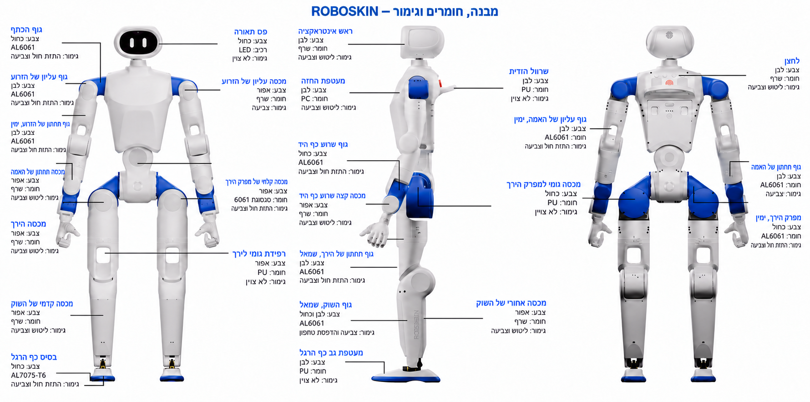

[עברית](robot_overview.md) · English

# Robot overview — structure, materials and finishes

[Back to project](../README.en.md) · [PCB files](../hardware/02_PCB/README.en.md) · [Harnesses and wiring](../hardware/03_Harness/README.en.md)

The illustration is a Hebrew-localized visual adaptation of the [source overview](https://github.com/Roboparty/RP1_hardware/blob/18ca38832cde37a8a4349cff8fbb565f05c6f254/assets/images/robot-overview.png), with ROBOSKIN branding. The three views show the base hardware. The tables below retain all **26 source callouts** for materials, colours and finishes in searchable, copyable, accessible text.

The visual localization used the built-in image-generation tool; the result is not a pixel-exact copy. Use the tables for material/finish values and the part drawings and CAD for exact identification, dimensions and locations. The illustrated shell does not represent manufactured and tested sensing skin.

Row numbers are legend entries, not part identifiers. Left and right refer to the robot. Within each view, entries follow the source's left callout column, then its right column.

## Front view

| No. | Part | Colour | Material or component | Finish |
| --- | --- | --- | --- | --- |
| 1 | Shoulder body | Blue | AL6061 | Sandblasting and spray painting |
| 2 | Upper arm, upper body | White | AL6061 | Sandblasting and spray painting |
| 3 | Right upper arm, lower body | White | AL6061 | Sandblasting and spray painting |
| 4 | Forearm lower cover | Grey | Resin — grade unspecified | Sanding/polishing and spray painting |
| 5 | Thigh cover | Grey | Resin — grade unspecified | Sanding/polishing and spray painting |
| 6 | Front shin cover | Grey | Resin — grade unspecified | Sanding/polishing and spray painting |
| 7 | Foot pad | Blue | AL7075-T6 | Sandblasting and spray painting |
| 8 | Light strip | Blue | LED | Unspecified in source (/) |
| 9 | Upper arm top cover | Grey | Resin — grade unspecified | Spray painting |
| 10 | Hip joint front cover | Grey | 6061 alloy | Sandblasting and spray painting |
| 11 | Thigh rubber pad | Grey | PU | Unspecified in source (/) |

## Side view

| No. | Part | Colour | Material or component | Finish |
| --- | --- | --- | --- | --- |
| 12 | Interaction head | White | Resin — grade unspecified | Sanding/polishing and spray painting |
| 13 | Chest shell | White | PC | Sanding/polishing and spray painting |
| 14 | Wrist body | Blue | AL6061 | Sandblasting and spray painting |
| 15 | Wrist end cover | Grey | Resin — grade unspecified | Sanding/polishing and spray painting |
| 16 | Left thigh lower body | White | AL6061 | Sandblasting and spray painting |
| 17 | Left shin body | White and blue | AL6061 | Spray painting and pad printing |
| 18 | Foot upper | White | PU | Unspecified in source (/) |
| 19 | Handle sleeve | White | PU | Unspecified in source (/) |
| 20 | Hip joint impact pad | Blue | PU | Unspecified in source (/) |
| 21 | Rear shin cover | Grey | Resin — grade unspecified | Sanding/polishing and spray painting |

## Rear view

| No. | Part | Colour | Material or component | Finish |
| --- | --- | --- | --- | --- |
| 22 | Right forearm upper body | White | AL6061 | Sandblasting and spray painting |
| 23 | Hip joint rubber cover | Blue | PU | Unspecified in source (/) |
| 24 | Button | White | Resin — grade unspecified | Sanding/polishing and spray painting |
| 25 | Forearm lower body | White | AL6061 | Spray painting |
| 26 | Right hip joint | Blue | AL6061 | Sandblasting and spray painting |

## Interpreting the data

- `AL6061` and `AL7075-T6` retain the source designations. No 6061 heat treatment is specified in the image; T6 must not be inferred.
- `PU` means polyurethane and `PC` means polycarbonate. Resin grade, hardness, paint thickness and process details are unspecified in the image.
- `LED` describes the light-strip component. A source process value of `/` is translated as “unspecified.”
- The lower forearm body specifies paint only; sandblasting has not been added. The left shin body includes pad printing.
- Skin mounting, adhesion and heat transfer must account for each substrate and finish under the [integration plan](../hardware/skin_integration.en.md).

The [previous skin-panel placement concept](../hardware/assets/images/skin-placement-concept.he.png) is retained separately. It illustrates proposed panel locations whose physical fit remains unverified.

## Source and localization record

Source illustration: RoboParty RP1 hardware overview at the linked source revision. Adaptation and translation: ROBOSKIN project. The [licence mapping](../hardware/LICENSES.en.md) remains applicable, including CC-BY-SA-4.0 for explanatory documents and images. Attribution does not imply partnership or approval.

[26-callout data](../hardware/provenance/robot_overview_callouts.json) · [Localization record](../hardware/provenance/robot_overview_localization.json) · [Built-in imagegen prompt set](../hardware/provenance/robot_overview_prompts.json)
