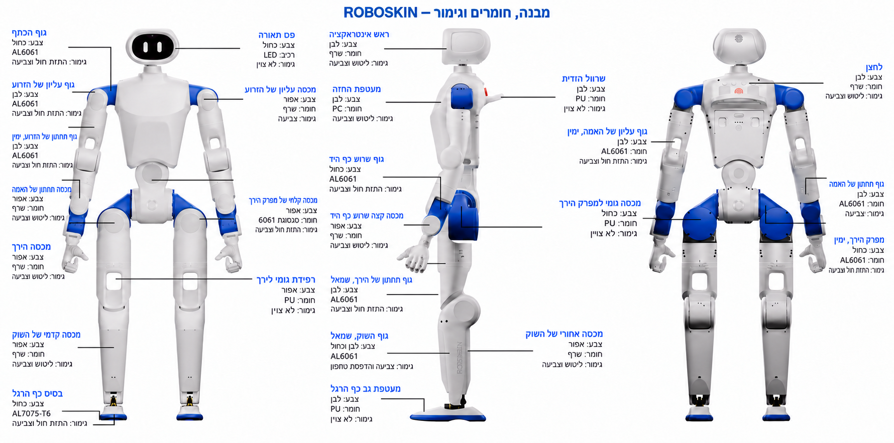

עברית · [English](robot_overview.en.md)

# סקירת הרובוט — מבנה, חומרים וגימור

[בחזרה לפרויקט](../README.md) · [קובצי PCB](../hardware/02_PCB/README.md) · [צמות וחיווט](../hardware/03_Harness/README.md)

האיור הוא עיבוד חזותי מתורגם של [תמונת המקור](https://github.com/Roboparty/RP1_hardware/blob/18ca38832cde37a8a4349cff8fbb565f05c6f254/assets/images/robot-overview.png), עם מיתוג ROBOSKIN. שלושת המבטים מציגים את חומרת הבסיס. הטבלאות להלן משמרות את כל **26 ההערות** על חומרים, צבעים וגימור שבמקור, גם לצורך חיפוש, העתקה ונגישות.

התרגום והעיבוד החזותי נעשו באמצעות כלי יצירת תמונות; התוצאה אינה העתק פיקסלים מדויק. יש להשתמש בטבלאות לנתוני החומר והגימור ובשרטוטי החלקים וב־CAD לזיהוי מדויק, מידות ומיקום. המעטפת באיור אינה דגם של עור חישה שיוצר ונבדק.

מספרי השורות משמשים את המקרא בלבד ואינם מספרי חלקים. כיווני ימין ושמאל מתייחסים לרובוט. סדר הרשומות בכל מבט הוא עמודת הכיתובים השמאלית ואחריה הימנית במקור.

## מבט קדמי

| מס׳ | חלק | צבע | חומר או רכיב | גימור |
| --- | --- | --- | --- | --- |
| 1 | גוף הכתף | כחול | AL6061 | התזת חול וצביעה |
| 2 | גוף עליון של הזרוע | לבן | AL6061 | התזת חול וצביעה |
| 3 | גוף תחתון של הזרוע, ימין | לבן | AL6061 | התזת חול וצביעה |
| 4 | מכסה תחתון של האמה | אפור | שרף — דרגה לא צוינה | ליטוש וצביעה |
| 5 | מכסה הירך | אפור | שרף — דרגה לא צוינה | ליטוש וצביעה |
| 6 | מכסה קדמי של השוק | אפור | שרף — דרגה לא צוינה | ליטוש וצביעה |
| 7 | בסיס כף הרגל | כחול | AL7075-T6 | התזת חול וצביעה |
| 8 | פס תאורה | כחול | LED | לא צוין במקור (/) |
| 9 | מכסה עליון של הזרוע | אפור | שרף — דרגה לא צוינה | צביעה |
| 10 | מכסה קדמי של מפרק הירך | אפור | סגסוגת 6061 | התזת חול וצביעה |
| 11 | רפידת גומי לירך | אפור | PU | לא צוין במקור (/) |

## מבט צד

| מס׳ | חלק | צבע | חומר או רכיב | גימור |
| --- | --- | --- | --- | --- |
| 12 | ראש אינטראקציה | לבן | שרף — דרגה לא צוינה | ליטוש וצביעה |
| 13 | מעטפת החזה | לבן | PC | ליטוש וצביעה |
| 14 | גוף שורש כף היד | כחול | AL6061 | התזת חול וצביעה |
| 15 | מכסה קצה שורש כף היד | אפור | שרף — דרגה לא צוינה | ליטוש וצביעה |
| 16 | גוף תחתון של הירך, שמאל | לבן | AL6061 | התזת חול וצביעה |
| 17 | גוף השוק, שמאל | לבן וכחול | AL6061 | צביעה והדפסת טמפון |
| 18 | מעטפת גב כף הרגל | לבן | PU | לא צוין במקור (/) |
| 19 | שרוול הידית | לבן | PU | לא צוין במקור (/) |
| 20 | מגן פגיעה למפרק הירך | כחול | PU | לא צוין במקור (/) |
| 21 | מכסה אחורי של השוק | אפור | שרף — דרגה לא צוינה | ליטוש וצביעה |

## מבט אחורי

| מס׳ | חלק | צבע | חומר או רכיב | גימור |
| --- | --- | --- | --- | --- |
| 22 | גוף עליון של האמה, ימין | לבן | AL6061 | התזת חול וצביעה |
| 23 | מכסה גומי למפרק הירך | כחול | PU | לא צוין במקור (/) |
| 24 | לחצן | לבן | שרף — דרגה לא צוינה | ליטוש וצביעה |
| 25 | גוף תחתון של האמה | לבן | AL6061 | צביעה |
| 26 | מפרק הירך, ימין | כחול | AL6061 | התזת חול וצביעה |

## משמעות הנתונים

- `AL6061` ו־`AL7075-T6` נשמרו בדיוק כפי שהם במקור. התמונה אינה מציינת טיפול תרמי ל־6061; אין להסיק ממנו T6.
- `PU` מציין פוליאוריתן ו־`PC` פוליקרבונט. סוג השרף, קשיות החומרים, עובי הצבע ופרטי תהליך אינם מוגדרים בתמונה.
- `LED` מתאר רכיב בפס התאורה. הסימן `/` בעמודת התהליך במקור תורגם ל״לא צוין״.
- גוף האמה התחתון מציין צביעה בלבד; לא נוספה לו דרישת התזת חול. גוף השוק השמאלי כולל הדפסת טמפון.
- לצורך שילוב עור החישה יש להתאים את ההתקנה, ההדבקה ומעבר החום לכל חומר וגימור לפי [תוכנית השילוב](../hardware/skin_integration.md).

[הדמיית מיקום פאנלי החישה שהוצגה בעבר](../hardware/assets/images/skin-placement-concept.he.png) נשמרת כקובץ נפרד. היא המחשה רעיונית של מיקומים מוצעים, וההתאמה הפיזית עדיין לא אומתה.

## מקור ותיעוד העיבוד

מקור האיור: RoboParty, תמונת סקירת חומרת RP1, מהדורת המקור המצוינת בקישור. העיבוד והתרגום: פרויקט ROBOSKIN. תחולת הרישוי נשמרת לפי [מסמך הרישיונות](../hardware/LICENSES.md), לרבות CC-BY-SA-4.0 למסמכי ההסבר והתמונות. הצגת המקור אינה מעידה על שותפות או אישור.

[נתוני 26 ההערות](../hardware/provenance/robot_overview_callouts.json) · [תיעוד העיבוד](../hardware/provenance/robot_overview_localization.json) · [הוראות העיבוד לכלי imagegen](../hardware/provenance/robot_overview_prompts.json)

