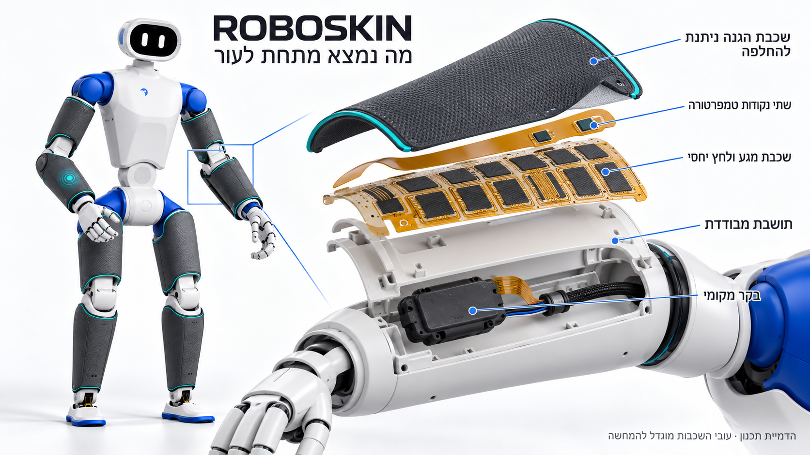
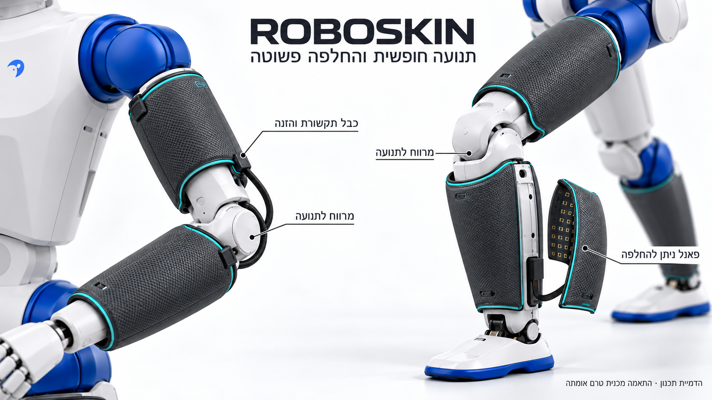

[עברית](skin_visualizations.md) · English

# Skin application visualizations

[Back to project](../README.en.md) · [Integration plan](../hardware/skin_integration.en.md) · [Skin construction](../mechanics/README.en.md)

Three studio 3D visualizations show ROBOSKIN electronic skin applied to RP1 robot hardware. They were created using the built-in `imagegen` tool and the robot reference image, with a consistent visual design: dark protective surfaces and teal edges over the white and blue shells. Click any illustration to open the full-size image file.

## 1. Skin installed on arms and legs

Protected panels cover rigid upper-arm, forearm, thigh and shin segments. Each segment has a separate panel, with gaps around joints. The glowing forearm graphic illustrates a contact event; it is not a display built into the skin. The head, fingers and soles are outside this coverage demonstration.

## 2. Beneath the protective surface

Outside to inside: a replaceable protective cover, two near-surface temperature points, a touch and relative-intensity sensing laminate, and an insulating carrier supported by the shell. A local controller acquires the signals, and a shared cable carries power and data. The two temperature points provide local measurements, not continuous thermal imaging.

Layers, sensor sizes and separation are exaggerated for explanation. Cell count, electrode shapes and controller dimensions in the illustration are conceptual. The complete design specification defines a reference patch with 28 touch cells and two temperature points; use the specification and drawings for construction.

## 3. Joint movement and panel replacement

Sensing sheets stay on rigid segments rather than stretching through the elbow or knee crease. A cable service loop and clamps on either side illustrate how movement is accommodated. The removable shin panel demonstrates maintenance and replacement of one sensing region without replacing the entire covering.

This is a visual design proposal. Panel placement, movement clearances, thickness, texture, attachment and cable routes have not been validated on a physical robot. The image is neither CAD nor a performance test result; fit and verification steps are specified in the integration plan.

## Files and visual source

Robot form reference: [RoboParty RP1 overview](https://github.com/Roboparty/RP1_hardware/blob/18ca38832cde37a8a4349cff8fbb565f05c6f254/assets/images/robot-overview.png). Skin overlays and visual adaptations were created for ROBOSKIN. The [licence and attribution mapping](../hardware/LICENSES.en.md) remains applicable; depicting the robot does not imply a partnership or endorsement by its creators.

[Complete generation prompts for all three images](../hardware/provenance/skin_visualization_prompts.json) · [Asset paths and hashes](../hardware/provenance/skin_visualization_assets.json)
