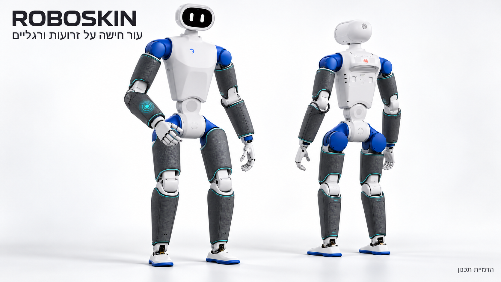
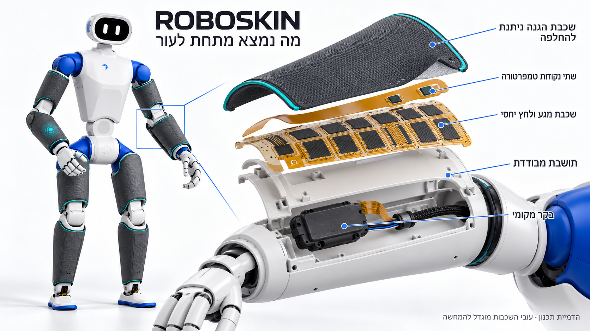
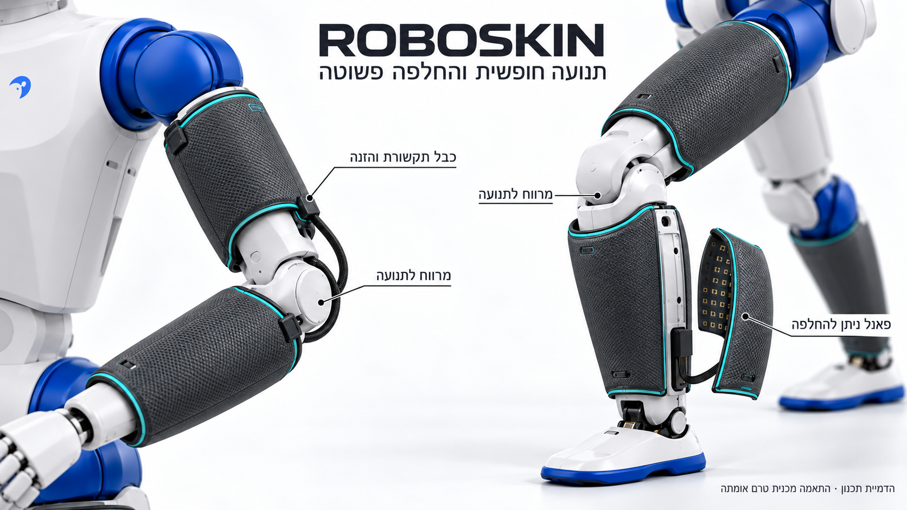

עברית · [English](skin_visualizations.en.md)

# הדמיות יישום העור על הרובוט

[בחזרה לפרויקט](../README.md) · [תוכנית השילוב](../hardware/skin_integration.md) · [מבנה העור](../mechanics/README.md)

שלוש הדמיות תלת־ממד מציגות את עור ROBOSKIN על חומרת רובוט RP1. הן נוצרו באמצעות כלי `imagegen` המובנה על בסיס תמונת הייחוס של הרובוט, עם שפה חזותית אחידה: כיסוי כהה ושוליים בטורקיז על גבי המעטפת הלבנה והכחולה. לחיצה על כל תמונה פותחת את קובץ המקור בגודל מלא.

## 1. העור מותקן על הזרועות והרגליים

פאנלים מוגנים מכסים מקטעים קשיחים בזרועות, באמות, בירכיים ובשוקיים. לכל מקטע פאנל נפרד, ומרווחים נותרים סביב המפרקים. הסימון הזוהר על האמה ממחיש אירוע מגע; הוא אינו תצוגה המותקנת בעור. הראש, האצבעות וסוליות כפות הרגליים נשארים מחוץ להדגמת הכיסוי הזאת.

## 2. מה נמצא מתחת לשכבת ההגנה

מבחוץ פנימה: כיסוי הגנה ניתן להחלפה, שתי נקודות מדידת טמפרטורה קרובות לפני השטח, שכבת חישה למגע ולעוצמה יחסית, ותושבת מבודדת הנתמכת במעטפת. בקר מקומי אוסף את האותות, וכבל משותף נושא מתח ותקשורת. שתי נקודות הטמפרטורה מספקות מדידות מקומיות; אין כאן צילום תרמי רציף.

השכבות, החיישנים והרווחים ביניהם מוגדלים לצורך ההסבר. מספר התאים, צורת האלקטרודות ומידות הבקר באיור הם המחשה. מפרט התכנון המלא מתאר פאנל ייחוס של 28 תאי מגע ושתי נקודות טמפרטורה; יש להשתמש במפרט ובשרטוטים לצורך בנייה.

## 3. תנועת מפרקים והחלפת פאנל

יריעות החישה נשארות על המקטעים הקשיחים ואינן נמתחות דרך קפל המרפק או הברך. לולאת שירות בכבל ועיגון משני צדי המפרק ממחישים כיצד מתאפשרת תנועה. פאנל השוק הנשלף ממחיש תחזוקה והחלפה של אזור חישה בלי להחליף את כל הכיסוי.

המראה הוא הצעת תכנון חזותית. מיקום הפאנלים, מרווחי התנועה, העובי, המרקם, העיגון ומסלול הכבלים טרם אומתו על רובוט פיזי. התמונה אינה דגם CAD או תוצאת בדיקת ביצועים; שלבי ההתאמה והבדיקה מפורטים בתוכנית השילוב.

## קבצים ומקור חזותי

מקור צורת הרובוט: [תמונת RP1 של RoboParty](https://github.com/Roboparty/RP1_hardware/blob/18ca38832cde37a8a4349cff8fbb565f05c6f254/assets/images/robot-overview.png). תוספת העור והעיבוד החזותי נוצרו עבור ROBOSKIN. [תחולת הרישיונות והייחוס](../hardware/LICENSES.md) נשמרת; הצגת הרובוט אינה מעידה על שותפות או אישור מצד יוצריו.

[הוראות היצירה המלאות לכל שלוש התמונות](../hardware/provenance/skin_visualization_prompts.json) · [רישום הקבצים וחתימותיהם](../hardware/provenance/skin_visualization_assets.json)

