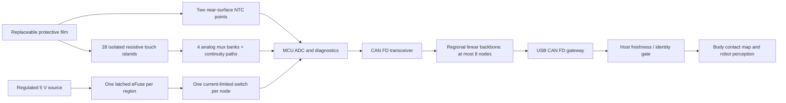

[עברית](electronic_skin.md) · English

# Affordable electronic skin for humanoid robots

**Repository scope update:** The adapted hardware package is now included under [hardware/](hardware/README.en.md), covering CNC, 3D printing, rubber, PCBs, harnesses and BOMs. The plan below specifies the skin subsystem; importing hardware does not prove mechanical, electrical or software integration on a robot. The [integration plan](hardware/skin_integration.en.md) distinguishes completed adaptations from checks still requiring hardware.

**Engineering plan, revision 2.2 — standalone ROBOSKIN design and verified host software, 25 October 2026**
**Owner:** Ilan. **First application:** protected contact-location and approximate-intensity sensing on humanoid arms, legs and torso, with sparse contact-temperature sensing.
**Status:** build and verification specification, with tested host protocol software and reproducible calculations. No physical performance, supplier quotation, certification, PCB release or patentability is implied by this document.

This standalone edition contains the original electronic-skin design, academic research review and host reference implementation. Revision 2.2 adds editable pin-level circuit/netlist exports, generic panel templates, the independent multi-region observer and identity/synchronization fixes. It replaces the earlier low gateway allowance with a separately priced isolated laboratory adapter. This is an engineering specification with offline checks; physical patches, board firmware, fabrication release and robot qualification remain unverified.

The generic 80-patch coverage allocation below is a planning scenario, not a fitted robot. The optional compact eight-controller example has 88 active touch sites; it does not physically instantiate the full-size panel allocation. Material and unit manufacturing allowances assume the explicitly stated batch size. Current supporting files are linked from [README.md](README.en.md), [electronics](electronics/README.en.md), [mechanics](mechanics/README.en.md) and [software](software/README.en.md).

**Navigation**

| Sections 1–10 | Sections 11–20 | Sections 21–30 |
|---|---|---|
| [1. Decision, limitations and what the audit changed](#section-1) | [11. CAN protocol, freshness and software interface](#section-11) | [21. Robot behavior and evidence of customer value](#section-21) |
| [2. Frozen requirements and coverage accounting](#section-2) | [12. Home-lab build, with explicit material selection experiment](#section-12) | [22. Competitive landscape](#section-22) |
| [3. Material decisions and alternatives](#section-3) | [13. Calibration, hold drift and replacement](#section-13) | [23. Israeli strategic partners](#section-23) |
| [4. System architecture and failure boundaries](#section-4) | [14. PCB release, CAD checks and configuration records](#section-14) | [24. Innovation, intellectual property and publication](#section-24) |
| [5. Mechanical stack and construction drawing specification](#section-5) | [15. BOM, price evidence and cost-down limits](#section-15) | [25. Supplier RFQs, partner scopes and purchasing decisions](#section-25) |
| [6. Analog circuits, diagnostics and exact component values](#section-6) | [16. Home-lab equipment and purchase ceilings](#section-16) | [26. Decision register: no unowned “research later” items](#section-26) |
| [7. Controller pin plan, power reference and clock](#section-7) | [17. Limb economics, mass, energy and commercial margin](#section-17) | [27. Reproducibility, service data and delivered artifacts](#section-27) |
| [8. Power distribution and fault coordination](#section-8) | [18. Manufacturing work instructions and service design](#section-18) | [28. Cheng algorithms translated into this product](#section-28) |
| [9. Harness and connectors](#section-9) | [19. Verification procedures, failure responses and reliability evidence](#section-19) | [29. Systematic review of the 84 Cheng references](#section-29) |
| [10. Embedded firmware work specification](#section-10) | [20. Phases, deliverables, budgets and hard stop decisions](#section-20) | [30. ProxySKIN comparison and the proximity decision](#section-30) |

<a id="section-1"></a>

## 1. Decision, limitations and what the audit changed

Build a **replaceable laminated resistive sensing sheet with local digitization and segmented CAN FD wiring**. Retain copper for the short power/data harness. The main reduction in long wires comes from sharing communication and doing measurement beside the sensors. No affordable material simultaneously improves copper's conductivity, equal-resistance cross-section, terminations and repeated-flex reliability for arbitrary actuator currents. Motor power wiring remains a separate engineering problem.

Use **28 independently wired touch cells and two temperature points per patch**, 25 mm pitch, four analog multiplexer banks, one STM32 controller and one CAN transceiver. This architecture supports simultaneous contacts without the electrical ghost paths of a passive resistive row/column matrix. There are still 28 short printed signal traces inside a patch; there are four conductors on its connection to the regional harness.

The initial product is **non-safety contact perception for indoor robot shells**. It can support awareness of contact, approximate contact intensity, contact-informed motion and maintenance diagnostics. It does not measure arbitrary force vectors, resolve fingers, cover joint gaps automatically or provide a certified protective stop. Two temperature points cannot identify every hot object touching the rest of the patch.

The project is technically plausible. **A commercial breakthrough and a $1,500 full-body production system are not established by present evidence.** The revised planning case is about $7,852 for an 80-patch installation, or $8,131 with spare patches, using bought development gateways and modeled 1,000-patch manufacturing costs. This is a conservative planning calculation, not a quotation. Selling an initial arm module is a more credible route than promising a complete low-cost humanoid on day one.

| Audit finding | Revision-2 decision | Concrete closure |
|---|---|---|
| Thin materials were confused with a thin installed system | Specify the complete laminate, attachment, controller pocket and joint harness separately | M01/M02 dimensional and coverage maps |
| 28 caps, pucks and guides create assembly and preload problems | Use isolated full-area resistive islands in a registered laminate; commercial FSR pucks only in the electrical bench fixture | Four-geometry coupon experiment, then full patch |
| Continuous resistive film can couple adjacent cells | Electrically separate all 28 resistive islands; one transfer carrier places them as an array | E02 multi-contact/isolation test |
| 330 kΩ diagnostic path has limited open-circuit margin | 100 kΩ remote end-of-line resistor, ±20% maximum including aging | Calculated window and E01 leakage test |
| Equal bank reference voltages hide bank swaps | Four reference levels: approximately 1,024, 1,638, 2,457, 3,071 ADC counts | E01 permutation and stuck-address tests |
| 200 Hz leaves little acquisition margin | 100 Hz baseline, approximately 4.42 ms nominal acquisition in a 10 ms period | E03 measured deadline and bus load |
| Receiving a frame was treated as proof of freshness | Capture timestamp, persistent boot epoch, config CRC and nonce time handshake | S01 tests, including delayed USB traffic |
| A hard contact could disappear into an invalid reading | Separate `CONTACT_OR_FAULT` from ordinary invalid coverage | S01 overload tests and behavior contract |
| Two ADC pins have stricter injection susceptibility | Move bank inputs to PA0, PA1, PA7 and PB1; move address GPIOs to PB5–PB7 | Package-specific connection review and E04 |
| Crystal startup and load values were guesses | Use a specified 8 MHz CMOS oscillator; configure HSE bypass | E03 clock/startup test |
| Gateway and manufacturing costs omitted real work | Price an identifiable development gateway; cost attended labor and station occupancy separately | C01 measured cycle time, RFQ ceiling |
| Million-cycle claims lacked a statistical meaning | Define load/environment, sample size, failures and confidence separately | R01; no extrapolation from one good sample |

This is an engineering plan, not a substitute for executing it. Every physical unknown below has a named experiment, numerical criterion and prescribed response. Supplier-only facts have an explicit order condition or price ceiling. If a result fails, the specified response changes the product or stops the release; it does not become a hidden assumption.

<a id="section-2"></a>

## 2. Frozen requirements and coverage accounting

| Item | Revision-2 baseline / pass condition |
|---|---|
| Patch coordinates | Seven columns × four rows. Cell `i=7r+c `; center `(12.5+25c, 12.5+25r)` mm, `r=0..3 `, `c=0..6` |
| Sensing rectangle | 175 × 100 mm; 23 × 23 mm electrode areas. Add a 3 mm external sealing margin: nominal physical panel 181 × 106 mm, excluding tail |
| Touch output | Cell ID, dimensionless intensity 0–254, validity mask, open mask and overload/contact-or-fault mask; 255 is invalid |
| Detection, dry indoor | At least 99 detections in 100 applications at 0.5 N center, 1 N two-cell boundary, 2 N four-cell intersection, with a 10 mm diameter flat probe; measure all cell centers and seam classes |
| Localization | At 2 N, report the contacted cell or its immediate neighbor; publish the full error distribution. No claim of sub-taxel accuracy |
| Intensity | Monotonic median response at 0.5, 2, 5, 10 and 20 N using the specified probe; at least three repeatable ordinal levels. No kPa label |
| Frame rate / latency | 100 complete acquisitions/s. Periodic mode sends 100 snapshots/s; qualified hybrid mode sends 50/s idle and up to 100/s on contact/change/fault. Normal contact-report latency p99.9 ≤30 ms; invalidate stale coverage within 40 ms of oldest possible acquisition time. See section 28 |
| Temperature | Two points, 10 Hz numerical update, calibrated 10–60°C; assembled error ≤±2°C at verification points; response 10–90% ≤3 s under specified fixture contact |
| Initial operating environment | Dry indoor, 10–40°C, 20–80% RH noncondensing. No liquid immersion, outdoor or solvent-cleaning claim |
| Thickness | Active sensing laminate ≤1.5 mm above existing shell, excluding a local thermal boss if needed; controller installed behind shell, pocket ≤5 mm including clearance |
| Mass | Reference 80-patch system engineering allocation ≤2.2 kg; a target requiring weighing, not a calculated guarantee |
| Electrical interface | Regulated regional 5 V ±5%; short branch; 3.3 V local electronics; 1/2 Mbit/s CAN FD |
| Consumption | Design budget ≤30 mA average per patch at 5 V, 80 mA peak; qualify a full installation source for 10 A including gateways/hubs and startup |
| Service | Whole sensor cassette changed in ≤5 min by trained operator; controller connector rated mating budget observed; faulted region explicitly unavailable |
| Life screen | 100,000 cycles for design selection; 1,000,000 cycles under R01 only after design freeze; drift and detection requirements still apply |

The seam targets differ deliberately. A 1 N load shared equally by four cells gives only 0.25 N per cell, below the proposed center detection threshold. A continuous cover does not repeal that force balance. Lower seam thresholds require measured mechanical transfer or a different sensing design.

One patch contains **0.014812 m² of electrode area**, 84.64% of its 0.0175 m² nominal sensing rectangle. This is geometric area, not verified detection coverage. With external sealing margins, active area is only about 77.2% of the 181 × 106 mm physical footprint. At 80 patches the summed sensing rectangle is 1.40 m² and summed electrode area is **1.185 m²**, before overlaps, contours and joint exclusions. At 36 patches there are 1,008 touch cells and 72 temperature points, occupying 0.63 m² of nominal sensing rectangles; that is not automatically a whole-body skin.

Use an initial allocation of eight patches per arm, sixteen per leg, twenty-eight torso/back and four optional head/neck: 80 total, 2,240 touch cells, 160 temperature points and ten regions of at most eight nodes. Hands, fingertips, soles and joint bearing surfaces are excluded. For a robot-specific map, export the shell mesh, place panel outlines, simulate the complete joint envelope and report measured contact coverage at every 15° of joint travel. Count inaccessible/uncovered area explicitly.

**Definition of pressure:** FSR resistance depends on load distribution and mechanics. Without knowing actual contact area, force divided by nominal cell area is not object pressure. Use “relative contact intensity”; calibrate in newtons only for the stated probe/stack and label that calibration narrowly.

<a id="section-3"></a>

## 3. Material decisions and alternatives

The first commercial candidate is a supplier-made, independently wired, laminated PET resistive array. A home-build surrogate uses interdigitated ENIG electrodes and **Sensitronics XactFSR** islands. These share a measurement principle; they do not share a guaranteed calibration or lifetime. Do not transfer a calibration between them.

| Approach | Decision and exact experiment | Why it is or is not the baseline |
|---|---|---|
| Resistive printed film, local ADC | Baseline. Run the coupon and loading sequence in section 12 | Simple electronics, simultaneous contacts, accessible manufacturing; creep and mechanics must meet tests |
| Thin copper/polyimide flex | Use for short electrodes/interconnect and thermal flex; weigh a 175 × 100 mm panel | Reliable industrial routing; flexibility is not stretchability. Two-layer flex may cost more than printed PET |
| Capacitive flex | Buy a development controller and build one guarded 4 × 4 coupon only if FSR drift fails M03 | Good contact/proximity option, but motor EMI, moisture and pressure interpretation need a different readout; not a plug-in film substitution |
| Magnetic elastomer / ReSkin-type | Benchmark one available module under identical probe and nearby operating motor | Adds shear capability, but magnets, calibration and motor magnetic fields complicate low-cost large-area coverage |
| Conductive textile / conductive foam | Build four isolated cells with the same divider for comparison; reject if unloaded drift >20% of contact span or adjacent unloaded response >15% | Quick and cheap to experiment with; material variation, humidity and dimensional stability often dominate |

Aluminum can reduce conductor mass at equal resistance but needs roughly 1.6× copper cross-section, difficult small terminations and flex-fatigue qualification. Silver ink is useful for short printed traces, not economical replacement for motor power cables. Carbon conductors need much more cross-section for equal low resistance. Optical fiber can carry data with little conductor mass but still needs powered transceivers and does not deliver actuator power. None solves the whole system simply by being thin.

The ADS7953 in the user's original image is an analog selector plus digitizer that sends numbers to a host. Local ADC conversion is useful; its external PGA/reference and extra IC are unnecessary for the first coarse resistive-contact product because the MCU already contains an ADC. More ADC bits cannot remove polymer creep or mechanical hysteresis. Introduce an external ADC only if measured electrical noise/settling fails E01 after layout fixes, and document the extra cost and power.

<a id="section-4"></a>

## 4. System architecture and failure boundaries



Power and data pass along a passive trunk, not through removable sensor boards. Unplugging one branch must not disconnect the downstream trunk. There is no CAN star with eight long branches. A bus short can stop its entire region; a crashed host or common 5 V source can stop all regions. A transceiver's dominant timeout does not clear a physical short. These limitations remain even with ten networks.

Use separate software names for `NO_CONTACT `, `CONTACT `, `CONTACT_OR_FAULT `, `COVERAGE_UNAVAILABLE `, and `TEMPERATURE_UNAVAILABLE`. A missing patch must never appear as an untouched patch. The robot's existing independent stop/protection system remains responsible for its safety function.

<a id="section-5"></a>

## 5. Mechanical stack and construction drawing specification

### 5.1 Replace the cap-and-puck production design

Do not assemble 28 individual caps and 28 silicone pucks per industrial patch. Start with the following laminate on an existing relatively rigid shell. It measures normal contact; it is not a stretchable sheet across an elbow crease.

| Outside to inside | Frozen initial construction | Role / assembly instruction |
|---|---|---|
| Sacrificial protective film C2 | Covestro Platilon U 4201 AU, 100 µm nominal; supplier-certified grade and gauge | Electrically insulating wear surface. Buy converted sheet/sample material; do not assume a web listing means small-lot inventory |
| Cover attachment | Perimeter/grid adhesive only, leaving active 23 mm squares free of adhesive | Avoid full-area bonding that stiffens sensing zones or creates an uncontrolled preload. Use a registered peelable cover cassette |
| Thermal islands | Two 0603 NTCs on a separate solderable polyimide flex, shallow pockets in nonsensing seam/header areas | Thin bond to cover, insulation toward shell, no heat path to regulator. Local bump can exceed film thickness; measure it |
| Resistive layer | 28 separate 24.5 × 24.5 mm XactFSR islands for the home prototype; coated face toward electrodes | A continuous conductive coating across cells is prohibited. Kiss-cut onto a transfer carrier for pilot manufacture |
| Spacer | One measured 3M 467MP layer, nominal 50–60 µm; 23 × 23 mm openings within each island | 0.75 mm adhesive rim; one 0.5 mm vent interruption per cell into a rear-directed vent path. No adhesive on interdigitated metal |
| Electrodes | 23 × 23 mm comb area on a two-layer flex; ENIG, 18 µm copper target, 0.254 mm trace and gap initially | Top layer electrodes, bottom routing; do not attempt to squeeze all signals through single-layer narrow gutters |
| Back attachment | Supported carrier registered to shell; edge clips or service screws at existing shell mounts | No loose fastener behind a sensing cell; no concentrated bump. Sensor sheet is replaceable as a cassette |

Covestro documents 50–100 µm variants of this grade; the order still requires a thickness/grade certificate. A readily identifiable thicker wear comparison is **3M 8671/8671HS**, about 0.35 mm applied thickness and 439 g/m². Its adhesive and stiffness make it a different stack; do not silently substitute it or claim the same sensitivity. At 1.4 m² it adds approximately 0.45 kg relative to a 100 µm TPU film, before other differences. [Covestro film availability](https://solutions.covestro.com/pt/highlights/articles/stories/2024/tpu-films-enhance-sports-equipment-design), [3M protective tape data](https://multimedia.3m.com/mws/media/2088428O/3m-polyurethane-protective-tape-8671.pdf).

The tape catalog and technical sheet use slightly different nominal gauges. Measure ten spacer samples with a micrometer, record compressed applied thickness and use that value in the drawing. Never include the removable liner in the installed stack. [3M 467MP technical sheet](https://multimedia.3m.com/mws/media/2366204O/3M-Adhesive-Transfer-Tape-467MP.pdf?pif=000024).

### 5.2 Electrode and sheet geometry

For each cell, two interleaved combs terminate at `SNS_i ` and `SENS_GND`. Use 0.254 mm fingers and gaps, with 0.5 mm end clearance and no soldermask on the active comb. Place vias, EOL resistors and stiffeners outside the active aperture. The 100 kΩ EOL path is at the **remote cell**, beyond the entire signal trace, connected from that electrode's signal to ground. A resistor beside the controller cannot diagnose a broken tail. For a flex prototype, mount a 0402 resistor on the back with a relieved carrier pocket; include 28 extra placements and their assembly cost. Industrial printed EOL resistors must meet the post-aging range of 80–120 kΩ.

The two-layer routing specification is a manufacturable constraint, not released copper artwork. Keep at least 0.15 mm conductor/space on routing layers, via annuli and minimum drill per the selected fabricator, and give the vendor a 40-contact reinforced tail. The production PET version may use printed dielectric crossovers or a second routing layer, but cannot be quoted as a one-print, single-layer sheet. Require an artwork/netlist check proving all 28 paths are independent. EOL and signal printing are included in the sheet RFQ price.

Specify end-to-end signal-trace resistance≤20 Ω and the effective common-ground return≤1 Ω from the most distant cell to the controller with the intended parallel ground contacts connected. At about 4.5 mA total loaded-cell current, 1 Ω adds only 4.5 mV; a narrow printed return of 10 Ω would add45 mV and could create cross-cell measurement errors. Measure this on completed sheets with a four-wire fixture where possible. On bare routing before resistive/EOL printing, require≥100 MΩ isolation at 3.3 V between unrelated traces. On finished sheets account for the intentional EOL paths through common ground; demanding100 MΩ between two completed sensor signals would contradict the circuit. Reject a cheap ink/layout quote that misses these resistance limits.

Film tolerance stack: electrode-to-spacer registration ±0.15 mm, resistive-island registration ±0.20 mm, cover ±0.5 mm, outside contour ±0.25 mm. Two 3 mm tooling holes outside the final outline set registration. Reject an island overlapping an adjacent electrode or adhesive entering the comb aperture. Use one removable transfer liner to place the array; remove that liner before final covering so it cannot bridge cells mechanically.

Use a vent path to the protected back edge of the cassette. Do not seal trapped air in each cavity and then expect static force response. Do not claim an ingress-protection rating with an open vent. If cleaning-fluid ingress fails M04, add a qualified hydrophobic vent membrane and rerun M01–M04, including pneumatic response; the extra part goes into the BOM.

### 5.3 Joint and curvature rules

Mount panels on stable shell segments. A 175 mm rectangle may wrap a cylindrical limb but cannot conform without strain to arbitrary double curvature. For compound curvature, split into row strips or narrower panels, preserve individual sensor boundaries and account for the added seam and connector area. Do not stretch a PET/PI circuit to fit.

No sensing laminate crosses the elbow/knee crease in revision 2. A loose overlapping protective flap can bridge a gap visually, but the gap remains uninstrumented unless a separate tested panel is installed. Define keep-out from the swept pinch envelope using CAD plus a physical clay/foam clearance test. Require ≥3 mm clearance at the worst tolerance, full load and cable deflection; if unavailable, omit coverage there and mark it on the body map.

For moving wire bundles, use a manufacturer-rated continuous-flex/torsion cable appropriate to the joint. Route near the rotation axis with a service loop, clamp both ends, and observe the larger of the vendor dynamic bend radius and 10× cable diameter until a smaller radius is qualified. Tensile elongation at break of TPU is not allowable cyclic strain for copper or printed silver. Test the actual harness, clamps and joint trajectory under R02.

<a id="section-6"></a>

## 6. Analog circuits, diagnostics and exact component values

### 6.1 One touch cell, repeated 28 times

```text
3V3_A -- 22.0k 1% -- SNS_i ----------------+-- resistive cell -- SENS_GND
                         long local trace  +-- 100k EOL ------- SENS_GND
                                           both at remote cell

At controller:
SNS_i -----+---------- 1.0k -----+------- mux Sx
           |                    |
      ESD array channel      100pF C0G
           |                    |
          GND                  GND
Mux D -- 4.7k -- ADC input
                 |
              100pF C0G
                 |
                GND
```

The 4.7 kΩ output resistor limits fault current and ADC charge transients; it is a revision-2 change from 100 Ω. A 250 µs settling wait is retained and checked using both loaded/unloaded transitions. It does not create a guarantee of ESD survival by itself.

With ADC full scale 4,095, `code=4095*Rparallel/(22000+Rparallel)`. Unloaded nominal is **3,356.6 counts**. EOL ±20% and bias ±1% produce approximately **3,205–3,466** before electrical error. Budget **3 µA total selected-path leakage** and ten additional ADC/reference error counts, conservatively including the 1 kΩ and 4.7 kΩ series resistance: the calculated worst unloaded upper value remains below 3,574, while an open line remains above 3,974 at VREF≥3.1 V. Set open threshold **3,900**, three successive scans to assert, 100 good scans and operator acknowledgment to clear a latched service fault. These are circuit-budget bounds; E01 measures aggregate leakage and verifies the margin at environmental limits.

The TMUX device alone has specified worst-case leakage that is much larger than its typical room-temperature number. The 3 µA budget includes mux, MCU, protection, contamination and board leakage; do not allocate the same budget independently to every component. If measured normal error exceeds this budget, clean/rework the PCB, reduce leakage or substitute a qualified lower-leakage mux. Do not widen the open threshold until broken traces become invisible. [TI TMUX1308 data](https://www.ti.com/lit/ds/symlink/tmux1308.pdf).

An ADC code below 30 for three scans means **contact overload or electrical short**. Keep intensity at 254 and set the dedicated mask while reporting the ambiguity. An open line cannot be inferred when a real contact shorts around a broken EOL path; a coating delamination can leave electrical continuity intact. Electrical continuity is not a complete test of tactile function.

Maximum branch current is limited by the 22 kΩ resistor: roughly 159 µA at 3.465 V and its low tolerance. Do not drive the film directly from a GPIO or power rail. For the commercial FSR402 bench fixture use an 8 mm diameter puck, and verify the supplier's current-density requirement for the actual loaded area. [Interlink integration guide](https://www.interlinkelectronics.com/downloads/integration-guides/fsr-400-series-integration-guide.pdf).

### 6.2 Four mux banks

Use **TMUX1308PWR, TSSOP-16**. VDD pin 16 to 3V3_A; GND 8; 100 nF local. `A0=11, A1=10, A2=9 `; common digital addresses from MCU PB5/PB6/PB7. `EN=6 `, **LOW selects, HIGH disables**, with 47 kΩ pull-up to 3V3. Pin 7 NC. `D=3 `. Input mapping is `S0=13, S1=14, S2=15, S3=12, S4=1, S5=5, S6=2, S7=4`.

Bank `b ` measures cells `7b..7b+6` on S0–S6. Its S7 is a local divider to verify the selected bank:

| Bank | Top resistor to 3V3_A | Bottom to GND | Expected code | Initial acceptable range |
|---|---:|---:|---:|---:|
| 0 | 30.0 kΩ 1% | 10.0 kΩ 1% | 1,024 | 944–1,104 |
| 1 | 15.0 kΩ 1% | 10.0 kΩ 1% | 1,638 | 1,558–1,718 |
| 2 | 10.0 kΩ 1% | 15.0 kΩ 1% | 2,457 | 2,377–2,537 |
| 3 | 10.0 kΩ 1% | 30.0 kΩ 1% | 3,071 | 2,991–3,151 |

A bad reference invalidates the corresponding seven cells immediately. Three bad scans latch a diagnostic. Distinct levels detect bank swaps but do not prove all seven addresses work. At factory test, drive a different known resistance on every channel and test every address, including stuck address-line faults.

### 6.3 Two temperature circuits

Use **Murata NCU18XH103F60RB**, 10 kΩ at 25°C, on the separate thermal flex. Each channel: `3V3_A →39 kΩ 1%→TEMP→NTC→THERM_GND`; TEMP through 1 kΩ to MCU ADC with 1 nF at the ADC and entry ESD protection. The 39 kΩ bias limits 25°C current to **67.35 µA**, approximately 45.4 µW self-heating and code 835.7. A 10 kΩ bias would exceed the listed 0.1 mA maximum operating current at 25°C. [Murata component specification](https://www.murata.com/en-us/products/productdetail?partno=NCU18XH103F60RB).

NTC1 at patch coordinate `(50, 0)` and NTC2 at `(125, 100)` mm, in dedicated edge/header pockets outside active electrodes; record actual location in the map. They sample two places only. If all-area heat awareness is a product requirement, this two-point product fails that requirement: add thermistors per cell with extra ADC channels or add an independently engineered thermal layer. Do not interpolate a colorful whole-surface temperature map and describe it as measured.

Define raw open/short guard bands `code>4000 ` / `code<20`; also reject calibrated results outside −20..85°C. Operational calibration is 10..60°C. Use a measured five-point raw-code/temperature table per assembled thermal channel, monotonic interpolation and independent verification temperatures. The B-value equation is only a bench sanity check, not the shipped calibration. Temperature age in the data frame reflects the age of the actual last measurement, not the most recent packet.

### 6.4 Protection and witness

Eight **TPD4E1U06DBVR** arrays cover 30 analog lines and two witness lines. Pins 1, 6, 3, 4 are channels, pin 2 GND, pin 5 NC. Route discharge loops directly to the connector-side ground copper. A protection part's IEC rating is not the complete board's rating; its clamp voltage can exceed MCU/mux rails. Do not allow exposed energized sensor contacts during service. [TI protection data](https://www.ti.com/lit/ds/symlink/tpd4e1u06.pdf).

Use the revised ADC pins in section 7, series resistance and a covered connector. E04 applies transients at accessible surfaces, power and CAN connections and observes downstream waveforms/current. A pulse exceeding a downstream absolute maximum stops release; the corrective order is shorter return path, connector shielding/grounding and an evaluated secondary clamp network, then rerun E01/E04. Do not infer positive-injection permission from a datasheet entry of “N/A, ” or use internal ESD diodes as a specified voltage regulator.

Witness drive PB2 through1 kΩ → sheet perimeter loop →1 kΩ return series resistor→PB4 input,100 kΩ pull-down. Drive low and high separately for 1 ms each every second; require matching return. A constant short to rail or broken loop fails. Route the loop around the tail neck and high-risk perimeter, and state that tears not crossing it may be undetected. A failed witness invalidates the entire patch immediately after the failed test, not the whole robot.

<a id="section-7"></a>

## 7. Controller pin plan, power reference and clock

Use **STM32G0B1CBT6, non-N, LQFP-48**. The N variant and Nucleo board package are different. The following is the controlled wiring plan; transcribe it into CAD and compare every physical pin against the package drawing. [ST datasheet, DS13560 revision 6](https://www.st.com/resource/en/datasheet/stm32g0b1cb.pdf).

| Function | MCU signal / package pin |
|---|---|
| Bank 0, ADC0 | PA0 / 11 |
| Bank 1, ADC1 | PA1 / 12 |
| Bank 2, ADC7 | PA7 / 18 |
| Bank 3, ADC9 | PB1 / 20 |
| Temperature 1, ADC15 | PB11 / 23 |
| Temperature 2, ADC16 | PB12 / 24 |
| Mux A0, A1, A2 | PB5 / 44; PB6 / 45; PB7 / 46 |
| Mux EN0..3 | PB10 / 22; PB13 / 25; PB14 / 26; PB15 / 27 |
| FDCAN1 RX/TX, AF3 | PB8 / 47; PB9 / 48 |
| Transceiver STB | PA8 / 28 |
| Node power FAULT | PA9 / 29 |
| Witness drive/return | PB2 / 21; PB4 / 43 |
| SWDIO / SWCLK | PA13 / 35; PA14 / 36 |
| USART2 service TX/RX, AF1 | PA2 / 13; PA3 / 14 |
| Physical service strap | PA10 / 32; 10 kΩ pull-up, jumper to GND |
| External clock in | PF0 / 8; PF1 / 9 unused |
| Reset | NRST / 10 |
| VDD/VDDA, VSS/VSSA, VREF+, VBAT | 6, 7, 5, 4 respectively |

Unused pins: PC13/14/15 pins 1/2/3; PA4/5/6 pins 15/16/17; PB0 pin 19; PA11/12 pins 33/34; PA15 pin 37; PC6/7 pins 30/31; PD0..3 pins 38..41; PB3 pin 42. Configure them analog/no-pull unless a boot/debug requirement overrides; do not tie arbitrary GPIOs directly to rails.

Supply: `5V_NODE →TPS7A2433→3V3 `. Connect VDD/VDDA and VBAT to 3V3; VSS/VSSA to the continuous ground plane. Place 100 nF and 4.7 µF at the MCU. Feed `3V3_A` through 10 Ω from 3V3 with 1 µF +100 nF at VREF+. This rail supplies muxes, sensor dividers and reference dividers. Disable the internal VREFBUF output. Require measured 3V3_A ≥3.1 V at maximum simultaneous contact and valid conversion; monitor VREFINT against its factory calibration for gross rail faults. Ratiometry removes common slow reference changes, not ground shift or mux-settling errors.

NRST has 10 kΩ pull-up and 100 nF to ground. SWD pads expose 3V3 sense, GND, SWDIO, SWCLK, NRST. Debugger sense is not a source of power; prohibit an external programmer from driving an unpowered node. Program a brownout threshold compatible with valid 3.3 V operation and verify measured trip/recovery under E05; keep ROM/SWD recovery available.

Clock: **Abracon ASV-8.000MHZ-LC-T**, 3.3 V, 8 MHz, ±50 ppm, four-pad 7 × 5.08 mm oscillator. Pin 1 enable tied to 3V3, pin 2 GND, pin 3 output through 33 Ω near oscillator to PF0, pin 4 3V3 with 100 nF. Use HSE **bypass**, no crystal load capacitors, PF1 unconnected. Budget up to 10 mA for this part even though typical is lower. Allow 10 ms for startup and fail acquisition if clock-ready is absent. Its extra cost buys a defined clock source without an unverified crystal gain margin. [Abracon ASV data and pinout](https://abracon.com/Oscillators/ASV.pdf).

Configure PLL HSE8 MHz /M1 ×N12 /R2 =48 MHz SYSCLK, PCLK1 48 MHz, FDCAN clock PCLK1 with divider 1. At 48 MHz: nominal prescaler 3, TSEG1 13, TSEG2 2, SJW 2 →1 Mbit/s; data prescaler 2, TSEG1 9, TSEG2 2, SJW 2 →2 Mbit/s. Confirm on the analyzer rather than trusting a GUI label.

**CAN transceiver:** TCAN3413DR. Pin 1 TXD→PB9 (10 kΩ pull-up), 2 GND, 3 VCC→3V3, 4 RXD→PB8, 5 VIO→3V3, 6 CANL, 7 CANH, 8 STB→PA8 with 47 kΩ pull-up. Put 100 nF at VCC and VIO plus 1 µF bulk. Reset leaves the bus driver in standby. Add PESD2CANFD24V-T at the connector, pins 1/2 to CANH/CANL and pin 3 to GND. Only the two trunk ends have 120 Ω termination. [TCAN3413 data](https://www.ti.com/lit/ds/symlink/tcan3413.pdf), [CAN protection data](https://assets.nexperia.com/documents/data-sheet/PESD2CANFD24V-T.pdf).

<a id="section-8"></a>

## 8. Power distribution and fault coordination

### 8.1 A closed electrical interface

The skin accepts **regulated 5 V**, not an unspecified robot battery. For one patch use an isolated current-limited bench supply initially set to 5.0 V/100 mA, increase only after checking startup. For eight nodes set a 1.5 A source limit upstream of the regional eFuse. For the 80-node test stand use an isolated regulated 5 V/10 A supply, protected terminals and a 10 A-rated central distribution assembly; do not run ten regions through a breadboard or one JST GH connector.

The production robot must supply 4.75–5.25 V, ≤100 mVpp ripple measured with a 20 MHz-limited probe at the distributor, and maintain each node's protected LDO input ≥3.8 V. Include a 2 V-to-0 V-to-5 V brownout sequence, motor regeneration and emergency power removal in E05. Raw 24/48 V connection is outside this interface. Selecting a converter without the robot battery's maximum charging and regenerative voltage would be false precision. The integration deliverable is a signed supply-interface record with actual input envelope, converter part, fuse, OVP behavior and E05 plots before connection to the robot.

At the target 30 mA average, 80 patches draw 2.4 A/12 W before gateways. At 80 mA each, patches alone need 6.4 A/32 W; the source must survive that transient plus gateways and startup. Label average and peak separately. Sequentially enable regions at 50 ms intervals to avoid common inrush collapse. With gateways external to the skin supply, still include their weight and power in system accounting.

### 8.2 Region eFuse, ten copies for the example robot

Use **TPS259530DSGR**, the specific latch-off, active-high-enable, 5.7 V clamp variant. Pin 1 dVdt:180 nF to GND. Pin 2 EN:100 kΩ to IN and 39 kΩ to GND, plus manual/open-drain reset control. Pins 3/4 IN:5 V source with 10 µF +100 nF. Pin 5 OUT:regional trunk, 10 µF local. Pin 6 nFLT:10 kΩ pull-up to the supervisor's 3.3 V. Pin 7 ILM:2.05 kΩ 1% to GND. Pin 8 and exposed pad:GND with thermal vias. Nominal current limit about 1 A; nominal ramp about 21 ms. These are starting circuit values; E05 records the actual thresholds with tolerances. [TI TPS2595 family data](https://www.ti.com/lit/ds/symlink/tps2595.pdf).

Provide a keyed service-reset button and a fault LED on each regional distributor for the laboratory build; use a separate supervisory MCU only when remote restart is implemented and tested. A USB-CAN dongle does not magically provide eFuse-control GPIOs. Automatic restart is limited to one attempt after at least one second, followed by latch-off and an operator fault record. Never continuously pulse into a hard short.

### 8.3 Per-node switch and LDO

**TPS2553DBVR-1**, latch-off SOT-23-6: pin 1 IN from branch5 V, 1 µF +100 nF; pin 2 GND; pin 3 EN pulled up 100 kΩ to IN; pin 4 FAULT to PA9 with 10 kΩ pull-up 3V3; pin 5 ILIM200 kΩ1%; pin 6 OUT=`5V_NODE`, 4.7 µF. The nominal limit is approximately135 mA, with a substantial specified range around116–158 mA before resistor tolerance. A dead downstream MCU cannot reset its own latched supply; reset by removing branch power or cycling its region. [TPS2553-1 data](https://www.ti.com/lit/ds/symlink/tps2553.pdf).

**TPS7A2433DBVR**, SOT-23-5: pin 1 IN5V_NODE; pin 2 GND; pin 3 EN tied IN; pin 4 NC grounded as allowed for the fixed-output part; pin 5 OUT3V3. Use4.7 µF X7R at input/output with effective capacitance ≥1 µF at voltage/temperature. Its18 V input capability accommodates the regional clamp better than a5.5 V-max LDO. Reverse current is not assumed safe: do not power the output through UART/SWD while input is off. [TI TPS7A24 data](https://www.ti.com/lit/ds/symlink/tps7a24.pdf).

TI's direct shop showed this LDO out of stock, while DigiKey showed stock and a1,000-piece price about$0.337 during this review. Retain the part; buy from an authorized channel and archive the actual order acknowledgment. Web inventory is not a supply agreement. [DigiKey orderable part](https://www.digikey.com/en/products/detail/texas-instruments/TPS7A2433DBVR/11502221).

Fault selectivity test: short one node after its limiter at the far end of a fully loaded eight-node trunk; require other seven nodes to remain above their valid rail and resume/retain valid reporting within 40 ms. Then short the trunk: the region must latch off, other regions must remain valid. Finally disconnect the common supply: all coverage becomes unavailable. Publish all three outcomes; do not claim node-level fault isolation for a trunk fault.

<a id="section-9"></a>

## 9. Harness and connectors

Use a linear, approximately120 Ω CAN twisted pair, maximum 2 m trunk in this reference design and stubs≤50 mm. Choose continuous-flex cable from a catalog family rated for the actual bend/torsion application; a stationary patch lead can be ordinary flexible wire. At power-off expect about 60 Ω between CANH and CANL with exactly two120 Ω terminations. Measure the real waveform with all eight nodes and the chosen adapter.

Keep motor return current out of the skin return. Measure ground shift between the furthest node and gateway under worst motor PWM/regeneration; project target≤0.25 V, while all transceiver common-mode limits must also remain satisfied. A scope ground clip must not create a new high-current return path. If the robot cannot provide this grounding environment, an isolated CAN/power interface becomes a priced redesign with its own EMC test; the four-wire nonisolated reference does not silently become suitable.

Use24 AWG for the regional power pair. A2 m outward/return loop is approximately0.336 Ω at 20°C, 0.376 Ω at 50°C before joints/connectors. At0.64 A its hot wire drop is about 0.24 V. Budget connector and splice resistance separately and measure the last node. Four conductors do not mean a single four-core cable of arbitrary impedance is acceptable.

Patch connector: **JST BM04B-GHS-TBT(LF)(SN)** header, **GHR-04 V-S** housing, **SSHL-002T-P0.2** contacts. Pin1 +5 V, 2 GND, 3 CANH, 4 CANL. The listed contact accepts26–30 AWG, so transition from the 24 AWG trunk to short26 AWG branches with qualified splices/distributor PCB. Never crimp24 AWG into that contact. Label pin 1 on both views and provide a red power conductor. Power-off service only; ordinary GH does not provide a guaranteed ground-first hot-swap sequence. [JST GH series](https://www.jst-mfg.com/product/pdf/eng/eGH.pdf).

Sensor tail connector: **Hirose FH12-40S-0.5SH(55)**, 40 contacts, 0.5 mm pitch, 0.3 mm finished stiffened tail and bottom-contact orientation. Pins1–28=SNS0–27; 29/30 reserved NC; 31=SENS_GND; 32=THERM_GND; 33=WIT_OUT; 34=WIT_IN; 35–40 additional ground returns. The two NTC analog signals use separate `T1_EXT `, `T2_EXT `, `THERM_GND` solder pads on the thermal flex; do not pretend they connect through reserved tail contacts. One end-of-line resistor remains at each cell, not in this connector. The connector's limited mating rating makes frequent film swaps inappropriate; service the cassette with a captive controller or select a separately qualified higher-cycle connector when its rated life is insufficient. [Hirose FH12 specification](https://www.hirose.com/en/product/series/FH12).

Manufacture a passive region distributor with keyed branches, trunk continuity independent of branches, test pads for H/L/GND/5 V, and termination selection only at physical ends. For a field service event: disable region, verify zero volts, replace cassette, inspect tail/strain relief, enable region, bind sheet serial/calibration, run one known-force check at each cell, and return coverage only after identity/time synchronization.

<a id="section-10"></a>

## 10. Embedded firmware work specification

### 10.1 Reproducible toolchain and acquisition

Use STM32CubeIDE/STM32CubeG0 HAL or LL with the exact device/package selected; record toolchain version, Cube package version, `.ioc`, linker script and Git commit in the build manifest. The reference code delivered with this plan is host software, not a flashable board firmware image. Embedded implementation is a defined phase with the following tasks and acceptance tests, not an assumed included cost.

1. Generate the pin/clock configuration from section7; export pin and peripheral reports and diff them against the controlled table.
2. Configure ADC12-bit, forward fixed sequence **0, 1, 7, 9, 13(VREFINT), 15, 16** using `ADC_SCAN_SEQ_FIXED`, HSI16/2=8 MHz ADC clock,160.5-cycle sample time, 2× hardware oversampling/right shift1. Calibrate ADC at startup while muxes are disabled.
3. Enable the VREFINT internal path and allow its startup delay before scanning. Use a static seven-element DMA buffer. At each address0..7: set all muxes disabled, change address, enable, wait250 µs using a hardware timer, acquire the seven-channel sequence, copy the completed results. Never let an aborted DMA write into a returned stack frame.
4. The seven oversampled conversions take approximately302.75 µs/address; eight addresses plus settling take 4,422 µs before software overhead. Require complete acquisition≤5 ms in normal operation. Deadline is 10 ms, not “as fast as possible.”
5. At S7 compare the four distinct references. Clear validity for the corresponding bank on failure. DMA indices0–3 are the four banks, index4 is VREFINT, indices5/6 are the two NTCs. Map touch data as `cell[7*bank+address]`. Calculate VREF+ from VREFINT using the ST factory calibration; require3.1–3.45 V and inactive power-FAULT for the power-valid flag. Internal reference channel 13 and fixed-forward sequencing are documented in the [ST ADC LL driver](https://raw.githubusercontent.com/STMicroelectronics/stm32g0xx-hal-driver/master/Inc/stm32g0xx_ll_adc.h) and [HAL definitions](https://raw.githubusercontent.com/STMicroelectronics/stm32g0xx-hal-driver/master/Inc/stm32g0xx_hal_adc.h).
6. Average temperature samples over the frame; update temperature output every 100 ms using the latest real sample. Stamp touch data at **start of scan**, so all reported sites are conservatively no newer than the timestamp; the within-frame skew is up to5 ms and belongs in the latency budget.
7. After processing, apply the section28 scheduler. Keep one immutable in-flight snapshot; impose a5 ms TX deadline and explicitly resolve completion/cancellation before reusing its buffer. Update the send-on-delta baseline only after successful TX completion. A failed send increments a diagnostic counter; retry the newest complete state. An unbounded transmit queue is prohibited.
8. Feed the independent watchdog only after successful acquisition and scheduler progress; set timeout100 ms initially and verify actual oscillator tolerance. ADC timeout400 µs/address triggers abort/reinitialize once; repeated failure invalidates acquisition and allows watchdog recovery. Log reset cause before clearing it.

Use TIM2 at 1 MHz for 32-bit microsecond timing and a monotonic32-bit millisecond uptime derived from it/software overflow extension; do not depend on a Cortex-M0+ DWT counter. Verify timer overflow and wrap logic. FDCAN interrupts have higher priority than logging; DMA completion higher than nonessential diagnostics. UART logging cannot block acquisition.

### 10.2 Contact processing and boot behavior

Load the stored unloaded baseline and calibration matched to **controller UID + sheet serial + cover revision**. Do not learn “zero” automatically at boot: the robot may already be touching an object. Missing or mismatched calibration means raw bench data only and invalid commercial intensity output.

For each site, convert ADC to an ordinal intensity using a monotonic piecewise table from section13. Assert contact after two frames above the calibrated on threshold; release after three frames below the lower off threshold. Choose on/off from the measured noise and 0.5 N data, not arbitrary universal ADC values: on must be ≥6× unloaded standard deviation and below the fifth-percentile0.5 N response; off initially0.6× on. If those ranges overlap, the material/mechanics fails M01 rather than being “fixed” by a misleading threshold.

Baseline adjustment is allowed only during a supervised unloaded calibration operation. A slow filter that adapts away a sustained hand/object contact is not acceptable. Report raw drift and overload flags independently of smoothed intensity. Temperature compensation is enabled only after cross-temperature calibration improves held-out data; do not fit a high-order curve to one sample and claim correction.

### 10.3 Persistent identity and interrupted writes

Commission node IDs1..8 one node at a time using the physical service UART/SWD. Read the STM3296-bit UID, assign physical body location, record sensor serial and calibration hash. Duplicate IDs on the same bus are a commissioning fault; identical CAN identifiers do not isolate devices with differing data.

Maintain a monotonically increasing32-bit **boot epoch** in a two-page flash journal. Reserve the last two2 KiB pages in the linker for the boot journal and two additional2 KiB pages for alternating calibration/configuration images; verify page size and flash geometry for this exact part in RM0444 before generating addresses. Each journal record is 32 bytes: magic32, format32, epoch32, complement32, CRC32, reserved32, and a final64-bit commit marker. Program the commit doubleword last, read back and verify before enabling CAN.

There are64 records per 2 KiB page. Append to unused erased records; on rollover erase the other page, write/verify epoch+1 there, then retire the old page. At reset use the highest valid committed epoch and reserve the next before announcing. A torn record is skipped and never reused in place. Empty factory storage starts at 1; conflicting or corrupted committed records require service and keep the bus in standby. Epoch wrap is a service fault, not permission to reuse0. This journal distributes erase wear; qualify100 random power cuts including rollover under S02. Do not write flash on each100 Hz sample.

Calibration images include format, length, generation, controller UID, sheet serial, cover revision, tables, thresholds, firmware compatibility, CRC32 and final commit marker. A failed update retains the previous valid image. CAN allows read-only service commands initially. Calibration/ID writes require a physical service condition and power stability. SWD is the recovery route; wireless updates and cryptographic firmware delivery are outside the first product, so keep the CAN skin on a trusted internal network.

<a id="section-11"></a>

## 11. CAN protocol, freshness and software interface

### 11.1 Capacity and topology

Use standard 11-bit identifiers, CAN FD with bit-rate switching, 1 Mbit/s arbitration and 2 Mbit/s data, ≤8 nodes per region,100 Hz/node. IDs are **added** to node 1..8: sync request `0x100+node`, data `0x200+node`, announce `0x300+node`, sync reply `0x380+node`. All multibyte application fields are little-endian. Disable remote frames. Use FD DLC 15 for 64-byte data and DLC 13 for 32-byte announce/reply; 16-byte requests use DLC 10.

The executable engineering model budgets80 nominal-rate bits plus 710 fast-rate bits per 64-byte frame: **435 µs**, a deliberately padded no-error envelope, not a normative bit-exact CAN simulator. Eight nodes at 100 Hz consume about 34.8% by that bound; adding20 diagnostic/control frames/s at the same conservative size gives 35.67%. Require measured bus use<50% in normal operation, and latency target at 60% injected traffic. Errors/retries are not free bandwidth. At persistent bus errors, invalidate coverage instead of promising bounded delivery.

At80 nodes payload is 4.096 Mbit/s aggregate before USB framing, distributed across ten buses. Test all gateways on the actual hub/controller with CPU stress and logging enabled. USB topology and driver buffering matter more than its headline link speed. Lower USB speed does not excuse accumulating old data.

### 11.2 Exact version-2 data frame, 64 bytes

| Offset | Type | Meaning |
|---:|---|---|
|0|u8|Version=2|
|1|u8|Flags bits 0 acquisition complete, 1 valid calibration, 2 witness pass, 3 power valid; bits 4–7 zero|
|2|u16|Sequence increments every 10 ms acquisition, including intentionally suppressed and dropped frames; wraps modulo 65536. A gap is not alone proof of network loss in hybrid mode|
|4|u32|Persistent boot epoch|
|8|u32|Monotonic uptime in ms at start of acquisition; wraps modulo 2^32|
|12|u32|Configuration/calibration CRC32|
|16–43|28×u8|Cell intensities in row-major physical order, 0–254; 255 invalid|
|44, 46|2×i16|Temperature centi-degrees C; −32768 invalid|
|48|u32|Open mask, low 28 bits only|
|52|u32|Short/overload `CONTACT_OR_FAULT` mask, low 28 bits only|
|56|u32|Valid touch mask, low 28 bits only; open channels must be invalid|
|60|u16|Temperature age in ms, 65535 if unavailable|
|62|u16|Diagnostics bits 0–3 bank-reference bad, 4/5 thermal1/2 bad, 6 previous transmit/scan frame dropped, 7 persistent-storage fault; 8–15 zero|

Valid data requires flags 0x0F, matching identity/boot/config and a valid time handshake. A bank fault clears its seven validity bits. Overload may remain valid as a saturated contact indication, with the ambiguity flag. It must not be rendered as “no contact.” The delivered Python codec rejects inconsistent validity/sentinel combinations and reserved bits.

### 11.3 Identity and time handshake

Announcement 32 bytes: version u8=2, kind u8=0xA1, node u16, UID12 bytes, boot u32, configCRC u32, capabilities u32=7, scan-period-ms u16=10, reserved u16=0. Send at boot and once/second. Capability 7 means28 touch, 2 thermal and this freshness protocol. Host binds UID to the commissioned physical location; CAN ID alone is not identity.

Sync request 16 bytes: version 2, kind 0x51, node u16, random nonce u64, expected boot u32. Reply 32 bytes: version 2, kind 0x52, node u16, same nonce u64, boot u32, node request-receive uptime-ms u32, node reply-enqueue uptime-ms u32, configCRC u32, reserved u32=0. Capture receive time when the frame is removed from the MCU RX FIFO, and enqueue time immediately before replying. Queueing increases the observed round-trip and therefore the uncertainty; it must not be hidden by a fabricated timestamp.

Host sends a request immediately after a new announcement and every 2 s thereafter, staggered across nodes. Require host round-trip≤12 ms; handshake expires after 2.5 s. Using host monotonic send/receive times and the node's two timestamps, bound the offset and acquisition age, including 1 ms quantization and 100 ppm relative drift. Reject any data whose **oldest possible acquisition age exceeds 40 ms**, or that is inconsistent with the future-time bound. The source timestamp is essential: kernel receive timestamps alone cannot reveal time spent in USB adapter firmware queues.

Do not accept a changed boot epoch from data alone. Require a matching announcement and fresh nonce handshake. Reject duplicates, reversed sequence numbers, nonadvancing capture time, bad configuration, malformed masks and uncommissioned nodes. Use modulo differences for sequence/uptime wrap. Host queue overflow or CAN error frames invalidate the region and require a new synchronization. CRC32 is corruption detection, not authentication.

### 11.4 Gateway decision and procurement limit

For the isolated bench reference use **PEAK PCAN-USB FD, IPEH-004022**, one port per region. Its manufacturer specifies CAN FD, USB-A and galvanic isolation; the interface alone does not isolate every skin power/ground path. Use an isolated regulated skin supply and the exact connector pin mapping. The published D-sub pins are CANH 7, CANL 2 and ground 3/6; leave optional supply pin 1 disconnected. Select ISO CAN FD and verify BRS at 1 Mbit/s arbitration / 2 Mbit/s data. [Manufacturer specifications](https://www.peak-system.com/products/hardware/external-pc-interfaces/pcan-usb-fd/?L=1).

The adapter allowance is $400 per region, not a supplier quotation. Add $67 per region for distribution/harness/box, a $300 reusable bench supply and $100 powered hub allowance when more than four regions are used. The small MCU boards still use quantity-1,000 manufacturing assumptions, so the model is not a retail eight-unit build quote. A non-isolated low-cost adapter is a different electrical scenario; it must not be silently substituted while retaining isolation claims.

Production alternatives are a compliant bought adapter or a costed OEM gateway based on reviewed open hardware, with license obligations, USB/ESD/power design, stable driver and enclosure qualification. A custom dual-region board is a separate deliverable with a suggested$15k–40k engineering/test allowance, not a presumed$20 item. Do not commission it until measured savings exceed that NRE: at$350 saving/robot, a$25k program needs about 72 robots merely to recover NRE, before support and financing.

### 11.5 Delivered host software and integration contract

Files in `software` implement the protocol codec, identity/freshness gate and a Linux SocketCAN FD reference receiver. They use only Python's standard library. The example manifest deliberately has `commissioned:false`; replace placeholders with measured UID/configuration and body coordinates before enabling it.

```sh
cd ~/electronic_skin
python3 -m unittest discover -s tests -v
python3 engineering/models.py
python3 -m software --demo
# Live acquisition requires a measured commissioning record and dedicated skin interfaces:
python3 -m software --config /absolute/path/to/commissioned_skin.json
```

The receiver emits JSON samples, explicit rejected records and coverage transitions, including an absolute `valid_until_monotonic_s` deadline. Consumers on the same host must compare that deadline with their own monotonic clock, so blocking stdout or downstream queues cannot refresh old data. Remote hosts require an explicitly synchronized transport bridge; monotonic timestamps from different computers are not directly comparable. Temperature validity includes both its reported measurement age and the conservative transport/capture age. Run the multi-region observer under a supervisor with restart logging, stable adapter identity and a bounded downstream queue. A supervisor process must also mark coverage absent if the receiver exits; consumers must independently expire samples, not wait forever for a final invalid message. Do not automatically restart a bus-off interface repeatedly; inspect/clear the physical fault and re-enable under service policy.

The observer reports local frame labels, intensity, validity, diagnostics and bounded capture age. A future robot-specific controller must supply measured per-cell positions/normals and articulated transforms; these are not inferred by this generic software. Use joint encoder time to transform the link frame; excessive transform age invalidates world-coordinate localization but does not erase the local contact. Skin messages initially advise the existing motion controller. No direct torque command or safety-stop authority is added merely because CAN data are available.

Section28 specifies the event scheduler, explicit curved-carrier geometry, reusable inertial calibration experiment, wrench aggregation and constrained robot-interface tests. The wire format and capture-age rules remain unchanged. Distinguish the ADC conversion rate, complete100 Hz patch acquisition, within-frame skew, physical sensor response, 50–100 Hz reporting and end-to-end behavior latency in every results table.

<a id="section-12"></a>

## 12. Home-lab build, with explicit material selection experiment

### 12.1 First purchases and a bounded sequence

Purchase one XactFSR11.5 ×13 inch sheet and one XactResponse four-geometry evaluation board. The manufacturer's displayed retail prices were$100 and$20 respectively, before listed shipping. The film sample is 5 mil PET; do not order an unspecified “conductive plastic” and assume it is equivalent. [Sensitronics material listing](https://www.sensitronics.com/products/detail/xactfsr-11-5-x-13.html), [evaluation board](https://www.sensitronics.com/products/detail/xactresponse-evaluation-board.html).

The sheet can nominally yield143 squares of 24.5 mm, or five complete28-cell sets before defects. Thus retail resistive film alone is approximately$20/patch; a$3 complete industrial sensor sheet cannot be justified from that retail purchase. Record actual usable dimensions before cutting.

For electronics buy one NUCLEO-G0B1RE, two TMUX1308 TSSOP-to-breadboard adapters, eight Interlink FSR402 sensors, a pair of 10 kΩ NTC test assemblies, resistors/capacitors and a multimeter. Begin through USB service serial; buy one CAN FD adapter and transceiver board only when the divider/ADC works. FSR402 assemblies are electronics/mechanics controls, not the final large-area industrial stack. Use their pin-mapped board connectors from the Nucleo manual; never apply the 48-pin production MCU package numbers to the 64-pin development board.

### 12.2 Day-by-day work instructions, not a shopping-to-full-body jump

1. **Day1, resistor simulator:** replace the film with 100 kΩ, 47 kΩ, 10 kΩ, 1 kΩ, open and short. Add the 100 kΩ remote EOL where appropriate. Record measured resistance and raw ADC at 1 ksample/s. Confirm divider orientation, monotonic response, no input above rail and expected open detection. Save supply voltage and multimeter uncertainty.
2. **Day2, two mux banks:** wire the selected eight FSRs, unique reference levels and common address bus. Apply contact to two cells together and to all eight, then deliberately disconnect each lead. Capture the mapping and error logs. No network is needed to prove this stage.
3. **Days3–4, geometry selection:** cut four XactFSR coupons for the supplied0.004, 0.007, 0.010 and 0.015 inch trace/gap evaluation areas; mount with the same measured spacer and protected cover. The preferred starting geometry is 0.010/0.010 inch, consistent with the vendor's practical fabrication guidance. Test five loads in both directions, three repetitions, then10 min holds at 2 and 10 N. Select the coarsest geometry that passes M01/M03 and gives at least200 ADC counts between no-load and 0.5 N. If none pass, test the defined one-layer versus two-layer spacer comparison and record its result; if neither passes, buy custom sample sensors rather than continually changing thresholds. [Sensitronics application guide](https://www.sensitronics.com/product-res/xactfsr/docs/XactFSR-Application-Guide.pdf).
4. **Day5, protective-cover comparison:** repeat on the selected geometry with 100 µm TPU, the identifiable thicker3M wear film, and no cover as a control. The winning stack must meet both sensitivity and abrasion targets. A failure of the 100 µm cover selects the thicker stack only with new mass/thermal/force calibration; do not preserve the old thickness claim.
5. **Week2, two communicating nodes:** commission distinct UIDs/IDs, exchange64-byte frames and handshake messages. Disconnect USB, delay software reception200 ms, reset one node under contact, introduce duplicate IDs on an isolated test bus and exercise all S01 states. Capture actual bus timing.
6. **Weeks3–5, custom board and full laminate:** capture the section6–9 nets in CAD, perform the release checks in section14, order five assembled controllers and five electrode/cassette sets. A full-panel rigid PCB is acceptable for a flat fixture only; it is not a flexible full-body implementation. Use flex or supplier-made PET for the moving-limb version.
7. **After passing electrical and mechanical gates:** populate one eight-node region and install it on a passive or low-energy guarded limb fixture. Move through the complete intended envelope, log no-contact motion artifacts, apply contacts at poses and execute joint life testing.

No step requires purchasing80 patches first. A failed film experiment is valuable and cheap; a failed fully tooled sleeve is not.

### 12.3 Low-cost force fixture and its limits

Use a vertical screw stand, a10 mm diameter flat-ended probe with a rounded edge, a0–50 N calibrated force gauge or load cell, and a displacement stop. For static points, traceable masses can generate0.5/2/5/10/20 N using `m=F/9.80665`; approximately51/204/510/1,020/2,039 g, including probe/carriage mass. Keep the load axis normal and eliminate guide friction or measure it in both directions. A kitchen scale display alone does not establish sub-newton accuracy.

Apply1 mm/s until target load, hold2 s, record the final0.5 s, unload and wait5 s. Use an actual load-cell channel for latency: timestamp force crossing and contact output with one clock. A hand press and a screen recording are insufficient for a30 ms latency claim. For20 N on a10 mm probe, nominal probe-area pressure is about 255 kPa; distribute the load safely on the fixture, and never press a live joint or a person's body during initial testing.

<a id="section-13"></a>

## 13. Calibration, hold drift and replacement

Calibrate the **assembled cassette**, including cover, support and adhesive dwell. Allow72 h adhesive dwell at controlled room conditions before the qualification calibration; production work-in-progress time and storage racks belong in the process plan. A quick electrical check may occur earlier but is not the final calibration.

For each cell:20 conditioning cycles0→10 N→0; record 30 s unloaded; measure0.5, 2, 5, 10, 20 N ascending and descending three times; hold2 N10 min and 10 N10 min; unload60 s. Save raw codes, force, temperature, sample timestamps and fixture identity. Reject nonmonotonic median response, any spontaneous no-contact-to-contact event during the specified unloaded test, or a held contact that disappears after initial settling.

Use five ordered intensity calibration knots for those force conditions, with 0 for the unloaded reference and 254 for saturation. Intensity indicates approximate load class under this fixture, not universally accurate force. Report hysteresis as the largest up/down difference divided by the measured0.5–20 N span. Initial product limit is≤25% of span; held10 min drift≤20% of span while contact remains detectable. If the application needs materially better precision, change sensor technology rather than hide drift with baseline adaptation.

Production calibration has two levels. **Every patch:** electrical simulator, unloaded map and 0.5/5/20 N response check plus one release cycle. **Sampled lot qualification:** full hysteresis/hold/cross-temperature test above. A simultaneous28-plunger platen requires 560 N total for 20 N/cell; a single rigid plate does not ensure equal force. Use independently calibrated spring plungers or a sequential instrumented probe. The cost model allows240 s station occupancy and 120 s attended calibration per patch; time the chosen fixture. If sequential testing takes 10 min, enter10 min in the cost model instead of claiming the budget was met.

Thermal calibration: equilibrate the assembled thermal area against a traceable temperature-controlled contact plate at 10, 20, 30, 45, 60°C, with a reference probe at the same surface and a reproducible2 N contact fixture. Store raw-code/temperature pairs. Verify at 15, 25, 37.5, 52.5°C not used in fitting; require±2°C. Run a25→45°C contact step to measure10–90% response. Repeat with motors and MCU transmitting to expose shell/board heating. Reject a20°C distant-hotspot demonstration as evidence that the two NTC points measure the whole patch.

On cover or sheet replacement, keep the previous calibration only if the approved replacement procedure passes the factory-equivalent force verification. Otherwise recalibrate. Bind records to sheet serial and cover revision; do not assign a new film the old serial to avoid commissioning. Factory baseline adaptation cannot substitute for a mechanically repeatable cassette.

<a id="section-14"></a>

## 14. PCB release, CAD checks and configuration records

The diagrams and pin tables above specify the intended circuit. **They are not routed PCB files.** No Gerber/CAD package has been generated or electrically checked by an EDA tool in this revision. The first PCB order is authorized by the following completed work package, not by the presence of a convincing block diagram.

Use a50 ×30 mm maximum four-layer controller PCB, 0.8 mm FR-4 initially: top components/signals; layer 2 continuous ground; layer 3 power/slow routing; bottom signals. Keep the ground plane continuous beneath CAN and analog paths; separate current paths by placement, not by cutting the return plane. Place sensor connector/ESD first, muxes next, MCU ADC pins nearest mux outputs, CAN/supply entry at the opposite edge. Place the oscillator beside PF0 with no analog trace beneath its output. Keep the regulator/transceiver outside the thermal island area.

CAD tasks and review evidence:

1. Create manufacturer-verified symbols for the exact orderable packages; check power pins and exposed pads. Importing a downloaded symbol is not verification.
2. Capture each connection in sections6–9, including NC pins, enable polarities, oscillator bypass, pull-ups, analog reference and all decoupling. Export the netlist, component list and pin report to a revision-controlled directory.
3. Run ERC; resolve every error and document intentional warnings individually. Have a second qualified reviewer compare the netlist with the pin table and datasheets. If no reviewer is available, buy a limited review rather than replacing it with an unsupported claim of independent audit.
4. Route with fabricator-approved widths/clearances; use≤0.15 mm minimum signal width/space only after DFM confirmation. Power/ground widths and vias follow current/temperature requirements, not the minimum signal rule. No via under a solder pad unless filled/capped and quoted.
5. Add test access to5V_PATCH, 5V_NODE, 3V3, 3V3_A, GND, all four mux outputs, S0–S7 control state, SWD, CANH/L, reset, witness and each fault signal. Expose sensor signals through a replaceable mating fixture, not28 probes touching fragile active film.
6. Run DRC; check connector side by a1:1 print and actual cable insertion. Ensure crystal footprints/load capacitors from revision 1 are absent. Check pin 1 marks on top and assembly views.
7. Produce schematic PDF, editable CAD, stackup, Gerbers, Excellon drills, pick/place, assembly drawings, BOM with approved MPNs and DNP list, test-point map and fixture netlist. Name every release with the same hardware revision and SHA256 manifest.
8. Order **five assembled boards**, not a full production lot. Request one unpowered first-article photo and electrical shorts/open test before completing assembly. Keep one untouched reference unit; use the others for measurement/fault injection.

**Controller passive population, excluding the regional distributor and 28 sheet EOLs:**

| Circuit | Resistors | Capacitors |
|---|---|---|
|28 touch inputs|28×22 kΩ1%; 28×1 kΩ1%|28×100 pF C0G|
|4 muxes/output filters|4×47 kΩ enable pull-ups; 4×4.7 kΩ1%|4×100 nF X7R; 4×100 pF C0G|
|4 distinct references|4×10 kΩ, 2×15 kΩ, 2×30 kΩ, all 1%|None|
|2 NTC channels|2×39 kΩ1%; 2×1 kΩ1%|2×1 nF C0G/X7R|
|Witness|2×1 kΩ; 1×100 kΩ|None|
|MCU/reset/reference/service|1×10 Ω; 2×10 kΩ|3×100 nF; 1×1 µF; 1×4.7 µF|
|Oscillator|1×33 Ω|1×100 nF|
|CAN transceiver|1×10 kΩ TXD; 1×47 kΩ STB|2×100 nF; 1×1 µF|
|Node power switch|1×100 kΩ EN; 1×10 kΩ FAULT; 1×200 kΩ ILIM|1×100 nF; 1×1 µF; 1×4.7 µF|
|LDO|None|2×4.7 µF|
|Total fitted|**88 resistors**|**52 capacitors**|

Use0402 or 0603 resistors appropriate to voltage/power and assembly capability; start0603 where space permits, do not choose0201 for a home serviceable prototype. Bulk capacitors are10 V minimum X7R with DC-bias curves checked; connector-side5 V capacitors use16 V where affordable. The100 pF capacitors are C0G.120 Ω termination is a DNP option on patch boards. The BOM allowance covers140 controller passives; fixture/programming contacts and board revisions must not silently change this count.

**Configuration image specification:** reserve1536 bytes per flash image. Offsets0–3 magic `SKC2`; 4 format u16=2; 6 length u16=1536; 8 generation u32; 12–23 controller UID; 24–39 printable16-byte sheet serial, padded zero; 40 cover revision u16; 42 period u16=10; 44 nodeID u16; 46 reserved u16=0. Offsets48–1167 hold28×40-byte cell records: baseline, on-delta, off-delta, noise-RMS as four u16; five raw ADC knots at 0.5/2/5/10/20 N as five u16; remaining 22 bytes zero. Offsets1168–1207 hold two five-entry thermal tables, each entry raw-code u16 andtemperature-centiC i16.1208 board revision u16; 1210 firmware ABI u16=2; 1212–1523 reserved zero.1524–1527 standard reflected CRC32/IEEE over bytes0–1523, identical toPython `zlib.crc32`; 1528–1535 final committed marker fixed `0x534b4332434f4d54` little-endian. Reject bad lengths/reserved bytes, CRC, ordering, serial or UID. Use the computed CRC at 1524 as the transmitted configuration CRC.

This image is not a substitute for complete raw calibration logs. Store the human-readable calibration report, fixture identity, raw data and SHA256 on the host. A1536-byte config fits one2 KiB page, leaving the other page for an independent valid copy. Validate actual flash memory geometry in the MCU linker release rather than hard-coding addresses from a different density device.

<a id="section-15"></a>

## 15. BOM, price evidence and cost-down limits

All costs are USD unless explicitly marked EUR. The cost model is at **1,000 patches manufactured**, approximately12.5 of the 80-patch example robots, not1,000 robots. It excludes tax, freight, import charges, development labor, warranty, sales margin and the host computer. Most numbers remain engineering allowances; exact industrial sheet and labor prices require supplier quotations. Their risk is represented in ranges and gates rather than omitted.

The complete editable cost input is[`engineering/cost_inputs.csv`](engineering/cost_inputs.csv). Prices for the LDO and oscillator have identified distributor snapshots; other values are allowances, not manufactured quotations. Typical sourcing: TI/ST/Nexperia/Murata/Abracon through authorized DigiKey/Mouser/Arrow channels; Hirose/JST through authorized connector channels; industrial film from Sensitronics/Interlink or a qualified custom converter; PCB assembly from competing EMS quotations. Supplier authenticity and exact suffix matter more than a marketplace photograph.

The oscillator snapshot is about$0.819 at 1,000 and$1.25 at single quantity, before shipping/tax; the listed replenishment lead time can be much longer than current stock availability. Archive an actual order acknowledgment before relying on a delivery date. [DigiKey oscillator order page](https://www.digikey.com/en/products/detail/abracon-llc/ASV-8-000MHZ-LC-T/15908697).

| Element | Quantity | Unit allowance at 1,000 patches | Per patch | Evidence |
|---|---:|---:|---:|---|
|STM32G0B1CBT6|1|$2.65|$2.65|engineering allowance|
|TCAN3413DR|1|$1.00|$1.00|engineering allowance|
|TMUX1308PWR|4|$0.30|$1.20|engineering allowance|
|TPS2553DBVR-1|1|$0.75|$0.75|engineering allowance|
|TPS7A2433DBVR|1|$0.34|$0.34|DigiKey quantity 1000 snapshot 2026-10-24|
|PESD2CANFD24V-T|1|$0.18|$0.18|engineering allowance|
|TPD4E1U06DBVR|8|$0.18|$1.44|engineering allowance|
|FH12-40S-0.5SH(55)|1|$2.50|$2.50|engineering allowance|
|BM04B-GHS-TBT(LF)(SN)|1|$0.24|$0.24|board header only; mating set in harness|
|ASV-8.000MHZ-LC-T|1|$0.82|$0.82|DigiKey quantity 1000 snapshot 2026-10-24|
|controller passives allowance|1|$0.90|$0.90|schedule in main document; not sheet EOL|
|controller bare PCB 4 layer 0.8 mm|1|$0.90|$0.90|RFQ ceiling must confirm layout fits|
|SMT assembly controller|1|$1.20|$1.20|RFQ incl AOI; programming labor separate|
|fully laminated 28 cell printed PET sheet with remote EOL|1|$12.00|$12.00|unquoted industrial allowance; no retail film assumption|
|two site thermal flex assembly excluding NTC|1|$1.20|$1.20|engineering allowance|
|NCU18XH103F60RB|2|$0.06|$0.12|engineering allowance|
|protective outer film die cut|1|$0.60|$0.60|industrial allowance incl converting scrap|
|backing and attachment carrier|1|$0.60|$0.60|no individual caps or pucks|
|cover and attachment adhesive|1|$0.35|$0.35|sensing-sheet spacer already in sheet price|
|serial labels and packaging|1|$0.25|$0.25|engineering allowance|
|**Material / outsourced assembly subtotal**|||**$29.24**|Before final process, rework and yield|

The printed sheet row is **$12/patch allowance with $6–20 sensitivity**, including independent sensor cells, EOL elements, routing, spacer, resistive layer, vent and reinforced tail. It excludes the external cover, thermal flex and final calibration listed elsewhere. This price is not confirmed. If the supplier cannot meet$12 at the required quality, recalculate the business case before buying tooling. The flexible-copper/XactFSR fallback is mechanically/electrically testable but has different cost: at retail the resistive islands alone are about$20, plus the flex and 28 EOL placements. It is a prototype route, not a disguised$6 industrial sheet.

### Manufacturing-time cost, made explicit

Budget fully burdened attended labor$24/h and station occupancy$12/h. Lamination/registration120 s; electrical test/programming60 s; attended calibration120 s; final inspection/packing45 s: **345 attended seconds=$2.30**. Electrical station60 s plus calibration station240 s: **300 station seconds=$1.00**. Process total$3.30. Add$0.50 expected rework/started unit, then divide total by95% final yield. With$29.24 material/outsourced-assembly subtotal, the reference good-patch cost is **$34.78**.

SMT assembly is already a separate BOM row; the attended times do not count pick-and-place again. The sheet quote already includes its internal lamination; patch assembly labor covers attaching the external cover, thermal strip, controller and carrier. A force fixture cannot be occupied by two patches simultaneously unless it actually has two independently measured nests. Keep operator time, machine time, adhesive dwell and calendar lead time separate.

With the same process/yield assumptions, the low/high material bounds imply about **$24.09–55.09 per good patch**. They are sensitivities, not price offers. At low volume yield may be85%, not95%; at that yield the reference case becomes$38.87. A 100% yield spreadsheet is not a production plan.

### Order of cost reduction

1. Remove manual alignment steps with a registered carrier and one array transfer. Save actual timed labor, not a hypothetical robot cell.
2. Obtain an all-in printed-sheet quote and compare it with copper flex at equal diagnostics and calibration. A lower film price that adds minutes of assembly is not automatically cheaper.
3. Reduce calibration time only after lot/fixture data proves the abbreviated test catches failures. Keep the golden part and destructive lot screen.
4. Negotiate connectors and high-placement-count assembly; do not delete ESD/current limiting first.
5. Consolidate gateways after volume justifies NRE and license/compliance work. Keep the same published protocol.
6. Consider a controller serving two neighboring sheets only in a separately budgeted redesign with added ADC/mux capacity and short analog tails. Do not remove half the current controllers from the cost model without actually designing that board.

An illustrative mature target of$22/patch plus$500 shared hardware gives$2,260 for 80 patches before spares, margin and NRE. It is a target requiring both verified sheet pricing and gateway redesign. A$1,500 installed target with$500 shared hardware requires **$12.50 per good patch**, substantially below the present reference: state that gap explicitly to investors.

<a id="section-16"></a>

## 16. Home-lab equipment and purchase ceilings

| Stage purchase | Quantity / budget | Deliverable before buying more |
|---|---:|---|
|XactFSR sheet + evaluation board|1 each; $120 displayed before shipping|Four-geometry force/hold comparison|
|Nucleo + two mux breakouts + discrete parts|$60–110 allowance|Resistor simulator and eight channels|
|Commercial FSR controls|8; $50–100 allowance|Independent comparison against DIY film|
|NTC/flex or leaded thermal test parts|$10–30|Calibrated thermal curve; leaded part is not production substitute|
|Cover/spacer samples, fixture stock, consumables|$60–150|Documented assembled stack|
|First isolated CAN FD adapter|$400 planning allowance before tax/shipping|Two-node protocol and timestamp tests|
|Second node/transceiver electronics|$60–130|Reset/fault isolation experiment|
|First five custom assembled PCBs + sensor carriers|$400–1,200 allowance|E01–E05 on actual layout|
|First full flex/PET samples and tooling charges|$300–1,500 allowance|M01–M04 full-panel evidence|

If basic tools are owned, the first coupon/eight-channel experiment can be planned at roughly$300–550; two network nodes, isolated adapter and materials about$800–1,300. A custom-board/full-patch POC may require$1,500–4,000 before equipment and engineering labor. Set a cash gate of$1,000 for the initial material decision: if eight-channel/coupon results fail, stop before ordering full panels.

Equipment: temperature-controlled soldering station and inspection magnifier; ESD mat; adjustable isolated5 V supply; calibrated multimeter; at least100 MHz oscilloscope with short-ground probes; logic/CAN analyzer or a second independently timestamped interface; 0–50 N force measurement and screw stand; micrometer; scale with 0.1 g resolution; thermally controlled plate plus calibrated reference; simple joint/flex fixture. Budget$1,500–5,000 if buying a serviceable set rather than already owning it. Add$500–2,000 for a multi-cell/load-life fixture as needed. Borrow/rent an environmental chamber and book an EMC lab; do not spend the first budget reproducing specialist compliance equipment.

Use a load-cell ADC with enough actual sample rate for the latency experiment; a10 Hz scale module is inadequate for a30 ms timing claim. Verify its delay independently or use an oscilloscope comparator/reference-force threshold channel. Equipment calibration uncertainty must be smaller than the performance difference being claimed.

<a id="section-17"></a>

## 17. Limb economics, mass, energy and commercial margin

The reproducible model uses `regions=ceil(patches/8)`, $400 isolated lab adapter plus $67 regional distributor/harness/box, one $300 bench supply, and $100 powered hub allowance above four regions. These are planning allowances. A reference eight-full-panel allocation uses one region; sixteen full panels use two. Panel counts do not prove physical coverage on a particular limb.

| Coverage scenario | Touch cells | Good patches | Shared hardware | Total before spares | With 10% spare patches rounded up |
|---|---:|---:|---:|---:|---:|
|Eight full panels|224|8|$767.00|$1,045.24|$1,080.02|
|Sixteen full panels|448|16|$1,234.00|$1,790.48|$1,860.04|
|1,008-cell demonstrator|1,008|36|$2,735.00|$3,987.08|$4,126.20|
|Example 80-patch system|2,240|80|$5,070.00|$7,852.40|$8,130.64|

The totals are amortized quantity-1,000 patch estimates, **not the cost of buying eight retail parts today**. The first arm will cost more because prototype PCBs, fixtures and small-lot film dominate. For product pricing, a40% gross margin on$8,131 direct cost implies about$13,552 before additional overhead/warranty, not$8,131 revenue. If an OEM's skin allowance is$1,000, this80-patch configuration does not meet it; offer reduced coverage or redesign against that budget before promising affordability.

### Mass is a system measurement

At1.4 m²,100 µm TPU of density1.15 g/cm³ is about 161 g. Two125 µm PET layers are approximately483 g at 1.38 g/cm³ before cutouts. Add spacer, ink, traces, tail reinforcement, thermal flex and external margin. Budget controller assemblies6 g×80=480 g; harness/connectors250–400 g; gateways/hubs must be weighed for the selected isolated interfaces; attachment/cover framing150–300 g. The previous 1.7–2.2 kg total used a lighter gateway assumption and is withdrawn for this isolated-adapter configuration. Sum actual gateway, hub and supply mass with the film/controller/harness allowances before stating a robot weight budget. Weigh rather than treat a density calculation as delivered mass. A full-area rigid FR-4 electrode panel is much heavier and is not included in that flexible-skin allocation.

For comparison, 2,240 separate two-wire2 m runs using0.032 mm² copper would contain about 2.57 kg of bare copper, before insulation/connectors. This is a deliberately explicit equal-function wiring example, **not the user's present few-dozen-sensor harness**. A distributed system could save long-wire mass relative to that baseline while still adding substantial mass relative to a sparsely instrumented robot. Both statements can be true.

Distal placement affects motion disproportionately. Adding100 g at 0.5 m from a joint adds0.025 kg·m² inertia. Log each cassette's mass and position in robot CAD; place controller pockets and branch hardware proximally where possible. Conductive film savings are not worthwhile if a heavy controller bracket moves to the wrist or ankle.

At30 mA/node from 5 V, the 80-patch average budget is 12 W before gateways. Add measured hub/gateway power and converter loss. A50 Wh battery would lose roughly 4.2 h worth of energy to a12 W skin alone if it powered nothing else; the actual robot runtime effect is computed against the much larger total robot load. LDO dissipation at 30 mA is about 51 mW/node. Surface heating and thermal-sensor bias are tested with actual mounting, not inferred harmless from low total watts.

<a id="section-18"></a>

## 18. Manufacturing work instructions and service design

### 18.1 Incoming inspection

Assign lot IDs to film, cover, adhesive, sheet, PCB and assembled controller. For each new material lot, measure thickness at ten distributed points, inspect coating under 10× magnification and check sheet resistance only using the supplier-approved method. A quoted Ω/square coating value is not directly the finished force sensor's resistance. For every sheet, test all 28 lead/EOL paths and witness loop using the mating fixture; sample electrical isolation between nonadjacent signal traces. Reject contaminated, creased or delaminated material before assembly.

Accept components only against exact MPNs or a signed alternate evaluation. Archive datasheets, certificates and order acknowledgments. A broker substitute with a similar name is not an approved second source. Maintain at least one alternate **supplier channel**, and separately evaluate alternate **component designs**; those are different risk controls.

### 18.2 Controller and laminate assembly traveler

1. PCBA supplier performs paste inspection as appropriate, reflow, AOI and electrical shorts checks. Program a unique build record; no production node ID is assigned automatically to every board.
2. Power on at current limit. Measure3V3/3V3_A, clock, reset and standby. Run the resistor fixture across all 28 channels, four references and both thermal inputs. Test both witness states. Record exact raw values, not just a green lamp.
3. Prepare the shell carrier and laminate on a clean flat fixture. Inspect and clean compatible surfaces per the material supplier's process; do not use an unapproved solvent on resistive ink. Register spacer and individual resistive islands using tooling holes. Photograph before closing.
4. Attach the thermal flex with a metered bond line; keep adhesive away from vents and active cells. Add external cover without intentional stretch. Apply controlled roller pressure only on the adhesive grid/perimeter, not a forceful whole-sheet pass that damages/preloads cells.
5. Attach controller/strain relief and label controller UID, sheet serial, material lot, cover revision, build date and orientation. Keep a machine-readable traveler tying these together.
6. Dwell72 h, then perform the assembled calibration and final functional test. A fixture rack can hold many units during dwell; include work-in-progress inventory and handling loss in cash planning.
7. Package with a flat support and no persistent contact load. Include approved cleaning instructions, operating limits, mating-cycle count and service procedure. Store one retain sample per material lot.

### 18.3 End-of-line test sequence and throughput

Every patch: program/configure, read UID, rail/current check; electrical load simulator; reference/witness test; assemble; after dwell force check0/0.5/5/20 N per cell; verify thermal channels at ambient against fixture reference; CAN identity/freshness exchange; disconnect/reconnect service test; final visual inspection. Full multi-temperature calibration may be grouped in a batch fixture and its station occupancy allocated honestly. If two-point ambient verification is substituted for full calibration in production, prove its adequacy over three material lots first and label the reduced process revision.

At345 attended seconds per patch, one operator working7 effective hours/day handles at most73 patches/day before other interruptions. At300 seconds total station occupancy a single integrated station handles at most84/day. Thus1,000 patches need roughly 14 operator-days plus lot qualification and adhesive dwell. At10,000/month over20 days, approximately500/day requires at least7 such operator equivalents or a measured faster process and enough fixtures. Automation is justified from these bottlenecks, not from annual-unit optimism.

### 18.4 Repair, warranty and field data

Track fault code, contact count, run hours, cover changes, connector mating count and current calibration revision. Do not log personal interaction audio/video merely because a tactile product is installed. For each returned unit, preserve raw logs, photograph damage and classify electrical/film/cover/adhesive/harness/software failure before replacing parts. Maintain a field failure Pareto chart and feed changes into a controlled revision.

Warranty reserve is separate from manufacturing yield: initial model provision2–5% of hardware revenue until field data supports a different figure. Avoid permanent potting of the whole skin; conformal coating the controller may be useful, but mask connectors, test pads and vent paths and include coating repair procedures. Replace covers/cassettes instead of discarding a whole limb shell wherever practical.

<a id="section-19"></a>

## 19. Verification procedures, failure responses and reliability evidence

All limits below are **release criteria**, not measured results. A test record contains: revision, serials, lot IDs, fixture/calibration IDs, operator, conditions, raw file SHA256, observed result, pass/fail and corrective action. Initial design screening uses five patches unless stated; pilot qualification uses thirty patches from three independent material lots. Three cuts from one sheet are not three material lots.

| ID | Procedure and sample | Pass criterion | Prescribed response if it fails |
|---|---|---|---|
|E01 analog accuracy/leakage|Five controllers, all channels; calibrated resistors for open/100k/47k/10k/1k/short; repeat at 10/25/40°C and 5 V min/max; alternate loaded/unloaded channels|Idle/open ranges separated by≥100 counts in measured data; 3 µA budget met; refs within stated windows; no channel permutation; loaded reading repeatable within 20 counts after settling|Inspect contamination/routing; increase settle to500 µs and measure total scan; if leakage dominates use qualified lower-leakage mux. No threshold-only concealment. At500 µs scan remains within 10 ms but must still pass latency|
|E02 independence|Simultaneously load combinations including two adjacent, four corners, all cells; open every signal and common return individually; short adjacent signals|Unloaded neighbors change<15% of loaded span under electrical simulator; map follows actual mechanical transfer; every injected electrical fault identified or documented as undetectable|Split conductive islands/repair routing; if common-return fault hides detection, revise continuity pattern and retest all channels|
|E03 clock/acquisition/network|Eight nodes on2 m trunk; 10,000 starts; run24 h; logic pulse around scan; inject60% total bus traffic and stress host logging|No acquisition>5 ms normal; 100 Hz schedule; clock within approved tolerance; normal bus<50%; p99.9 contact latency≤30 ms; no accepted data older than 40 ms|Fix scheduling/queues; reduce diagnostic traffic; split region to four nodes if necessary and recost gateways. Do not quietly lower advertised rate|
|E04 EMC/ESD|Five assembled cassettes; specialist precompliance test:±4 kV contact on accessible conductive points, ±8 kV air on cover, ten strikes/polarity/location; operate motors at worst PWM/current near harness|No damage, unsafe control action or silently valid corrupted data; recoverable resets explicitly invalidate coverage and re-handshake; no component overstress in probed development tests|Improve discharge return/shield/secondary clamps; rerun leakage and power tests. If it resets, it cannot be marketed as uninterrupted sensing at that level|
|E05 power/fault isolation|Fully loaded eight-node region; node short, trunk short, hot motor switching, input ramp2→0→5 V, 1,000 plug/power cycles, oscillator worst startup|Neighbor nodes remain valid for node short; regional fault contained; no backfeed; node input≥3.8 V at load; 3V3_A≥3.1 V; boot identity never reused|Increase wire/connector margin, stagger enable, correct limiter coordination; do not delete protection to force startup|
|M01 sensitivity/coverage|Five patches; every center100 applications0.5 N; all two-cell seams1 N/four-cell corners2 N; 2 mm spatial raster around representative seam/edge; 10 mm probe|≥99/100 detections at each specified point; noise/contact distribution supports thresholds; report uncovered perimeter/joints|Reduce cover stiffness/spacer gap using predefined coupon comparison; or enlarge printed electrode area. If still failing change stated coverage/pitch and rerun costs|
|M02 thickness/mass/fit|Five complete cassettes; micrometer and weighing; all robot poses at 15° increments with tolerance fixture|Active stack≤1.5 mm, target mass allocation met, no abrasion/pinch, ≥3 mm mechanical clearance where required|Move electronics proximally, split panel geometry, omit impossible crease coverage and update map; do not stretch PET to fit|
|M03 drift/hysteresis|Thirty patches/three lots, representative center/edge cells; 0.5–20 N up/down; 10 min2 N and 10 N holds; repeat 10/25/40°C|Monotonic medians; hysteresis≤25% span; hold drift≤20% span; contact never auto-zeroed away; release recovers within 60 s|Try supplier's lower-drift formulation; compare capacitive/magnetic alternative under same test; restrict product to transient contact if that is the only passing behavior and customer accepts it|
|M04 cover/adhesive/cleaning|Five patches; 10,000 dry abrasion strokes with defined10 mm rounded pad, 5 N, 25 mm stroke; 500 wipes with approved cleaner; 168 h40°C/80% RH noncondensing; then full functional check|No exposed conductor, delamination>2 mm from edge, blocked vent or moisture-induced false touch; M01 sensitivity retained|Select thicker cover, revise perimeter/vent and requalify thermal/mass; remove unsupported cleaner from product instructions|
|M05 overload and minor impact|Five shell-supported patches; 10 mm flat probe100 N for 60 s, ten repetitions; separate20 mm hemispherical striker0.5 J impact at three defined sites; fixture guarded and unpowered for first impacts|No exposed conductor, short, cracked carrier or permanent loss of required M01 response after 60 s recovery; record raw saturation and any temporary invalidity|Add a mechanically supported wear layer or reduce survival specification; repeat sensitivity and thermal tests. This test does not qualify sharp tools, robot falls or joint crushing|
|T01 thermal|Five assembled patches; five calibration and four independent check temperatures; 25→45°C contact step; heated object midway between sensors|Each instrumented site±2°C andresponse≤3 s; distant unobserved heat clearly reported as outside coverage|Reduce thermal bond/isolate shell; otherwise relax response spec or add sensors and redesign channels/cost. No synthetic full-area thermal claim|
|S01 host and protocol|Delivered unit tests plus real gateways; 200 ms delayed traffic, old boot replay, wrong UID/CRC, duplicate ID, seq/uptime wrap, CAN errors, USB disconnect, host process death|Every invalid/stale case rejected; overload retained asCONTACT_OR_FAULT; downstream consumer times out≤40 ms; no stale queue becomes fresh on reconnect|Fix timestamp/identity state machine; retain raw failure log. Never clear fault by labeling receive time as acquisition time|
|S02 flash and brownout|Five controllers,100 randomized power cuts including each journal/config rollover stage, plus 1,000 normal boots|No reused boot epoch after announcing; previous valid config survives interrupted update; corruption enters service state|Fix commit ordering/erase sequence; inhibit CAN until verified persistence; repeat entire campaign|
|R01 sensing endurance|Thirty patches/three lots; specified sites0→10 N→0 at 2 Hz, 10 mm probe; checks10k/100k/1M cycles|No electrical opens/shorts or cover breach; M01/M03 still pass; report exact failures and cumulative cycles|Redesign film/support/cover; do not extrapolate life from a visually intact sample|
|R02 joint harness life|Six complete harness/clamp assemblies; actual worst bend/torsion stroke, 1 Hz max unless representative; check100k then1M cycles|No intermittent frames/resistance rise>10%; no insulation damage/strain-relief migration; all joint poses retain clearance|Increase bend radius, change cable grade/clamps, reroute near axis; repeat with identical new build|
|C01 manufacturing/cost|Thirty consecutive patches through actual process with stopwatches and invoices; three material lots; no hand-selected golden units|≥95% final yield, record first-pass yield separately; ≤345 s attended and 300 s station time or recost; sheet quote meets approved ceiling|Update cost and selling price immediately; repair process before promising volume economics|
|B01 meaningful customer benefit|One OEM task with matched controller settings and matched task set, with/without skin; predefined100 trials each|At least one agreed benefit, e.g≥20% fewer contact-related task aborts without increased dangerous contact, or≥30% faster cassette service vs chosen baseline|Change target task/market before increasing taxel count; do not claim business value from a colorful display|

For E03 latency, a force-reference timestamp and received sample must share a validated clock or measured synchronization bound. Report p50, p95, p99.9, maximum, number of samples and dropped/invalid events. Ten thousand events are a starting latency dataset, not a worst-case proof.

For M04, freeze the abrasion counterface as a smooth POM pad with 2 mm edge radius, photograph its surface and replace it at a defined wear limit; this is a repeatable engineering screen, not a claimed ASTM abrasion rating. The initial cleaning procedure is a damp microfiber cloth with 0.5% neutral detergent in water, followed by a damp-water wipe and drying; no immersion, alcohol, bleach or solvent compatibility is assumed. Control applied liquid and pad load, record the actual cleaner, and do not approve cleaning before the test passes. M05 similarly defines only a blunt-contact survival envelope; the skin is not armor.

**False contacts:** define an event as a new contact episode after debounce, not every 100 Hz sample. Test the whole intended installation under unloaded motion, temperature change and motor EMI for at least24 h. With zero events in24 system-hours, a simple Poisson upper95% bound is about 0.125 events/hour; it does not prove “never.” One patch-hour cannot be multiplied into full-robot reliability without an explicit dependence model. Re-run after adding patches or changing thresholds.

**Reliability statistics:** thirty samples surviving a defined mission with zero failures only give a one-sided95% lower reliability bound of about 90.5%, under the independent-identical-sample model. Demonstrating99% reliability at 95% confidence with zero failures would require299 samples of that same mission. One million cycles at 2 Hz takes 5.8 days of uninterrupted cycling; at 1 Hz it takes 11.6 days. This does not include thermal aging, correlated lot defects or years of calendar exposure.

### Failure modes that diagnostics cannot fully cover

| Failure | What detects it | Residual limitation / control |
|---|---|---|
|Broken signal trace|Remote EOL/open range|A concurrent contact or alternative short path can mask it; factory force test still needed|
|Resistive coating loses sensitivity|Known-force functional test|Continuity alone does not detect this; scheduled service test and lot endurance screen|
|Cover tension/preload|Baseline/pose tests|Do not auto-zero it away; correct mechanics|
|Water/ionic contamination|Unexpected response/leakage/environment screen|No waterproof claim; current PCB diagnostics cannot identify every contamination mode|
|Shorted CAN bus|CAN errors/missing valid data|Entire region unavailable; independent regions remain only if common source/host survives|
|Wrong cassette location|Commissioned UID/body map and physical orientation check|Software cannot infer arbitrary mounting from an ID alone|
|NTC lifted from cover|Thermal step/fixture test|Its resistance can look normal while measuring shell/air; electrical continuity is insufficient|
|Host crash or stale transforms|Consumer watchdog/time bounds|Skin itself cannot stop the robot safely; existing independent protection required|

This product is not a safety-rated sensing subsystem. Determine the applicable robot/product standards for the actual deployment, including [ISO 10218-1:2025](https://www.iso.org/standard/73933.html) for industrial robots, [ISO 13482:2014](https://www.iso.org/standard/53820.html) for relevant personal-care contexts, and [ISO 13849-1:2023](https://www.iso.org/standard/73481.html) for safety-related controls if a safety function is designed. The ISO 13482 revision was at FDIS stage when checked; a draft is not a published certificate. E04 precompliance does not certify a product; an IP rating, CE declaration or performance level requires its own defined scope and evidence. Keep this boundary in investor and customer material, not just engineering footnotes.

<a id="section-20"></a>

## 20. Phases, deliverables, budgets and hard stop decisions

The schedule below assumes one capable embedded/electronics engineer plus part-time mechanical/process support and access to a lab. If the home builder lacks these skills, contract the stated deliverables. Calendar time includes purchasing and fixture construction; it cannot be replaced with a promise that the final design is already validated.

| Phase | Concrete work and exit package | Typical elapsed time / cash excluding founder labor | Exit or stop decision |
|---|---|---|---|
|P0 requirements and material coupon|Freeze contact/thermal claims; buy four-geometry sheet test; run resistor simulator andM01/M03 coupon sequence; record complete material stack|1–2 weeks; $300–1,000 if tools owned|Proceed only if at least one covered stack meets sensitivity/hold criteria. If none:buy custom supplier samples or switch sensing principle before electronics scale-up|
|P1 two-node communications|Implement ADC/HAL application, protocol, flash journal; commission two nodes; runS01/S02 andE03 timing; deliver reproducible firmware image/source/config|2–4 weeks; $500–1,500 incremental prototype hardware|No scale-up until old/queued packets and reboot-loaded contact are handled correctly; software unit tests alone do not close this gate|
|P2 five production-layout patches|Complete CAD review/release; order five assembled boards and full laminates; executeE01–E05, M01/M02, T01; update BOM with actual invoices|3–6 weeks; $1,500–5,000 plus engineering|If analog/EMC or mechanics fail, make one controlled revision and repeat affected tests. Two failed iterations trigger independent architecture review|
|P3 one moving arm region|Eight nodes, real continuous-flex harness, body map, fixture and robot-task integration; preliminary100k cycles; complete24 h false-contact test|3–6 weeks; $1,500–5,000 incremental plus robot access|Require valid coverage in motion and measured benefit on one task. If weight/coverage harms performance more than sensing helps, reduce panel count/relocate hardware|
|P4 thirty-unit pilot across three lots|Run full calibration/DFM/endurance/cleaning process; time every operation; obtain at least two comparable supplier quotes; release article dataset and independent review|6–12 weeks; $8,000–25,000 excluding staff and robot|Final yield≥95%, defined performance pass, customer cost ceiling accepted. Otherwise recost/redesign before advertising mass producibility|
|P5 36/80-patch system and OEM pilot|Build physical counted system, all-region stress/fault tests, measured total mass/power/cost, customer pilot and service workflow|4–8 weeks after earlier gates; $5,000–20,000 hardware/fixtures/system integration allowance|No1,008-cell claim from simulated nodes. OEM task benefit and paid/contracted pilot support commercialization case|
|P6 production transfer|Compliance scope and testing, approved suppliers, controlled CAD/tooling, fixture capacity, production gateway if justified, field support and pilot-customer acceptance|3–6 months typical; $30,000–100,000 external NRE/test/tooling allowance|Release only with signed electrical/mechanical/software/process acceptance, quoted recurring cost and defined warranty responsibility|

These stages overlap only where evidence permits. Do not order production tooling while a material gate is unresolved. A credible home POC may take two to three months of part-time iteration; a robust pilot and manufacturing transfer are commonly a many-month engineering program. No schedule can guarantee supplier lead times or first-pass hardware success.

Engineering workload planning: electronics/CAD160–300 h; embedded firmware 250–450 h; host/robot integration120–250 h; mechanics/process200–400 h; fixtures/qualification250–500 h; manufacturing transfer/compliance coordination120–250 h. Total roughly 1,100–2,150 h. At$50–100/h this is$55k–215k of engineering effort, even if founder labor is initially unpaid. Do not add a second generic NRE figure to those hours without identifying overlapping work. Legal/IP and external test-lab bills remain separate.

**Hard pivots:**

- If a protected FSR stack cannot retain a10 min contact under temperature/pose changes, it cannot be sold for sustained contact awareness under those conditions. Change material or narrow the task with customer agreement.
- If sparse thermistors cannot satisfy the customer's heat-coverage requirement, offer contact skin without that claim or budget a denser thermal design. Do not pretend two readings are an epidermis-wide heat sensor.
- If qualified printed sheet cost is>$20 at 1,000 patches, stop the low-cost whole-body pitch and compare partial-coverage economics, another supplier or another architecture.
- If the whole system exceeds the robot's distal mass/energy allowance, relocate electronics and reduce coverage before pursuing thinner wire alone.
- If no customer can identify a task worth the installed price, stop increasing sensor count and test an arm/forearm product with a specific workflow.

<a id="section-21"></a>

## 21. Robot behavior and evidence of customer value

The behaviors below are now implemented against the Cheng-derived architecture in section28. P1 additionally closes A01; P2 closes A02 and A06; P3 closes A04/A05 before enabling tactile motion. A03 is required only for an inertial-calibration claim; known CAD/manual mapping remains the base release path. No phase may substitute synthetic algorithm tests for measured sensor, actuator or transport results.

Start with three explicit perception behaviors, each inside the robot's existing motion limits:

1. **Contact localization during close interaction:** map a touched forearm/shin/torso zone to a link coordinate. The controller can choose an already approved slower motion or request operator attention. Test repeated contact at different poses; compare against current torque/current sensing.
2. **Contact-aware task recovery:** during a low-energy manipulation/navigation task, identify which shell touched the environment and choose among prevalidated recovery motions. Measure successful recoveries, task time, false triggers and peak contact reference force over100 matched trials. Do not infer force safety from skin intensity.
3. **Maintenance and service:** identify absent coverage, a torn sheet or a shorted region before the next task; replace one cassette and verify it. Measure detection delay and hands-on service minutes against whole-sleeve replacement.

Temperature is an additional point-sensing channel: report temperature at each instrumented position and explicitly indicate unavailable areas. It can support thermal-contact experiments or identify local heating; it cannot substitute for motor winding sensors, thermal camera coverage or burn protection.

The first market offer should specify: covered area, probe detection threshold, pose range, update/age bounds, expected lifetime under a defined load, service time, installed cost and integration API. Customers buy task capability and maintainability, not the fact that a robot has a large number of receptors. Biological skin is an inspiration; a low-cost industrial implementation should copy useful distributed sensing and replaceability without claiming the full function of human skin.

<a id="section-22"></a>

## 22. Competitive landscape

The following combines official vendor information and primary research. Commercial statements are supplier claims unless independently tested. Products differ substantially in resolution, force axes, safety certification, coverage and included electronics. Public information does **not** establish delivered unit prices for equivalent full-body systems.

| Organization / platform | Established approach | Implication for this venture |
|---|---|---|
| **TUM robot skin** | Modular, distributed skin and event-driven processing; published large-scale work includes 1,260 cells and 7,560 sensing elements. A later public robot demonstration reports more than 13,000 mixed sensing elements. [TUM paper record](https://portal.fis.tum.de/en/publications/evaluation-of-a-large-scale-event-driven-robot-skin/), [TUM full-body demonstration](https://www.tum.de/en/news-and-events/all-news/press-releases/details/35732-1) | Thousands of receptors, distributed processing and reduced wiring are established prior art. Count like-for-like taxels, modalities and area |
| **University of Genoa / ElbaTech, CySkin and ProxySKIN** | Research on modular tactile skin and distributed acquisition; 2024 primary research discusses tactile/proximity integration and system implementation. [From CySkin to ProxySKIN](https://pmc.ncbi.nlm.nih.gov/articles/PMC10892799/) | Local readout and a networked skin are not a new invention by themselves; study their mechanical and network tradeoffs |
| **XELA Robotics, uSkin** | Commercial magnetic tactile technology with three-axis sensing; official information describes millimeter-scale sites and high update rates. [XELA technology](https://xelarobotics.com/technology/) | Stronger force-vector capability than this inexpensive normal-contact design; request equivalent-area quote and motor-magnetic-environment specifications |
| **tacterion, plyon** | Commercial resistive/capacitive hybrid flexible sensors; manufacturer states roughly 0.5–0.7 mm sensor thickness and static-drift compensation. [tacterion technology](https://www.tacterion.com/technology) | A serious film supplier, license option or competitor. Thin protected sensing is already commercial; compare assembled thickness and cost, not bare film alone |
| **AIRSKIN** | Commercial pneumatic contact pads; vendor describes safety-rated industrial configurations with dual-channel outputs. [AIRSKIN technology](https://airskin.io/airskin-technology/) | Relevant benchmark for rugged, maintainable contact protection. Its certified configurations are not comparable to an uncertified research skin, and it is not a dense pressure map |
| **Touchlab** | Company develops tactile electronic skin and robotic touch applications. Public detailed specifications and equivalent-system prices need direct confirmation. [Touchlab](https://www.touchlab.io/), [company technical material](https://www.touchlab.io/_files/ugd/3d73f8_2941d745d9eb44d0b0641cd8eff7d048.pdf?index=true) | Direct strategic competitor/possible supplier; do not assert a price, volume capability or full-body performance without a current quote |
| **Meta ReSkin** | Replaceable magnetic tactile research skin. The 2021 announcement cited under $6 per sensor at 100 units; that historical figure excludes a complete humanoid deployment. [Meta ReSkin research announcement](https://ai.meta.com/blog/reskin-a-versatile-replaceable-low-cost-skin-for-ai-research-on-tactile-perception/) | Low-cost replaceable tactile skin is not new; use as a research baseline with comparable electronics, calibration and coverage costs |
| **AnySkin** | Research project on replaceable magnetic tactile sensing and transfer between sensor units. [AnySkin primary project](https://any-skin.github.io/) | Replacement without intensive recalibration is an active research area; do not claim universal calibration-free replacement for this FSR design |
| **Interlink / Sensitronics / Tekscan** | Established force-sensing film products and custom manufacture. [Interlink custom sensors](https://www.interlinkelectronics.com/custom-sensor-solutions), [Sensitronics](https://www.sensitronics.com/), [Tekscan FlexiForce](https://www.tekscan.com/products-solutions/force-sensors/flexiforce-a201-sensor-0) | Sensible sourcing/partner paths. A commercial skin integrator can add value through packaging, production, diagnostics and robot integration without inventing a new sensing polymer |

### Competitive experiment before investor claims

Buy or obtain evaluation samples of commercial FSR, tacterion if accessible, and one magnetic research/commercial design. Test identical active area, protective cover, contact probe, force sequence, motion, environmental range and total electronics/assembly cost. Report detection probability, false positives, hold drift, coverage gaps, installed thickness, mass, power, latency, replacement time and quoted delivered cost. If a vendor will not provide a quote, mark cost unknown rather than inventing an expensive comparison.

Your system may win on installed coverage and service cost while losing on force precision or shear. That can still support a business. A claim of superiority in every dimension will not survive technical scrutiny.


### A controlled benchmark, with a purchase limit

Use three baseline classes: commercial Interlink/Sensitronics resistive controls, one available capacitive/hybrid film sample, and one magnetic tactile module. Allocate at most $1,500 to comparison samples before an OEM pilot; if a supplier will not sell a sample within that budget, record it as not experimentally compared. Do not label an unavailable commercial product inferior from its marketing page.

Use five samples per available technology where budget permits, the same 10 mm probe, five loads, loading speed, hold duration and ambient conditions. Compare both bare sensors and each supplier-approved protective stack; forcing the wrong cover onto a competing technology is not a fair product comparison. Present native spatial resolution, axes, installed area, sensing/processing electronics, sample rate, latency, power, service procedure and delivered price separately. Normalize cost per **tested covered square meter at a stated detection threshold**, not simply per taxel. Publish excluded areas, thermal coverage and whether a device includes a safety function.

Specific advantage hypothesis: a replaceable cassette can preserve at least 99/100 center detections after ten cover replacements, with median 5 N response changing no more than 15% and each service taking under five minutes. Test five cassettes and randomize replacement order; recalibration counts as service time. If it fails, sell calibrated replacement cassettes instead of claiming calibration-free service. This is a falsifiable engineering differentiator, not an established patent claim.

<a id="section-23"></a>

## 23. Israeli strategic partners

These are **potential fits inferred from public capabilities**, not relationships, endorsements or indications that they will participate. No organization has been contacted for this plan.

| Candidate | Verified public capability | Specific proposed collaboration / first question |
|---|---|---|
| **Technion, Prof. Hossam Haick / LNBD, through T3** | Research and transferable technology in skin-like sensing, protective layers, pressure/temperature and self-healing concepts. [Haick laboratory](https://lnbd.technion.ac.il/team/prof-hossam-haick/), [T3 skin-like platform](https://t3.technion.ac.il/technology/new-skin-like-sensing-platform-for-a-full-physical-and-chemical-perception-of-the-surrounding-space/) | Request a paid technical assessment and review relevant licensing/IP. Ask which materials are reproducible, what measured durability/cost data exist and whether the proposed stack conflicts with/licences their patents |
| **Feelit** | Industrial sensing products and printed/nanomaterial sensing heritage; current business is industrial asset monitoring. [Feelit official site](https://feelit.tech/) | Explore printed film process and industrial qualification expertise. Ask if they offer OEM materials/process collaboration rather than assume their maintenance sensor is already a humanoid skin |
| **Nistec** | Electronic design, PCB assembly, product assembly and test. [Nistec official site](https://www.nistec.com/) | Quote5/100/1k/10k controller boards, review DFM and bed-of-nails test; ask for actual placement/test labor and approved alternatives |
| **Eltek / Nistec group** | Israeli high-reliability PCB and flex/rigid-flex manufacture. [Eltek company profile](https://www.nisteceltek.com/about-us/company-profile/), [flex-rigid capability](https://www.nisteceltek.com/high-end-pcb/flex-rigid-boards/) | Evaluate a flex interconnect only if standard FR-4 + printed sheet cannot meet mechanics. Premium rigid-flex may be unnecessary cost. Eltek and Nistec are related, not fully independent sourcing alternatives |
| **PCB Technologies** | Israeli PCB, turnkey PCBA and packaging capabilities. [PCB Technologies](https://www.pcb-technologies.com/) | Independent DFM/manufacturing quote and pilot capacity; request cost appropriate to an affordable consumer/industrial robot, not an unnecessarily expensive packaging stack |
| **Ben-Gurion University, Robotics and Control lab / Amir Shapiro** | Public lab focus on robot control, locomotion and manipulation. [BGU lab record](https://cris.bgu.ac.il/en/equipments/robotics-and-control-research-lab/) | Seek access to a realistic moving-limb integration experiment and contact-aware control evaluation; agree publication/IP ownership before work |
| **Ben-Gurion University, haptics / human interaction research** | Biomedical engineering laboratories include haptics-related expertise. [BGU laboratories](https://www.bgu.ac.il/en/u/faculties/engineering/departments/biomedical-engineering/laboratories/) | Develop meaningful touch/interaction experiments and measurement protocols, rather than only a visual demo |
| **Israel Innovation Authority** | Published startup and ideation funding programs. [Startup Fund](https://innovationisrael.org.il/en/programs/startup-fund/), [Tnufa](https://innovationisrael.org.il/en/programs/ideation-tnufa-incentive-program/) | Check current eligibility, matching funding, permitted expenses and IP/royalty obligations. Grants are competitive and conditional; do not treat them as committed cash |

Recommended order: independent electrical/process review → film supplier samples and quotations → one EMS DFM quote → robotic lab/OEM pilot. Advanced university materials are valuable if they solve a measured limitation; adding an exotic material solely to sound innovative can delay an affordable product.

T3's public page lists a physical-sciences business-development contact. Use its official contact route with a one-page nonconfidential brief; agree confidentiality and ownership before sharing potentially patentable details. Do not send the entire unreviewed concept publicly and then assume novelty is protected.


### Sequence and decision criteria for Israeli engagement

First prepare a two-page nonconfidential brief: measured coupon curves, stack drawing, target application, cost ceiling and one specific technical question. After P0, seek a controller/DFM review from Nistec or PCB Technologies; request a dated written issue list and quote, not a general endorsement. In parallel, ask a film supplier for the tightly specified samples in section 25. A robotics laboratory becomes useful after a stable patch exists: agree one moving-limb protocol, robot time, raw-data ownership and publication rights before work begins.

For Technion/T3 or Feelit, the decision is whether their accessible material/process solves a measured failure such as creep, adhesion or manufacturing yield. Request evidence on that exact issue and licensing/OEM supply terms. If the proposed material cannot be obtained reproducibly or exceeds the product's cost allowance, retain the established film architecture. For grant applications, use the current official program terms and a reviewed project budget; award availability and eligibility are not assumed. No partner commitment or communication has been made here.

<a id="section-24"></a>

## 24. Innovation, intellectual property and publication

### 24.1 A defensible innovation thesis

The combination of electronic skin, temperature/touch layers, local multiplexing, a shared communication bus and thousands of sensing points **is not a demonstrated technological breakthrough**. Existing research and commercial systems already cover much of that ground. The supplied ADC diagram is not sufficient evidence of novelty either.

Potential differentiators worth investigating:

1. A manufacturable registered laminate/vent/cover geometry that achieves low-force seam coverage with repeatable assembly and low creep.
2. A low-cost printed sheet with remote electrical diagnostics and a service/calibration workflow that substantially reduces installed maintenance cost.
3. A production test method that calibrates many cells rapidly while preserving contact-detection reliability across film lots.
4. An integration package with accurate fault-aware body maps, verified joint motion life and transparent cost/coverage data.

Each is a **hypothesis** until a prior-art search and controlled comparison establish what is different and useful. A unique market advantage can also come from execution, OEM integration, supply agreements and validated lifetime cost; it need not be a new material discovery.

Before public disclosure, consult an appropriate patent professional about novelty, ownership, filing strategy and freedom to operate. Publication can destroy novelty in jurisdictions without applicable grace periods. A provisional filing, if used, does not automatically establish patentability or freedom to operate. [EPO novelty requirement, Article54](https://www.epo.org/en/legal/epc/2020/a54.html), [WIPO patent FAQ](https://www.wipo.int/en/web/patents/faq_patents).

### 24.2 Article structure and minimum evidence

Proposed honest title: **“A serviceable, low-cost contact skin for humanoid limbs: distributed acquisition, protected printed sensors and measured manufacturing tradeoffs.”** Use “low-cost” only alongside the actual cost definition and comparator.

Article sections: problem and equal-function wiring baseline; related work; sensor/material stack; circuit and network; calibration; coverage and environmental experiments; moving-limb integration; production cost model; limitations; reproducible files/data; next qualification steps.

| Proposed claim | Evidence needed before publication |
|---|---|
| “Over1,000 touch sites” | Physical system with 1,008 independently addressed sites; not simulated nodes or mixed modality channel counting |
| “Reduced wiring mass” | Weighed baseline and new harness at equal area, sample rate, function and length; include connectors/insulation |
| “Thin” | Measured complete installed stack at active area and electronics pockets, not bare film gauge |
| “Low-cost” | Dated small-lot invoices, supplier quotations by volume, yield/labor assumptions and NRE shown separately |
| “Rugged” | Defined life, abrasion, cleaning, temperature, ESD and motion tests with sample count and failure data |
| “Replaceable” | Timed replacement, mating-cycle budget, recalibration burden and response before/after |
| “Fault tolerant” | Deliberate lead breaks, node power shorts, bus faults and host failure tests; state regional/common failure limits |
| “Temperature sensing” | Assembled accuracy, thermal response and detection coverage; show missed hot spots if only two sites |
| “Breakthrough” | Independent prior-art review and a substantial reproducible advance over the relevant baseline |

Release raw CSV logs, fixture drawings, BOM revision, firmware/source hashes, protocol, body map and analysis scripts where IP strategy permits. Publish failures and conditions. Separate conceptual videos from footage of working hardware; label rendered cutaways as illustrations. Do not imply the previously requested animation proves functionality.

### 24.3 Investor package after the POC

Include a working limb, a short unedited multi-contact/hold/fault/replacement demonstration, independent reviewer notes, three-lot performance data, dated manufacturing RFQs, measured mass/power, customer task and pilot interest, a cost sensitivity model, IP position, remaining qualification risks and a funded milestone plan. A genuine paid pilot or documented OEM requirement is stronger market evidence than a large hypothetical humanoid market figure.


### Article protocol and novelty discipline

Before collecting the comparison dataset, freeze the hypothesis, primary metric, loads, temperatures, sample counts, failure criteria and exclusion rules in a dated protocol. Use separate calibration and evaluation samples where possible. Keep every failed prototype in the engineering record; an article can describe a corrected failure, but cannot quietly remove inconvenient test units from a claimed yield calculation. Report confidence intervals and sample sizes alongside averages.

Prepare a prior-art matrix with columns: source/date, sensing principle, independent taxels and area, protective stack, network/readout, calibration/replacement, measured durability and cost boundary. Start with the primary research above and search patents for robot tactile skin, replaceable resistive arrays, distributed sensor acquisition, damage/continuity networks and calibration fixtures. A patent professional must evaluate claim scope/FTO for the final implementation; this document is not an FTO opinion. Until that review, describe the contribution as an affordable serviceable implementation with measured tradeoffs, not the first artificial skin or the first robot with thousands of sensors.

Minimum publication package for the first article: five physical full patches, one moving limb, raw sensitivity/seam/hold/thermal/latency/fault data, exact BOM and source revisions, actual prototype invoices, explicit industrial-cost assumptions, comparison samples available within budget and a limitations table. A 1,008-site article additionally needs the physical 36-node system. Customer value is assessed separately from scientific novelty; a well-executed incremental product can be commercially useful.

<a id="section-25"></a>

## 25. Supplier RFQs, partner scopes and purchasing decisions

No supplier or partner has been contacted as part of this plan. Use the ready-to-edit[`templates/rfq.md`](templates/rfq.en.md) and attach the controlled drawing/netlist once available. Obtain comparable written responses rather than treating a component marketplace price as an industrial assembly quotation.

**Film RFQ:**28 independent23 mm touch areas on25 mm pitch; 175 ×100 mm sensing rectangle plus defined margins/tail; all 28 remote100 kΩ EOLs80–120 kΩ after qualification; 40-contact0.3 mm reinforced tail; specified vent and cover interfaces; no row/column ghosting; all 28 resistance paths tested. Request5/30/100/1,000/10,000 patches with NRE, material MOQ, tool life, lead time, yield, test records, storage life and material-change notification separate. Include drawings of film islands and routing crossovers, not just a photograph of skin. Cost gates: preferred≤$12/complete sheet at 1,000; >$20 triggers a commercial review before tooling. If no supplier offers that price, keep the measured prototype and change the business case; do not invent a successful RFQ.

**EMS RFQ:**five first articles, then30/100/1,000 controllers; exact MPN BOM,140 fitted passives including the service-strap pull-up, PCB stackup, AOI, programming, test fixture minutes and repair rates. Require quote exclusions to be itemized. Separate PCB fabrication, components, assembly, test, fixture NRE and freight. The assembler must identify unbuildable spacing/thermal pads before purchasing. Collect at least two independent quotations; Nistec and Eltek are related and should not be counted as fully independent competing supply chains.

**Converter RFQ:**100 µm TPU, die-cut grid/perimeter attachment, thermal-flex pockets, vent path and repeatable cassette registration. Ask for delivered pieces per panel/roll and scrap allowance. “$X per square meter” alone omits cutting, liner, handling and material MOQ. Request the current approved adhesive/film compatibility statement and limits for cleaning chemicals.

**Paid external review scopes:**

| Reviewer / candidate type | Deliverable to request | Budget ceiling to negotiate, not a quote |
|---|---|---:|
|Independent analog/embedded engineer|Pin/netlist audit, worst-case analog/power review, firmware timing and fault-state review, annotated issue list and closure check|$1,500–4,000|
|Nistec or PCB Technologies|DFM review of the actual CAD/BOM, 5/30/1,000 quote, fixture/test-time estimate, lead-time risks|$500–2,000 for paid review if not included in quote|
|Sensitronics/Interlink/custom film supplier|Five sample laminates with measured force curves, known process/lot, quoted production path|$500–3,000 samples/NRE allowance|
|Technion/T3 or suitable sensor-material lab|Defined assessment of one failed material issue or licensing fit, with sample test results and IP terms|$2,000–8,000 scoped study allowance|
|BGU/robotics integration lab or OEM|One moving-limb fixture and 100-trial task protocol, raw data and joint-motion test access|$2,000–10,000 access/integration allowance|

Do not pay a university materials program to solve an unmeasured problem that a commercial film already solves. Conversely, do not demand proprietary ink formulation disclosure from a supplier if buying qualified film meets the business need. Require rights to your controller/fixture/artwork and clarify access to replacement material and tooling if the supplier stops production.

Purchase-release checklist:approved revision; required quantity; quote total including NRE/shipping; cash ceiling; exact material/component substitutions; delivery date; acceptance test; warranty/rework obligation; ownership/license terms; person responsible for incoming inspection. A failed item blocks that purchase, not all unrelated prototype work.

<a id="section-26"></a>

## 26. Decision register: no unowned “research later” items

| Issue | Decision now | Evidence required before the named release | Fixed alternative or stop condition |
|---|---|---|---|
|Touch modality|Independent resistive cells|P0:M01/M03 covered coupon results|If drift/sensitivity fails, buy a lower-drift custom sample or switch to a compared modality; no full-body order|
|Prototype material|XactFSR plus interdigitated ENIG electrodes, commercial FSR controls|Record actual sheet gauge, lot, cutting yield and all test curves|Do not substitute generic antistatic bag material for industrial claims|
|Production material|Supplier-made isolated printed PET array with EOL and vent|P4:samples from 3 lots, priced RFQ and same tests|Copper-flex build is a separately costed fallback; sheet>$20 triggers economics review|
|Protection layer|100 µm specified TPU with grid/perimeter attachment|P2/M04:thickness, abrasion, adhesion, cleaning; actual supplier certificate|Thicker3M wear comparison only after recalibration, mass and thermal retest|
|Thermal ambition|Two actual measurement points/patch|T01 assembled accuracy/response and heat blind-spot demonstration|Dense thermal sensing requires new channel/BOM design; drop unsupported whole-area claim|
|Electrical margins|100 kΩ EOL, 22 kΩ bias, 3 µA aggregate budget, distinct refs|E01 at min/max supply and temperature|Lower-leakage parts/cleaning/layout revision; no diagnostic threshold camouflage|
|Clock|Specific8 MHz oscillator, HSE bypass|E03 startup/tolerance; archived purchase record|An alternate oscillator must meet supply, logic, startup, pinout and timing; not a random crystal substitution|
|Gateway|Bought manufacturer-specific FD adapter for lab|P1/P5:driver/firmware hashes, all-node timing, USB queue tests|Commercial adapter or reviewed OEM gateway for shipping; prototype status disclosed|
|Robot power|5 V regulated interface, 10 A system test source|Before robot integration:actual battery envelope, converter/fuse/OVP choice, E05 plots|Remain on isolated bench supply until interface passes; no direct motor-bus connection|
|Joint geometry|No laminate in hinge crease; tested flexible harness|P3:full-envelope clearance map andR02|Split/omit panels and publish blind zones; do not claim human-like stretch|
|Firmware completeness|Detailed embedded work package; tested host core supplied|P1/P2:compiling pinned Cube project, on-board traces, flash power-cut evidence|No claim of a flashable/qualified firmware release from Python tests|
|Industrial affordability|Reference$34.78/patch planning case, explicit process cost|C01 supplier quotes, 30-unit measured time/yield, customer cost ceiling|Reduce scope or redesign; do not present$12.50 target as demonstrated cost|
|Reliability|Defined test missions and sample confidence|P4:R01/R02 plus environmental evidence|Narrow rating or redesign; do not convert cycles into years without a mission model|
|Novelty and market|No breakthrough assertion; test maintainability/cost-coverage advantage|Prior-art review, controlled comparator, customer pilot evidence|Publish an honest reproducible engineering contribution if novelty is limited|

Actual measurements, independent review and quotations cannot be generated by prose. This register removes unspecified decisions; it does not pretend experiments already happened. Every row maps to a deliverable, cost or pass/fail gate. Material substitutions, extra sensors, new joint coverage, new firmware and increased node count are controlled changes that rerun the affected tests.

<a id="section-27"></a>

## 27. Reproducibility, service data and delivered artifacts

### 27.1 Local files

| File | Purpose / actual status |
|---|---|
|[`electronic_skin.md`](electronic_skin.en.md)|This revised engineering and commercialization plan|
|[`software/skin_protocol.py`](software/skin_protocol.py)|Executable64-byte codec, identity binding, time handshake and freshness/validity gate|
|[`software/skin_receiver.py`](software/skin_receiver.py)|Linux native SocketCAN FD reference receiver, overflow/error handling, JSON records; not exercised on physical CAN hardware here|
|[`tests/test_protocol.py`](tests/test_protocol.py)|Automated protocol/fault tests; synthetic inputs explicitly separate from hardware measurements|
|[`engineering/models.py`](engineering/models.py)|ADC margin, CAN budget, scan time, cost, coverage, mass example and reliability calculations|
|[`engineering/cost_inputs.csv`](engineering/cost_inputs.csv)|Editable per-element costs, quantity, range and evidence labels|
|[`engineering/model_results.json`](engineering/model_results.json)|Saved output of the calculation model for this revision|
|[`engineering/patch_geometry.svg`](engineering/patch_geometry.svg)|Dimensioned mechanical layout/inspection aid; not PCB artwork or approved die tooling|
|[`templates/manifest.example.json`](templates/manifest.example.json)|Intentionally uncommissioned identity/body-map example|
|[`templates/test_record.csv`](templates/test_record.csv)|Blank structured test-record template; no fabricated measurements|
|[`templates/rfq.md`](templates/rfq.en.md)|Draft supplier inquiry; not sent|

### 27.2 Electrical/calibration service interface

Use USART2, 115200 baud, 8 data bits, no parity, 1 stop bit, 3.3 V logic. Never connect true±RS-232 levels. For production-board service, PA10/pin 32 is a service strap pulled up by10 kΩ to3V3; ground it before reset to allow calibration writes. The service-strap resistor is included in the controlled schedule: **88 resistors +52 capacitors=140 fitted passives**. Without the strap, UART may expose read-only diagnostics but cannot change identity/calibration.

Raw acquisition record is 96 bytes:offset 0 magicASCII `SKR2`; 4 length u16=96; 6 flags u16; 8 boot u32; 12 capture-start-ms u32; 16 sequence u16; 18 reserved u16=0; 20–75 twenty-eight raw u16 touch codes; 76/78 two raw u16 thermal codes; 80–87 four raw u16 references; 88 CRC32/IEEE over bytes0–87; 92 magicASCII `END2`. Use0xFFFF for invalid ADC channels. Emit at 25 Hz in service mode while ordinary acquisition continues. Frame parsing resynchronizes on magic, checks length/CRC/end marker and imposes a200 ms timeout.

Service command transport:one newline-delimited UTF-8 JSON object, maximum 256 bytes, request `{"op":"get_id","tx":1}`; operations `get_id`,`get_status `,`raw_start `with`rate_hz `1..25,`raw_stop `; write operations only`config_begin `withlength1536/expected old CRC,`config_chunk `withoffset and≤64 bytes hexadecimal data,`config_commit `withCRC. Because raw binary and JSON share the UART,`raw_start `acknowledgment precedes raw streaming; while streaming accept only`raw_stop`, which ends on a complete96-byte frame before JSON resumes. No mixed arbitrary asynchronous logs.

Write state machine:service strap required; begin reserves RAM staging buffer and verifies expected old configuration; chunks must be in order, no gaps or overlaps; commit validates all fields, UID, calibration ordering andCRC, then writes the alternate flash page with commit marker last. Reply contains `tx`,`ok`, error code andnewCRC. A timeout5 s aborts RAM staging without changing the current image. A reset at any point must leave the prior valid config or a complete new one. These are embedded implementation requirements and S02 test cases; the supplied host receiver does not implement this UART programmer.

### 27.3 Reproduce the calculations and check the files

```sh
cd ~/electronic_skin
python3 -m unittest discover -s tests -v
python3 -m compileall -q software engineering/models.py
python3 engineering/models.py > engineering/model_results.json
```

The model currently checks that the open threshold lies between conservative connected/open bounds, scan timing fits the selected frame period and nominal regional traffic remains below 40% under its conservative no-error estimate. Its outputs also expose a560 N total load for a28-plunger20 N calibration fixture and the sample size required for a stated reliability confidence. These checks catch accounting/design contradictions; they are not FEA, EMC simulation or a mechanical sensor model.

For firmware release, attach the actual build transcript, firmware image hash, configurationCRC, pin report, oscilloscope traces and hardware-test results. For an article, release raw data and analysis along with the cost assumptions, including failures. State which results are predictions, bench measurements or qualified product specifications. A studio3D animation is useful to explain the layers but is not experimental evidence.

### 27.4 Evidence boundary after this revision

Research and cross-checking support the architecture, component selection, known limitations and proposed work program. Software tests exercise the host codec/state machine; the arithmetic model is executable and checked. **There is still no measured working physical patch, reviewed/routed production PCB, compiled target firmware, industrial sheet quotation or completed qualification campaign in this delivery.** Those are concrete execution phases with defined inputs and exit evidence above, not unspecified research tasks. The project should attract serious technical interest through reproducible evidence as those gates are completed, not through a promise of guaranteed novelty or guaranteed manufacturing success.

<a id="section-28"></a>

## 28. Cheng algorithms translated into this product

### 28.1 Source, evidence and exact adoption boundary

The complete 18-page user-supplied [Cheng et al. paper](https://doi.org/10.1109/JPROC.2019.2933348), *A Comprehensive Realization of Robot Skin: Sensors, Sensing, Control, and Applications*, Proceedings of the IEEE 107(10), 2034–2051 (2019), DOI [10.1109/JPROC.2019.2933348](https://doi.org/10.1109/JPROC.2019.2933348), was read, including the mathematical sections, application limitations, figures and bibliography. The figure provided by the user is its Fig. 2: front and rear of **one** multimodal module. The 16.31 mm dimension is a hexagon side, not thickness: regular-hexagon geometry gives approximately 28.25 mm across flats, 32.62 mm across corners and 691.13 mm² area. The figure does not establish a manufacturing price.

Our taxel is a resistive contact site; their cell contains several sensor modalities and a processor. Counts of cells, force transducers, axes and channels must therefore be reported separately. Do not describe our 2,240 scalar touch sites as equivalent to 2,240 TUM multimodal cells. Their capacitive force-cell implementation does not validate our resistive film, protective laminate or calibration curves.

| Method in the paper | Product decision | Prerequisite and limitation |
|---|---|---|
| Send-on-delta, §III-A, Algorithm 1, equations 6–7 | Implement hybrid reporting locally; preserve periodic mode for comparison | 100 Hz sampling remains; absolute refresh and validity override suppression |
| Self-configuration/localization, §II-C, equations 1–3 | Use explicit per-taxel geometry and measured root transforms; offer an offline inertial calibration experiment | Base skin has no accelerometers or neighbor-port graph. Known carrier geometry is an input, not a newly discovered result |
| Kinematic identification, §II-D | Verify CAD/encoder geometry using a reusable motion-sensing fixture | Axis/radius identification needs excitation and timing; it cannot recover all geometric or dynamic parameters from static touch |
| Activity matrix and postural sensory-motor map, §IV-A | Acquire an offline map on the fixed-base test rig; compare its predicted response with a geometric Jacobian | Apply observability and pose-domain gates; do not extrapolate a nearest-pose lookup across the entire humanoid workspace |
| Skin force → wrench → joint torque, §IV-B | Implement frame-explicit virtual-force mapping and link-wrench aggregation | Ordinal intensity is not measured force; retain individual contacts for constraints |
| Distributed torque evaluation, §IV-B6 | First aggregate wrenches on the host per rigid link; optionally move aggregation into patch controllers after profiling | No joint-state broadcasts or per-taxel trigonometry needed for the first implementation |
| Dynamic routing/load balancing, §III-B | Retain independent CAN regions and branch-independent passive trunks | CAN is not their four-port routed mesh; no 40 ms rerouting claim |
| Hierarchical control/torque resolver, §IV-B and §V-D/E | Use an existing robot controller's constrained task hierarchy and interface; validate a fixed-base limb first | Skin firmware does not provide a biped balance controller or a universal torque-to-position conversion |

This is an explicit adaptation of published methods. The paper reports application-dependent savings of up to 90% in bandwidth and 60% in driver CPU, and specific network recovery demonstrations. None is a guaranteed figure for this design. Sections 28.2–28.9 state our own implementation and tests.

### 28.2 Event generation without hiding failed or old sensors

For each calibrated scalar `x_i[k]`, compare against the last successfully transmitted absolute value `s_i`, not against the previous sample:

```text
event_i = abs(x_i[k] - s_i) >= delta_i
```

The paper's SoDP transmits the new absolute value, not merely a signed increment. A lost packet therefore does not introduce a permanent integration drift once a later absolute value arrives. It still loses information and delays the receiver's knowledge. An unchanged contact after a lost onset event can remain unknown unless we add refresh; absolute encoding alone does not repair that.

**Controlled reporting profiles:**

- `periodic`: acquire and transmit every 10 ms. This is the P1 commissioning and comparison mode.
- `hybrid`: acquire every 10 ms; transmit on a delta, any contact/candidate transition, any validity/health/identity transition, and every scan while contact or a fault is active. Otherwise transmit a complete absolute snapshot at least every 20 ms of acquisition time. Use the existing 64-byte version-2 frame in both profiles.
- All 28 values, masks and temperature fields are included when any trigger fires. One packet combines simultaneous taxel events. There is no separate CAN packet per touched cell.
- Increment sequence every acquisition, including intentionally suppressed scans. A sequence gap alone is not a packet-loss measurement in hybrid mode. Keep separate generated, suppressed, enqueued, completed, aborted and host-rejected counters. Diagnostic bit 6 denotes an actual scan/TX failure, not intentional suppression.
- Keep acquisition-period announcement at 10 ms. Bind reporting profile, delta table, calibration, contact thresholds and geometry revision to the configuration record/CRC and host manifest. A mode change requires recommissioning that configuration; never silently change the interpretation of a running robot.

Start the bench comparison at `delta_i=4 ` intensity counts and temperature delta 50 centi-degrees C. These are experiment settings, not material-independent thresholds. Using held-out unloaded motion/noise data, calculate robust dispersion `sigma_i = 1.4826 median(|x_i - median(x_i)|)` and choose `delta_i >= max(1, ceil(6 sigma_i))`. Check that this does not hide the fifth-percentile required contact response. A failed separation returns to material/mechanics or periodic reporting; it does not justify raising the detection threshold until false triggers disappear. Keep contact on/off thresholds and debounce from section 10, evaluated at the fixed acquisition rate. The host must not count irregularly received packets as if they were equally spaced scans.

The transmitted absolute snapshot is refreshed at 50 Hz in a quiet healthy patch, so the **maximum quiet-state data-frame reduction is 50%**, not 90%. Using the existing conservative 435 µs airtime model, eight quiet nodes use 17.4% for data or 18.27% including the same 20 frames/s control allowance; all active nodes remain at the existing 35.67% modeled allowance. Do not reduce bus capacity based on average inactivity. The same 40 ms capture-age deadline and nonce synchronization remain in force. MCU analog scanning and most sensor power remain active; half as many transmitted packets does not mean half the power.

**Transmit semantics:** hold one immutable in-flight snapshot; do not advance `s_i ` on queue insertion. Advance it only on successful FDCAN TX completion. Impose a 5 ms enqueue-to-completion deadline in normal operation, cancel/resolve a timed-out mailbox and mark a transport fault before the next scan completes. Eight simultaneous data frames already require up to 3.48 ms in the padded airtime model; a 2 ms deadline would be inconsistent with that burst. Stagger nominal acquisition starts by `(node_id-1)` ms within each 10 ms period, and still test synchronized bursts after reboot. A next completed scan cannot silently replace an in-flight frame. Retry the newest absolute state after a failure; retain a diagnostic record of any transient event that was not delivered. Continuous congestion invalidates coverage through the host deadline, rather than growing a stale queue. The host can still miss a CAN-successful frame in a USB/OS queue; periodic absolute refresh and acquisition-age validation address recovery and staleness separately.

Executable scheduling reference: [`skin_events.py `](software/skin_events.py). It requires explicit TX success/failure resolution and does not claim to be an MCU driver. `test_cheng_algorithms.py` checks deadband relative to last sent value, failed sends, lost-onset recovery, wrap, contact transitions, invalid channels and quiet/active reporting. Port it into the measured firmware acquisition state machine; do not run Python as a real-time motor-control loop.

### 28.3 Body coordinates are a commissioned asset

Use unambiguous notation: `T_A_B` transforms coordinates **from B to A**, column vectors, metres and radians, right-handed axes. For cell i on rigid link L:

```text
T_world_cell(q,t) = T_world_link(q,t) * T_link_carrier * T_carrier_cell_i
p_world_i = R_world_link * p_link_i + t_world_link
n_world_i = R_world_link * n_link_i
```

Store `p_link_i ` and outward unit normal `n_link_i` for every cell. A flat 7×4 coordinate table with identical normals is only correct for a flat carrier. A sheet wrapped around an arm must use its installed curved surface coordinates and normals. The controller pocket's orientation is not the sensing surface's normal. Fixed rigid carriers with keyed mounts let this geometry be produced once per part design and verified after assembly; no IMU is required in every shipped taxel.

Commissioning procedure:

1. Export the actual robot URDF/CAD, link names, joint order/sign/zero conventions, carrier drawing and per-cell positions/normals. Record hashes and metres/radians explicitly. Never transpose a matrix merely to make a display look correct.
2. Register the carrier against three well-separated, noncollinear mechanical datums, using a measured fixture or fiducial board. Three points determine rigid pose only when their correspondence, scale and handedness are correct; use at least five points for a residual check. Mechanical datums are separate from the coarse contact response.
3. Touch all 28 numbered cells in a recorded sequence with the fixture, then five seam/edge positions. Confirm UID, row/column order, body link and outward normal independently. A mirrored map can look plausible in a heatmap but command the wrong joint reaction.
4. Inspect at least ten joint poses covering the approved range. For the geometry registration alone, require position residual p95 ≤5 mm and normal error ≤5° against fixture/CAD references; publish uncertainty. These are mapping targets, not a claim of 5 mm tactile spatial resolution for 25 mm-pitch sensors.
5. Match joint encoder states to acquisition time for logging, and to the current controller tick for current kinematics. Require a bounded common timebase, joint-state age ≤10 ms and no interpolation across a detected dropout. A historical contact location and a current control point are different calculations. For stale transforms retain the local contact flag but invalidate its world-coordinate interpretation and any associated control request.
6. Sign the commissioned manifest only after these tests. Cover/cassette replacement must preserve the datum relationship or rerun the mapping check. Record both geometry and force calibration revisions.

Add fields to the production manifest: `frame_convention `, `length_unit `, `angle_unit `, `robot_model_sha256 `, `joint_order `, `carrier_geometry_sha256 `, `cells[{id,p_link_m,normal_link}]`, mapping residuals, timestamp uncertainty, reporting profile and threshold-table hash. The supplied example remains uncommissioned; no guessed identity or geometry becomes automatically trusted.

### 28.4 A reusable fixture for the inertial algorithms

The TUM self-localization algorithm measures gravity vectors from accelerometers at different poses, relates neighboring rigid cells and uses known cell geometry to infer translations. Its relative-distance assumption explicitly excludes stretching in §II-C. Our base resistive sheet has neither those accelerometers nor that network geometry. We therefore use known rigid-carrier geometry for production and a **reusable two-IMU commissioning rig** for controlled axis/radius and activity experiments. It is not a replacement for simultaneous arbitrary-shape skin reconstruction.

Bench fixture BOM: two [Adafruit LSM6DSOX boards, product 4438](https://www.adafruit.com/product/4438), listed $11.95 each when checked; one Raspberry Pi Pico RP2040 board, $6 allowance; short cables/headers $10 allowance; two repeatable brackets and fasteners $15–30 allowance. Total approximately $55–70 excluding tax/freight, reference encoder and motion fixture. This cost belongs to reusable lab equipment; it is not an extra IMU charge on each patch. Do not add an inertial feature to the commercial skin data sheet until actual production hardware is specified and costed.

Use one board on the stationary reference and the other on the rigid moving carrier of a small single-joint bench fixture. Keep I²C wiring ≤20 cm and strain-relieved. This short-bus fixture is not a proposal for running I²C through a 2 m humanoid limb.

| Pico physical pin / signal | IMU connection |
|---|---|
|36, 3V3 OUT|Both breakout VIN pins; leave breakout 3Vo outputs unconnected|
|8, GND|Both breakout GND pins|
|6, GP4 / I²C0 SDA|Both SDA pins|
|7, GP5 / I²C0 SCL|Both SCL pins|
|9, GP6|Stationary IMU INT1, configured as data-ready output|
|10, GP7|Moving IMU INT1, configured as data-ready output|
|Board address selection|Stationary default 0x6A; moving D0 high / address jumper gives 0x6B|

Pin references: [official Pico pinout](https://datasheets.raspberrypi.com/pico/Pico-R3-A4-Pinout.pdf), [Adafruit breakout pinout](https://learn.adafruit.com/lsm6dsox-and-ism330dhc-6-dof-imu/pinouts), [ST LSM6DSOX datasheet](https://www.st.com/resource/en/datasheet/lsm6dsox.pdf). Configure 400 kHz I²C, accelerometer ±2 g and gyroscope ±250°/s, both at 416 Hz, block-data-update and register auto-increment. Timestamp each board's data-ready interrupt on the same Pico monotonic clock, then burst-read; retain saturation and FIFO/overrun flags. The boards' internal sample clocks are not synchronized merely because I²C is shared. Resample by measured timestamps; require time alignment ≤1 ms, otherwise reject that dataset. Validate with a shared mechanical excitation before parameter fitting. USB reception time is not the measurement timestamp.

Log `run_id, imu_id, irq_us, ax, ay, az, gx, gy, gz, q_encoder, q_time, status, pose_id`. Convert accelerations to m/s² and gyro to rad/s. Record six-face static scale/bias checks and 30 s noise at rest. The sensor reports specific force: gravity subtraction requires a consistent orientation/sign convention. Do not blindly subtract 9.81 from whichever axis appears largest during motion.

For a full robot whose sensors cannot fit on the short fixture bus, keep the CAD/manual commissioning route as the release method. The inertial experiment is then performed on representative detached link/carrier fixtures or with the robot's existing, timestamped link IMUs. A complete distributed inertial acquisition network is a separate hardware change, not an unstated requirement for shipping the base skin.

### 28.5 Calibration algorithms and their observability checks

**Relative orientation via orthogonal Procrustes (paper equations 1–3).** First lock the fixture joint so the two IMUs have a fixed relative orientation, then reorient the **entire locked fixture** through at least six diverse static poses. Both boards must observe changing gravity directions with the same fixed inter-board rotation. Holding one board stationary while rotating only the other invalidates this fit. Reject moving/vibrating samples using measured gyro and acceleration norms. Put corresponding vectors in columns of `A ` and `B `. For `H=B*A^T=U*S*V^T `, use `R_B_A=U*diag(1,1,det(U*V^T))*V^T `. The determinant correction prevents reflections. Do not subtract the mean from these static gravity vectors as if they were ordinary centered point clouds; the sensor-axis origins and calibrated bias have a different meaning. Require at least two well-separated gravity directions; use `S[1]/S[0] >= 0.1` as the initial conditioning gate. A nonzero third singular value is not required for a proper rotation fit from two independent directions. One direction leaves yaw about gravity unobservable. Use the fixture geometry for translation—gravity orientation data alone does not reveal translation. Afterwards fix the reference board/base and unlock the joint for the separate axis/radius experiment.

The original network method finds connected components, selects a root minimizing graph path lengths, estimates neighbor transforms and composes them along short paths. Our CAN address list is not such a physical-neighbor graph. A 7×4 printed grid can provide a known geometry graph, but it supplies no measured bend angles without inertial/visual observations. Use the stored geometry and make that distinction explicit.

**Axis/radius estimation (§II-D).** Hold other joints fixed, use encoder measurements rather than assuming commanded motion occurred, and move one revolute joint at a time on the supported fixture. Begin with a 2° peak-to-peak approved excursion at 0.5 Hz for ten cycles, ramped smoothly at the ends. Increase excitation only within the fixture/robot's approved velocity, acceleration and jerk envelope and only if measured signal-to-noise is inadequate. A small, slow motion may be safe but uninformative; failure to identify parameters is an acceptable test result.

Fit the joint-axis direction from the direction of gyro/angular-acceleration observations or the paper's inertial geometry procedure; determine its sign from encoder direction. In the moving sensor frame, for a fixed axis `u ` and sensor radius vector `r` perpendicular to that axis:

```text
a_motion[k] = alpha[k] * (u × r)
            + omega[k]^2 * (u × (u × r)) + residual[k]
```

After correcting specific force for gravity and bias, fit the two components of `r ` in an orthonormal basis perpendicular to `u` using least squares across both motion directions. Separately implement the paper's tangential-component/SVD and radius-versus-angular-acceleration fit as a comparison. The centripetal term may be negligible only after bounding it from actual speed. Require excitation signal RMS ≥10× measured stationary noise, full rank in the fitted plane, and condition number ≤100. Validate on a second frequency/pose dataset not used in fitting; require axis error ≤5° and radius error ≤max(5 mm, 5% of measured radius) against the fixture. These are our engineering gates, not accuracy figures claimed by Cheng.

The component of position along the joint axis is unobservable from this single-joint acceleration experiment. Encoder zero offsets, axis intersections, parallel-axis conventions and root pose require CAD/metrology or additional independent observations. Gravity-aligned axes require complementary robot orientations. Do not manufacture a complete D-H table from underdetermined data. Export valid identified transforms to the robot's existing URDF convention; D-H parameters are an optional representation. Kinematic identification alone does **not** identify link masses, inertia tensors, friction or actuator dynamics needed by a torque resolver.

**Activity matrix and postural weights (§IV-A, equations 8–13).** At each approved posture, execute the same one-joint-at-a-time pattern, remove the mean from the dynamic acceleration records, and low-pass with bandwidth greater than ten times the pattern frequency while remaining below Nyquist. For the 0.5 Hz/416 Hz initial experiment, use a recorded 10 Hz low-pass setting and quantify filter delay. Calculate peak-to-peak amplitudes `A_x,A_y,A_z `; reject near-zero denominator cases before computing `w_z=s_z*A_z/(A_x+A_y+A_z)`. Reproduce the paper's first-maximum/first-minimum sign rule on synchronized whole cycles; compare against signed correlation with measured angular acceleration as a robustness check. Do not quietly replace the algorithm while calling it an exact replication.

Create a binary activity matrix from joint-to-segment influence, suppress weak responses, and mask impossible ancestry using the robot kinematic tree. Repeat in complementary orientations to avoid false zeros. For our known curved carrier, project the measured/modelled local motion onto each taxel's own normal; one IMU z-axis cannot stand for every normal on a curved arm. Store pose vector, valid joint range, experiment quality and geometry hash with each weight matrix. Disable lookup outside a validated neighborhood (initially ≤5° per tested joint, then expand only using held-out tests). Require ≥95% correct predicted reaction sign for nondegenerate test contacts and explicitly reject all low-observability cases. The geometric Jacobian remains the control reference; this map is a benchmark/diagnostic until its full operating domain is demonstrated.

### 28.6 Contact signals, wrenches and inexpensive computation

The base product reports ordinal intensity, not a calibrated normal force in newtons. A control experiment can construct a deliberately named **virtual force**:

```text
u_i = intensity_i / 254                 # only for valid cells
f_i = -min(g_i*u_i, f_cap_i) * n_i      # n_i is outward; compression is inward
```

`g_i ` and `f_cap_i` are controller tuning parameters in virtual-newton units, not a conversion inferred from polymer resistance. Choose signs by a fixture push test: a positive compressive input must yield motion away from the contacting obstacle for the approved behavior. Unknown, open or overloaded/ambiguous readings do not become a zero force; dispatch their existing fault/contact-or-fault state to the behavior supervisor. Actual Newton/kPa reporting needs an independent force calibration appropriate to contact area, loading history and temperature.

Freeze a per-contact and per-link virtual-command budget with the robot-specific gain set. Summing ordinal intensities otherwise makes the response grow with taxel count and contact spread even at the same physical load. Test one probe, a broad pad and simultaneous contacts at matched reference loads. If aggregate force/moment limits require scaling, apply the same documented scale to both direct and aggregated comparison paths. Preserve all contact constraints before scaling. Virtual intensity-derived effort cannot be used as a measured energy/force input to claim physical passivity or a force limit.

For multiple sites on the **same rigid link**, aggregate about a specified link origin O:

```text
F_L = sum(f_i)
M_L = sum(r_i × f_i)      # r_i measured from O
W_L = [F_L; M_L]
tau_L = J_L(q)^T * W_L
tau_skin = sum_over_links(tau_L)
```

`J_L ` maps joint velocities to the linear/angular velocity of that same origin in the same axes; wrench ordering is `[force; moment]`. This is the link-level formulation in the paper's equations 22–25. It is algebraically equivalent to summing point-Jacobian contributions for rigidly attached contacts evaluated at the same joint state. It is **not** equivalent if taxels span articulated links, normals deform unpredictably, or timestamps/joint states differ.

Changing axes at the same physical origin uses block-diagonal rotation of force and moment. Shifting the origin additionally requires `M_new=M_old+(O_old-O_new)×F `. Omitting this term, or both adding it and using an already-shifted point Jacobian, gives wrong torques. Validate virtual work `tau·qdot = W·(J*qdot)` and compare direct per-taxel versus aggregated results over randomized poses. [`skin_wrench.py`](software/skin_wrench.py) supplies frame-explicit reference operations; tests include force couples, origin shifts, proper rotations, nonfinite inputs and equivalence across 28 random contacts.

On the first system, compute all of this on the host: it simplifies debugging, keeps raw taxel information, and adds no controller parts. Profile 80×28 sites over the actual approved joint model and require p99 computation ≤1 ms inside the integration budget. If it fails, move the fixed-geometry sums `F_L,M_L` to patch/regional processors and keep joint kinematics on the host. Different patches on a link must aggregate about a common origin. Include a coverage mask, oldest sample age, configuration epoch and maximum individual intensity alongside every aggregate. Never discard the location list needed for obstacle constraints.

Opposing contacts can cancel net force or even net wrench while both contacts remain hazardous. A zero aggregate is not proof of no contact. Likewise, a centroid is unreliable for opposing normals; retain forces and moments instead of blindly averaging positions.

Full per-cell forward-kinematics/fixed-point torque propagation from §IV-B6 is a second implementation choice, not necessary for this cost target. It would require joint-state broadcasts, consistent joint ordering/epochs, overflow bounds, loop-free aggregation and revalidated timing. No “constant latency regardless of sensor count” claim is made for our CAN/USB/host implementation.

### 28.7 Controller interface and constrained behavior

Keep the paper's useful software separation: behavior/primitive generator → task library → constrained task fusion → gain set → robot-specific interface. Place event decoding, logging and visualization outside the real-time motor thread. The robot controller continues at its supported deterministic rate; 100 Hz skin data is a slower feedback channel with explicit age, not a justification to reduce a 1 kHz motor loop to 100 Hz.

For a fixed-base bench limb, first run shadow mode: calculate reactions without sending them, compare contact normal, predicted joint direction, joint limits, singularities and reference-force readings. Then enable one validated compliant behavior through the robot's existing position/velocity/admittance API or torque-control API with a separately reviewed gain set. The software supplied here does not open an actuator interface.

The TUM position/velocity torque resolver contains nonlinear virtual dynamics and inner feedback compensating real/virtual tracking error. Multiplying torque by a scalar and sending it as an angle is not an implementation. A separate bench admittance comparison may use `M_v*qdd + D_v*qd + K_v*(q-q_ref)=tau_skin`, with positive virtual mass/damping, explicit time integration, acceleration/velocity/position/torque limits and anti-windup. Label that as a simplified comparison, not replication of their nonlinear observer. Tune only on the chosen robot with measured delays and an independent force reference.

For a biped, preserve the existing controller's balance, ground contacts, joint/actuator limits and self-collision constraints above discretionary tactile behavior. A weighted sum alone does not guarantee these constraints. Null-space projections require consistent Jacobian rank, dynamic assumptions and task ordering; damping a pseudoinverse changes exact task orthogonality. After actuator saturation, a formally projected task can violate a higher-priority objective. Use the OEM whole-body constrained controller, supplying contact tasks and timestamps through its supported API. Without that interface, the delivered behavior remains perception/advisory.

Run explicit conflict cases: opposing contacts, a joint at either limit, singular straight arm, one stale patch, stale joint state, sensor restart while loaded, unexpected ground contact, controller saturation, task activation/deactivation and a blocked escape direction. Ramp tactile gains smoothly and enforce speed/acceleration/jerk limits already approved for the fixture. If no feasible retreat exists, invoke the existing controlled halt/operator-handling behavior; never pick an untested joint direction just because it reduces a local intensity. Skin intensity is not used as a measured force limit.

### 28.8 Mechanical, networking and manufacturing consequences

Cheng's mounting discussion identifies curvature-induced preload and cable interference. Extend M02 with the patch attached at minimum/maximum approved curvature, ten robot postures and three harness tension conditions. Record unloaded response and a known-contact response at each. Route cables beneath non-sensing seams/carrier channels, never directly beneath an active pad. Use replaceable covers attached without stretch and compliant support where required by measured shell edges. No automatic re-zeroing is allowed to conceal strain-induced pressure.

Do not copy the UR5 cable reels by default: they add bearings, tension, mass and wear points. First use internal ducts or qualified slack loops with measured full-range clearance. Add a reel only if the actual robot geometry cannot meet the harness test; its spring force and life then become separately specified components. A flexible printed circuit is conformable, not necessarily stretchable or qualified for repeated hinge bending.

For CAN, unplugging a branch remains independent of backbone continuity. A physical short still disables a region; segmentation detects/contains faults but does not reroute them. An availability requirement to survive one cable cut requires a separately designed redundant route/dual network with independent power/fault domains, extra transceivers, harness and duplicate suppression. It cannot be achieved by copying a routing algorithm into a single-bus transceiver. Freeze the base product claim as detection plus regional fault containment.

### 28.9 Additional release tests and cost effects

These gates extend section 19 and are mandatory for the corresponding feature, alongside the existing electrical/material tests.

| ID / phase | Concrete experiment | Acceptance / failure response |
|---|---|---|
|A01 / P1 event reporting|Replay identical recorded unloaded, single contact, all-contact, sustained-contact and motor-noise traces in periodic and hybrid modes; drop host packets and timeout MCU TX; record generated/sent/received counters|No missed required contact due to deadband; no fault suppression; absolute state repaired by next ≤20 ms acquisition refresh plus measured transport; existing ≤30 ms p99.9 normal onset and 40 ms validity deadline. Fail → periodic mode, preserve raw logs|
|A02 / P2 installed map|Five patches, all cells, five seam points, ten poses, five geometric datums|Correct identity/link/order every time; geometry residual ≤5 mm p95 and normal ≤5°; cell-contact localization remains section 2's coarser target. Fail → fix mount/map|
|A03 / P3 inertial experiment|Two-IMU fixture, six static orientations, ten cycles/joint, complementary gravity orientations and held-out second frequency|Timing ≤1 ms, no saturation, SNR/rank/condition gates and axis/radius thresholds in 28.5. Fail → known CAD/manual calibration; no autonomous-calibration claim|
|A04 / P3 control mathematics|Direct versus aggregated J-transpose, virtual-work checks, point/origin-frame perturbations, opposing contacts and missing masks|Double-precision synthetic equivalence relative error <1e-9 away from numerical zero; all frame/unit/validity faults rejected; real integration p99 compute ≤1 ms or profile/redesign|
|A05 / P3 robot behavior|Shadow mode followed by supported fixed-base tests; 100 repetitions for each approved behavior and fault/conflict case|No wrong-direction response, all OEM constraints held, bounded activation and stale-data behavior; reference-force/time records retained. Failure → advisory operation only|
|A06 / P2 dynamic contact screen|Instrumented 10 mm rounded probe with independent load cell and common clock; controlled 10/50/100 mm/s approach, 20 N cutoff, ten repetitions/cell class, and short pulses of measured duration|Record actual peak force, missed pulses, damage, filter delay and saturation. Claim only the demonstrated pulse-duration/load envelope; a 100 Hz scanner cannot promise detection of every sub-10 ms impact|

A06 is a low-energy fixture screen, not a certified collision-protection test or human-contact trial. A thin wear laminate is not established impact padding. Do not extrapolate static sensitivity to dynamic collision safety.

Recurring patch hardware is unchanged by the baseline event/mapping/host-wrench adaptation; the existing $34.78/patch figure remains a **model**, not a validated price. Add approximately $55–70 reusable inertial electronics/brackets and $100–300 additional fixtures/reference-sensing allowance where not already covered by the lab budget. Robot access and a suitably sampled/calibrated force reference can cost more and must be itemized from actual procurement. Plan an additional 60–120 engineering hours for event integration/bench comparisons, 40–80 hours for mapping/fixture processing and 80–160 hours for one robot-interface validation **only where these tasks were not already included in section 20's integration/qualification hours**. Full biped control and autonomous reconstruction are not concealed inside this allowance.

Delivered now: reference scheduler, wrench mathematics, synthetic tests and detailed work instructions. Not delivered by the literature review: target MCU firmware execution, SVD/identification application, live sensor data, real-time controller validation, supplier qualification or proof that the virtual-force behavior is stable on a particular robot.

<a id="section-29"></a>

## 29. Systematic review of the 84 Cheng references

The requested bibliography was divided among three research agents by technical responsibility, then consolidated into a reference-by-reference register. This is a systematic review of this **specified bibliography**, not an exhaustive systematic review of all worldwide literature or a patent freedom-to-operate opinion. The review records failed access and separates direct source reading from Cheng's secondary summary.

| Original-source access | Number of references |
|---|---:|
|ABSTRACT_ONLY|29|
|CITATION_ONLY|13|
|FULL_TEXT|25|
|PARTIAL_TEXT|17|
|**Total audited entries**|**84**|

Read the [complete numbered register](research/reference_index.en.md) and its [machine-readable records](research/reference_index.json). Every number 1–84 must occur exactly once. `read_scope ` states which sections or excerpts were actually examined. `FULL_TEXT ` means an original full text was available and specified sections were read; it does not automatically mean every page of a dissertation or book was studied. `ABSTRACT_ONLY`, partial-text and citation-only entries cannot substantiate uninspected experimental details. A blocked paper remains a documented evidence gap, not an invented summary.

| Research dossier | Assigned reference numbers | Design responsibility |
|---|---|---|
|[Sensing and materials](research/sensing_materials/review.en.md)|1–19, 30–34, 36–40|Transduction, protective mechanics, spatial/temporal resolution, material and assembly tradeoffs|
|[Calibration and networking](research/calibration_networks/review.en.md)|20–24, 41–62|Sensor readout, self-localization, neuromorphic/event reporting and fault recovery|
|[Control and applications](research/control_applications/review.en.md)|25–29, 35, 63–84|Robot behavior, model assumptions, constraints, force interpretation and validity of demonstrations|

The most consequential decisions are traceable through the individual source records:

1. **No first-ever skin claim.** Pressure/thermal layers, modular distributed readout, serviceability, whole-body contact and event reporting are established prior art. Pitch a measured implementation advantage with a controlled comparison, not discovery of these concepts.
2. **Physical architecture remains a choice to test.** Capacitive, magnetic, piezoelectric and resistive skins have different response, shielding, preload and integration needs. Evidence for one does not validate our selected FSR laminate. Maintain the capped comparison program in section22.
3. **Protective cover is part of calibration.** Record complete stack and loading conditions. Pressure-insensitive reference channels used by another design are not interchangeable with our sparse surface-temperature NTCs. A touch-like response caused by a human acting as a capacitive ground does not establish response to arbitrary insulated objects.
4. **Report each timing layer.** ADC conversion rate, multiplexed complete-frame rate, filtering, physical material response, bus rate and final control latency are different. Our 100 Hz requirement means all 28 contact sites acquired in each10 ms cycle, with within-scan skew reported.
5. **Require observability and independent validation.** Gravity data does not determine every orientation or translation; one revolute axis does not determine axial sensor offset; simulation is not physical calibration evidence. The fallback is explicit known geometry, not fabricated self-calibration.
6. **Report event savings with their denominator.** Remaining traffic is not percentage reduction. Include timestamps, diagnostics, refresh, losses and active/stressed cases in our A01 comparison. No bandwidth claim rests on an idle-only demonstration.
7. **Respect controller assumptions.** Fixed-base and mobile-manipulator demonstrations do not establish biped balance under contact; sequential contacts do not establish arbitrary simultaneous contacts; kinesthetic teaching interfaces do not establish safe unknown-force interaction.
8. **Keep raw data and failures.** Literature headline numbers do not supply production yield, lifetime, EMC performance or current component costs. Source inconsistencies stay in the dossier; our own article must include raw data, test settings, sample counts and exclusions.

For investor review, use a two-axis evidence table: **source support** and **our experimental validation**. A well-supported algorithm can still be untested on our hardware. For an article, cite the original applicable paper and the precise adopted/adapted method, list departures, and disclose inaccessible originals where they affect reproducibility. A reference list by itself is not an implementation.

<a id="section-30"></a>

## 30. ProxySKIN comparison and the proximity decision

The additional requested source is [Giovinazzo et al., *From CySkin to ProxySKIN*](https://pmc.ncbi.nlm.nih.gov/articles/PMC10892799/), Sensors24, 1334 (2024), DOI10.3390/s24041334. The complete18-page publisher PDF was read, including hardware/network sections, both tables, figures and conclusions. The open-access article is linked with attribution; third-party paper PDFs are not bundled here.

**Source findings:** CySkin uses11 capacitive taxels per triangle; ProxySKIN combines tactile modules with VL53L8CX proximity arrays. Reported density is 2.03 taxels/cm². The described system uses separate EtherCAT backbones at 20 Hz tactile and 15 Hz proximity. Ten ToFs consume a typical2.15 W. Table1's three10-sensor arrays leave1.067 m³ blind within 3.746 m³. Table2 reports roughly 22–49 mm standard deviations at some500/1,000 mm tests; small interference effects do not imply millimeter absolute accuracy. The conclusion describes further integration, environmental and network validation as future work. These are2024 research results, not current commercial quotations or certification evidence.

**Our engineering interpretation and decisions:**

- The current patch has28 sites over175 cm², or 0.16 sites/cm². It deliberately resolves coarse contact regions. Do not claim detailed hand-shape reconstruction from this density, or compare counts without an equal-area/resolution calculation. A high-resolution capacitive coupon remains a comparison/fallback; changing to it entails a different readout and cost model.
- Retain **touch + sparse temperature** as the affordable product baseline. Put proximity on a separate optional strip or use the robot's existing vision/range sensors. A time-of-flight sensor measures distance; its infrared emitter does not make it a temperature camera. No new proximity channel or part is silently added to the base BOM.
- A full360° arrangement still needs a volumetric blind-zone map. Our optional module's qualification must include near-surface gaps, limb self-occlusion, all joint poses and a detected/undetected map using specified target sizes, distances, colors and angles. A polished 3D picture is not proof of complete coverage.
- Allocate optical sensors their own power/thermal budget. Place them away from thermal measurement islands; quantify regulator/emitter self-heating before interpreting skin temperature. For planning, three arrays at the paper's per-array allowance would alone require6.45 W, before interface electronics; that materially changes our existing system budget.
- Keep distance images off the present tactile CAN regions unless a measured bandwidth/latency budget proves they fit. A future proximity gateway can use an appropriate higher-bandwidth link while retaining the tested tactile timing contract. More complex networking is justified by measured payload, synchronization and fault requirements, not by assuming the newest bus is automatically the cheapest solution.
- Protect any optional optical aperture with an independently tested optical window and emitter/receiver separation. Our opaque or scattering protective TPU stack cannot be assumed optically suitable. Test the actual cover, air gap, scratches, dust, condensation and cleaner residues; qualify under indoor lighting, sunlight exposure and other active IR devices. An invalid range must remain invalid rather than being replaced with an apparently safe far-away value.
- Use a defined optional-module experiment before redesign: one sensor alone, adjacent sensors, opposing arrays and moving limb configurations, on identical targets with shared timing. Record all zones, valid-return rate, bias, standard deviation, tails, interference deltas, current and temperature. Compare against a measured reference distance. Keep the entire test envelope in the article, including failures.

The paper supports multimodal modular integration as a serious existing field. Our potential commercial contribution remains independently demonstrated installed cost, service time, durable protection and useful contact coverage. It does not establish that our present design is cheaper than ProxySKIN, and it does not provide permission to claim its preliminary demonstrations as our measured capabilities.
