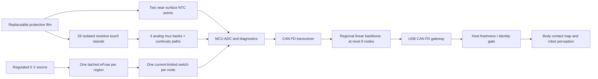

<div dir="rtl" lang="he">

עברית · [English](electronic_skin.en.md)

# עור אלקטרוני במחיר נגיש לרובוטים דמויי אדם

**עדכון היקף המאגר:** חבילת החומרה המותאמת נמצאת כעת ב[hardware/](hardware/README.md), כולל CNC, הדפסת תלת־ממד, גומי, PCB, צמות ורשימות חומרים. התכנון להלן מתאר את מערכת העור; יבוא החומרה אינו מוכיח התאמה מכנית, חשמלית או תוכנתית לרובוט. [תוכנית השילוב](hardware/skin_integration.md) מפרידה בין ההתאמות שבוצעו לבין הבדיקות שעדיין דורשות חומרה.

**תוכנית הנדסית, מהדורה 2.2 — תכנון עצמאי של ROBOSKIN ותוכנת מארח שנבדקה, 25 באוקטובר 2026**
**בעלים:** אילן. **יישום ראשון:** חישה מוגנת של מיקום מגע ועוצמה מקורבת בזרועות, ברגליים ובגוף של רובוט דמוי אדם, לצד חישת טמפרטורה בנקודות מגע מעטות.
**מצב:** מפרט בנייה ואימות, הכולל תוכנת פרוטוקול למארח שנבדקה וחישובים הניתנים לשחזור. מסמך זה אינו מעיד על ביצועים פיזיים, הצעת מחיר מספק, הסמכה, אישור PCB לייצור או כשירות לפטנט.

מהדורה עצמאית זו כוללת את תכנון העור האלקטרוני המקורי, סקירת המחקר האקדמי ומימוש הייחוס למארח. מהדורה 2.2 מוסיפה ייצוא ניתן לעריכה של מעגלים ורשימות חיבורים ברמת הפינים, תבניות לוחות כלליות, רכיב ניטור עצמאי למספר אזורים ותיקוני זיהוי וסנכרון. היא מחליפה את הקצאת העלות הנמוכה הקודמת לשער התקשורת במתאם מעבדה מבודד המתומחר בנפרד. זהו מפרט הנדסי עם בדיקות ללא חומרה; מקטעי עור פיזיים, קושחת הכרטיסים, אישור הייצור והסמכת הרובוט טרם אומתו.

הקצאת הכיסוי הכללית ל־80 מקטעים שלהלן היא תרחיש תכנון, ולא התאמה לרובוט מסוים. הדוגמה הקומפקטית האופציונלית, הכוללת שמונה בקרים, מכילה 88 אתרי מגע פעילים; היא אינה מימוש פיזי של הקצאת הלוחות בגודל המלא. הקצאות החומרים ועלות הייצור ליחידה מניחות את גודל האצווה המוצהר במפורש. קבצי התמיכה העדכניים מקושרים מתוך [README.md](README.md), [אלקטרוניקה](electronics/README.md), [מכניקה](mechanics/README.md) ו[תוכנה](software/README.md).

**ניווט**

| סעיפים 1–10 | סעיפים 11–20 | סעיפים 21–30 |
|---|---|---|
| [1. החלטה, מגבלות והשינויים בעקבות הביקורת](#section-1) | [11. פרוטוקול CAN, עדכניות הנתונים וממשק התוכנה](#section-11) | [21. התנהגות הרובוט וראיות לערך ללקוח](#section-21) |
| [2. דרישות מוקפאות וחשבונאות כיסוי](#section-2) | [12. בנייה במעבדה ביתית, כולל ניסוי מפורש לבחירת חומרים](#section-12) | [22. מפת התחרות](#section-22) |
| [3. החלטות חומרים וחלופות](#section-3) | [13. כיול, סחיפה תחת עומס קבוע והחלפה](#section-13) | [23. שותפים אסטרטגיים בישראל](#section-23) |
| [4. ארכיטקטורת המערכת וגבולות הכשל](#section-4) | [14. אישור PCB לייצור, בדיקות CAD ורשומות תצורה](#section-14) | [24. חדשנות, קניין רוחני ופרסום](#section-24) |
| [5. מבנה השכבות המכני ומפרט שרטוטי הבנייה](#section-5) | [15. רשימת חומרים, ראיות למחירים ומגבלות הוזלה](#section-15) | [25. בקשות להצעות מחיר, תחומי שותפות והחלטות רכש](#section-25) |
| [6. מעגלים אנלוגיים, אבחון וערכי רכיבים מדויקים](#section-6) | [16. ציוד למעבדה הביתית ותקרות רכש](#section-16) | [26. יומן החלטות: אין משימות ״מחקר בהמשך״ ללא אחראי](#section-26) |
| [7. מפת פיני הבקר, ייחוס ההספק והשעון](#section-7) | [17. כלכלת גפיים, מסה, אנרגיה ומרווח מסחרי](#section-17) | [27. שחזור, נתוני שירות ותוצרים שנמסרו](#section-27) |
| [8. חלוקת הספק ותיאום הגנות](#section-8) | [18. הוראות עבודה לייצור ותכנון לשירות](#section-18) | [28. התאמת האלגוריתמים של Cheng למוצר זה](#section-28) |
| [9. רתמה ומחברים](#section-9) | [19. נוהלי אימות, תגובות לכשל וראיות לאמינות](#section-19) | [29. סקירה שיטתית של 84 המקורות של Cheng](#section-29) |
| [10. מפרט העבודה לקושחה המשובצת](#section-10) | [20. שלבים, תוצרים, תקציבים והחלטות עצירה מחייבות](#section-20) | [30. השוואה ל־ProxySKIN וההחלטה לגבי חישת קרבה](#section-30) |

<a id="section-1"></a>

## 1. החלטה, מגבלות והשינויים בעקבות הביקורת

יש לבנות **יריעת חישה התנגדותית למינציה, הניתנת להחלפה, עם דגימה דיגיטלית מקומית וחיווט CAN FD המחולק למקטעים**. יש להשאיר נחושת ברתמת ההספק והנתונים הקצרה. עיקר הצמצום בחוטים ארוכים נובע משיתוף התקשורת ומביצוע המדידה ליד החיישנים. אין חומר במחיר נגיש שמשפר בו־זמנית את המוליכות של נחושת, שטח החתך הנדרש להתנגדות שווה, חיבורי הקצה והאמינות בכיפוף חוזר עבור זרמי מפעילים שרירותיים. חיווט ההספק למנועים נותר בעיה הנדסית נפרדת.

יש להשתמש ב־**28 תאי מגע המחווטים בנפרד ובשתי נקודות טמפרטורה לכל מקטע**, בפסיעה של 25 mm, עם ארבע קבוצות מרבבים אנלוגיים, בקר STM32 אחד ומשדר־מקלט CAN אחד. ארכיטקטורה זו תומכת במגעים בו־זמניים ללא מסלולי המגע המדומים החשמליים של מטריצת שורות/עמודות התנגדותית פסיבית. בתוך המקטע עדיין יש 28 מוליכי אות מודפסים קצרים; בחיבור שלו לרתמה האזורית יש ארבעה מוליכים.

המוצר הראשוני הוא **מערכת תפיסת מגע שאינה מערכת בטיחות, למעטפות רובוטים בסביבה פנימית**. הוא יכול לתמוך בזיהוי מגע, עוצמת מגע מקורבת, תנועה המתחשבת במגע ואבחון תחזוקה. הוא אינו מודד וקטורי כוח שרירותיים, אינו מפריד בין אצבעות, אינו מכסה אוטומטית פערים במפרקים ואינו מספק עצירה מגוננת מוסמכת. שתי נקודות טמפרטורה אינן יכולות לזהות כל חפץ חם שנוגע בשאר המקטע.

הפרויקט אפשרי מבחינה טכנית. **הראיות הקיימות אינן מבססות פריצת דרך מסחרית או מערכת ייצור לכל הגוף במחיר $1,500.** תרחיש התכנון המעודכן הוא כ־$7,852 להתקנה של 80 מקטעים, או $8,131 עם מקטעים חלופיים, באמצעות שערי פיתוח קנויים ועלויות ייצור ממודלות לכמות של 1,000 מקטעים. זהו חישוב תכנון שמרני, לא הצעת מחיר. מכירת מודול ראשוני לזרוע היא דרך אמינה יותר מהבטחה לרובוט דמוי אדם שלם וזול כבר ביום הראשון.

| ממצא בביקורת | החלטה במהדורה 2 | אופן סגירה קונקרטי |
|---|---|---|
| נוצר בלבול בין חומרים דקים למערכת מותקנת דקה | להגדיר בנפרד את מלוא הלמינציה, החיבור, כיס הבקר ורתמת המפרק | מפות מידות וכיסוי M01/M02 |
| 28 כיפות, דיסקיות ומובילים יוצרים בעיות הרכבה ועומס מוקדם | להשתמש באיי חישה התנגדותיים מבודדים על מלוא שטח התא, בלמינציה מיושרת; דיסקיות FSR מסחריות ישמשו רק במתקן הניסוי החשמלי | ניסוי דוגמיות בארבע גאומטריות, ואחריו מקטע מלא |
| שכבה התנגדותית רציפה עלולה לצמד תאים סמוכים | להפריד חשמלית את כל 28 האיים ההתנגדותיים; למקם אותם כמערך באמצעות יריעת העברה אחת | בדיקת מגעים מרובים ובידוד E02 |
| מסלול אבחון של 330 kΩ נותן מרווח מוגבל לזיהוי נתק | נגד סוף־קו מרוחק של 100 kΩ, לכל היותר ±20% כולל הזדקנות | חלון מחושב ובדיקת זליגה E01 |
| מתחי ייחוס שווים בקבוצות מסתירים החלפת קבוצות | ארבע רמות ייחוס: בקירוב 1,024, 1,638, 2,457, 3,071 ספירות ADC | בדיקות החלפת ערוצים וכתובת תקועה E01 |
| 200 Hz משאירים מרווח קטן לרכישה | בסיס של 100 Hz, עם רכישה נומינלית של כ־4.42 ms בתוך מחזור של 10 ms | מדידת עמידה בזמן ועומס אפיק E03 |
| קבלת מסגרת נחשבה להוכחה לעדכניות | חותמת זמן רכישה, מונה אתחול מתמיד, CRC תצורה ולחיצת יד לזמן עם nonce | בדיקות S01, כולל תעבורת USB שהתעכבה |
| מגע חזק עלול להיעלם לתוך קריאה לא תקפה | להפריד `CONTACT_OR_FAULT` מכיסוי לא תקף רגיל | בדיקות עומס יתר S01 וחוזה התנהגות |
| שני פיני ADC רגישים יותר להזרקת זרם | להעביר את כניסות הקבוצות ל־PA0, PA1, PA7 ו־PB1; להעביר את פיני כתובת ה־GPIO ל־PB5–PB7 | בדיקת חיבורים לפי המארז ו־E04 |
| ערכי התנעת הגביש והעומס היו ניחוש | להשתמש במתנד CMOS מוגדר של 8 MHz; להגדיר HSE במצב bypass | בדיקת שעון והתנעה E03 |
| עלויות השער והייצור השמיטו עבודה בפועל | לתמחר שער פיתוח מזוהה; לחשב בנפרד זמן עבודה עם מפעיל ותפוסת עמדת בדיקה | זמן מחזור מדוד C01 ותקרת RFQ |
| טענות למיליון מחזורים חסרו משמעות סטטיסטית | להגדיר בנפרד עומס/סביבה, גודל מדגם, כשלים ורמת ביטחון | R01; אין להשליך מדוגמה טובה אחת |

זו תוכנית הנדסית, לא תחליף לביצועה. לכל אי־ודאות פיזית שלהלן יש ניסוי בעל שם, קריטריון מספרי ותגובה מוגדרת. לעובדות שרק הספק יכול לאשר יש תנאי הזמנה או תקרת מחיר מפורשים. אם תוצאה נכשלת, התגובה שנקבעה משנה את המוצר או עוצרת את שחרורו; היא אינה הופכת להנחה נסתרת.

<a id="section-2"></a>

## 2. דרישות מוקפאות וחשבונאות כיסוי

| פריט | בסיס מהדורה 2 / תנאי קבלה |
|---|---|
| קואורדינטות המקטע | שבע עמודות × ארבע שורות. תא `i=7r+c `; מרכז `(12.5+25c, 12.5+25r)` mm, ‏`r=0..3 `, ‏`c=0..6` |
| מלבן החישה | 175 × 100 mm; שטחי אלקטרודות של 23 × 23 mm. להוסיף שול איטום חיצוני של 3 mm: גודל לוח פיזי נומינלי 181 × 106 mm, ללא הזנב |
| פלט המגע | מזהה תא, עוצמה חסרת יחידות 0–254, מסכת תקפות, מסכת נתק ומסכת עומס יתר/מגע־או־תקלה; 255 מציין ערך לא תקף |
| זיהוי, סביבה פנימית יבשה | לפחות 99 זיהויים מתוך 100 הפעלות ב־0.5 N במרכז, 1 N בגבול בין שני תאים, 2 N במפגש ארבעה תאים, באמצעות גשוש שטוח בקוטר 10 mm; למדוד בכל מרכזי התאים ובכל סוגי התפרים |
| מיקום | ב־2 N לדווח על התא שנגעו בו או על שכנו המיידי; לפרסם את התפלגות השגיאה המלאה. אין טענה לדיוק קטן מתא חישה |
| עוצמה | תגובת חציון מונוטונית ב־0.5, 2, 5, 10 ו־20 N באמצעות הגשוש המוגדר; לפחות שלוש רמות סדר ניתנות לחזרה. ללא תווית kPa |
| קצב מסגרות / השהיה | 100 רכישות מלאות בשנייה. מצב מחזורי שולח 100 תמונות מצב בשנייה; מצב משולב שאומת שולח 50 בשנייה במנוחה ועד 100 בשנייה במגע/שינוי/תקלה. השהיית דיווח מגע רגיל p99.9 ≤30 ms; לפסול כיסוי מיושן בתוך 40 ms מזמן הרכישה המוקדם ביותר האפשרי. ראו סעיף 28 |
| טמפרטורה | שתי נקודות, עדכון מספרי ב־10 Hz, כיול ב־10–60°C; שגיאת מכלול ≤±2°C בנקודות האימות; תגובה מ־10% ל־90% בתוך ≤3 s במגע עם המתקן המוגדר |
| סביבת עבודה ראשונית | פנים יבש, 10–40°C, לחות יחסית 20–80% ללא עיבוי. אין טענה לטבילה בנוזל, עבודה בחוץ או ניקוי בממסים |
| עובי | למינציית חישה פעילה ≤1.5 mm מעל המעטפת הקיימת, ללא בליטה תרמית מקומית אם נדרשת; הבקר מותקן מאחורי המעטפת, כיס ≤5 mm כולל מרווח |
| מסה | הקצאה הנדסית למערכת ייחוס של 80 מקטעים ≤2.2 kg; יעד המחייב שקילה, לא הבטחה מחושבת |
| ממשק חשמלי | הזנה אזורית מיוצבת של 5 V ±5%; ענף קצר; אלקטרוניקה מקומית של 3.3 V; ‏CAN FD בקצב 1/2 Mbit/s |
| צריכה | תקציב תכנון ≤30 mA בממוצע לכל מקטע ב־5 V, ‏80 mA בשיא; להכשיר ספק למערכת מלאה ל־10 A כולל שערים/רכזות והתנעה |
| שירות | החלפת קסטת חישה שלמה בתוך ≤5 min בידי מפעיל מיומן; עמידה במספר מחזורי החיבור המותר של מחבר הבקר; אזור תקול מסומן במפורש כלא זמין |
| בדיקת אורך חיים מקדימה | 100,000 מחזורים לבחירת התכנון; 1,000,000 מחזורים במסגרת R01 רק לאחר הקפאת התכנון; דרישות הסחיפה והזיהוי ממשיכות לחול |

יעדי התפרים שונים במכוון. עומס של 1 N המתחלק שווה בשווה בין ארבעה תאים נותן רק 0.25 N לתא, פחות מסף הזיהוי המוצע במרכז. כיסוי רציף אינו מבטל את מאזן הכוחות הזה. ספי תפר נמוכים יותר מחייבים העברת כוח מכנית שנמדדה או תכנון חישה אחר.

מקטע אחד מכיל **0.014812 m² של שטח אלקטרודות**, שהם 84.64% ממלבן החישה הנומינלי שלו, ששטחו 0.0175 m². זהו שטח גאומטרי, לא כיסוי זיהוי מאומת. עם שולי האיטום החיצוניים, השטח הפעיל הוא רק כ־77.2% מהשטח הפיזי של 181 × 106 mm. ב־80 מקטעים סכום מלבני החישה הוא 1.40 m² וסכום שטחי האלקטרודות הוא **1.185 m²**, לפני חפיפות, קווי מתאר והחרגת מפרקים. ב־36 מקטעים יש 1,008 תאי מגע ו־72 נקודות טמפרטורה, בתוך מלבני חישה נומינליים ששטחם הכולל 0.63 m²; אין פירוש הדבר אוטומטית עור לכל הגוף.

יש להתחיל בהקצאה של שמונה מקטעים לכל זרוע, שישה־עשר לכל רגל, עשרים ושמונה לגוף/גב וארבעה אופציונליים לראש/צוואר: 80 בסך הכול, 2,240 תאי מגע, 160 נקודות טמפרטורה ועשרה אזורים של עד שמונה צמתים. כפות ידיים, קצות אצבעות, סוליות ומשטחי מיסבים במפרקים אינם כלולים. למפה המותאמת לרובוט, יש לייצא את רשת המעטפת, למקם קווי מתאר של לוחות, לדמות את מלוא מעטפת תנועת המפרקים ולדווח על כיסוי מגע שנמדד בכל 15° של תנועת מפרק. יש לספור במפורש שטחים שאינם נגישים או מכוסים.

**הגדרת לחץ:** התנגדות FSR תלויה בפיזור העומס ובמכניקה. ללא ידיעת שטח המגע בפועל, כוח חלקי שטח התא הנומינלי אינו לחץ החפץ. יש להשתמש במונח ״עוצמת מגע יחסית״; לכייל בניוטון רק עבור הגשוש ומבנה השכבות שהוגדרו, ולסמן את תחום הכיול במדויק.

<a id="section-3"></a>

## 3. החלטות חומרים וחלופות

המועמד המסחרי הראשון הוא מערך התנגדותי בלמינציית PET, מתוצרת ספק ועם חיווט נפרד לכל תא. תחליף לבנייה ביתית משתמש באלקטרודות ENIG משולבות כאצבעות ובאיים של **Sensitronics XactFSR**. עקרון המדידה שלהם משותף; אין להם כיול או אורך חיים משותפים ומובטחים. אין להעביר כיול מאחד לשני.

| גישה | החלטה וניסוי מדויק | מדוע היא בסיס התכנון או אינה כזו |
|---|---|---|
| שכבה התנגדותית מודפסת, ADC מקומי | בסיס התכנון. לבצע את ניסוי הדוגמיות ורצף ההעמסה בסעיף 12 | אלקטרוניקה פשוטה, מגעים בו־זמניים וייצור נגיש; זחילה ומכניקה חייבות לעמוד בבדיקות |
| מעגל גמיש דק מנחושת/פוליאימיד | להשתמש לאלקטרודות/חיבורים קצרים ולמעגל התרמי הגמיש; לשקול לוח של 175 × 100 mm | ניתוב תעשייתי אמין; גמישות אינה יכולת מתיחה. מעגל גמיש דו־שכבתי עלול לעלות יותר מ־PET מודפס |
| מעגל גמיש קיבולי | לקנות בקר פיתוח ולבנות דוגמית 4 × 4 אחת עם הגנת guard רק אם סחיפת FSR נכשלת ב־M03 | אפשרות טובה למגע/קרבה, אך EMI ממנועים, לחות ופירוש לחץ מחייבים מערכת קריאה אחרת; אין זו החלפת יריעה ללא שינוי |
| אלסטומר מגנטי / מסוג ReSkin | לבדוק מודול זמין אחד באותו גשוש וליד מנוע פועל | מוסיף יכולת חישת גזירה, אך מגנטים, כיול ושדות מגנטיים של מנועים מסבכים כיסוי שטח גדול במחיר נמוך |
| טקסטיל מוליך / קצף מוליך | לבנות ארבעה תאים מבודדים עם אותו מחלק מתח להשוואה; לפסול אם הסחיפה ללא עומס >20% מטווח המגע או תגובת תא סמוך שאינו מועמס >15% | מהיר וזול לניסוי; שונות החומר, לחות ויציבות ממדית נוטות להיות גורמים מכריעים |

אלומיניום עשוי להפחית מסת מוליך בהתנגדות שווה, אך דורש שטח חתך של כ־1.6× מנחושת, חיבורי קצה קטנים קשים לביצוע והכשרה לעייפות כיפוף. דיו כסף שימושי למוליכים מודפסים קצרים, ואינו תחליף חסכוני לכבלי הספק למנועים. מוליכי פחמן זקוקים לשטח חתך גדול בהרבה לאותה התנגדות נמוכה. סיב אופטי יכול להעביר נתונים עם מעט מסת מוליך, אך עדיין דורש משדרים־מקלטים מוזנים ואינו מספק אנרגיה למפעילים. אף אחת מהחלופות אינה פותרת את המערכת כולה רק משום שהיא דקה.

ה־ADS7953 שבתמונה המקורית של המשתמש הוא בורר אנלוגי וממיר לדיגיטלי, השולח מספרים למארח. המרת ADC מקומית מועילה; ה־PGA/ייחוס החיצוניים שלו והשבב הנוסף אינם נחוצים למוצר המגע ההתנגדותי הגס הראשון, משום שב־MCU כבר יש ADC. יותר סיביות ADC אינן יכולות לבטל זחילת פולימר או היסטרזיס מכני. יש להוסיף ADC חיצוני רק אם רעש חשמלי/זמן התייצבות שנמדדו נכשלים ב־E01 לאחר תיקוני תכנון המעגל, ולתעד את העלות והצריכה הנוספות.

<a id="section-4"></a>

## 4. ארכיטקטורת המערכת וגבולות הכשל

<div dir="ltr">



</div>

ההספק והנתונים עוברים לאורך גזע פסיבי, ולא דרך כרטיסי חיישנים הניתנים להסרה. ניתוק ענף אחד חייב להשאיר את המשך הגזע מחובר. אין כאן כוכב CAN עם שמונה ענפים ארוכים. קצר באפיק עלול לעצור אזור שלם; קריסת מארח או כשל במקור 5 V משותף עלולים לעצור את כל האזורים. פסק הזמן למצב דומיננטי במשדר־מקלט אינו מסלק קצר פיזי. מגבלות אלה קיימות גם עם עשר רשתות.

יש להשתמש בשמות תוכנה נפרדים עבור `NO_CONTACT `, ‏`CONTACT `, ‏`CONTACT_OR_FAULT `, ‏`COVERAGE_UNAVAILABLE ` ו־`TEMPERATURE_UNAVAILABLE`. מקטע חסר לעולם אינו יכול להיראות כמקטע שלא נגעו בו. מערכת העצירה/ההגנה העצמאית הקיימת של הרובוט ממשיכה להיות אחראית לתפקוד הבטיחות שלו.

<a id="section-5"></a>

## 5. מבנה השכבות המכני ומפרט שרטוטי הבנייה

### 5.1 החלפת תכנון הייצור המבוסס על כיפות ודיסקיות

אין להרכיב 28 כיפות נפרדות ו־28 דיסקיות סיליקון לכל מקטע תעשייתי. יש להתחיל בלמינציה שלהלן על מעטפת קיימת וקשיחה יחסית. היא מודדת מגע בכיוון הניצב למשטח; היא אינה יריעה נמתחת החוצה קפל מרפק.

| מבחוץ פנימה | מבנה ראשוני מוקפא | תפקיד / הוראת הרכבה |
|---|---|---|
| שכבת הגנה מתכלה C2 | Covestro Platilon U 4201 AU, עובי נומינלי 100 µm; דרגת חומר ועובי מאושרים בידי הספק | משטח שחיקה מבודד חשמלית. לרכוש יריעה מעובדת/חומר לדוגמה; אין להניח שרישום באתר מעיד על מלאי בכמויות קטנות |
| חיבור הכיסוי | דבק בהיקף/רשת בלבד, והשארת ריבועים פעילים של 23 mm ללא דבק | להימנע מהדבקה בכל השטח שמקשיחה אזורי חישה או יוצרת עומס מוקדם לא מבוקר. להשתמש בקסטת כיסוי מתקלפת ומיושרת |
| איים תרמיים | שני NTC בגודל 0603 על מעגל פוליאימיד גמיש נפרד הניתן להלחמה, בכיסים רדודים באזורי תפר/חיבור שאינם חשים | חיבור דק לכיסוי, בידוד לכיוון המעטפת, ללא מסלול חום למייצב. בליטה מקומית עשויה לחרוג מעובי היריעה; יש למדוד אותה |
| שכבה התנגדותית | 28 איי XactFSR נפרדים בגודל 24.5 × 24.5 mm לאב־הטיפוס הביתי; הצד המצופה פונה לאלקטרודות | אסור ציפוי מוליך רציף בין תאים. לבצע חיתוך kiss-cut על יריעת העברה לייצור פיילוט |
| מרווחן | שכבת 3M 467MP מדודה אחת, נומינלית 50–60 µm; פתחים של 23 × 23 mm בתוך כל אי | שול דבק של 0.75 mm; הפסקת אוורור אחת של 0.5 mm לכל תא, למסלול אוורור הפונה לאחור. ללא דבק על המתכת המשולבת |
| אלקטרודות | אזור מסרק של 23 × 23 mm על מעגל גמיש דו־שכבתי; ENIG, יעד נחושת 18 µm, מוליך ורווח של 0.254 mm בתחילה | אלקטרודות בשכבה העליונה וניתוב בתחתונה; אין לנסות לדחוס את כל האותות לתעלות צרות בשכבה אחת |
| חיבור אחורי | נשא נתמך ומיושר למעטפת; תפסי קצה או ברגי שירות בנקודות ההרכבה הקיימות במעטפת | ללא מחבר מכני רופף מאחורי תא חישה וללא בליטה נקודתית. יריעת החישה ניתנת להחלפה כקסטה |

Covestro מתעדת גרסאות של 50–100 µm לדרגת חומר זו; ההזמנה עדיין מחייבת תעודת עובי/דרגה. חלופת שחיקה עבה יותר שניתן לזהות בבירור היא **3M 8671/8671HS**, בעובי מותקן של כ־0.35 mm ובמסה של 439 g/m². הדבק והקשיחות שלה יוצרים מבנה שכבות אחר; אין להחליף אותה ללא ציון או לטעון לאותה רגישות. בשטח 1.4 m² היא מוסיפה כ־0.45 kg ביחס ליריעת TPU בעובי 100 µm, עוד לפני הבדלים נוספים. [זמינות יריעות Covestro](https://solutions.covestro.com/pt/highlights/articles/stories/2024/tpu-films-enhance-sports-equipment-design), [נתוני סרט הגנה 3M](https://multimedia.3m.com/mws/media/2088428O/3m-polyurethane-protective-tape-8671.pdf).

קטלוג הסרט והדף הטכני משתמשים בעוביים נומינליים מעט שונים. יש למדוד עשר דוגמיות מרווחן במיקרומטר, לתעד את העובי הדחוס לאחר היישום ולהשתמש בערך זה בשרטוט. לעולם אין לכלול את שכבת השחרור הנשלפת במבנה המותקן. [דף טכני 3M 467MP](https://multimedia.3m.com/mws/media/2366204O/3M-Adhesive-Transfer-Tape-467MP.pdf?pif=000024).

### 5.2 גאומטריית האלקטרודות והיריעה

בכל תא, שני מסרקים משולבים מסתיימים ב־`SNS_i ` וב־`SENS_GND`. יש להשתמש באצבעות וברווחים של 0.254 mm, עם מרווח קצה של 0.5 mm וללא מסכת הלחמה על המסרק הפעיל. יש למקם חורי מעבר, נגדי EOL וקשיחונים מחוץ לפתח הפעיל. מסלול EOL של 100 kΩ נמצא ב־**תא המרוחק**, מעבר לכל מוליך האות, ומחבר בין אות האלקטרודה להארקה. נגד ליד הבקר אינו יכול לאבחן זנב שבור. באב־טיפוס גמיש, יש להרכיב נגד 0402 בצד האחורי עם כיס שחרור בנשא; לכלול 28 השמות רכיבים נוספות ואת עלות הרכבתן. נגדי EOL מודפסים תעשייתיים חייבים לעמוד בטווח 80–120 kΩ לאחר הזדקנות.

מפרט הניתוב הדו־שכבתי הוא אילוץ המאפשר ייצור, ולא קובץ נחושת מאושר לייצור. יש לשמור על מוליך/רווח של לפחות 0.15 mm בשכבות הניתוב, טבעות חורי מעבר וקוטר קידוח מינימלי לפי היצרן הנבחר, ולמסור לספק זנב מחוזק בעל 40 מגעים. גרסת PET לייצור יכולה להשתמש בגשרי חצייה עם דיאלקטרי מודפס או בשכבת ניתוב נוספת, אך אי אפשר לתמחר אותה כיריעה חד־שכבתית בהדפסה אחת. יש לדרוש בדיקת גרפיקה/רשימת חיבורים המוכיחה שכל 28 המסלולים עצמאיים. הדפסת EOL והאותות נכללת במחיר בקשת הצעת המחיר ליריעה.

יש להגדיר התנגדות מקצה לקצה של מוליך אות ≤20 Ω והתנגדות אפקטיבית של החזרת ההארקה המשותפת ≤1 Ω מהתא הרחוק ביותר לבקר, עם מגעי ההארקה המקבילים המיועדים מחוברים. בזרם כולל של כ־4.5 mA בתאים המועמסים, 1 Ω מוסיף רק 4.5 mV; החזרה מודפסת צרה של 10 Ω תוסיף 45 mV ועלולה ליצור שגיאות מדידה בין תאים. יש למדוד זאת ביריעות גמורות במתקן ארבעה חוטים ככל האפשר. בניתוב החשוף לפני הדפסת השכבה ההתנגדותית/EOL, יש לדרוש בידוד ≥100 MΩ ב־3.3 V בין מוליכים שאינם קשורים. ביריעות גמורות יש להביא בחשבון את מסלולי ה־EOL המכוונים דרך ההארקה המשותפת; דרישה ל־100 MΩ בין שני אותות חיישן גמורים תסתור את המעגל. יש לפסול הצעת מחיר זולה לדיו/ניתוב שאינה עומדת במגבלות ההתנגדות האלה.

שרשרת הסבולות של היריעה: יישור אלקטרודה–מרווחן ±0.15 mm, יישור אי התנגדותי ±0.20 mm, כיסוי ±0.5 mm, קו מתאר חיצוני ±0.25 mm. שני חורי כלי בקוטר 3 mm מחוץ לקו המתאר הסופי קובעים את היישור. יש לפסול אי החופף לאלקטרודה סמוכה או דבק החודר לפתח המסרק. יש להשתמש בשכבת העברה נשלפת אחת למיקום המערך; להסיר אותה לפני הכיסוי הסופי כדי שלא תגשר מכנית בין תאים.

יש להשתמש במסלול אוורור לקצה האחורי המוגן של הקסטה. אין לאטום אוויר כלוא בכל חלל ואז לצפות לתגובה לכוח סטטי. אין לטעון לדירוג הגנה מפני חדירה עם פתח אוורור פתוח. אם חדירת נוזל ניקוי נכשלת ב־M04, יש להוסיף ממברנת אוורור הידרופובית שאומתה ולחזור על M01–M04, כולל התגובה הפנאומטית; החלק הנוסף נכנס ל־BOM.

### 5.3 כללי מפרקים ועקמומיות

יש להרכיב לוחות על מקטעי מעטפת יציבים. מלבן של 175 mm עשוי לעטוף גפה גלילית, אך אינו יכול להתאים ללא מאמץ לעקמומיות כפולה שרירותית. בעקמומיות מורכבת, יש לפצל לרצועות שורות או ללוחות צרים יותר, לשמר את גבולות החיישנים הנפרדים ולחשב את שטח התפרים והמחברים הנוסף. אין למתוח מעגל PET/PI כדי להתאימו.

במהדורה 2 אף למינציית חישה אינה חוצה את קפל המרפק/הברך. דש מגן חופף ורפוי יכול לגשר חזותית על פער, אך הפער נשאר ללא חישה אלא אם הותקן בו לוח נפרד שנבדק. יש להגדיר אזור אסור מתוך מעטפת הצביטה הנסחפת, באמצעות CAD ובדיקת מרווח פיזית בחומר פלסטי/קצף. יש לדרוש מרווח ≥3 mm בסבולת הגרועה ביותר, בעומס מלא ובהסטת הכבל; אם אין מרווח כזה, יש לוותר על הכיסוי שם ולסמן זאת במפת הגוף.

בצמות חוטים נעות, יש להשתמש בכבל שהיצרן דירג לכיפוף מתמשך/פיתול המתאים למפרק. יש לנתב ליד ציר הסיבוב עם לולאת שירות, לקבע בשני הקצוות ולשמור על הגדול מבין רדיוס הכיפוף הדינמי של הספק ו־10× קוטר הכבל, עד לאימות רדיוס קטן יותר. התארכות TPU בשבר אינה העיוות המחזורי המותר לנחושת או לכסף מודפס. יש לבדוק את הרתמה, התפסים ומסלול המפרק בפועל במסגרת R02.

<a id="section-6"></a>

## 6. מעגלים אנלוגיים, אבחון וערכי רכיבים מדויקים

### 6.1 תא מגע אחד, החוזר 28 פעמים

<div dir="ltr">

```text
3V3_A -- 22.0k 1% -- SNS_i ----------------+-- resistive cell -- SENS_GND
                         long local trace  +-- 100k EOL ------- SENS_GND
                                           both at remote cell

At controller:
SNS_i -----+---------- 1.0k -----+------- mux Sx
           |                    |
      ESD array channel      100pF C0G
           |                    |
          GND                  GND
Mux D -- 4.7k -- ADC input
                 |
              100pF C0G
                 |
                GND
```

</div>

נגד היציאה של 4.7 kΩ מגביל זרם תקלה ומעברי מטען של ה־ADC; זהו שינוי במהדורה 2 ביחס ל־100 Ω. נשמרת המתנת התייצבות של 250 µs, הנבדקת במעברים עם עומס וללא עומס. היא אינה מבטיחה בפני עצמה שרידות ESD.

כאשר מלוא סקלת ה־ADC היא 4,095, ‏`code=4095*Rparallel/(22000+Rparallel)`. הערך הנומינלי ללא עומס הוא **3,356.6 ספירות**. EOL של ±20% ונגד הטיה של ±1% נותנים בקירוב **3,205–3,466** לפני שגיאה חשמלית. יש להקצות **3 µA לזליגה הכוללת במסלול הנבחר** ועוד עשר ספירות שגיאת ADC/ייחוס, תוך הכללה שמרנית של נגדי הטור 1 kΩ ו־4.7 kΩ: הערך העליון המחושב ללא עומס, בתרחיש הגרוע ביותר, נשאר מתחת ל־3,574, בעוד שקו פתוח נשאר מעל 3,974 כאשר VREF≥3.1 V. יש לקבוע סף נתק של **3,900**, עם שלוש סריקות רצופות להפעלה, ו־100 סריקות תקינות ואישור מפעיל לניקוי תקלת שירות שננעלה. אלה גבולות של תקציב המעגל; E01 מודד זליגה מצטברת ומאמת את המרווח בגבולות הסביבה.

לרכיב TMUX לבדו מוגדרת זליגה בתרחיש הגרוע ביותר הגדולה בהרבה מהערך הטיפוסי בטמפרטורת החדר. תקציב 3 µA כולל מרבב, MCU, הגנה, זיהום וזליגת הכרטיס; אין להקצות את אותו תקציב לכל רכיב בנפרד. אם השגיאה הנורמלית שנמדדה חורגת מהתקציב, יש לנקות/לעבד מחדש את ה־PCB, להפחית זליגה או להחליף למרבב בעל זליגה נמוכה יותר שעבר אימות. אין להרחיב את סף הנתק עד שמוליכים שבורים נעשים בלתי נראים. [נתוני TI TMUX1308](https://www.ti.com/lit/ds/symlink/tmux1308.pdf).

קוד ADC נמוך מ־30 במשך שלוש סריקות פירושו **עומס מגע חריג או קצר חשמלי**. יש להשאיר את העוצמה ב־254 ולהפעיל את המסכה הייעודית תוך דיווח על אי־הוודאות. אי אפשר להסיק שיש נתק כאשר מגע אמיתי יוצר קצר העוקף מסלול EOL שנשבר; היפרדות ציפוי יכולה להשאיר רציפות חשמלית תקינה. רציפות חשמלית אינה בדיקה מלאה של תפקוד המישוש.

זרם הענף המרבי מוגבל באמצעות נגד 22 kΩ: כ־159 µA ב־3.465 V ובקצה הסבולת הנמוך שלו. אין להניע את היריעה ישירות מ־GPIO או ממסילת הספק. במתקן המעבדה עם FSR402 מסחרי, יש להשתמש בדיסקית בקוטר 8 mm ולאמת את דרישת צפיפות הזרם של הספק עבור שטח ההעמסה בפועל. [מדריך השילוב של Interlink](https://www.interlinkelectronics.com/downloads/integration-guides/fsr-400-series-integration-guide.pdf).

### 6.2 ארבע קבוצות מרבבים

יש להשתמש ב־**TMUX1308PWR, TSSOP-16**. פין VDD מספר 16 ל־3V3_A; ‏GND בפין 8; ‏100 nF מקומי. ‏`A0=11, A1=10, A2=9 `; כתובות דיגיטליות משותפות מפיני MCU ‏PB5/PB6/PB7. ‏`EN=6 `, **LOW בוחר, HIGH משבית**, עם נגד משיכה של 47 kΩ ל־3V3. פין 7 הוא NC. ‏`D=3 `. מיפוי הכניסות הוא `S0=13, S1=14, S2=15, S3=12, S4=1, S5=5, S6=2, S7=4`.

קבוצה `b ` מודדת את התאים `7b..7b+6` ב־S0–S6. ‏S7 שלה הוא מחלק מתח מקומי לאימות הקבוצה שנבחרה:

| קבוצה | נגד עליון ל־3V3_A | נגד תחתון ל־GND | קוד צפוי | טווח קבלה ראשוני |
|---|---:|---:|---:|---:|
| 0 | 30.0 kΩ 1% | 10.0 kΩ 1% | 1,024 | 944–1,104 |
| 1 | 15.0 kΩ 1% | 10.0 kΩ 1% | 1,638 | 1,558–1,718 |
| 2 | 10.0 kΩ 1% | 15.0 kΩ 1% | 2,457 | 2,377–2,537 |
| 3 | 10.0 kΩ 1% | 30.0 kΩ 1% | 3,071 | 2,991–3,151 |

ייחוס לא תקין פוסל מיד את שבעת התאים המתאימים. שלוש סריקות לא תקינות נועלות אבחון תקלה. הרמות השונות מזהות החלפת קבוצות, אך אינן מוכיחות שכל שבע הכתובות עובדות. בבדיקת המפעל יש להפעיל התנגדות ידועה שונה בכל ערוץ ולבדוק כל כתובת, כולל תקלות של קו כתובת תקוע.

### 6.3 שני מעגלי טמפרטורה

יש להשתמש ב־**Murata NCU18XH103F60RB**, ‏10 kΩ ב־25°C, על המעגל התרמי הגמיש הנפרד. בכל ערוץ: `3V3_A →39 kΩ 1%→TEMP→NTC→THERM_GND`; ‏TEMP דרך 1 kΩ ל־ADC של ה־MCU, עם 1 nF ליד ה־ADC והגנת ESD בכניסה. נגד ההטיה 39 kΩ מגביל את הזרם ב־25°C ל־**67.35 µA**, עם חימום עצמי של כ־45.4 µW וקוד 835.7. נגד הטיה של 10 kΩ יחרוג מזרם העבודה המרבי הרשום, 0.1 mA ב־25°C. [מפרט רכיב Murata](https://www.murata.com/en-us/products/productdetail?partno=NCU18XH103F60RB).

NTC1 בקואורדינטת המקטע `(50, 0)` ו־NTC2 ב־`(125, 100)` mm, בכיסי קצה/חיבור ייעודיים מחוץ לאלקטרודות הפעילות; יש לתעד את המיקום בפועל במפה. הם דוגמים רק שני מקומות. אם זיהוי חום בכל השטח הוא דרישת מוצר, מוצר דו־נקודתי זה אינו עומד בה: יש להוסיף תרמיסטורים לכל תא עם ערוצי ADC נוספים, או להוסיף שכבה תרמית שתוכננה בנפרד. אין לבצע אינטרפולציה למפת טמפרטורה צבעונית של כל המשטח ולתאר אותה כמדידה.

יש להגדיר תחומי סף גולמיים לנתק/קצר `code>4000 ` / ‏`code<20`; יש לפסול גם תוצאות מכוילות מחוץ ל־−20..85°C. כיול העבודה הוא 10..60°C. יש להשתמש בטבלת קוד גולמי/טמפרטורה שנמדדה בחמש נקודות לכל ערוץ תרמי מורכב, באינטרפולציה מונוטונית ובטמפרטורות אימות עצמאיות. משוואת ערך B היא רק בדיקת סבירות במעבדה, לא הכיול המסופק במוצר. גיל הטמפרטורה במסגרת הנתונים משקף את גיל המדידה האחרונה בפועל, ולא את גיל החבילה האחרונה.

### 6.4 הגנה ולולאת בדיקת שלמות

שמונה מערכי **TPD4E1U06DBVR** מכסים 30 קווים אנלוגיים ושני קווי בדיקת שלמות. פינים 1, 6, 3, 4 הם ערוצים, פין 2 הוא GND ופין 5 הוא NC. יש לנתב לולאות פריקה ישירות לנחושת ההארקה בצד המחבר. דירוג IEC של רכיב הגנה אינו דירוג הכרטיס השלם; מתח ההגבלה שלו עלול לחרוג ממסילות ה־MCU/מרבב. אין לאפשר מגעי חישה חשופים ומוזנים בזמן שירות. [נתוני הגנה של TI](https://www.ti.com/lit/ds/symlink/tpd4e1u06.pdf).

יש להשתמש בפיני ה־ADC המעודכנים בסעיף 7, בנגדי טור ובמחבר מכוסה. E04 מפעיל פולסים חולפים על משטחים נגישים, חיבורי הספק ו־CAN, ובוחן צורות גל/זרם בהמשך המסלול. פולס החורג מהערך המרבי המוחלט של רכיב בהמשך המסלול עוצר את השחרור; סדר התיקון הוא מסלול החזרה קצר יותר, סיכוך/הארקת מחבר ורשת הגבלה משנית שנבדקה, ואז הרצה מחדש של E01/E04. אין להסיק הרשאה להזרקת זרם חיובי מרישום ״N/A, ״ בדף נתונים, ואין להשתמש בדיודות ESD פנימיות כמייצב מתח מוגדר.

הנעת בדיקת השלמות: PB2 דרך 1 kΩ → לולאה בהיקף היריעה → נגד טור של 1 kΩ בהחזרה → כניסת PB4, עם נגד משיכה מטה של 100 kΩ. יש להניע LOW ו־HIGH בנפרד למשך 1 ms לכל מצב, בכל שנייה; נדרשת החזרה תואמת. קצר קבוע למסילה או לולאה שבורה גורמים לכישלון. יש לנתב את הלולאה סביב צוואר הזנב וההיקף שבסיכון גבוה, ולציין שקרעים שאינם חוצים אותה עשויים לא להתגלות. כשל בלולאה פוסל את המקטע כולו מיד לאחר הבדיקה שנכשלה, ולא את הרובוט כולו.

<a id="section-7"></a>

## 7. מפת פיני הבקר, ייחוס ההספק והשעון

יש להשתמש ב־**STM32G0B1CBT6, non-N, LQFP-48**. גרסת N ומארז הכרטיס Nucleo שונים. להלן תוכנית החיווט המבוקרת; יש להעתיק אותה ל־CAD ולהשוות כל פין פיזי לשרטוט המארז. [דף נתונים ST, ‏DS13560 מהדורה 6](https://www.st.com/resource/en/datasheet/stm32g0b1cb.pdf).

| תפקיד | אות MCU / פין במארז |
|---|---|
| קבוצה 0, ADC0 | PA0 / 11 |
| קבוצה 1, ADC1 | PA1 / 12 |
| קבוצה 2, ADC7 | PA7 / 18 |
| קבוצה 3, ADC9 | PB1 / 20 |
| טמפרטורה 1, ADC15 | PB11 / 23 |
| טמפרטורה 2, ADC16 | PB12 / 24 |
| מרבב A0, A1, A2 | PB5 / 44; PB6 / 45; PB7 / 46 |
| מרבב EN0..3 | PB10 / 22; PB13 / 25; PB14 / 26; PB15 / 27 |
| FDCAN1 RX/TX, AF3 | PB8 / 47; PB9 / 48 |
| STB של המשדר־מקלט | PA8 / 28 |
| FAULT בהספק הצומת | PA9 / 29 |
| הנעה/החזרה של לולאת השלמות | PB2 / 21; PB4 / 43 |
| SWDIO / SWCLK | PA13 / 35; PA14 / 36 |
| USART2 לשירות TX/RX, AF1 | PA2 / 13; PA3 / 14 |
| גישור שירות פיזי | PA10 / 32; נגד משיכה של 10 kΩ למעלה, מגשר ל־GND |
| כניסת שעון חיצוני | PF0 / 8; ‏PF1 / 9 אינו בשימוש |
| איפוס | NRST / 10 |
| VDD/VDDA, VSS/VSSA, VREF+, VBAT | 6, 7, 5, 4 בהתאמה |

פינים שאינם בשימוש: PC13/14/15 בפינים 1/2/3; ‏PA4/5/6 בפינים 15/16/17; ‏PB0 בפין 19; ‏PA11/12 בפינים 33/34; ‏PA15 בפין 37; ‏PC6/7 בפינים 30/31; ‏PD0..3 בפינים 38..41; ‏PB3 בפין 42. יש להגדיר אותם כאנלוגיים ללא משיכה, אלא אם דרישת אתחול/ניפוי שגיאות גוברת על כך; אין לקשור פיני GPIO שרירותיים ישירות למסילות.

הזנה: `5V_NODE →TPS7A2433→3V3 `. יש לחבר VDD/VDDA ו־VBAT ל־3V3; ‏VSS/VSSA למישור ההארקה הרציף. יש למקם 100 nF ו־4.7 µF ליד ה־MCU. יש להזין את `3V3_A` דרך 10 Ω מ־3V3, עם 1 µF +100 nF ליד VREF+. מסילה זו מזינה את המרבבים, מחלקי החיישנים ומחלקי הייחוס. יש להשבית את יציאת VREFBUF הפנימית. נדרש 3V3_A מדוד ≥3.1 V במגע בו־זמני מרבי ובהמרה תקפה; יש לנטר את VREFINT מול כיול המפעל שלו לזיהוי תקלות מסילה גסות. מדידה יחסית מסלקת שינויים איטיים משותפים בייחוס, אך לא הסטת הארקה או שגיאות התייצבות של מרבב.

ל־NRST יש נגד משיכה של 10 kΩ למעלה וקבל 100 nF להארקה. משטחי SWD חושפים חישת 3V3, ‏GND, ‏SWDIO, ‏SWCLK, ‏NRST. חישת המתח של מנפה השגיאות אינה מקור הספק; יש לאסור על מתכנת חיצוני להזין צומת כבוי. יש לתכנת סף נפילת מתח המתאים לפעולה תקפה ב־3.3 V ולאמת את סף הניתוק/ההתאוששות שנמדד במסגרת E05; יש להשאיר שחזור ROM/SWD זמין.

שעון: **Abracon ASV-8.000MHZ-LC-T**, ‏3.3 V, ‏8 MHz, ‏±50 ppm, מתנד בעל ארבעה משטחים בגודל 7 × 5.08 mm. פין האפשור 1 קשור ל־3V3, פין 2 ל־GND, פין 3 הוא יציאה דרך 33 Ω ליד המתנד ל־PF0, ופין 4 ל־3V3 עם 100 nF. יש להשתמש ב־HSE במצב **bypass**, ללא קבלי עומס לגביש, ו־PF1 אינו מחובר. יש להקצות עד 10 mA לרכיב זה אף שהערך הטיפוסי נמוך יותר. יש לאפשר 10 ms להתנעה ולהכשיל את הרכישה אם אין אות clock-ready. העלות הנוספת קונה מקור שעון מוגדר ללא מרווח הגבר גביש שלא אומת. [נתוני Abracon ASV ומפת פינים](https://abracon.com/Oscillators/ASV.pdf).

יש להגדיר PLL ‏HSE8 MHz /M1 ×N12 /R2 =48 MHz SYSCLK, ‏PCLK1 48 MHz ושעון FDCAN מתוך PCLK1 עם מחלק 1. ב־48 MHz: מחלק מקדים נומינלי 3, ‏TSEG1 13, ‏TSEG2 2, ‏SJW 2 →1 Mbit/s; מחלק מקדים לנתונים 2, ‏TSEG1 9, ‏TSEG2 2, ‏SJW 2 →2 Mbit/s. יש לאשר במנתח, ולא לסמוך על תווית בממשק גרפי.

**משדר־מקלט CAN:** ‏TCAN3413DR. פין 1 TXD→PB9 עם נגד משיכה 10 kΩ למעלה, 2 GND, ‏3 VCC→3V3, ‏4 RXD→PB8, ‏5 VIO→3V3, ‏6 CANL, ‏7 CANH, ‏8 STB→PA8 עם נגד משיכה 47 kΩ למעלה. יש למקם 100 nF ליד VCC ו־VIO ועוד 1 µF קיבול צבירה. איפוס משאיר את דרייבר האפיק במצב המתנה. יש להוסיף PESD2CANFD24V-T ליד המחבר, פינים 1/2 ל־CANH/CANL ופין 3 ל־GND. רק שני קצות הגזע כוללים סיומת 120 Ω. [נתוני TCAN3413](https://www.ti.com/lit/ds/symlink/tcan3413.pdf), [נתוני הגנת CAN](https://assets.nexperia.com/documents/data-sheet/PESD2CANFD24V-T.pdf).

<a id="section-8"></a>

## 8. חלוקת הספק ותיאום הגנות

### 8.1 ממשק חשמלי מוגדר וסגור

העור מקבל **5 V מיוצבים**, ולא סוללת רובוט שמאפייניה אינם מוגדרים. למקטע יחיד יש להשתמש בתחילה בספק מעבדה מבודד ומוגבל זרם, המוגדר ל־5.0 V/100 mA, ולהגדיל רק לאחר בדיקת ההתנעה. לשמונה צמתים יש להגדיר מגבלת מקור של 1.5 A לפני ה־eFuse האזורי. למתקן ניסוי של 80 צמתים יש להשתמש בספק מבודד ומיוצב של 5 V/10 A, הדקים מוגנים ומכלול חלוקה מרכזי בדירוג 10 A; אין להעביר עשרה אזורים דרך מטריצה או מחבר JST GH יחיד.

הרובוט בייצור חייב לספק 4.75–5.25 V, אדווה ≤100 mVpp הנמדדת ליד המפצל באמצעות גשוש המוגבל ל־20 MHz, ולשמור על כניסת ה־LDO המוגנת של כל צומת ≥3.8 V. יש לכלול ב־E05 רצף נפילת מתח מ־2 V ל־0 V ול־5 V, רגנרציה של מנועים וניתוק הספק בחירום. חיבור ישיר של 24/48 V נמצא מחוץ לממשק זה. בחירת ממיר בלי לדעת את מתח הטעינה והרגנרציה המרבי של סוללת הרובוט תהיה דיוק מדומה. תוצר השילוב הוא רשומת ממשק הספק חתומה עם מעטפת כניסה בפועל, דגם ממיר, נתיך, התנהגות OVP ותרשימי E05 לפני החיבור לרובוט.

ביעד של 30 mA בממוצע, 80 מקטעים צורכים 2.4 A/12 W לפני שערי התקשורת. ב־80 mA לכל אחד, המקטעים לבדם דורשים 6.4 A/32 W; המקור חייב לעמוד במעבר הזה בנוסף לשערים ולהתנעה. יש לסמן ממוצע ושיא בנפרד. יש להפעיל אזורים ברצף, במרווחי 50 ms, כדי למנוע קריסה משותפת עקב זרם התנעה. גם כאשר השערים מוזנים מחוץ להספק העור, יש לכלול את משקלם וצריכתם בחשבונאות המערכת.

### 8.2 eFuse אזורי, עשרה עותקים לרובוט שבדוגמה

יש להשתמש ב־**TPS259530DSGR**, הגרסה המסוימת עם כיבוי ננעל, אפשור ב־HIGH והגבלת מתח של 5.7 V. פין 1 dVdt: ‏180 nF ל־GND. פין 2 EN: ‏100 kΩ ל־IN ו־39 kΩ ל־GND, בתוספת בקרת איפוס ידנית/יציאה פתוחה. פינים 3/4 IN: מקור 5 V עם 10 µF +100 nF. פין 5 OUT: הגזע האזורי, 10 µF מקומי. פין 6 nFLT: נגד משיכה 10 kΩ ל־3.3 V של יחידת הניטור. פין 7 ILM: ‏2.05 kΩ 1% ל־GND. פין 8 והמשטח החשוף: GND עם חורי מעבר תרמיים. מגבלת הזרם הנומינלית היא כ־1 A; העלייה הנומינלית כ־21 ms. אלה ערכי פתיחה למעגל; E05 מתעד את הספים בפועל עם סבולות. [נתוני משפחת TI TPS2595](https://www.ti.com/lit/ds/symlink/tps2595.pdf).

בבניית המעבדה יש לספק לחצן איפוס שירות מקודד ונורית תקלה בכל מפצל אזורי; להשתמש ב־MCU ניטור נפרד רק כאשר הפעלה מחדש מרחוק ממומשת ונבדקה. מתאם USB-CAN אינו מספק מעצמו GPIO לבקרת eFuse. הפעלה מחדש אוטומטית מוגבלת לניסיון אחד אחרי שנייה אחת לפחות, ואחריו כיבוי ננעל ורשומת תקלה למפעיל. לעולם אין לשלוח פולסי הפעלה ללא הפסקה לתוך קצר קשיח.

### 8.3 מתג ו־LDO לכל צומת

**TPS2553DBVR-1**, כיבוי ננעל, SOT-23-6: פין 1 IN מהזנת הענף 5 V, עם 1 µF +100 nF; פין 2 GND; פין 3 EN עם משיכה של 100 kΩ ל־IN; פין 4 FAULT ל־PA9 עם משיכה 10 kΩ ל־3V3; פין 5 ILIM עם 200 kΩ 1%; פין 6 OUT=`5V_NODE`, ‏4.7 µF. המגבלה הנומינלית היא כ־135 mA, עם טווח מוגדר משמעותי של כ־116–158 mA לפני סבולת הנגד. MCU כבוי אחרי המתג אינו יכול לאפס בעצמו את ההזנה שננעלה; האיפוס נעשה בהסרת מתח הענף או בכיבוי והדלקת האזור שלו. [נתוני TPS2553-1](https://www.ti.com/lit/ds/symlink/tps2553.pdf).

**TPS7A2433DBVR**, ‏SOT-23-5: פין 1 IN ל־5V_NODE; פין 2 GND; פין 3 EN קשור ל־IN; פין 4 NC מוארק, כפי שמותר ברכיב בעל יציאה קבועה; פין 5 OUT ל־3V3. יש להשתמש ב־4.7 µF X7R בכניסה/יציאה, עם קיבול אפקטיבי ≥1 µF במתח ובטמפרטורה. יכולת הכניסה שלו, 18 V, מתאימה להגבלה האזורית טוב יותר מ־LDO בעל מתח מרבי של 5.5 V. אין להניח שזרם הפוך בטוח: אין להזין את היציאה דרך UART/SWD כאשר הכניסה כבויה. [נתוני TI TPS7A24](https://www.ti.com/lit/ds/symlink/tps7a24.pdf).

בחנות הישירה של TI ה־LDO הזה הוצג כחסר במלאי, בעוד שב־DigiKey הוצג מלאי ומחיר לכמות של 1,000 יחידות בסביבות $0.337 בזמן הסקירה. יש להשאיר את הרכיב; לקנות מערוץ מורשה ולשמור את אישור ההזמנה בפועל. מלאי באתר אינו הסכם אספקה. [רכיב להזמנה ב־DigiKey](https://www.digikey.com/en/products/detail/texas-instruments/TPS7A2433DBVR/11502221).

בדיקת סלקטיביות תקלות: לקצר צומת אחד אחרי מגביל הזרם שלו, בקצה הרחוק של גזע שמונה צמתים המועמס במלואו; לדרוש ששבעת הצמתים האחרים יישארו מעל מתח הפעולה התקף שלהם ויחזרו/ימשיכו לדווח נתונים תקפים בתוך 40 ms. לאחר מכן לקצר את הגזע: האזור חייב להינעל כבוי והאזורים האחרים חייבים להישאר תקפים. לבסוף לנתק את המקור המשותף: כל הכיסוי נעשה לא זמין. יש לפרסם את שלוש התוצאות; אין לטעון לבידוד תקלות ברמת הצומת במקרה של תקלה בגזע.

<a id="section-9"></a>

## 9. רתמה ומחברים

יש להשתמש בזוג CAN שזור ליניארי של כ־120 Ω, עם גזע של 2 m לכל היותר בתכנון ייחוס זה וענפים ≤50 mm. יש לבחור כבל לכיפוף מתמשך ממשפחת קטלוג המדורגת ליישום הכיפוף/פיתול בפועל; מוליך למקטע נייח יכול להיות חוט גמיש רגיל. כאשר ההספק כבוי, מצפים לכ־60 Ω בין CANH ל־CANL עם שתי סיומות של 120 Ω בדיוק. יש למדוד את צורת הגל האמיתית עם כל שמונת הצמתים והמתאם שנבחר.

יש למנוע מזרם החזרת המנועים לעבור בהחזרת העור. יש למדוד הסטת הארקה בין הצומת הרחוק ביותר לשער בתנאי PWM/רגנרציה הגרועים ביותר של המנועים; יעד הפרויקט ≤0.25 V, ובמקביל יש לעמוד בכל גבולות המצב המשותף של המשדר־מקלט. תנין הארקה של אוסצילוסקופ אינו יכול ליצור מסלול החזרה חדש בעל זרם גבוה. אם הרובוט אינו יכול לספק סביבת הארקה כזו, ממשק CAN/הספק מבודד הופך לתכנון מחדש מתומחר עם בדיקת EMC משלו; תכנון הייחוס הלא־מבודד בעל ארבעת החוטים אינו הופך בשתיקה למתאים.

יש להשתמש ב־24 AWG לזוג ההספק האזורי. לולאת הלוך/חזור של 2 m היא כ־0.336 Ω ב־20°C ו־0.376 Ω ב־50°C לפני חיבורים ומחברים. ב־0.64 A נפילת המתח בחוט החם היא כ־0.24 V. יש לתקצב בנפרד את התנגדות המחברים והחיבורים ולמדוד בצומת האחרון. ארבעה מוליכים אינם אומרים שכבל ארבע־גידי יחיד בעל עכבה שרירותית מתאים.

מחבר המקטע: ראש **JST BM04B-GHS-TBT(LF)(SN)**, בית **GHR-04 V-S**, מגעים **SSHL-002T-P0.2**. פין 1 הוא +5 V, ‏2 GND, ‏3 CANH, ‏4 CANL. המגע הרשום מתאים ל־26–30 AWG, לכן יש לעבור מגזע 24 AWG לענפי 26 AWG קצרים באמצעות חיבורים שאומתו או PCB מפצל. לעולם אין ללחוץ 24 AWG לתוך המגע הזה. יש לסמן פין 1 בשתי תצוגות המחבר ולהשתמש במוליך הספק אדום. שירות רק כשההספק כבוי; GH רגיל אינו מבטיח רצף החלפה חמה שבו ההארקה מתחברת ראשונה. [סדרת JST GH](https://www.jst-mfg.com/product/pdf/eng/eGH.pdf).

מחבר זנב החיישן: **Hirose FH12-40S-0.5SH(55)**, ‏40 מגעים, פסיעה 0.5 mm, זנב מחוזק גמור בעובי 0.3 mm וכיוון מגע תחתון. פינים 1–28=SNS0–27; ‏29/30 שמורים NC; ‏31=SENS_GND; ‏32=THERM_GND; ‏33=WIT_OUT; ‏34=WIT_IN; ‏35–40 החזרות הארקה נוספות. שני אותות ה־NTC האנלוגיים משתמשים במשטחי הלחמה נפרדים `T1_EXT `, ‏`T2_EXT `, ‏`THERM_GND` על המעגל התרמי הגמיש; אין להציג כאילו הם מתחברים דרך מגעי הזנב השמורים. נגד סוף־קו אחד נשאר בכל תא, ולא במחבר הזה. דירוג מחזורי החיבור המוגבל של המחבר הופך החלפות יריעה תכופות לבלתי מתאימות; יש לטפל בקסטה עם בקר שנשאר מחובר אליה, או לבחור מחבר בעל מספר מחזורים גבוה יותר שאומת בנפרד כאשר אורך החיים המדורג אינו מספיק. [מפרט Hirose FH12](https://www.hirose.com/en/product/series/FH12).

יש לייצר מפצל אזורי פסיבי עם ענפים מקודדים, רציפות גזע שאינה תלויה בענפים, משטחי בדיקה ל־H/L/GND/5 V ובחירת סיומת רק בקצוות הפיזיים. באירוע שירות בשטח: להשבית את האזור, לוודא אפס וולט, להחליף קסטה, לבדוק זנב ושחרור מאמץ, להפעיל את האזור, לקשור מספר סידורי של היריעה וכיול, לבצע בדיקת כוח ידוע אחת בכל תא, ולהחזיר את הכיסוי לפעולה רק לאחר סנכרון זהות וזמן.

<a id="section-10"></a>

## 10. מפרט העבודה לקושחה המשובצת

### 10.1 שרשרת כלים ניתנת לשחזור ורכישת נתונים

יש להשתמש ב־STM32CubeIDE/STM32CubeG0 HAL או LL עם בחירה מדויקת של ההתקן והמארז; לתעד במניפסט הבנייה את גרסת שרשרת הכלים, גרסת חבילת Cube, קובץ `.ioc`, סקריפט המקשר ו־Git commit. קוד הייחוס שנמסר עם התוכנית הוא תוכנת מארח, ולא תמונת קושחה הניתנת לצריבה בכרטיס. מימוש משובץ הוא שלב מוגדר עם המשימות ובדיקות הקבלה שלהלן, ולא עלות שמניחים שנכללה.

1. ליצור את תצורת הפינים והשעון מסעיף 7; לייצא דוחות פינים וציוד היקפי ולהשוות אותם לטבלה המבוקרת.
2. להגדיר ADC של 12 סיביות, רצף קבוע קדימה **0, 1, 7, 9, 13(VREFINT), 15, 16** באמצעות `ADC_SCAN_SEQ_FIXED`, שעון ADC של HSI16/2=8 MHz, זמן דגימה של 160.5 מחזורים, דגימת יתר בחומרה 2× והזזה ימינה ב־1. לכייל ADC באתחול כאשר המרבבים מושבתים.
3. להפעיל את המסלול הפנימי של VREFINT ולהמתין את זמן ההתנעה שלו לפני הסריקה. להשתמש במאגר DMA סטטי בן שבעה איברים. בכל כתובת 0..7: להשבית את כל המרבבים, לשנות כתובת, להפעיל, להמתין 250 µs באמצעות טיימר חומרה, לרכוש את רצף שבעת הערוצים ולהעתיק את התוצאות שהושלמו. לעולם אין לאפשר ל־DMA שבוטל לכתוב למסגרת מחסנית שכבר חזרה.
4. שבע ההמרות עם דגימת היתר אורכות כ־302.75 µs לכתובת; שמונה כתובות עם התייצבות אורכות 4,422 µs לפני תקורת תוכנה. יש לדרוש רכישה מלאה ≤5 ms בפעולה רגילה. המועד האחרון הוא 10 ms, ולא ״מהר ככל האפשר״.
5. ב־S7 להשוות את ארבע רמות הייחוס השונות. בכשל יש לנקות את תקפות הקבוצה המתאימה. אינדקסי DMA ‏0–3 הם ארבע הקבוצות, אינדקס 4 הוא VREFINT ואינדקסים 5/6 הם שני ה־NTC. יש למפות נתוני מגע כ־`cell[7*bank+address]`. לחשב VREF+ מתוך VREFINT באמצעות כיול המפעל של ST; לדגל תקפות ההספק נדרשים 3.1–3.45 V ואות power-FAULT שאינו פעיל. ערוץ ייחוס פנימי 13 והרצף הקבוע קדימה מתועדים ב[דרייבר ST ADC LL](https://raw.githubusercontent.com/STMicroelectronics/stm32g0xx-hal-driver/master/Inc/stm32g0xx_ll_adc.h) וב[הגדרות HAL](https://raw.githubusercontent.com/STMicroelectronics/stm32g0xx-hal-driver/master/Inc/stm32g0xx_hal_adc.h).
6. למצע דגימות טמפרטורה לאורך המסגרת; לעדכן פלט טמפרטורה כל 100 ms באמצעות הדגימה האמיתית האחרונה. להחתים נתוני מגע ב־**תחילת הסריקה**, כך שכל האתרים המדווחים נחשבים באופן שמרני ללא־חדשים יותר מחותמת הזמן; הפער בתוך המסגרת מגיע עד 5 ms ונכלל בתקציב ההשהיה.
7. לאחר העיבוד, להפעיל את המתזמן מסעיף 28. לשמור תמונת מצב בלתי משתנה אחת במהלך שידור; לאכוף מועד TX של 5 ms ולהכריע במפורש אם השידור הושלם או בוטל לפני שימוש חוזר במאגר שלו. לעדכן את בסיס send-on-delta רק לאחר השלמת TX מוצלחת. כשל בשידור מגדיל מונה אבחון; לנסות שוב את המצב המלא החדש ביותר. תור שידור שאינו מוגבל אסור.
8. להזין את כלב השמירה העצמאי רק אחרי רכישה מוצלחת והתקדמות המתזמן; לקבוע בתחילה timeout של 100 ms ולאמת את סבולת המתנד בפועל. timeout של ADC של 400 µs לכתובת מפעיל ביטול ואתחול מחדש פעם אחת; כשל חוזר פוסל רכישה ומאפשר התאוששות באמצעות כלב השמירה. לתעד סיבת איפוס לפני ניקויה.

יש להשתמש ב־TIM2 בתדר 1 MHz לתזמון מיקרו־שניות של 32 סיביות ובזמן פעילות מונוטוני של 32 סיביות במילישניות הנגזר ממנו/מהרחבת גלישה בתוכנה; אין להסתמך על מונה DWT של Cortex-M0+. יש לאמת גלישת טיימר ולוגיקת חזרה לאפס. פסיקות FDCAN בעדיפות גבוהה מרישום יומן; השלמת DMA בעדיפות גבוהה מאבחון שאינו חיוני. רישום UART אינו יכול לחסום רכישה.

### 10.2 עיבוד מגע והתנהגות אתחול

יש לטעון את קו הבסיס ללא עומס ואת הכיול השמורים, התואמים ל־**UID של הבקר + מספר סידורי של היריעה + מהדורת הכיסוי**. אין ללמוד ״אפס״ אוטומטית באתחול: ייתכן שהרובוט כבר נוגע בחפץ. כיול חסר או לא תואם מאפשר רק נתוני מעבדה גולמיים ופלט עוצמה מסחרי לא תקף.

לכל אתר יש להמיר ADC לעוצמה סדרית באמצעות טבלה מונוטונית מקטעית מסעיף 13. יש להפעיל מצב מגע אחרי שתי מסגרות מעל סף ההפעלה המכויל; לשחרר אחרי שלוש מסגרות מתחת לסף הכיבוי הנמוך יותר. יש לבחור ספי הפעלה/כיבוי מתוך הרעש שנמדד ונתוני 0.5 N, ולא מתוך ערכי ADC אוניברסליים שרירותיים: סף ההפעלה חייב להיות ≥6× סטיית התקן ללא עומס ומתחת לאחוזון החמישי של תגובת 0.5 N; סף הכיבוי יהיה בתחילה 0.6× סף ההפעלה. אם הטווחים חופפים, החומר/המכניקה נכשלו ב־M01, במקום ״לתקן״ זאת באמצעות סף מטעה.

התאמת קו הבסיס מותרת רק בפעולת כיול מפוקחת ללא עומס. מסנן איטי שמעלים בהסתגלות מגע מתמשך של יד/חפץ אינו קביל. יש לדווח על סחיפה גולמית ודגלי עומס יתר בנפרד מעוצמה מוחלקת. פיצוי טמפרטורה מופעל רק לאחר שכיול בין טמפרטורות משפר נתוני אימות שלא שימשו להתאמה; אין להתאים עקום מסדר גבוה לדוגמה אחת ולטעון לתיקון.

### 10.3 זהות מתמידה וכתיבות שנקטעו

יש להקצות מזהי צומת 1..8, צומת אחד בכל פעם, באמצעות UART/SWD פיזי לשירות. יש לקרוא את UID בן 96 הסיביות של STM32, להקצות מיקום פיזי בגוף ולתעד מספר סידורי של החיישן וגיבוב הכיול. מזהים כפולים באותו אפיק הם תקלת הכנסה לשירות; מזהי CAN זהים אינם מבודדים התקנים בעלי נתונים שונים.

יש לנהל **מספר דור אתחול** עולה מונוטונית של 32 סיביות ביומן flash בן שני דפים. יש לשמור במקשר את שני דפי 2 KiB האחרונים ליומן האתחול ושני דפי 2 KiB נוספים לתמונות כיול/תצורה מתחלפות; יש לאמת גודל דף וגאומטריית flash לרכיב המדויק ב־RM0444 לפני יצירת כתובות. כל רשומת יומן היא 32 בתים: magic32, format32, epoch32, complement32, CRC32, reserved32 וסמן commit סופי של 64 סיביות. יש לתכנת את המילה הכפולה של ה־commit אחרונה, לקרוא בחזרה ולאמת לפני אפשור CAN.

יש 64 רשומות בכל דף של 2 KiB. יש להוסיף לרשומות מחוקות שטרם נוצלו; במעבר לדף הבא למחוק את הדף האחר, לכתוב ולאמת בו epoch+1, ורק אז להוציא את הדף הישן משימוש. באיפוס יש להשתמש בדור הגבוה ביותר שרשומתו תקפה ומאושרת, ולשמור את הדור הבא לפני ההכרזה. מדלגים על רשומה שנכתבה חלקית, ולעולם אין להשתמש שוב באותו מקום. אחסון ריק מהמפעל מתחיל ב־1; רשומות commit סותרות או פגומות מחייבות שירות ומשאירות את האפיק בהמתנה. גלישת דור היא תקלת שירות, לא הרשאה להשתמש שוב ב־0. היומן מפזר שחיקת מחיקה; יש לאמת 100 ניתוקי הספק אקראיים, כולל מעבר דף, במסגרת S02. אין לכתוב ל־flash בכל דגימה של 100 Hz.

תמונות כיול כוללות פורמט, אורך, דור, UID בקר, מספר סידורי של יריעה, מהדורת כיסוי, טבלאות, ספים, תאימות קושחה, CRC32 וסמן commit סופי. עדכון שנכשל משמר את התמונה התקפה הקודמת. בתחילה CAN מאפשר פקודות שירות לקריאה בלבד. כתיבת כיול/מזהה מחייבת מצב שירות פיזי ויציבות הספק. SWD הוא מסלול השחזור; עדכונים אלחוטיים והפצת קושחה קריפטוגרפית אינם חלק מהמוצר הראשון, ולכן יש להשאיר את CAN של העור ברשת פנימית מהימנה.

<a id="section-11"></a>

## 11. פרוטוקול CAN, עדכניות הנתונים וממשק התוכנה

### 11.1 קיבולת וטופולוגיה

יש להשתמש במזהים תקניים של 11 סיביות, CAN FD עם החלפת קצב סיביות, קצב בוררות 1 Mbit/s וקצב נתונים 2 Mbit/s, ‏≤8 צמתים לאזור, 100 Hz לצומת. המזהים **מתווספים** למספר הצומת 1..8: בקשת סנכרון `0x100+node`, נתונים `0x200+node`, הכרזה `0x300+node`, תשובת סנכרון `0x380+node`. כל שדות היישום מרובי הבתים הם little-endian. יש להשבית מסגרות מרוחקות. למסגרת נתונים של 64 בתים יש להשתמש ב־FD DLC 15, ולהכרזה/תשובה של 32 בתים ב־DLC 13; בקשות של 16 בתים משתמשות ב־DLC 10.

המודל ההנדסי הניתן להרצה מקצה 80 סיביות בקצב הנומינלי ועוד 710 סיביות בקצב המהיר לכל מסגרת של 64 בתים: **435 µs**, מעטפת ללא שגיאות הכוללת מרווח מכוון, ולא סימולטור CAN תקני מדויק ברמת הסיבית. שמונה צמתים ב־100 Hz צורכים כ־34.8% לפי הגבול הזה; תוספת של 20 מסגרות אבחון/בקרה בשנייה באותו גודל שמרני מביאה ל־35.67%. יש לדרוש ניצולת אפיק מדודה <50% בפעולה רגילה ועמידה ביעד ההשהיה ב־60% תעבורה מוזרקת. שגיאות וניסיונות חוזרים צורכים רוחב פס. כאשר יש שגיאות אפיק מתמשכות, יש לפסול כיסוי במקום להבטיח מסירה חסומה בזמן.

ב־80 צמתים המטען השימושי המצטבר הוא 4.096 Mbit/s לפני מסגור USB, מחולק לעשרה אפיקים. יש לבדוק את כל השערים על הרכזת/בקר בפועל, עם עומס CPU ורישום יומן פעילים. טופולוגיית USB ואגירה בדרייבר חשובות יותר ממהירות הקישור המוצהרת. מהירות USB נמוכה יותר אינה תירוץ לצבירת נתונים ישנים.

### 11.2 מסגרת הנתונים המדויקת בגרסה 2, 64 בתים

| היסט | טיפוס | משמעות |
|---:|---|---|
|0|u8|גרסה=2|
|1|u8|דגלים: סיבית 0 רכישה הושלמה, 1 כיול תקף, 2 בדיקת שלמות עברה, 3 הספק תקף; סיביות 4–7 אפס|
|2|u16|מונה רצף גדל בכל רכישה של 10 ms, כולל מסגרות שהושתקו במכוון ונשמטו; חוזר לאפס מודולו 65536. פער לבדו אינו הוכחה לאובדן ברשת במצב משולב|
|4|u32|דור אתחול מתמיד|
|8|u32|זמן פעילות מונוטוני במילישניות בתחילת הרכישה; חוזר לאפס מודולו 2^32|
|12|u32|CRC32 של תצורה/כיול|
|16–43|28×u8|עוצמות תאים בסדר פיזי שורה־אחר־שורה, 0–254; ‏255 לא תקף|
|44, 46|2×i16|טמפרטורה במאיות מעלה C; ‏−32768 לא תקף|
|48|u32|מסכת נתק, 28 הסיביות הנמוכות בלבד|
|52|u32|מסכת קצר/עומס יתר `CONTACT_OR_FAULT`, ‏28 הסיביות הנמוכות בלבד|
|56|u32|מסכת מגע תקף, 28 הסיביות הנמוכות בלבד; ערוצים מנותקים חייבים להיות לא תקפים|
|60|u16|גיל טמפרטורה במילישניות, 65535 אם לא זמינה|
|62|u16|סיביות אבחון 0–3 ייחוס קבוצה לא תקין, 4/5 ערוץ תרמי 1/2 לא תקין, 6 מסגרת שידור/סריקה קודמת נשמטה, 7 תקלת אחסון מתמיד; 8–15 אפס|

נתונים תקפים מחייבים דגלים 0x0F, התאמה בזהות/אתחול/תצורה ולחיצת יד תקפה לזמן. תקלה בקבוצה מנקה את שבע סיביות התקפות שלה. עומס יתר יכול להישאר תקף כאינדיקציה למגע רווי, עם דגל אי־הוודאות. אסור להציגו כ״אין מגע״. מקודד/מפענח Python שנמסר דוחה שילובים סותרים של תקפות/ערך סימון וסיביות שמורות.

### 11.3 לחיצת יד לזהות ולזמן

הכרזה של 32 בתים: version u8=2, ‏kind u8=0xA1, ‏node u16, ‏UID באורך 12 בתים, boot u32, ‏configCRC u32, ‏capabilities u32=7, ‏scan-period-ms u16=10, ‏reserved u16=0. יש לשלוח באתחול ופעם בשנייה. capability 7 פירושה 28 ערוצי מגע, 2 ערוצים תרמיים ופרוטוקול עדכניות זה. המארח קושר UID למיקום הפיזי שנקבע בהכנסה לשירות; מזהה CAN לבדו אינו זהות.

בקשת סנכרון של 16 בתים: version 2, ‏kind 0x51, ‏node u16, ‏nonce אקראי u64, ‏expected boot u32. תשובה של 32 בתים: version 2, ‏kind 0x52, ‏node u16, אותו nonce u64, ‏boot u32, זמן פעילות הצומת במילישניות בעת קבלת הבקשה u32, זמן פעילות הצומת במילישניות בעת הכנסת התשובה לתור u32, ‏configCRC u32, ‏reserved u32=0. יש ללכוד את זמן הקבלה כשהמסגרת מוצאת מ־RX FIFO של ה־MCU, ואת זמן ההכנסה לתור מיד לפני התשובה. ההמתנה בתור מגדילה את זמן ההלוך־חזור הנצפה ולכן את אי־הוודאות; אין להסתיר אותה באמצעות חותמת זמן מומצאת.

המארח שולח בקשה מיד אחרי הכרזה חדשה וכל 2 s לאחר מכן, בהזזה בין הצמתים. נדרש זמן הלוך־חזור במארח ≤12 ms; תוקף לחיצת היד פג לאחר 2.5 s. באמצעות זמני השליחה/קבלה המונוטוניים של המארח ושתי חותמות הזמן של הצומת, יש לחסום את היסט הזמן וגיל הרכישה, כולל קוונטיזציה של 1 ms וסחיפה יחסית של 100 ppm. יש לדחות כל נתון ש־**גיל הרכישה המוקדם ביותר האפשרי שלו עולה על 40 ms**, או שאינו תואם לגבול הזמן העתידי. חותמת זמן המקור חיונית: חותמות קבלה של הליבה לבדן אינן חושפות זמן המתנה בתורים בקושחת מתאם USB.

אין לקבל שינוי בדור האתחול מתוך נתונים בלבד. נדרשות הכרזה תואמת ולחיצת יד חדשה עם nonce. יש לדחות כפילויות, מספרי רצף בסדר הפוך, זמן רכישה שאינו מתקדם, תצורה שגויה, מסכות פגומות וצמתים שלא הוכנסו לשירות. יש להשתמש בהפרשים מודולריים לגלישת רצף/זמן פעילות. גלישת תור במארח או מסגרות שגיאה של CAN פוסלות את האזור ומחייבות סנכרון חדש. CRC32 הוא זיהוי שיבוש, לא אימות זהות קריפטוגרפי.

### 11.4 החלטת שער התקשורת ומגבלת הרכש

למימוש הייחוס המבודד במעבדה יש להשתמש ב־**PEAK PCAN-USB FD, IPEH-004022**, יציאה אחת לכל אזור. היצרן מציין CAN FD, ‏USB-A ובידוד גלווני; הממשק לבדו אינו מבודד כל מסלול הספק/הארקה בעור. יש להשתמש בספק עור מבודד ומיוצב ובמיפוי פיני המחבר המדויק. פיני D-sub המפורסמים הם CANH ‏7, ‏CANL ‏2 והארקה 3/6; יש להשאיר את פין ההזנה האופציונלי 1 מנותק. יש לבחור ISO CAN FD ולאמת BRS בקצב בוררות של 1 Mbit/s וקצב נתונים של 2 Mbit/s. [מפרטי היצרן](https://www.peak-system.com/products/hardware/external-pc-interfaces/pcan-usb-fd/?L=1).

הקצאת העלות למתאם היא $400 לאזור, ולא הצעת מחיר מספק. יש להוסיף $67 לאזור עבור חלוקה/רתמה/מארז, $300 לספק מעבדה רב־פעמי והקצאה של $100 לרכזות מוזנות כאשר משתמשים ביותר מארבעה אזורים. כרטיסי ה־MCU הקטנים עדיין משתמשים בהנחות ייצור לכמות של 1,000, ולכן המודל אינו הצעת מחיר קמעונאית לבנייה של שמונה יחידות. מתאם זול שאינו מבודד הוא תרחיש חשמלי אחר; אין להחליפו בשתיקה תוך שמירה על טענות הבידוד.

חלופות לייצור הן מתאם קנוי העומד בדרישות או שער OEM מתומחר המבוסס על חומרה פתוחה שנבדקה, עם חובות רישוי, תכנון USB/ESD/הספק, דרייבר יציב והכשרת מארז. כרטיס מותאם לשני אזורים הוא תוצר נפרד עם הקצאה מוצעת של $15k–40k להנדסה/בדיקה, ולא פריט שמניחים שעולה $20. אין להזמינו עד שהחיסכון הנמדד עולה על עלות הפיתוח החד־פעמית: בחיסכון של $350 לרובוט, תוכנית של $25k דורשת כ־72 רובוטים רק כדי להחזיר NRE, לפני תמיכה ומימון.

### 11.5 תוכנת המארח שנמסרה וחוזה השילוב

הקבצים ב־`software` מממשים את מקודד/מפענח הפרוטוקול, מנגנון הבקרה על זהות ועדכניות ומקלט ייחוס Linux SocketCAN FD. הם משתמשים רק בספרייה התקנית של Python. מניפסט הדוגמה כולל במכוון `commissioned:false`; יש להחליף ערכי מציין־מקום ב־UID/תצורה שנמדדו ובקואורדינטות גוף לפני הפעלתו.

<div dir="ltr">

```sh
cd ~/electronic_skin
python3 -m unittest discover -s tests -v
python3 engineering/models.py
python3 -m software --demo
# Live acquisition requires a measured commissioning record and dedicated skin interfaces:
python3 -m software --config /absolute/path/to/commissioned_skin.json
```

</div>

המקלט מפיק דגימות JSON, רשומות דחייה מפורשות ומעברי כיסוי, כולל מועד תפוגה מוחלט `valid_until_monotonic_s`. צרכנים באותו מארח חייבים להשוות את המועד הזה לשעון המונוטוני שלהם, כך שחסימת stdout או תורים בהמשך השרשרת לא יהפכו נתונים ישנים לעדכניים. מארחים מרוחקים מחייבים גשר תעבורה המסונכרן במפורש; חותמות זמן מונוטוניות ממחשבים שונים אינן ניתנות להשוואה ישירה. תקפות הטמפרטורה כוללת הן את גיל המדידה המדווח שלה והן את גיל התעבורה/הרכישה השמרני. יש להריץ את רכיב הניטור הרב־אזורי תחת מנהל תהליכים עם תיעוד הפעלות מחדש, זהות מתאם יציבה ותור מוגבל בהמשך השרשרת. תהליך הניטור חייב גם לסמן כיסוי כחסר אם המקלט יוצא; הצרכנים חייבים לפוג דגימות באופן עצמאי, ולא להמתין לעד להודעת אי־תקפות אחרונה. אין להפעיל מחדש אוטומטית שוב ושוב ממשק bus-off; יש לבדוק/לסלק את התקלה הפיזית ולהפעיל מחדש לפי מדיניות שירות.

רכיב הניטור מדווח על תוויות מערכת צירים מקומית, עוצמה, תקפות, אבחון וגיל רכישה חסום. בקר עתידי המותאם לרובוט חייב לספק מיקומים ונורמלים מדודים לכל תא וטרנספורמציות של המפרקים; התוכנה הכללית הזו אינה מסיקה אותם. יש להשתמש בזמן מקודד המפרק כדי להתמיר את מערכת הצירים של החוליה; גיל טרנספורמציה חריג פוסל מיקום בקואורדינטות העולם, אך אינו מוחק את המגע המקומי. בתחילה הודעות העור מייעצות לבקר התנועה הקיים. עצם זמינותם של נתוני CAN אינה מוסיפה פקודת מומנט ישירה או סמכות לעצירת בטיחות.

סעיף 28 מגדיר את מתזמן האירועים, גאומטריית הנשא הקמור המפורשת, ניסוי כיול אינרציאלי הניתן לשימוש חוזר, צבירת כוח/מומנט ובדיקות ממשק רובוט תחת אילוצים. פורמט התעבורה וכללי גיל הרכישה נשארים ללא שינוי. בכל טבלת תוצאות יש להבחין בין קצב המרת ADC, רכישת מקטע מלאה ב־100 Hz, פער הזמנים בתוך מסגרת, תגובת החיישן הפיזית, דיווח ב־50–100 Hz והשהיית התנהגות מקצה לקצה.

<a id="section-12"></a>

## 12. בנייה במעבדה ביתית, כולל ניסוי מפורש לבחירת חומרים

### 12.1 רכישות ראשונות ורצף מוגבל

יש לרכוש יריעת XactFSR אחת בגודל 11.5 ×13 inch וכרטיס הערכה XactResponse אחד בעל ארבע גאומטריות. המחירים הקמעונאיים שהציג היצרן היו $100 ו־$20 בהתאמה, לפני המשלוח המוצג. דוגמית היריעה היא PET בעובי 5 mil; אין להזמין ״פלסטיק מוליך״ לא מוגדר ולהניח שהוא שקול. [רשומת חומר Sensitronics](https://www.sensitronics.com/products/detail/xactfsr-11-5-x-13.html), [כרטיס הערכה](https://www.sensitronics.com/products/detail/xactresponse-evaluation-board.html).

היריעה יכולה להניב נומינלית 143 ריבועים של 24.5 mm, או חמישה סטים מלאים של 28 תאים לפני פגמים. לכן היריעה ההתנגדותית הקמעונאית לבדה עולה כ־$20 למקטע; אי אפשר להצדיק יריעת חישה תעשייתית שלמה במחיר $3 מתוך רכישה קמעונאית זו. יש לתעד מידות שימושיות בפועל לפני החיתוך.

לאלקטרוניקה יש לקנות NUCLEO-G0B1RE אחד, שני מתאמי TMUX1308 ממארז TSSOP למטריצה, שמונה חיישני Interlink FSR402, זוג מכלולי NTC לבדיקה של 10 kΩ, נגדים/קבלים ומולטימטר. יש להתחיל דרך תקשורת שירות טורית ב־USB; לקנות מתאם CAN FD וכרטיס משדר־מקלט אחד רק כאשר מחלק המתח/ADC עובדים. מכלולי FSR402 הם אמצעי ביקורת לאלקטרוניקה/מכניקה, ולא מבנה השכבות התעשייתי הסופי לשטח גדול. יש להשתמש במחברי הכרטיס לפי מפת הפינים במדריך Nucleo; לעולם אין להחיל את מספרי פיני מארז ה־MCU לייצור, בעל 48 הפינים, על כרטיס הפיתוח בעל 64 הפינים.

### 12.2 הוראות עבודה יום־אחר־יום, ולא קפיצה מקניות לגוף שלם

1. **יום 1, מדמה נגדים:** להחליף את היריעה ב־100 kΩ, ‏47 kΩ, ‏10 kΩ, ‏1 kΩ, נתק וקצר. להוסיף EOL מרוחק של 100 kΩ היכן שנדרש. לתעד התנגדות מדודה ו־ADC גולמי ב־1 ksample/s. לאשר כיוון מחלק המתח, תגובה מונוטונית, היעדר כניסה מעל המסילה וזיהוי נתק צפוי. לשמור מתח הזנה ואי־ודאות מולטימטר.
2. **יום 2, שתי קבוצות מרבבים:** לחווט את שמונת ה־FSR הנבחרים, רמות ייחוס ייחודיות ואפיק כתובת משותף. להפעיל מגע בשני תאים יחד ובכל השמונה, ואז לנתק במכוון כל מוליך. ללכוד את המיפוי ויומני השגיאות. אין צורך ברשת כדי להוכיח שלב זה.
3. **ימים 3–4, בחירת גאומטריה:** לחתוך ארבע דוגמיות XactFSR לאזורי ההערכה המסופקים עם מוליך/רווח של 0.004, 0.007, 0.010 ו־0.015 inch; להרכיב עם אותו מרווחן מדוד וכיסוי מגן. גאומטריית הפתיחה המועדפת היא 0.010/0.010 inch, בהתאם להנחיית הייצור המעשית של הספק. לבדוק חמישה עומסים בשני הכיוונים, שלוש חזרות, ואז החזקות של 10 min ב־2 וב־10 N. לבחור את הגאומטריה הגסה ביותר שעוברת M01/M03 ונותנת לפחות 200 ספירות ADC בין היעדר עומס ל־0.5 N. אם אף גאומטריה אינה עוברת, לבדוק את ההשוואה המוגדרת בין מרווחן של שכבה אחת לשתי שכבות ולתעד את התוצאה; אם שתיהן נכשלות, לקנות חיישני דוגמה מותאמים במקום לשנות ספים ללא סוף. [מדריך היישום של Sensitronics](https://www.sensitronics.com/product-res/xactfsr/docs/XactFSR-Application-Guide.pdf).
4. **יום 5, השוואת כיסויי הגנה:** לחזור על הניסוי בגאומטריה שנבחרה עם TPU בעובי 100 µm, יריעת השחיקה העבה והמזוהה של 3M, וללא כיסוי כביקורת. מבנה השכבות הנבחר חייב לעמוד הן ביעדי הרגישות והן ביעדי השחיקה. כשל בכיסוי 100 µm מעביר לכיסוי העבה רק עם כיול חדש למסה/חום/כוח; אין לשמר את טענת העובי הישנה.
5. **שבוע 2, שני צמתים מתקשרים:** להגדיר UID/ID שונים, להחליף מסגרות של 64 בתים והודעות לחיצת יד. לנתק USB, לעכב קבלה בתוכנה ב־200 ms, לאפס צומת אחד תחת מגע, ליצור מזהים כפולים באפיק ניסוי מבודד ולהפעיל את כל מצבי S01. ללכוד תזמון אפיק בפועל.
6. **שבועות 3–5, כרטיס מותאם ולמינציה מלאה:** להזין ל־CAD את הרשתות מסעיפים 6–9, לבצע את בדיקות האישור בסעיף 14, ולהזמין חמישה בקרים מורכבים וחמישה סטים של אלקטרודות/קסטה. PCB קשיח בגודל לוח מלא קביל רק למתקן שטוח; הוא אינו מימוש גמיש לכל הגוף. לגרסה על גפה נעה יש להשתמש במעגל גמיש או ב־PET מתוצרת ספק.
7. **לאחר מעבר שערי הקבלה החשמליים והמכניים:** לאכלס אזור אחד של שמונה צמתים ולהתקינו על מתקן גפה פסיבי או בעל אנרגיה נמוכה ומוגן. לנוע בכל המעטפת המיועדת, לתעד ארטיפקטים של תנועה ללא מגע, להפעיל מגעים בתנוחות שונות ולבצע בדיקות אורך חיים למפרק.

אף שלב אינו מחייב לרכוש 80 מקטעים מראש. ניסוי יריעה שנכשל הוא מועיל וזול; שרוול שכל כלי הייצור שלו כבר הוכנו ונכשל אינו כזה.

### 12.3 מתקן כוח זול ומגבלותיו

יש להשתמש במעמד בורג אנכי, גשוש בעל קצה שטוח בקוטר 10 mm ושפה מעוגלת, מד כוח או תא עומס מכויל של 0–50 N ומעצור העתקה. בנקודות סטטיות, מסות עקיבות יכולות להפיק 0.5/2/5/10/20 N באמצעות `m=F/9.80665`; בקירוב 51/204/510/1,020/2,039 g, כולל מסת הגשוש/העגלה. יש לשמור על ציר עומס ניצב ולסלק חיכוך במוביל או למדוד אותו בשני הכיוונים. תצוגת משקל מטבח לבדה אינה מבססת דיוק קטן מניוטון.

יש להתקדם ב־1 mm/s עד לעומס היעד, להחזיק 2 s, לתעד את 0.5 s האחרונות, לפרוק ולהמתין 5 s. למדידת השהיה יש להשתמש בערוץ תא עומס אמיתי: להחתים את חציית סף הכוח ואת פלט המגע באמצעות שעון אחד. לחיצה ביד והקלטת מסך אינן מספיקות לטענת השהיה של 30 ms. ב־20 N על גשוש 10 mm, הלחץ הנומינלי לפי שטח הגשוש הוא כ־255 kPa; יש לפזר את העומס בבטחה במתקן, ולעולם לא ללחוץ על מפרק פעיל או על גוף אדם בבדיקות הראשוניות.

<a id="section-13"></a>

## 13. כיול, סחיפה תחת עומס קבוע והחלפה

יש לכייל את **הקסטה המורכבת**, כולל כיסוי, תמיכה וזמן התייצבות הדבק. יש לאפשר לדבק 72 h להתייצבות בתנאי חדר מבוקרים לפני כיול ההסמכה; זמן עבודה בתהליך ומדפי אחסון בייצור שייכים לתוכנית התהליך. בדיקה חשמלית מהירה יכולה להתבצע מוקדם יותר, אך אינה הכיול הסופי.

לכל תא: 20 מחזורי הכנה 0→10 N→0; לתעד 30 s ללא עומס; למדוד 0.5, 2, 5, 10, 20 N בעלייה ובירידה שלוש פעמים; להחזיק 2 N במשך 10 min ו־10 N במשך 10 min; לפרוק 60 s. לשמור קודים גולמיים, כוח, טמפרטורה, חותמות זמן דגימה וזהות המתקן. יש לפסול תגובת חציון שאינה מונוטונית, כל מעבר ספונטני מאין־מגע למגע במהלך בדיקת היעדר העומס שהוגדרה, או מגע מוחזק שנעלם לאחר ההתייצבות הראשונית.

יש להשתמש בחמש נקודות כיול עוצמה מסודרות עבור תנאי הכוח הללו, עם 0 לייחוס ללא עומס ו־254 לרוויה. העוצמה מציינת קבוצת עומס מקורבת תחת מתקן זה, ולא כוח מדויק אוניברסלי. יש לדווח על היסטרזיס כהפרש העלייה/ירידה הגדול ביותר חלקי הטווח המדוד של 0.5–20 N. מגבלת המוצר הראשונית היא ≤25% מהטווח; סחיפה בהחזקה של 10 min תהיה ≤20% מהטווח, בעוד שהמגע ממשיך להתגלות. אם היישום דורש דיוק טוב יותר באופן מהותי, יש להחליף טכנולוגיית חיישן במקום להסתיר סחיפה באמצעות הסתגלות קו הבסיס.

לכיול הייצור שתי רמות. **כל מקטע:** מדמה חשמלי, מפת היעדר עומס ובדיקת תגובה ב־0.5/5/20 N ועוד מחזור שחרור אחד. **הכשרת אצווה מדגמית:** בדיקת ההיסטרזיס/החזקה/טמפרטורות המלאה שתוארה לעיל. משטח בעל 28 בוכנות בו־זמניות דורש כוח כולל של 560 N כדי לקבל 20 N לתא; לוח קשיח יחיד אינו מבטיח כוח שווה. יש להשתמש בבוכנות קפיציות מכוילות בנפרד או בגשוש מדידה עוקב. מודל העלות מאפשר תפוסת עמדה של 240 s ו־120 s של כיול עם מפעיל לכל מקטע; יש למדוד את זמן המתקן שנבחר. אם הבדיקה העוקבת אורכת 10 min, יש להזין 10 min במודל העלות במקום לטעון שהתקציב נשמר.

כיול תרמי: להביא את האזור התרמי המורכב לשיווי משקל מול משטח מגע בעל טמפרטורה מבוקרת ועקיבה ב־10, 20, 30, 45, 60°C, עם גשוש ייחוס באותו משטח ומתקן מגע חוזר של 2 N. לשמור זוגות קוד גולמי/טמפרטורה. לאמת ב־15, 25, 37.5, 52.5°C שלא שימשו בהתאמה; נדרש ±2°C. לבצע מדרגת מגע 25→45°C כדי למדוד תגובה של 10–90%. לחזור עם מנועים ו־MCU משדר כדי לחשוף התחממות מעטפת/כרטיס. יש לפסול הדגמת נקודה חמה מרוחקת ב־20°C כראיה לכך ששתי נקודות ה־NTC מודדות את כל המקטע.

בעת החלפת כיסוי או יריעה, יש לשמור את הכיול הקודם רק אם נוהל ההחלפה המאושר עובר אימות כוח השקול למפעל. אחרת יש לכייל מחדש. יש לקשור רשומות למספר הסידורי של היריעה ולמהדורת הכיסוי; אין להקצות ליריעה חדשה את המספר הישן כדי להימנע מהכנסה לשירות. הסתגלות קו בסיס במפעל אינה תחליף לקסטה מכנית הניתנת לחזרה.

<a id="section-14"></a>

## 14. אישור PCB לייצור, בדיקות CAD ורשומות תצורה

התרשימים וטבלאות הפינים לעיל מגדירים את המעגל המיועד. **הם אינם קובצי PCB מנותבים.** במהדורה זו לא נוצרה חבילת Gerber/CAD ולא בוצעה בדיקה חשמלית בכלי EDA. ההזמנה הראשונה של PCB מאושרת על בסיס חבילת העבודה המושלמת שלהלן, ולא מעצם קיומו של תרשים בלוקים משכנע.

יש להשתמש ב־PCB בקר בעל ארבע שכבות, בגודל מרבי 50 ×30 mm ובתחילה FR-4 בעובי 0.8 mm: רכיבים/אותות למעלה; שכבה 2 הארקה רציפה; שכבה 3 הספק/ניתוב איטי; אותות בתחתית. יש לשמור מישור הארקה רציף מתחת למסלולי CAN והאנלוג; להפריד מסלולי זרם באמצעות מיקום רכיבים ולא באמצעות חיתוך מישור ההחזרה. למקם תחילה מחבר חיישן/ESD, אחריו מרבבים, את פיני ADC של ה־MCU קרוב ככל האפשר ליציאות המרבבים, ואת כניסת CAN/ההספק בקצה הנגדי. למקם את המתנד ליד PF0 ללא מוליך אנלוגי מתחת ליציאתו. להשאיר את המייצב/המשדר־מקלט מחוץ לאזור האי התרמי.

משימות CAD וראיות לביקורת:

1. ליצור סמלים שאומתו מול היצרן למארזים המדויקים הניתנים להזמנה; לבדוק פיני הספק ומשטחים חשופים. ייבוא סמל שהורד אינו אימות.
2. להזין כל חיבור בסעיפים 6–9, כולל פיני NC, קוטביות אפשור, עקיפת מתנד, נגדי משיכה, ייחוס אנלוגי וכל קבלי הניתוק. לייצא רשימת חיבורים, רשימת רכיבים ודוח פינים לתיקייה מבוקרת גרסאות.
3. להריץ ERC; לפתור כל שגיאה ולתעד כל אזהרה מכוונת בנפרד. בודק מוסמך שני ישווה את רשימת החיבורים לטבלת הפינים ולדפי הנתונים. אם אין בודק זמין, יש לרכוש ביקורת מוגבלת במקום להחליפה בטענה לא מבוססת לביקורת עצמאית.
4. לנתב ברוחבים/מרווחים שאושרו בידי היצרן; להשתמש ברוחב/מרווח אות מינימלי ≤0.15 mm רק לאחר אישור DFM. רוחבי הספק/הארקה וחורי מעבר נקבעים לפי דרישות זרם/טמפרטורה, ולא לפי כלל האות המינימלי. אין חור מעבר מתחת למשטח הלחמה אלא אם הוא מלא/מכוסה ונכלל בהצעת המחיר.
5. להוסיף גישת בדיקה ל־5V_PATCH, ‏5V_NODE, ‏3V3, ‏3V3_A, ‏GND, לכל ארבע יציאות המרבבים, למצב בקרת S0–S7, ל־SWD, ‏CANH/L, איפוס, לולאת בדיקת שלמות ולכל אות תקלה. לחשוף אותות חיישן באמצעות מתקן מתחבר הניתן להחלפה, ולא באמצעות 28 גשושים הנוגעים ביריעה פעילה עדינה.
6. להריץ DRC; לבדוק את צד המחבר באמצעות הדפסה בקנה מידה 1:1 והכנסת הכבל בפועל. לוודא שטביעות הרגל של גביש וקבלי העומס ממהדורה 1 אינן קיימות. לבדוק סימוני פין 1 בתצוגת העל ובהרכבה.
7. להפיק PDF סכימה, CAD ניתן לעריכה, מבנה שכבות, Gerbers, קידוחי Excellon, קובצי מיקום רכיבים, שרטוטי הרכבה, BOM עם MPN מאושרים ורשימת DNP, מפת נקודות בדיקה ורשימת חיבורים למתקן. לכל שחרור לתת אותה מהדורת חומרה ומניפסט SHA256.
8. להזמין **חמישה כרטיסים מורכבים**, ולא אצוות ייצור מלאה. לבקש צילום יחידה ראשונה ללא הספק ובדיקת קצרים/נתקים חשמלית לפני השלמת ההרכבה. להשאיר יחידת ייחוס אחת ללא שינוי; להשתמש באחרות למדידה/הזרקת תקלות.

**אוכלוסיית הרכיבים הפסיביים בבקר, ללא המפצל האזורי ו־28 נגדי EOL של היריעה:**

| מעגל | נגדים | קבלים |
|---|---|---|
|28 כניסות מגע|28×22 kΩ1%; ‏28×1 kΩ1%|28×100 pF C0G|
|4 מרבבים/מסנני יציאה|4×47 kΩ משיכות אפשור למעלה; ‏4×4.7 kΩ1%|4×100 nF X7R; ‏4×100 pF C0G|
|4 רמות ייחוס שונות|4×10 kΩ, ‏2×15 kΩ, ‏2×30 kΩ, כולם 1%|אין|
|2 ערוצי NTC|2×39 kΩ1%; ‏2×1 kΩ1%|2×1 nF C0G/X7R|
|בדיקת שלמות|2×1 kΩ; ‏1×100 kΩ|אין|
|MCU/איפוס/ייחוס/שירות|1×10 Ω; ‏2×10 kΩ|3×100 nF; ‏1×1 µF; ‏1×4.7 µF|
|מתנד|1×33 Ω|1×100 nF|
|משדר־מקלט CAN|1×10 kΩ TXD; ‏1×47 kΩ STB|2×100 nF; ‏1×1 µF|
|מתג הספק צומת|1×100 kΩ EN; ‏1×10 kΩ FAULT; ‏1×200 kΩ ILIM|1×100 nF; ‏1×1 µF; ‏1×4.7 µF|
|LDO|אין|2×4.7 µF|
|סך הכול מורכב|**88 נגדים**|**52 קבלים**|

יש להשתמש בנגדי 0402 או 0603 המתאימים למתח/הספק וליכולת ההרכבה; להתחיל ב־0603 היכן שהמקום מאפשר, ולא לבחור 0201 לאב־טיפוס הניתן לשירות בבית. קבלי צבירה הם X7R בדירוג 10 V לפחות, עם בדיקת עקומי הטיית DC; בקבלי 5 V בצד המחבר יש להשתמש ב־16 V כאשר העלות מאפשרת. קבלי 100 pF הם C0G. סיומת 120 Ω היא אפשרות DNP בכרטיסי המקטעים. הקצאת ה־BOM מכסה 140 רכיבים פסיביים בבקר; מגעי מתקן/תכנות ומהדורות כרטיס אינם רשאים לשנות את הספירה בשתיקה.

**מפרט תמונת תצורה:** יש להקצות 1536 בתים לכל תמונת flash. היסטים 0–3 הם magic ‏`SKC2`; ‏4 format u16=2; ‏6 length u16=1536; ‏8 generation u32; ‏12–23 UID בקר; ‏24–39 מספר סידורי של יריעה בן 16 בתים ניתנים להדפסה, מרופד באפס; ‏40 cover revision u16; ‏42 period u16=10; ‏44 nodeID u16; ‏46 reserved u16=0. היסטים 48–1167 מכילים 28×40 בתים של רשומות תאים: baseline, on-delta, off-delta, noise-RMS כארבעה u16; חמש נקודות ADC גולמיות ב־0.5/2/5/10/20 N כחמישה u16; ‏22 הבתים הנותרים אפס. היסטים 1168–1207 מכילים שתי טבלאות תרמיות בנות חמישה איברים; בכל איבר raw-code u16 ו־temperature-centiC i16. ‏1208 board revision u16; ‏1210 firmware ABI u16=2; ‏1212–1523 שמורים כאפס. ‏1524–1527 הם CRC32/IEEE תקני משוקף על בתים 0–1523, זהה ל־Python ‏`zlib.crc32`; ‏1528–1535 הם סמן commit סופי קבוע `0x534b4332434f4d54` ב־little-endian. יש לדחות אורכים/בתים שמורים שגויים, CRC, סדר, מספר סידורי או UID שגויים. יש להשתמש ב־CRC המחושב בהיסט 1524 כ־CRC התצורה המשודר.

תמונה זו אינה תחליף ליומני כיול גולמיים מלאים. יש לשמור במארח דוח כיול קריא, זהות מתקן, נתונים גולמיים ו־SHA256. תצורה של 1536 בתים מתאימה לדף אחד של 2 KiB, ומשאירה את הדף השני לעותק תקף עצמאי. יש לאמת את גאומטריית זיכרון ה־flash בפועל בשחרור המקשר של ה־MCU, במקום לקבע כתובות מהתקן בעל צפיפות אחרת.

<a id="section-15"></a>

## 15. רשימת חומרים, ראיות למחירים ומגבלות הוזלה

כל העלויות הן בדולר ארה״ב, אלא אם צוין במפורש EUR. מודל העלות מתייחס ל־**ייצור 1,000 מקטעים**, שהם כ־12.5 רובוטים לדוגמה בעלי 80 מקטעים, ולא 1,000 רובוטים. הוא אינו כולל מס, הובלה, חיובי יבוא, עבודת פיתוח, אחריות, מרווח מכירה או מחשב מארח. רוב המספרים עדיין הקצאות הנדסיות; מחירי יריעה תעשייתית ועבודה מדויקים מחייבים הצעות מחיר מספקים. הסיכון שלהם מיוצג בטווחים ובשערי החלטה, ולא מושמט.

קובץ קלט העלויות המלא והניתן לעריכה הוא [`engineering/cost_inputs.csv`](engineering/cost_inputs.csv). למחירי ה־LDO והמתנד יש צילומי מצב מזוהים של מפיצים; יתר הערכים הם הקצאות, ולא הצעות מחיר שהומצאו. מקורות רכש טיפוסיים: TI/ST/Nexperia/Murata/Abracon דרך ערוצים מורשים של DigiKey/Mouser/Arrow; ‏Hirose/JST דרך ערוצי מחברים מורשים; יריעה תעשייתית מ־Sensitronics/Interlink או ממעבד מותאם שהוכשר; הרכבת PCB דרך הצעות מחיר מתחרות של EMS. מקוריות הספק והסיומת המדויקת חשובות יותר מתמונה בזירת מסחר.

צילום מצב מחיר המתנד הוא כ־$0.819 בכמות של 1,000 וכ־$1.25 ליחידה אחת, לפני משלוח/מס; זמן חידוש המלאי הרשום עלול להיות ארוך בהרבה מזמינות המלאי הנוכחי. יש לשמור אישור הזמנה בפועל לפני הסתמכות על תאריך אספקה. [דף הזמנת מתנד ב־DigiKey](https://www.digikey.com/en/products/detail/abracon-llc/ASV-8-000MHZ-LC-T/15908697).

| רכיב | כמות | הקצאה ליחידה בכמות 1,000 מקטעים | למקטע | ראיה |
|---|---:|---:|---:|---|
|STM32G0B1CBT6|1|$2.65|$2.65|הקצאה הנדסית|
|TCAN3413DR|1|$1.00|$1.00|הקצאה הנדסית|
|TMUX1308PWR|4|$0.30|$1.20|הקצאה הנדסית|
|TPS2553DBVR-1|1|$0.75|$0.75|הקצאה הנדסית|
|TPS7A2433DBVR|1|$0.34|$0.34|צילום מצב DigiKey לכמות 1000, ‏2026-10-24|
|PESD2CANFD24V-T|1|$0.18|$0.18|הקצאה הנדסית|
|TPD4E1U06DBVR|8|$0.18|$1.44|הקצאה הנדסית|
|FH12-40S-0.5SH(55)|1|$2.50|$2.50|הקצאה הנדסית|
|BM04B-GHS-TBT(LF)(SN)|1|$0.24|$0.24|ראש מחבר בכרטיס בלבד; הצד המשלים ברתמה|
|ASV-8.000MHZ-LC-T|1|$0.82|$0.82|צילום מצב DigiKey לכמות 1000, ‏2026-10-24|
|הקצאת רכיבים פסיביים לבקר|1|$0.90|$0.90|הרשימה במסמך הראשי; ללא EOL של היריעה|
|PCB חשוף לבקר, 4 שכבות, 0.8 mm|1|$0.90|$0.90|תקרת RFQ מחייבת אישור שהתכנון נכנס|
|הרכבת SMT לבקר|1|$1.20|$1.20|RFQ כולל AOI; עבודת תכנות בנפרד|
|יריעת PET מודפסת בלמינציה מלאה, 28 תאים, עם EOL מרוחק|1|$12.00|$12.00|הקצאה תעשייתית ללא הצעת מחיר; ללא הנחת יריעה קמעונאית|
|מכלול מעגל תרמי גמיש לשני אתרים ללא NTC|1|$1.20|$1.20|הקצאה הנדסית|
|NCU18XH103F60RB|2|$0.06|$0.12|הקצאה הנדסית|
|יריעת הגנה חיצונית חתוכה בתבנית|1|$0.60|$0.60|הקצאה תעשייתית כולל פחת עיבוד|
|נשא גב וחיבור|1|$0.60|$0.60|ללא כיפות או דיסקיות נפרדות|
|דבק כיסוי וחיבור|1|$0.35|$0.35|מרווחן יריעת החישה כבר נכלל במחיר היריעה|
|תוויות סידוריות ואריזה|1|$0.25|$0.25|הקצאה הנדסית|
|**סכום ביניים חומרים / הרכבה במיקור חוץ**|||**$29.24**|לפני תהליך סופי, תיקונים ותפוקה תקינה|

שורת היריעה המודפסת היא **הקצאה של $12 למקטע, עם רגישות לטווח $6–20**, וכוללת תאי חישה נפרדים, רכיבי EOL, ניתוב, מרווחן, שכבה התנגדותית, אוורור וזנב מחוזק. היא אינה כוללת את הכיסוי החיצוני, המעגל התרמי הגמיש והכיול הסופי הרשומים בנפרד. המחיר אינו מאושר. אם הספק אינו יכול לעמוד ב־$12 באיכות הנדרשת, יש לחשב מחדש את המקרה העסקי לפני רכישת כלי ייצור. חלופת הנחושת הגמישה/XactFSR ניתנת לבדיקה מכנית/חשמלית אך עלותה שונה: בקמעונאות האיים ההתנגדותיים לבדם עולים כ־$20, נוסף על המעגל הגמיש ו־28 השמות EOL. זהו מסלול לאב־טיפוס, ולא יריעה תעשייתית של $6 במסווה.

### עלות זמן הייצור, במפורש

יש לתקצב עבודת מפעיל בעלות מלאה של $24/h ותפוסת עמדה ב־$12/h. למינציה/יישור 120 s; בדיקה חשמלית/תכנות 60 s; כיול עם מפעיל 120 s; בדיקה סופית/אריזה 45 s: **345 שניות מפעיל=$2.30**. עמדה חשמלית 60 s ועוד עמדת כיול 240 s: **300 שניות עמדה=$1.00**. סך התהליך $3.30. יש להוסיף $0.50 תיקונים צפויים לכל יחידה שהתחילה בתהליך, ואז לחלק את הסכום בתפוקה סופית תקינה של 95%. עם סכום ביניים של $29.24 לחומרים/הרכבה במיקור חוץ, עלות הייחוס למקטע תקין היא **$34.78**.

הרכבת SMT כבר נמצאת בשורת BOM נפרדת; זמני המפעיל אינם סופרים שוב השמת רכיבים. הצעת המחיר ליריעה כבר כוללת את הלמינציה הפנימית שלה; עבודת הרכבת המקטע מכסה חיבור כיסוי חיצוני, פס תרמי, בקר ונשא. מתקן כוח אינו יכול להיות תפוס בידי שני מקטעים בו־זמנית אלא אם יש בו בפועל שני מושבים הנמדדים בנפרד. יש להפריד בין זמן מפעיל, זמן מכונה, זמן התייצבות דבק וזמן אספקה קלנדרי.

באותן הנחות תהליך/תפוקה, גבולות החומרים הנמוך/הגבוה נותנים כ־**$24.09–55.09 למקטע תקין**. אלה רגישויות, לא הצעות מחיר. בכמות נמוכה התפוקה התקינה עשויה להיות 85% ולא 95%; בתפוקה זו מקרה הייחוס עולה ל־$38.87. גיליון חישוב עם תפוקה תקינה של 100% אינו תוכנית ייצור.

### סדר הפחתת העלויות

1. להסיר שלבי יישור ידניים באמצעות נשא מיושר והעברת מערך אחת. לחסוך זמן עבודה שנמדד בפועל, ולא תא רובוטי היפותטי.
2. לקבל הצעת מחיר כוללת ליריעה מודפסת ולהשוות למעגל נחושת גמיש באותה רמת אבחון וכיול. מחיר יריעה נמוך יותר המוסיף דקות הרכבה אינו בהכרח זול יותר.
3. להפחית זמן כיול רק אחרי שנתוני אצווה/מתקן מוכיחים שהבדיקה המקוצרת מזהה כשלים. לשמור את יחידת הייחוס המוסמכת ואת בדיקת האצווה ההרסנית.
4. לנהל משא ומתן על מחברים והרכבה בעלת מספר השמות גבוה; לא להסיר קודם ESD/הגבלת זרם.
5. לאחד שערי תקשורת לאחר שהכמות מצדיקה NRE ועבודת רישוי/עמידה בדרישות. לשמור את אותו פרוטוקול מפורסם.
6. לשקול בקר המשרת שתי יריעות שכנות רק בתכנון מחדש מתוקצב בנפרד, עם תוספת קיבולת ADC/מרבב וזנבות אנלוגיים קצרים. אין להסיר מחצית מהבקרים הנוכחיים ממודל העלות בלי לתכנן בפועל כרטיס כזה.

יעד בוגר להמחשה של $22 למקטע ועוד $500 לחומרה משותפת נותן $2,260 ל־80 מקטעים, לפני חלפים, מרווח ו־NRE. זהו יעד המחייב גם מחיר יריעה מאומת וגם תכנון מחדש של השער. יעד מותקן של $1,500 עם חומרה משותפת של $500 מחייב **$12.50 למקטע תקין**, הרבה מתחת לייחוס הנוכחי: יש להציג את הפער הזה למשקיעים במפורש.

<a id="section-16"></a>

## 16. ציוד למעבדה הביתית ותקרות רכש

| רכישה בשלב | כמות / תקציב | תוצר לפני רכישה נוספת |
|---|---:|---|
|יריעת XactFSR וכרטיס הערכה|אחד מכל סוג; $120 מוצג לפני משלוח|השוואת כוח/החזקה בארבע גאומטריות|
|Nucleo, שני מתאמי מרבב ורכיבים בדידים|הקצאה $60–110|מדמה נגדים ושמונה ערוצים|
|חיישני FSR מסחריים לביקורת|8; הקצאה $50–100|השוואה עצמאית מול יריעה בבנייה עצמית|
|NTC/מעגל גמיש או רכיבי ניסוי תרמיים עם רגליים|$10–30|עקום תרמי מכויל; רכיב עם רגליים אינו תחליף לייצור|
|דוגמיות כיסוי/מרווחן, חומר גלם למתקן וחומרים מתכלים|$60–150|מבנה שכבות מורכב ומתועד|
|מתאם CAN FD מבודד ראשון|הקצאת תכנון של $400 לפני מס/משלוח|בדיקות פרוטוקול וחותמות זמן בשני צמתים|
|אלקטרוניקת צומת/משדר־מקלט שני|$60–130|ניסוי איפוס ובידוד תקלות|
|חמשת ה־PCB המותאמים והמורכבים הראשונים ונשאי חיישנים|הקצאה $400–1,200|E01–E05 בתכנון המעגל בפועל|
|דוגמיות מעגל גמיש/PET מלאות ראשונות ועלויות כלי ייצור|הקצאה $300–1,500|ראיות M01–M04 ללוח מלא|

אם הכלים הבסיסיים כבר קיימים, ניתן לתכנן את ניסוי הדוגמיות/שמונה הערוצים הראשון בכ־$300–550; שני צמתי רשת, מתאם מבודד וחומרים בכ־$800–1,300. הוכחת היתכנות של כרטיס מותאם/מקטע מלא עשויה לדרוש $1,500–4,000 לפני ציוד ועבודת הנדסה. יש לקבוע שער הוצאה של $1,000 להחלטת החומרים הראשונית: אם תוצאות שמונה הערוצים/הדוגמיות נכשלות, לעצור לפני הזמנת לוחות מלאים.

ציוד: תחנת הלחמה מבוקרת טמפרטורה וזכוכית מגדלת לבדיקה; משטח ESD; ספק 5 V מבודד ומתכוונן; מולטימטר מכויל; אוסצילוסקופ של לפחות 100 MHz עם גשושים בעלי חיבור הארקה קצר; מנתח לוגי/CAN או ממשק שני בעל חותמות זמן עצמאיות; מדידת כוח 0–50 N ומעמד בורג; מיקרומטר; משקל ברזולוציית 0.1 g; משטח מבוקר תרמית וייחוס מכויל; מתקן מפרק/כיפוף פשוט. יש לתקצב $1,500–5,000 אם קונים מערך שימושי במקום להשתמש בציוד שכבר קיים. להוסיף $500–2,000 למתקן רב־תאי/אורך חיים תחת עומס לפי הצורך. לשאול/לשכור תא סביבתי ולהזמין מעבדת EMC; אין להשקיע את התקציב הראשון בשחזור ציוד ייעודי לעמידה בתקנים.

יש להשתמש ב־ADC של תא עומס בעל קצב דגימה בפועל המספיק לניסוי ההשהיה; מודול שקילה של 10 Hz אינו מספיק לטענת תזמון של 30 ms. יש לאמת את העיכוב שלו בנפרד, או להשתמש בערוץ משווה/סף כוח ייחוס באוסצילוסקופ. אי־ודאות כיול הציוד חייבת להיות קטנה מהפרש הביצועים שעליו טוענים.

<a id="section-17"></a>

## 17. כלכלת הגפיים, מסה, אנרגיה ושולי רווח מסחריים

המודל הניתן לשחזור משתמש ב־`regions=ceil(patches/8)`, במתאם מעבדה מבודד בעלות $400 בתוספת $67 למפצל אזורי/צמה/קופסה, בספק שולחני אחד בעלות $300, ובהקצבה של $100 לרכזת מוזנת כאשר יש יותר מארבעה אזורים. אלה הקצבות לתכנון. הקצאת ייחוס של שמונה לוחות מלאים משתמשת באזור אחד; שישה־עשר לוחות מלאים משתמשים בשניים. מספר הלוחות אינו מוכיח כיסוי פיזי של גפה מסוימת.

| תרחיש כיסוי | תאי מגע | טלאים תקינים | חומרה משותפת | סך הכול לפני חלפים | כולל 10% טלאים חלופיים, בעיגול כלפי מעלה |
|---|---:|---:|---:|---:|---:|
|שמונה לוחות מלאים|224|8|$767.00|$1,045.24|$1,080.02|
|שישה־עשר לוחות מלאים|448|16|$1,234.00|$1,790.48|$1,860.04|
|מדגים בעל 1,008 תאים|1,008|36|$2,735.00|$3,987.08|$4,126.20|
|מערכת לדוגמה בעלת 80 טלאים|2,240|80|$5,070.00|$7,852.40|$8,130.64|

הסכומים הם אומדנים המחושבים לפי ייצור 1,000 טלאים ופיזור העלויות על פני הכמות, **ולא עלות רכישת שמונה חלקים במחיר קמעונאי היום**. הזרוע הראשונה תעלה יותר, משום שמעגלי אב־טיפוס, מתקני עזר ויריעות בכמות קטנה הם מרכיבי עלות מרכזיים. בתמחור מוצר, שיעור רווח גולמי של 40% על עלות ישירה של $8,131 מחייב מחיר של כ־$13,552 לפני תקורה ואחריות נוספות, ולא הכנסה של $8,131. אם תקציב העור של יצרן ציוד מקורי הוא $1,000, תצורה זו של 80 טלאים אינה עומדת בו; יש להציע כיסוי מצומצם או לתכנן מחדש בהתאם לתקציב לפני שמבטיחים מחיר נגיש.

### מסה נמדדת ברמת המערכת

בשטח של 1.4 m², שכבת TPU בעובי 100 µm ובצפיפות 1.15 g/cm³ שוקלת כ־161 g. שתי שכבות PET בעובי 125 µm שוקלות כ־483 g בצפיפות 1.38 g/cm³, לפני פתחים וחיתוכים. יש להוסיף מרווחן, דיו, מוליכים מודפסים, חיזוק לזנב החיבור, מעגל גמיש תרמי ושוליים חיצוניים. הקציבו למכלולי הבקרה 6 g×80=480 g; לצמה ולמחברים 250–400 g; את השערים והרכזות יש לשקול עבור הממשקים המבודדים שנבחרו; לקיבוע ולמסגרות הכיסוי 150–300 g. הסכום הקודם, 1.7–2.2 kg, התבסס על הנחה של שער קל יותר, והוא מבוטל עבור תצורת המתאם המבודד הזו. לפני הצגת תקציב המשקל לרובוט, חברו את המסה בפועל של השער, הרכזת והספק להקצבות היריעה, הבקר והצמה. יש לשקול, ולא להתייחס לחישוב צפיפות כאילו היה המסה המסופקת בפועל. לוח אלקטרודות קשיח מ־FR-4 המכסה את מלוא השטח כבד הרבה יותר ואינו כלול בהקצאה זו לעור גמיש.

לשם השוואה, 2,240 קווים נפרדים, שכל אחד מהם מורכב משני חוטים באורך 2 m ובחתך נחושת 0.032 mm², יכילו כ־2.57 kg נחושת חשופה, לפני בידוד ומחברים. זו דוגמה מפורשת במכוון לחיווט בעל תפקוד שקול, **ולא הצמה הקיימת של המשתמש המשרתת כמה עשרות חיישנים**. מערכת מבוזרת עשויה לחסוך מסה של חוטים ארוכים ביחס לקו בסיס זה, ובה בעת להוסיף מסה ניכרת ביחס לרובוט בעל מעט חיישנים. שתי האמירות יכולות להיות נכונות.

מיקום בקצה הגפה משפיע על התנועה באופן לא יחסי למסה. הוספת 100 g במרחק 0.5 m מציר מפרק מוסיפה מומנט התמד של 0.025 kg·m². תעדו ב־CAD של הרובוט את המסה ואת המיקום של כל קסטה; ככל האפשר, מקמו את כיסי הבקרים ואת חומרת ההסתעפות קרוב יותר לבסיס הגפה. חיסכון ביריעה מוליכה אינו כדאי אם תושבת בקר כבדה עוברת אל שורש כף היד או הקרסול.

בצריכה של 30 mA לצומת מ־5 V, תקציב ההספק הממוצע ל־80 טלאים הוא 12 W לפני השערים. הוסיפו את ההספק המדוד של הרכזת והשער ואת הפסדי הממיר. סוללת 50 Wh הייתה מספקת אנרגיה לעור הצורך 12 W לבדו במשך כ־4.2 h אילו לא הזינה דבר אחר; ההשפעה בפועל על זמן הפעולה של הרובוט מחושבת ביחס לעומס הכולל של הרובוט, הגדול בהרבה. פיזור ההספק ב־LDO בזרם 30 mA הוא כ־51 mW לצומת. יש לבדוק התחממות פני שטח והטיה בחיישן הטמפרטורה במתקון האמיתי, ולא להסיק שהן זניחות רק משום שסך ההספק נמוך.

<a id="section-18"></a>

## 18. הוראות עבודה לייצור ותכנון השירות

### 18.1 ביקורת קבלה

הקצו מזהי אצווה ליריעה, לכיסוי, לדבק, ללוח החישה, ל־PCB ולבקר המורכב. בכל אצוות חומר חדשה, מדדו עובי בעשר נקודות מפוזרות, בדקו את הציפוי בהגדלה של 10× ובדקו התנגדות משטחית רק בשיטה שאישר הספק. ערך ציפוי נתון ביחידות Ω/square אינו שווה ישירות להתנגדותו של חיישן הכוח המוגמר. בכל יריעה, בדקו את כל 28 מסלולי המוליך/EOL ואת לולאת הבקרה באמצעות מתקן החיבור התואם; בצעו בדיקות מדגמיות של בידוד חשמלי בין מוליכי אות שאינם סמוכים. פסלו חומר מזוהם, מקומט או בעל היפרדות שכבות לפני ההרכבה.

קבלו רכיבים רק לפי מספרי MPN מדויקים או הערכת חלופה חתומה. שמרו גיליונות נתונים, תעודות ואישורי הזמנה בארכיון. תחליף מסוחר רכיבים בעל שם דומה אינו מקור חלופי מאושר. החזיקו לפחות **ערוץ אספקה** חלופי אחד, ובנפרד העריכו **תכנוני רכיבים** חלופיים; אלה אמצעי בקרת סיכון שונים.

### 18.2 גיליון ליווי להרכבת הבקר והלמינציה

1. ספק ה־PCBA מבצע, לפי הצורך, ביקורת משחת הלחמה, הלחמה בתנור, AOI ובדיקות קצרים חשמליים. צרבו רשומת ייצור ייחודית; אין להקצות אוטומטית לכל לוח אותו מזהה צומת ייצור.
2. הפעילו מתח עם הגבלת זרם. מדדו 3V3/3V3_A, שעון, איפוס ומצב המתנה. הפעילו את מתקן הנגדים על כל 28 הערוצים, ארבעת ערוצי הייחוס ושתי הכניסות התרמיות. בדקו את שני מצבי לולאת הבקרה. תעדו ערכי גלם מדויקים, ולא רק נורית ירוקה.
3. הכינו את נושא המעטפת ואת הלמינציה על מתקן שטוח ונקי. בדקו ונקו משטחים תואמים לפי תהליך ספק החומר; אין להשתמש בממס שלא אושר על דיו התנגדותי. יישרו את המרווחן ואת איי החומר ההתנגדותי הנפרדים בעזרת חורי מיקום. צלמו לפני הסגירה.
4. חברו את המעגל הגמיש התרמי באמצעות שכבת דבק בעובי מבוקר; הרחיקו דבק מפתחי אוורור ומתאים פעילים. הוסיפו את הכיסוי החיצוני ללא מתיחה מכוונת. הפעילו לחץ גליל מבוקר רק על רשת הדבק ועל ההיקף, ולא מעבר חזק על כל היריעה שעלול לפגוע בתאים או להעמיסם מראש.
5. חברו את הבקר ואת משכך המתיחה, וסמנו UID של הבקר, מספר סידורי של היריעה, אצוות חומר, מהדורת כיסוי, תאריך ייצור וכיוון. שמרו גיליון ליווי קריא למכונה המקשר בין כל אלה.
6. המתינו 72 h, ואז בצעו כיול של המכלול ובדיקת תפקוד סופית. מדף מתקנים יכול להחזיק יחידות רבות במהלך ההמתנה; כללו מלאי בתהליך ואובדן עקב טיפול בתכנון התזרים.
7. ארזו עם תמיכה שטוחה וללא עומס מגע מתמשך. צרפו הוראות ניקוי מאושרות, מגבלות הפעלה, מספר מחזורי החיבור והניתוק ונוהל שירות. שמרו דוגמת ייחוס אחת מכל אצוות חומר.

### 18.3 רצף בדיקות בסוף קו הייצור ותפוקה

לכל טלאי: צריבה/הגדרה, קריאת UID, בדיקת מסילות מתח וזרם; מדמה עומס חשמלי; בדיקת ערוצי ייחוס ולולאת בקרה; הרכבה; לאחר זמן ההמתנה, בדיקת כוח של 0/0.5/5/20 N לכל תא; אימות הערוצים התרמיים בטמפרטורת הסביבה מול ייחוס המתקן; החלפת מידע לזיהוי ולעדכניות ב־CAN; בדיקת שירות של ניתוק וחיבור מחדש; ביקורת חזותית סופית. אפשר לרכז כיול מלא במספר טמפרטורות במתקן אצווה, ולהקצות ביושר את תפוסת התחנה שהוא דורש. אם בייצור מחליפים כיול מלא באימות דו־נקודתי בתנאי סביבה, יש להוכיח תחילה שהוא מספק בשלוש אצוות חומר ולסמן את מהדורת התהליך המצומצם.

ב־345 שניות עבודה בנוכחות מפעיל לכל טלאי, מפעיל אחד העובד 7 שעות יעילות ביום מטפל לכל היותר ב־73 טלאים ביום, לפני הפרעות נוספות. בתפוסת תחנה כוללת של 300 שניות, תחנה משולבת יחידה מטפלת לכל היותר ב־84 ביום. לפיכך, 1,000 טלאים דורשים כ־14 ימי־מפעיל, נוסף על הסמכת אצוות וזמן ההמתנה לדבק. בייצור של 10,000 בחודש על פני 20 ימים, נדרשים כ־500 ביום, ולכן לפחות 7 שווי־ערך של מפעילים כאלה, או תהליך מהיר יותר שנמדד ומספר מתקנים מספיק. הצדקת אוטומציה נובעת מצווארי הבקבוק האלה, ולא מאופטימיות לגבי מספר היחידות השנתי.

### 18.4 תיקון, אחריות ונתוני שטח

עקבו אחר קוד תקלה, מספר מגעים, שעות פעולה, החלפות כיסוי, מספר חיבורי מחבר ומהדורת הכיול הנוכחית. אין לתעד שמע או וידאו של אינטראקציות אישיות רק משום שהותקן מוצר חישה במגע. לכל יחידה שהוחזרה, שמרו יומני גלם, צלמו נזק וסווגו את הכשל כחשמלי/יריעה/כיסוי/דבק/צמה/תוכנה לפני החלפת חלקים. נהלו תרשים פארטו של תקלות שטח והכניסו שינויים למהדורה מבוקרת.

עתודת האחריות נפרדת מתשואת הייצור: ההפרשה הראשונית במודל היא 2–5% מהכנסות החומרה, עד שנתוני שטח יצדיקו נתון אחר. הימנעו מיציקה אוטמת קבועה של כל העור; ציפוי מגן קונפורמי לבקר עשוי להועיל, אך יש למסך מחברים, נקודות בדיקה ונתיבי אוורור ולכלול נהלים לתיקון הציפוי. ככל שניתן, החליפו כיסויים וקסטות במקום להשליך מעטפת של גפה שלמה.

<a id="section-19"></a>

## 19. נהלי אימות, תגובות לכשל וראיות לאמינות

כל הגבולות להלן הם **תנאי שחרור**, ולא תוצאות שנמדדו. רשומת בדיקה כוללת: מהדורה, מספרים סידוריים, מזהי אצוות, מזהי מתקן וכיול, מפעיל, תנאים, SHA256 של קובץ הגלם, תוצאה שנצפתה, עבר/נכשל ופעולה מתקנת. סינון תכן ראשוני מתבצע על חמישה טלאים, אלא אם צוין אחרת; הסמכת פיילוט מתבצעת על שלושים טלאים משלוש אצוות חומר עצמאיות. שלוש חתיכות מאותה יריעה אינן שלוש אצוות חומר.

| מזהה | נוהל ומדגם | תנאי קבלה | תגובה מחייבת במקרה כשל |
|---|---|---|---|
|E01 דיוק אנלוגי וזליגה|חמישה בקרים, כל הערוצים; נגדים מכוילים למצבי נתק/100k/47k/10k/1k/קצר; חזרה ב־10/25/40°C ובמינימום ובמקסימום של הזנת 5 V; החלפה בין ערוצים עמוסים ולא עמוסים|הפרדה של ≥100 ספירות בין טווח מנוחה לטווח נתק בנתונים המדודים; עמידה בתקציב 3 µA; ערוצי הייחוס בתוך החלונות המוגדרים; ללא החלפת ערוצים; חזרתיות הקריאה בעומס בתוך 20 ספירות לאחר התייצבות|בדקו זיהום וניתוב; הגדילו את זמן ההתייצבות ל־500 µs ומדדו את זמן הסריקה הכולל; אם הזליגה דומיננטית, השתמשו במרבב מוסמך בעל זליגה נמוכה יותר. אין להסתיר את הבעיה רק בשינוי סף. בזמן התייצבות של 500 µs הסריקה עדיין בתוך 10 ms, אך חייבת לעבור גם את בדיקת ההשהיה|
|E02 עצמאות|העמיסו בו־זמנית שילובים הכוללים שני תאים סמוכים, ארבע פינות וכל התאים; נתקו כל אות ואת המוליך החוזר המשותף בנפרד; קצרו אותות סמוכים|שינוי בשכנים שאינם עמוסים <15% מטווח הקריאה בעומס במדמה החשמלי; המפה תואמת להעברה המכנית האמיתית; כל תקלה חשמלית מוזרקת מזוהה או מתועדת כבלתי ניתנת לזיהוי|הפרידו איים מוליכים או תקנו ניתוב; אם תקלה במוליך החוזר המשותף מסתירה זיהוי, שנו את תבנית בדיקת הרציפות ובדקו שוב את כל הערוצים|
|E03 שעון/דגימה/רשת|שמונה צמתים על קו ראשי באורך 2 m; ‏10,000 הפעלות; הרצה של 24 h; פולס לוגי המקיף את הסריקה; הזרקת תעבורה עד 60% עומס אפיק כולל והעמסת רישום היומנים במארח|אין דגימה >5 ms במצב רגיל; תזמון של 100 Hz; שעון בתוך הסבולת המאושרת; עומס אפיק רגיל <50%; השהיית מגע p99.9≤30 ms; אין קבלת נתונים שגילם מעל 40 ms|תקנו תזמון ותורים; הפחיתו תעבורת אבחון; פצלו אזור לארבעה צמתים במידת הצורך וחשבו מחדש את עלות השערים. אין להפחית בשקט את הקצב המוצהר|
|E04 EMC/ESD|חמש קסטות מורכבות; בדיקת קדם־תאימות בידי מומחה: ±4 kV במגע בנקודות מוליכות נגישות, ±8 kV באוויר על הכיסוי, עשר פריקות לכל קוטביות ולכל מיקום; הפעילו מנועים בתנאי PWM וזרם מחמירים ליד הצמה|אין נזק, פעולת בקרה לא בטוחה או נתונים משובשים המוצגים בשקט כתקינים; איפוסים שמהם ניתן להתאושש מבטלים במפורש את תקפות הכיסוי ודורשים לחיצת יד מחדש; אין חריגה מעומס הרכיבים בבדיקות הפיתוח עם גששים|שפרו את נתיב חזרת הפריקה, הסיכוך והמהדקים המשניים; חזרו על בדיקות זליגה והספק. אם המערכת מתאפסת, אין לשווק אותה כחישה רציפה ללא הפרעה ברמה זו|
|E05 הזנה ובידוד תקלות|אזור בעל שמונה צמתים בעומס מלא; קצר בצומת, קצר בקו הראשי, מיתוג מנוע חם, שינוי מתח כניסה 2→0→5 V, ‏1,000 מחזורי חיבור והזנה, התנעת מתנד בתנאי קצה|צמתים שכנים נשארים תקפים בקצר של צומת; תקלה אזורית נשארת תחומה; אין הזנה חוזרת; כניסת הצומת ≥3.8 V בעומס; ‏3V3_A≥3.1 V; זהות אתחול אינה משמשת שוב|הגדילו מרווח תכנון בחוטים ובמחברים, דרגו את ההפעלה בזמן, תקנו את תיאום מגבילי הזרם; אין להסיר הגנה כדי לכפות התנעה|
|M01 רגישות וכיסוי|חמישה טלאים; 100 הפעלות של 0.5 N בכל מרכז; כל התפרים בין שני תאים ב־1 N ופינות של ארבעה תאים ב־2 N; סריקה מרחבית בצעדי 2 mm סביב תפר ושפה מייצגים; גשש 10 mm|≥99/100 זיהויים בכל נקודה מוגדרת; התפלגות הרעש והמגע תומכת בספים; דיווח על היקף ומפרקים ללא כיסוי|הפחיתו קשיחות כיסוי או מרווח מרווחן באמצעות השוואת קופונים שהוגדרה מראש, או הגדילו את שטח האלקטרודות המודפסות. אם עדיין נכשל, שנו את הכיסוי והפסיעה המוצהרים וחשבו מחדש עלויות|
|M02 עובי/מסה/התאמה|חמש קסטות שלמות; מיקרומטר ושקילה; כל תנוחות הרובוט במרווחי 15° עם מתקן לסבולות|שכבה פעילה ≤1.5 mm, עמידה בהקצאת המסה, ללא שחיקה או צביטה, מרווח מכני ≥3 mm במקומות הנדרשים|העבירו אלקטרוניקה לכיוון בסיס הגפה, פצלו גאומטריית לוח, ותרו על כיסוי קפלים בלתי אפשרי ועדכנו את המפה; אין למתוח PET כדי להתאים|
|M03 סחיפה והיסטרזיס|שלושים טלאים משלוש אצוות, תאי מרכז ושפה מייצגים; עלייה וירידה ב־0.5–20 N; החזקות של 10 min ב־2 N וב־10 N; חזרה ב־10/25/40°C|חציונים מונוטוניים; היסטרזיס ≤25% מהטווח; סחיפה בהחזקה ≤20% מהטווח; מגע לעולם אינו נעלם באיפוס אוטומטי; התאוששות לאחר שחרור בתוך 60 s|נסו הרכב בעל סחיפה נמוכה יותר מהספק; השוו חלופה קיבולית או מגנטית באותה בדיקה; הגבילו את המוצר למגע חולף אם זו ההתנהגות היחידה העוברת והלקוח מקבל זאת|
|M04 כיסוי/דבק/ניקוי|חמישה טלאים; 10,000 תנועות שחיקה יבשה עם כרית מעוגלת מוגדרת של 10 mm, כוח 5 N ומהלך 25 mm; ‏500 ניגובים בחומר ניקוי מאושר; ‏168 h ב־40°C/80% RH ללא עיבוי; לאחר מכן בדיקת תפקוד מלאה|אין מוליך חשוף, היפרדות שכבות >2 mm מן השפה, פתח אוורור חסום או מגע שווא שנגרם מלחות; רגישות M01 נשמרת|בחרו כיסוי עבה יותר, שנו היקף ואוורור והסמיכו מחדש ביצועים תרמיים ומסה; הסירו חומר ניקוי בלתי מבוסס מהוראות המוצר|
|M05 עומס יתר ופגיעה קלה|חמישה טלאים הנתמכים במעטפת; גשש שטוח 10 mm מפעיל 100 N למשך 60 s, עשר חזרות; בנפרד, מכה של 0.5 J ממקוש חצי־כדורי בקוטר 20 mm בשלושה אתרים מוגדרים; מתקן מוגן וללא מתח בפגיעות הראשונות|אין מוליך חשוף, קצר, נושא סדוק או אובדן קבוע של תגובת M01 הנדרשת לאחר התאוששות של 60 s; תיעוד רוויה גולמית וכל אי־תקפות זמנית|הוסיפו שכבת שחיקה הנתמכת מכנית או הפחיתו את מפרט העמידות; חזרו על בדיקות רגישות ותרמיות. בדיקה זו אינה מסמיכה עמידות לכלים חדים, לנפילת רובוט או למעיכה במפרק|
|T01 תרמי|חמישה טלאים מורכבים; חמש טמפרטורות כיול וארבע טמפרטורות בדיקה עצמאיות; מדרגת מגע 25→45°C; גוף מחומם באמצע הדרך בין חיישנים|כל אתר מצויד בחיישן עומד ב־±2°C ובזמן תגובה ≤3 s; חום מרוחק שאינו נצפה מדווח בבירור כמחוץ לכיסוי|הפחיתו את ההתנגדות התרמית בחיבור או בודדו מהמעטפת; אחרת, הקלו במפרט זמן התגובה או הוסיפו חיישנים ותכננו מחדש ערוצים ועלות. אין לטעון לכיסוי תרמי סינתטי של כל השטח|
|S01 מארח ופרוטוקול|בדיקות היחידה המסופקות יחד עם שערים אמיתיים; תעבורה המתעכבת 200 ms, שידור חוזר מאתחול ישן, UID/CRC שגויים, מזהה כפול, גלישת seq/uptime, שגיאות CAN, ניתוק USB, קריסת תהליך המארח|כל מקרה לא תקף או ישן נדחה; עומס יתר נשמר כ־CONTACT_OR_FAULT; צרכן במורד השרשרת מפעיל פסק זמן ≤40 ms; תור ישן אינו נעשה עדכני בחיבור מחדש|תקנו את מכונת המצבים של חותמות זמן וזהות; שמרו יומן גלם של הכשל. לעולם אין לנקות תקלה באמצעות הצגת זמן הקבלה כזמן הדגימה|
|S02 זיכרון הבזק ונפילות מתח|חמישה בקרים, 100 ניתוקי מתח אקראיים הכוללים כל שלב של גלגול יומן/תצורה, וכן 1,000 אתחולים רגילים|אין שימוש חוזר בתקופת אתחול לאחר הכרזה עליה; התצורה התקפה הקודמת שורדת עדכון שנקטע; השחתה מעבירה למצב שירות|תקנו סדר השלמה ורצף מחיקה; חסמו CAN עד לאימות שמירה מתמשכת; חזרו על כל מסע הבדיקות|
|R01 סיבולת חישה|שלושים טלאים משלוש אצוות; אתרים מוגדרים במחזור 0→10 N→0 ב־2 Hz, גשש 10 mm; בדיקות ב־10k/100k/1M מחזורים|אין נתקים או קצרים חשמליים ואין פריצת כיסוי; M01/M03 עדיין עוברים; דיווח על כשלים מדויקים ועל מספר מחזורים מצטבר|תכננו מחדש יריעה, תמיכה וכיסוי; אין להסיק אורך חיים מדוגמה שנראית שלמה|
|R02 חיי צמת מפרק|שישה מכלולי צמה ומהדקים שלמים; מהלך הכיפוף והפיתול המחמיר בפועל, עד 1 Hz אלא אם קצב אחר מייצג; בדיקה ב־100k ולאחר מכן ב־1M מחזורים|אין מסגרות לסירוגין או עליית התנגדות >10%; אין נזק לבידוד או תזוזת משכך המתיחה; נשמר מרווח בכל תנוחות המפרק|הגדילו רדיוס כיפוף, החליפו סוג כבל או מהדקים, נתבו מחדש סמוך לציר; חזרו על הבדיקה עם מכלול חדש זהה|
|C01 ייצור ועלות|שלושים טלאים רצופים בתהליך האמיתי עם שעוני עצר וחשבוניות; שלוש אצוות חומר; ללא יחידות מצטיינות שנבחרו ידנית|תשואה סופית ≥95%, תיעוד נפרד של תשואה במעבר ראשון; ≤345 s עבודה בנוכחות מפעיל ו־300 s זמן תחנה, או חישוב עלות מחדש; הצעת מחיר ליריעה עומדת בתקרה המאושרת|עדכנו מיד עלות ומחיר מכירה; תקנו את התהליך לפני הבטחת כדאיות בייצור כמותי|
|B01 תועלת ממשית ללקוח|משימת OEM אחת עם הגדרות בקרה ומערך משימות תואמים, עם העור ובלעדיו; 100 ניסויים מוגדרים מראש בכל מצב|לפחות תועלת מוסכמת אחת, לדוגמה ≥20% פחות הפסקות משימה הקשורות למגע ללא עלייה במגע מסוכן, או שירות קסטה מהיר ב־≥30% לעומת קו בסיס נבחר|שנו את משימת היעד או השוק לפני הגדלת מספר תאי החישה; אין לטעון לערך עסקי על סמך תצוגה צבעונית|

לבדיקת ההשהיה E03, חותמת הזמן של ייחוס הכוח והדגימה שהתקבלה חייבות להשתמש בשעון משותף שאומת או בגבול שגיאת סנכרון שנמדד. דווחו p50, p95, p99.9, מקסימום, מספר דגימות ואירועים שאבדו או נפסלו. עשרת אלפים אירועים הם מערך נתוני השהיה התחלתי, ולא הוכחה למקרה הגרוע ביותר.

ב־M04, קבעו את משטח השחיקה הנגדי ככרית POM חלקה בעלת רדיוס שפה 2 mm, צלמו את פניה והחליפו אותה בגבול שחיקה מוגדר; זהו סינון הנדסי חוזר, ולא דירוג שחיקה נטען לפי ASTM. נוהל הניקוי הראשוני הוא מטלית מיקרופייבר לחה עם 0.5% חומר ניקוי ניטרלי במים, לאחריה ניגוב במים וייבוש; אין להניח התאמה לטבילה, לאלכוהול, לאקונומיקה או לממסים. בקרו את כמות הנוזל ואת עומס הכרית, תעדו את חומר הניקוי בפועל ואל תאשרו ניקוי לפני שהבדיקה עוברת. גם M05 מגדיר רק מעטפת עמידות למגע קהה; העור אינו שריון.

**מגעי שווא:** הגדירו אירוע כאפיזודת מגע חדשה לאחר סינון קפיצות, ולא ככל דגימה ב־100 Hz. בדקו את כל ההתקנה המיועדת בתנועה ללא עומס, בשינוי טמפרטורה ובהפרעות אלקטרומגנטיות מהמנועים במשך לפחות 24 h. אם לא נצפו אירועים ב־24 שעות־מערכת, חסם עליון פשוט ברמת 95% לפי פואסון הוא כ־0.125 אירועים לשעה; הוא אינו מוכיח "לעולם לא". אין להכפיל שעת־טלאי אחת לאמינות של רובוט שלם ללא מודל תלות מפורש. חזרו על הבדיקה לאחר הוספת טלאים או שינוי ספים.

**סטטיסטיקת אמינות:** שלושים מדגמים השורדים משימה מוגדרת ללא כשלים מספקים רק חסם אמינות תחתון חד־צדדי ברמת 95% של כ־90.5%, תחת מודל מדגמים עצמאיים וזהים. הדגמת אמינות של 99% ברמת ביטחון 95% וללא כשלים דורשת 299 מדגמים של אותה משימה. מיליון מחזורים ב־2 Hz דורשים 5.8 ימים של מחזוריות רצופה; ב־1 Hz הם דורשים 11.6 ימים. הדבר אינו כולל הזדקנות תרמית, פגמים מתואמים באצווה או שנות חשיפה קלנדריות.

### מצבי כשל שהאבחון אינו יכול לכסות במלואם

| כשל | מה מזהה אותו | מגבלה שיורית / אמצעי בקרה |
|---|---|---|
|מוליך אות שבור|טווח EOL/נתק מרוחק|מגע בו־זמני או מסלול קצר חלופי יכולים להסתירו; עדיין נדרשת בדיקת כוח במפעל|
|ציפוי התנגדותי מאבד רגישות|בדיקת תפקוד בכוח ידוע|רציפות לבדה אינה מזהה זאת; נדרשים מבחן שירות מתוזמן וסינון סיבולת אצווה|
|מתח בכיסוי או עומס מקדים|בדיקות קו בסיס ותנוחה|אין להעלים זאת באיפוס אוטומטי; יש לתקן את המכניקה|
|מים או זיהום יוני|תגובה לא צפויה, זליגה וסינון סביבתי|אין טענה לאטימות למים; האבחון הנוכחי ב־PCB אינו מזהה כל סוג זיהום|
|אפיק CAN מקוצר|שגיאות CAN או היעדר נתונים תקפים|כל האזור אינו זמין; אזורים עצמאיים נשארים רק אם מקור ההזנה והמארח המשותפים ממשיכים לתפקד|
|מיקום קסטה שגוי|מפת UID/גוף שהוכנסה לשירות ובדיקת כיוון פיזית|תוכנה אינה יכולה להסיק התקנה שרירותית ממזהה בלבד|
|NTC נפרד מהכיסוי|מדרגה תרמית או בדיקת מתקן|ההתנגדות שלו עשויה להיראות תקינה בזמן שהוא מודד מעטפת או אוויר; רציפות חשמלית אינה מספיקה|
|קריסת מארח או טרנספורמציות לא עדכניות|כלב שמירה בצרכן וגבולות זמן|העור עצמו אינו יכול לעצור את הרובוט בבטחה; נדרשת הגנה עצמאית קיימת|

מוצר זה אינו תת־מערכת חישה בעלת דירוג בטיחות. יש לקבוע אילו תקני רובוט ומוצר חלים על הפריסה בפועל, ובהם [ISO 10218-1:2025](https://www.iso.org/standard/73933.html) לרובוטים תעשייתיים, [ISO 13482:2014](https://www.iso.org/standard/53820.html) להקשרים רלוונטיים של טיפול אישי, ו־[ISO 13849-1:2023](https://www.iso.org/standard/73481.html) לבקרות הקשורות לבטיחות אם מתוכננת פונקציית בטיחות. מהדורת התיקון של ISO 13482 הייתה בשלב FDIS בעת הבדיקה; טיוטה אינה תעודה שפורסמה. בדיקת קדם־תאימות E04 אינה מסמיכה מוצר; דירוג IP, הצהרת CE או רמת ביצועים דורשים תחום מוגדר וראיות משלהם. שמרו על הבחנה זו בחומר למשקיעים וללקוחות, ולא רק בהערות שוליים הנדסיות.

<a id="section-20"></a>

## 20. שלבים, תוצרים, תקציבים והחלטות עצירה מחייבות

לוח הזמנים להלן מניח מהנדס משובצות/אלקטרוניקה מיומן אחד, תמיכה חלקית במכניקה ובתהליכים וגישה למעבדה. אם לבונה הביתי אין מיומנויות אלה, יש להזמין את התוצרים המוגדרים מאנשי מקצוע. הזמן הקלנדרי כולל רכש ובניית מתקנים; אי אפשר להחליפו בהבטחה שהתכן הסופי כבר אומת.

| שלב | עבודה מעשית וחבילת סיום | זמן טיפוסי / הוצאה כספית ללא עבודת המייסד | החלטת המשך או עצירה |
|---|---|---|---|
|P0 דרישות וקופון חומר|הקפאת טענות המגע והתרמיות; רכישת ניסוי יריעה בארבע גאומטריות; הפעלת מדמה נגדים ורצף קופונים M01/M03; תיעוד מלא של שכבות החומר|1–2 שבועות; $300–1,000 אם הכלים קיימים|המשך רק אם לפחות מבנה שכבות מכוסה אחד עומד בתנאי הרגישות וההחזקה. אם אין: רכישת דוגמאות מותאמות מספק או החלפת עקרון החישה לפני הרחבת האלקטרוניקה|
|P1 תקשורת בין שני צמתים|מימוש יישום ADC/HAL, פרוטוקול ויומן הבזק; הכנסת שני צמתים לשירות; ביצוע S01/S02 ותזמון E03; מסירת תמונת קושחה, קוד מקור ותצורה ניתנים לשחזור|2–4 שבועות; $500–1,500 נוספים לחומרת אב־טיפוס|אין להרחיב לפני טיפול נכון במנות ישנות או ממתינות ובמגע טעון בזמן אתחול; בדיקות יחידה לתוכנה לבדן אינן סוגרות שלב זה|
|P2 חמישה טלאים בפריסת ייצור|השלמת סקירת CAD ושחרור; הזמנת חמישה לוחות מורכבים ולמינציות מלאות; ביצוע E01–E05, M01/M02, T01; עדכון BOM לפי חשבוניות בפועל|3–6 שבועות; $1,500–5,000 בתוספת הנדסה|אם האנלוג, EMC או המכניקה נכשלים, לבצע מהדורה מבוקרת אחת ולחזור על הבדיקות המושפעות. שתי איטרציות שנכשלו מחייבות סקירת ארכיטקטורה עצמאית|
|P3 אזור אחד של זרוע נעה|שמונה צמתים, צמה אמיתית לכיפוף מתמשך, מפת גוף, מתקן ושילוב במשימת רובוט; 100k מחזורים מקדימים; בדיקת מגעי שווא מלאה של 24 h|3–6 שבועות; $1,500–5,000 נוספים, בתוספת גישה לרובוט|נדרש כיסוי תקף בתנועה ותועלת מדודה במשימה אחת. אם המשקל או הכיסוי פוגעים בביצועים יותר מהתועלת בחישה, להפחית לוחות או להעביר חומרה|
|P4 פיילוט של שלושים יחידות משלוש אצוות|ביצוע תהליך מלא של כיול, DFM, סיבולת וניקוי; מדידת זמן לכל פעולה; קבלת לפחות שתי הצעות ספקים בנות־השוואה; פרסום מערך נתונים למאמר וסקירה עצמאית|6–12 שבועות; $8,000–25,000 ללא כוח אדם ורובוט|תשואה סופית ≥95%, עמידה בביצועים מוגדרים, ותקרת עלות שהלקוח מקבל. אחרת, חישוב עלות מחדש או תכנון מחדש לפני פרסום יכולת ייצור המוני|
|P5 מערכת של 36/80 טלאים ופיילוט OEM|בניית מערכת פיזית שסופרים את רכיביה, בדיקות עומס ותקלה בכל האזורים, מדידת מסה/הספק/עלות כוללים, פיילוט לקוח ותהליך שירות|4–8 שבועות לאחר השלבים הקודמים; הקצבה של $5,000–20,000 לחומרה, מתקנים ואינטגרציית מערכת|אין לטעון ל־1,008 תאים על סמך צמתים מדומים. תועלת במשימת OEM ופיילוט בתשלום או בחוזה תומכים בהצדקה למסחור|
|P6 העברה לייצור|הגדרת תחום תאימות ובדיקות, ספקים מאושרים, CAD וכלים מבוקרים, קיבולת מתקנים, שער ייצור אם מוצדק, תמיכת שטח וקבלת לקוח פיילוט|3–6 חודשים בדרך כלל; הקצבה של $30,000–100,000 להנדסה חד־פעמית חיצונית, בדיקות וכלים|שחרור רק עם אישור חתום לחשמל, מכניקה, תוכנה ותהליך, עלות חוזרת מגובה בהצעת מחיר ואחריות מוגדרת|

שלבים אלה חופפים רק כאשר הראיות מאפשרות זאת. אין להזמין כלי ייצור כל עוד שער קבלת חומר לא נסגר. הוכחת היתכנות ביתית אמינה עשויה לדרוש חודשיים עד שלושה של איטרציות במשרה חלקית; פיילוט עמיד והעברה לייצור הם בדרך כלל תוכנית הנדסית הנמשכת חודשים רבים. שום לוח זמנים אינו יכול להבטיח זמני אספקה של ספקים או הצלחת חומרה בניסיון הראשון.

תכנון היקף העבודה ההנדסית: אלקטרוניקה/CAD ‏160–300 h; קושחה משובצת 250–450 h; שילוב מארח ורובוט 120–250 h; מכניקה ותהליך 200–400 h; מתקנים והסמכה 250–500 h; העברה לייצור ותיאום תאימות 120–250 h. סך הכול כ־1,100–2,150 h. בתעריף של $50–100/h מדובר במאמץ הנדסי בשווי $55k–215k, גם אם עבודת המייסד אינה מתוגמלת בתחילה. אין להוסיף לשעות אלה אומדן כללי נוסף של הנדסה חד־פעמית בלי לזהות עבודה חופפת. הוצאות משפטיות/קניין רוחני וחשבונות מעבדות בדיקה חיצוניות נשארים נפרדים.

**שינויי כיוון מחייבים:**

- אם מבנה FSR מוגן אינו מסוגל לשמר זיהוי מגע במשך 10 min תחת שינויי טמפרטורה ותנוחה, אין למכור אותו לצורך מודעות למגע מתמשך בתנאים אלה. יש להחליף חומר או לצמצם את המשימה בהסכמת הלקוח.
- אם תרמיסטורים דלילים אינם מספקים את דרישת הלקוח לכיסוי תרמי, יש להציע עור מגע ללא טענה זו או לתקצב תכנון תרמי צפוף יותר. אין להציג שתי קריאות כחיישן חום על פני האפידרמיס כולו.
- אם עלות יריעה מודפסת שהוסמכה היא >$20 בכמות של 1,000 טלאים, יש להפסיק את הצגת פתרון הגוף המלא כזול ולהשוות כדאיות של כיסוי חלקי, ספק אחר או ארכיטקטורה אחרת.
- אם המערכת כולה חורגת מתקציב המסה בקצות הגפיים או מתקציב האנרגיה של הרובוט, יש להעביר אלקטרוניקה ולצמצם כיסוי לפני שמתמקדים רק בחוט דק יותר.
- אם אף לקוח אינו יכול לזהות משימה המצדיקה את המחיר המותקן, יש לעצור את הגדלת מספר החיישנים ולבחון מוצר לזרוע או לאמה בעל תהליך עבודה מוגדר.

<a id="section-21"></a>

## 21. התנהגות הרובוט וראיות לערך ללקוח

ההתנהגויות שלהלן ממומשות כעת על גבי הארכיטקטורה הנגזרת מ־Cheng בסעיף 28. ‏P1 סוגר בנוסף את A01; ‏P2 סוגר את A02 ואת A06; ‏P3 סוגר את A04/A05 לפני הפעלת תנועה המגיבה למגע. A03 נדרש רק לצורך טענה לכיול אינרציאלי; מיפוי CAD ידוע או מיפוי ידני נשאר נתיב השחרור הבסיסי. שום שלב אינו רשאי להחליף תוצאות מדודות של חיישנים, מפעילים או תעבורה בבדיקות אלגוריתם סינתטיות.

התחילו בשלוש התנהגויות תפיסה מפורשות, כל אחת בתוך מגבלות התנועה הקיימות של הרובוט:

1. **איתור מגע במהלך אינטראקציה קרובה:** מיפוי אזור באמה, בשוק או בגו שנגעו בו לקואורדינטת חוליה. הבקר יכול לבחור תנועה איטית יותר שכבר אושרה, או לבקש את תשומת לב המפעיל. בדקו מגע חוזר בתנוחות שונות; השוו לחישת המומנט או הזרם הנוכחית.
2. **התאוששות משימה המתחשבת במגע:** במהלך משימת מניפולציה או ניווט באנרגיה נמוכה, זהו איזו מעטפת נגעה בסביבה ובחרו מתוך תנועות התאוששות שאומתו מראש. מדדו התאוששויות מוצלחות, זמן משימה, הפעלות שווא ושיא כוח מגע לפי חיישן הייחוס לאורך 100 ניסויים תואמים. אין להסיק בטיחות כוח מעוצמת אות העור.
3. **תחזוקה ושירות:** זיהוי כיסוי חסר, יריעה קרועה או אזור מקוצר לפני המשימה הבאה; החלפת קסטה אחת ואימותה. מדדו עיכוב זיהוי ודקות עבודה ידנית בשירות לעומת החלפת שרוול שלם.

טמפרטורה היא ערוץ נוסף של חישה נקודתית: דווחו טמפרטורה בכל מיקום מצויד בחיישן וציינו במפורש אזורים שאינם זמינים. הוא יכול לתמוך בניסויי מגע תרמי או לזהות התחממות מקומית; הוא אינו תחליף לחיישני ליפופי מנוע, לכיסוי מצלמה תרמית או להגנה מכוויות.

ההצעה הראשונה לשוק צריכה להגדיר: שטח מכוסה, סף זיהוי בגשש, טווח תנוחות, גבולות עדכון וגיל נתונים, אורך חיים צפוי בעומס מוגדר, זמן שירות, עלות מותקנת ו־API לאינטגרציה. לקוחות קונים יכולת ביצוע משימה ויכולת תחזוקה, ולא את עצם העובדה שלרובוט קולטנים רבים. עור ביולוגי הוא מקור השראה; מימוש תעשייתי זול צריך להעתיק חישה מבוזרת שימושית ויכולת החלפה, בלי לטעון למלוא התפקוד של עור אנושי.

<a id="section-22"></a>

## 22. מפת התחרות

המידע הבא משלב מידע רשמי מספקים ומחקר ראשוני. אמירות מסחריות הן טענות ספק, אלא אם נבדקו באופן עצמאי. המוצרים שונים מאוד ברזולוציה, בצירי הכוח, בהסמכת בטיחות, בכיסוי ובאלקטרוניקה הכלולה. מידע ציבורי **אינו** קובע מחירי יחידה מסופקים עבור מערכות שקולות המכסות גוף שלם.

| ארגון / פלטפורמה | גישה מבוססת | משמעות למיזם זה |
|---|---|---|
| **TUM robot skin** | עור מודולרי מבוזר ועיבוד מונחה אירועים; עבודות שפורסמו בהיקף גדול כוללות 1,260 תאים ו־7,560 רכיבי חישה. הדגמת רובוט ציבורית מאוחרת יותר מדווחת על יותר מ־13,000 רכיבי חישה ממספר סוגים. [רשומת מאמר TUM](https://portal.fis.tum.de/en/publications/evaluation-of-a-large-scale-event-driven-robot-skin/), [הדגמת גוף מלא של TUM](https://www.tum.de/en/news-and-events/all-news/press-releases/details/35732-1) | אלפי קולטנים, עיבוד מבוזר וצמצום חיווט הם ידע קודם מבוסס. יש להשוות תאי חישה, סוגי חישה ושטח על בסיס שקול |
| **University of Genoa / ElbaTech, CySkin and ProxySKIN** | מחקר על עור מגע מודולרי ואיסוף נתונים מבוזר; מחקר ראשוני מ־2024 דן בשילוב מגע וקִרבה ובמימוש המערכת. [מ־CySkin ל־ProxySKIN](https://pmc.ncbi.nlm.nih.gov/articles/PMC10892799/) | קריאה מקומית ועור מרושת אינם כשלעצמם המצאה חדשה; יש ללמוד את הפשרות המכניות והרשתיות שלהם |
| **XELA Robotics, uSkin** | טכנולוגיית מגע מגנטית מסחרית עם חישה בשלושה צירים; המידע הרשמי מתאר אתרי חישה בקנה מידה מילימטרי וקצבי עדכון גבוהים. [טכנולוגיית XELA](https://xelarobotics.com/technology/) | יכולת מדידת וקטור כוח טובה יותר מתכנון זול זה למגע נורמלי למשטח; יש לבקש הצעת מחיר לשטח שקול ומפרט פעולה בסביבה מגנטית של מנועים |
| **tacterion, plyon** | חיישנים גמישים מסחריים היברידיים, התנגדותיים וקיבוליים; היצרן מציין עובי חיישן של כ־0.5–0.7 mm ופיצוי סחיפה סטטית. [טכנולוגיית tacterion](https://www.tacterion.com/technology) | ספק יריעה משמעותי, אפשרות לרישוי או מתחרה. חישה דקה ומוגנת כבר מסחרית; יש להשוות עובי ועלות של מכלול, ולא רק יריעה חשופה |
| **AIRSKIN** | כריות מגע פנאומטיות מסחריות; הספק מתאר תצורות תעשייתיות בעלות דירוג בטיחות ויציאות דו־ערוציות. [טכנולוגיית AIRSKIN](https://airskin.io/airskin-technology/) | אמת מידה רלוונטית להגנת מגע עמידה וקלה לתחזוקה. התצורות המוסמכות שלה אינן שקולות לעור מחקרי לא מוסמך, והיא אינה מפת לחץ צפופה |
| **Touchlab** | החברה מפתחת עור אלקטרוני למגע ויישומי מגע רובוטיים. יש לאשר ישירות מפרטים מפורטים ומחירי מערכות שקולות, שאינם מפורסמים במלואם. [Touchlab](https://www.touchlab.io/), [חומר טכני של החברה](https://www.touchlab.io/_files/ugd/3d73f8_2941d745d9eb44d0b0641cd8eff7d048.pdf?index=true) | מתחרה אסטרטגי ישיר או ספק אפשרי; אין לטעון למחיר, לכושר ייצור כמותי או לביצועי גוף מלא בלי הצעת מחיר עדכנית |
| **Meta ReSkin** | עור מחקרי מגנטי ניתן להחלפה. בהכרזה מ־2021 צוין מחיר נמוך מ־$6 לחיישן בכמות של 100 יחידות; נתון היסטורי זה אינו כולל פריסה מלאה בהומנואיד. [הכרזת מחקר Meta ReSkin](https://ai.meta.com/blog/reskin-a-versatile-replaceable-low-cost-skin-for-ai-research-on-tactile-perception/) | עור מגע זול וניתן להחלפה אינו חדש; יש להשתמש בו כקו בסיס מחקרי עם עלויות אלקטרוניקה, כיול וכיסוי בנות־השוואה |
| **AnySkin** | פרויקט מחקר לחישה מגנטית ניתנת להחלפה ולהעברה בין יחידות חיישן. [הפרויקט הראשוני AnySkin](https://any-skin.github.io/) | החלפה ללא כיול מחדש אינטנסיבי היא תחום מחקר פעיל; אין לטעון להחלפה אוניברסלית ללא כיול בתכן FSR זה |
| **Interlink / Sensitronics / Tekscan** | מוצרי יריעה מבוססים לחישת כוח וייצור מותאם. [חיישנים מותאמים של Interlink](https://www.interlinkelectronics.com/custom-sensor-solutions), [Sensitronics](https://www.sensitronics.com/), [Tekscan FlexiForce](https://www.tekscan.com/products-solutions/force-sensors/flexiforce-a201-sensor-0) | מסלולי אספקה ושותפות סבירים. משלב עור מסחרי יכול להוסיף ערך באריזה, ייצור, אבחון ואינטגרציה לרובוט בלי להמציא פולימר חישה חדש |

### ניסוי השוואתי לפני טענות למשקיעים

רכשו או השיגו דוגמאות הערכה של FSR מסחרי, של tacterion אם ניתן להשיגו, ושל תכנון מגנטי מחקרי או מסחרי אחד. בדקו שטח פעיל זהה, כיסוי מגן, גשש מגע, רצף כוחות, תנועה, טווח סביבתי ועלות כוללת של אלקטרוניקה והרכבה. דווחו הסתברות זיהוי, זיהויי שווא, סחיפה בהחזקה, פערי כיסוי, עובי מותקן, מסה, הספק, השהיה, זמן החלפה ועלות מסופקת לפי הצעת מחיר. אם ספק אינו מספק הצעת מחיר, סמנו את העלות כלא ידועה במקום להמציא השוואה יקרה.

המערכת שלכם עשויה לנצח בכיסוי מותקן ובעלות שירות, ולהפסיד בדיוק כוח או בגזירה. גם כך אפשר לבסס עסק. טענה לעליונות בכל ממד לא תעמוד בביקורת טכנית.


### השוואה מבוקרת עם תקרת רכש

השתמשו בשלוש קבוצות בסיס: חיישני ביקורת התנגדותיים מסחריים של Interlink/Sensitronics, דוגמת יריעה קיבולית או היברידית זמינה אחת, ומודול מגע מגנטי אחד. הקצו לכל היותר $1,500 לדוגמאות השוואה לפני פיילוט OEM; אם ספק אינו מוכר דוגמה במסגרת תקציב זה, תעדו שלא נערכה השוואה ניסויית מולו. אין להגדיר מוצר מסחרי שאינו זמין כנחות על סמך עמוד השיווק שלו.

השתמשו בחמש דוגמאות לכל טכנולוגיה זמינה, ככל שהתקציב מאפשר, ובאותו גשש 10 mm, חמישה עומסים, מהירות העמסה, משך החזקה ותנאי סביבה. השוו גם חיישנים חשופים וגם כל מבנה הגנה שאושר בידי ספקו; כפיית כיסוי לא מתאים על טכנולוגיה מתחרה אינה השוואת מוצר הוגנת. הציגו בנפרד רזולוציה מרחבית טבעית, צירים, שטח מותקן, אלקטרוניקת חישה ועיבוד, קצב דגימה, השהיה, הספק, נוהל שירות ומחיר מסופק. נרמלו עלות לפי **מטר רבוע מכוסה שנבדק בסף זיהוי מוגדר**, ולא רק לפי תא חישה. פרסמו אזורים מוחרגים, כיסוי תרמי והאם התקן כולל פונקציית בטיחות.

השערת יתרון מוגדרת: קסטה ניתנת להחלפה יכולה לשמר לפחות 99/100 זיהויי מרכז לאחר עשר החלפות כיסוי, כאשר חציון התגובה ב־5 N משתנה בלא יותר מ־15% וכל פעולת שירות נמשכת פחות מחמש דקות. בדקו חמש קסטות ובחרו סדר החלפה אקראי; כיול מחדש נכלל בזמן השירות. אם המבחן נכשל, מכרו קסטות חלופיות מכוילות במקום לטעון לשירות ללא כיול. זהו בידול הנדסי שניתן להפריך בניסוי, ולא טענת פטנט מבוססת.

<a id="section-23"></a>

## 23. שותפים אסטרטגיים בישראל

אלה **התאמות אפשריות המוסקות מיכולות ציבוריות**, ולא קשרים קיימים, המלצות או סימן לכך שהארגונים ישתתפו. לא נערכה פנייה לשום ארגון לצורך תוכנית זו.

| מועמד | יכולת ציבורית מאומתת | שיתוף פעולה מוצע ומוגדר / שאלה ראשונה |
|---|---|---|
| **הטכניון, פרופ׳ חוסאם חאיק / LNBD, באמצעות T3** | מחקר וטכנולוגיה הניתנת להעברה בתחום חישה דמוית עור, שכבות מגן, לחץ וטמפרטורה ורעיונות לריפוי עצמי. [מעבדת חאיק](https://lnbd.technion.ac.il/team/prof-hossam-haick/), [פלטפורמה דמוית עור של T3](https://t3.technion.ac.il/technology/new-skin-like-sensing-platform-for-a-full-physical-and-chemical-perception-of-the-surrounding-space/) | בקשו הערכה טכנית בתשלום ובדקו רישוי וקניין רוחני רלוונטיים. שאלו אילו חומרים ניתנים לשחזור, אילו נתוני עמידות ועלות מדודים קיימים, והאם המבנה המוצע מתנגש בפטנטים שלהם או מחייב רישוי שלהם |
| **Feelit** | מוצרי חישה תעשייתיים ורקע בחישה מודפסת ובננו־חומרים; הפעילות הנוכחית היא ניטור נכסים תעשייתיים. [האתר הרשמי של Feelit](https://feelit.tech/) | בדקו מומחיות בתהליכי יריעה מודפסת ובהסמכה תעשייתית. שאלו אם החברה מציעה שיתוף פעולה בחומרים או בתהליכים ל־OEM, במקום להניח שחיישן התחזוקה שלה הוא כבר עור להומנואיד |
| **Nistec** | תכנון אלקטרוני, הרכבת PCB, הרכבת מוצרים ובדיקות. [האתר הרשמי של Nistec](https://www.nistec.com/) | בקשו הצעות ל־5/100/1k/10k לוחות בקרה, סקירת DFM ובדיקת מיטת מסמרים; שאלו על עבודה בפועל בהשמה ובבדיקה ועל חלופות מאושרות |
| **Eltek / קבוצת Nistec** | ייצור ישראלי של PCB באמינות גבוהה ומעגלים גמישים וקשיחים־גמישים. [פרופיל חברת Eltek](https://www.nisteceltek.com/about-us/company-profile/), [יכולת מעגלים קשיחים־גמישים](https://www.nisteceltek.com/high-end-pcb/flex-rigid-boards/) | בחנו חיבור גמיש רק אם FR-4 רגיל עם יריעה מודפסת אינו עומד בדרישות המכניות. מעגל קשיח־גמיש יוקרתי עלול להיות עלות מיותרת. Eltek ו־Nistec קשורות זו לזו, ואינן חלופות אספקה עצמאיות לחלוטין |
| **PCB Technologies** | יכולות ישראליות ב־PCB, ‏PCBA בשירות מלא ואריזה אלקטרונית. [PCB Technologies](https://www.pcb-technologies.com/) | הצעת DFM וייצור עצמאית וקיבולת פיילוט; בקשו עלות המתאימה לרובוט צרכני או תעשייתי במחיר נגיש, ולא מבנה אריזה יקר ללא צורך |
| **אוניברסיטת בן־גוריון, המעבדה לרובוטיקה ובקרה / אמיר שפירא** | המיקוד הציבורי של המעבדה הוא בקרת רובוטים, תנועה ומניפולציה. [רשומת המעבדה בבן־גוריון](https://cris.bgu.ac.il/en/equipments/robotics-and-control-research-lab/) | בקשו גישה לניסוי שילוב מציאותי בגפה נעה ולהערכת בקרה המתחשבת במגע; הסכימו על זכויות פרסום וקניין רוחני לפני תחילת העבודה |
| **אוניברסיטת בן־גוריון, מחקר בהפטיקה ובאינטראקציה אנושית** | מעבדות ההנדסה הביו־רפואית כוללות מומחיות הקשורה להפטיקה. [מעבדות בן־גוריון](https://www.bgu.ac.il/en/u/faculties/engineering/departments/biomedical-engineering/laboratories/) | פתחו ניסויי מגע ואינטראקציה בעלי משמעות ופרוטוקולי מדידה, ולא רק הדגמה חזותית |
| **רשות החדשנות** | מסלולי מימון מפורסמים לסטארטאפים ולשלב הרעיון. [קרן ההזנק](https://innovationisrael.org.il/en/programs/startup-fund/), [תנופה](https://innovationisrael.org.il/en/programs/ideation-tnufa-incentive-program/) | בדקו זכאות עדכנית, מימון משלים, הוצאות מותרות וחובות קניין רוחני ותמלוגים. מענקים תחרותיים ומותנים; אין להתייחס אליהם ככסף שהובטח |

סדר מומלץ: סקירת חשמל ותהליך עצמאית ← דוגמאות והצעות מחיר מספק יריעות ← הצעת DFM אחת מספק EMS ← פיילוט במעבדת רובוטיקה או אצל OEM. חומרים אוניברסיטאיים מתקדמים מועילים אם הם פותרים מגבלה מדודה; הוספת חומר אקזוטי רק כדי להישמע חדשניים עלולה לעכב מוצר במחיר נגיש.

העמוד הציבורי של T3 מציג איש קשר לפיתוח עסקי במדעי הפיזיקה. השתמשו בערוץ הקשר הרשמי עם תקציר לא סודי בן עמוד אחד; הסכימו על סודיות ובעלות לפני שיתוף פרטים העשויים להיות כשירים לפטנט. אין לשלוח לציבור את כל הרעיון שלא נבדק ואז להניח שהחדשנות מוגנת.


### סדר וקריטריוני החלטה לפנייה לשותפים בישראל

ראשית הכינו תקציר לא סודי בן שני עמודים: עקומות קופון מדודות, שרטוט שכבות, יישום יעד, תקרת עלות ושאלה טכנית מוגדרת אחת. לאחר P0, בקשו סקירת בקר/DFM מ־Nistec או מ־PCB Technologies; דרשו רשימת בעיות כתובה ומתוארכת והצעת מחיר, ולא המלצה כללית. במקביל, בקשו מספק יריעות את הדוגמאות המוגדרות בקפידה בסעיף 25. מעבדת רובוטיקה נעשית שימושית לאחר שקיים טלאי יציב: הסכימו מראש על פרוטוקול גפה נעה אחד, זמן רובוט, בעלות על נתוני גלם וזכויות פרסום.

במקרה של הטכניון/T3 או Feelit, ההחלטה היא האם החומר או התהליך הנגישים שלהם פותרים כשל מדוד כגון זחילה, הידבקות או תשואת ייצור. בקשו ראיות לבעיה המדויקת ולתנאי רישוי או אספקה ל־OEM. אם אי אפשר להשיג את החומר המוצע באופן חוזר, או שהוא חורג מהקצאת העלות למוצר, השאירו את ארכיטקטורת היריעה המבוססת. בבקשות מענק השתמשו בתנאי המסלול הרשמיים העדכניים ובתקציב פרויקט שנבדק; אין להניח זמינות מענק או זכאות. לא ניתנה כאן שום התחייבות שותף ולא נערכה תקשורת עם שותף.

<a id="section-24"></a>

## 24. חדשנות, קניין רוחני ופרסום

### 24.1 תזה של חדשנות שניתן להגן עליה

השילוב של עור אלקטרוני, שכבות טמפרטורה ומגע, ריבוב מקומי, אפיק תקשורת משותף ואלפי נקודות חישה **אינו פריצת דרך טכנולוגית שהוכחה**. מחקרים ומערכות מסחריות קיימים כבר מכסים חלק גדול מהתחום. גם תרשים ה־ADC שסופק אינו ראיה מספקת לחדשנות.

בידולים אפשריים שכדאי לחקור:

1. גאומטריית למינציה מיושרת, אוורור וכיסוי הניתנת לייצור ומאפשרת כיסוי תפרים בכוח נמוך, עם הרכבה חוזרת וזחילה נמוכה.
2. יריעה מודפסת זולה עם אבחון חשמלי מרוחק ותהליך שירות וכיול המפחית משמעותית את עלות התחזוקה המותקנת.
3. שיטת בדיקת ייצור המכיילת תאים רבים במהירות, תוך שמירה על אמינות זיהוי מגע בין אצוות יריעה.
4. חבילת אינטגרציה עם מפות גוף מדויקות המתחשבות בתקלות, חיי תנועה מאומתים במפרקים ונתוני עלות וכיסוי שקופים.

כל אחד מאלה הוא **השערה** עד שחיפוש ידע קודם והשוואה מבוקרת יבססו מה שונה ומה שימושי. יתרון שוק ייחודי יכול לנבוע גם מביצוע, משילוב עם OEM, מהסכמי אספקה ומעלות מחזור חיים מאומתת; אין הכרח שיהיה גילוי של חומר חדש.

לפני חשיפה לציבור, התייעצו עם איש מקצוע מתאים בתחום הפטנטים לגבי חדשנות, בעלות, אסטרטגיית הגשה וחופש פעולה. פרסום עלול לשלול חדשנות בתחומי שיפוט שאין בהם תקופות חסד רלוונטיות. הגשת בקשה זמנית, אם נעשית, אינה מוכיחה אוטומטית כשירות לפטנט או חופש פעולה. [דרישת החדשנות של EPO, סעיף 54](https://www.epo.org/en/legal/epc/2020/a54.html), [שאלות נפוצות על פטנטים של WIPO](https://www.wipo.int/en/web/patents/faq_patents).

### 24.2 מבנה המאמר והראיות המזעריות

כותרת מוצעת וישרה: **״עור מגע בר־שירות ובעלות נמוכה לגפיים הומנואידיות: איסוף מבוזר, חיישנים מודפסים מוגנים ופשרות ייצור מדודות״.** השתמשו ב״עלות נמוכה״ רק לצד הגדרת העלות בפועל והגורם שאליו משווים.

פרקי המאמר: הבעיה וקו בסיס לחיווט בעל תפקוד שקול; עבודות קשורות; מבנה החיישן והחומרים; מעגל ורשת; כיול; ניסויי כיסוי וסביבה; שילוב בגפה נעה; מודל עלות ייצור; מגבלות; קבצים ונתונים ניתנים לשחזור; שלבי ההסמכה הבאים.

| טענה מוצעת | ראיות נדרשות לפני פרסום |
|---|---|
| ״יותר מ־1,000 אתרי מגע״ | מערכת פיזית בעלת 1,008 אתרים ממוענים באופן עצמאי; לא צמתים מדומים ולא ספירת ערוצים מסוגי חישה שונים יחד |
| ״מסה מופחתת של חיווט״ | שקילת צמת בסיס וצמה חדשה באותו שטח, קצב דגימה, תפקוד ואורך; כולל מחברים ובידוד |
| ״דק״ | מדידת כל המבנה המותקן באזור הפעיל ובכיסי האלקטרוניקה, ולא רק עובי יריעה חשופה |
| ״עלות נמוכה״ | חשבוניות מתוארכות לכמויות קטנות, הצעות מחיר ספקים לפי נפח, הנחות תשואה ועבודה והצגה נפרדת של עלויות חד־פעמיות |
| ״עמיד״ | בדיקות מוגדרות של אורך חיים, שחיקה, ניקוי, טמפרטורה, ESD ותנועה, עם מספר דוגמאות ונתוני כשל |
| ״ניתן להחלפה״ | מדידת זמן החלפה, תקציב מחזורי חיבור, היקף כיול מחדש ותגובה לפני ואחרי |
| ״סביל לתקלות״ | ניתוקים מכוונים של מוליכים, קצרים בהזנת צמתים, תקלות אפיק וכשל מארח; פירוט גבולות הכשל האזורי והמשותף |
| ״חישת טמפרטורה״ | דיוק במכלול, תגובה תרמית וכיסוי זיהוי; הצגת מוקדים חמים שהוחמצו אם יש רק שני אתרים |
| ״פריצת דרך״ | סקירת ידע קודם עצמאית והתקדמות משמעותית וניתנת לשחזור ביחס לקו הבסיס הרלוונטי |

פרסמו יומני CSV גולמיים, שרטוטי מתקנים, מהדורת BOM, גיבובי קושחה וקוד מקור, פרוטוקול, מפת גוף וסקריפטי ניתוח ככל שאסטרטגיית הקניין הרוחני מאפשרת. פרסמו כשלים ותנאים. הפרידו סרטוני קונספט מצילום חומרה פועלת; סמנו חתכים מרונדרים כאיורים. אין לרמוז שהאנימציה שהתבקשה קודם מוכיחה תפקוד.

### 24.3 חבילת משקיעים לאחר הוכחת ההיתכנות

כללו גפה פועלת, הדגמה קצרה ולא ערוכה של ריבוי מגעים, החזקה, תקלה והחלפה, הערות סוקר עצמאי, נתוני ביצועים משלוש אצוות, בקשות הצעת מחיר מתוארכות לייצור, מסה והספק מדודים, משימת לקוח ועניין בפיילוט, מודל רגישות עלות, מצב קניין רוחני, סיכוני הסמכה שנותרו ותוכנית אבני דרך ממומנת. פיילוט אמיתי בתשלום או דרישת OEM מתועדת הם ראיית שוק חזקה יותר מנתון היפותטי גדול על שוק ההומנואידים.


### פרוטוקול המאמר ומשמעת בטענות חדשנות

לפני איסוף נתוני ההשוואה, הקפיאו בפרוטוקול מתוארך את ההשערה, המדד הראשי, העומסים, הטמפרטורות, גדלי המדגם, תנאי הכשל וכללי ההחרגה. ככל האפשר, השתמשו בדוגמאות נפרדות לכיול ולהערכה. שמרו כל אב־טיפוס שנכשל ברשומה ההנדסית; מאמר יכול לתאר כשל שתוקן, אך אינו יכול להסיר בשקט יחידות בדיקה לא נוחות מחישוב תשואה מוצהר. דווחו רווחי סמך וגדלי מדגם לצד ממוצעים.

הכינו מטריצת ידע קודם עם העמודות: מקור ותאריך, עקרון חישה, תאי חישה עצמאיים ושטח, מבנה הגנה, רשת וקריאה, כיול והחלפה, עמידות מדודה וגבול חישוב העלות. התחילו במחקר הראשוני לעיל וחפשו פטנטים על עור מגע רובוטי, מערכים התנגדותיים ניתנים להחלפה, איסוף נתוני חיישנים מבוזר, רשתות נזק ורציפות ומתקני כיול. איש מקצוע בפטנטים חייב להעריך את היקף התביעות וחופש הפעולה של המימוש הסופי; מסמך זה אינו חוות דעת לחופש פעולה. עד להשלמת הסקירה, תארו את התרומה כמימוש בר־שירות ובמחיר נגיש עם פשרות מדודות, ולא כעור המלאכותי הראשון או כרובוט הראשון בעל אלפי חיישנים.

חבילת הפרסום המזערית למאמר הראשון: חמישה טלאים מלאים פיזיים, גפה נעה אחת, נתוני גלם של רגישות, תפרים, החזקה, תרמיקה, השהיה ותקלות, מהדורות BOM ומקור מדויקות, חשבוניות אב־טיפוס בפועל, הנחות מפורשות לעלות תעשייתית, דוגמאות השוואה הזמינות בתקציב וטבלת מגבלות. מאמר על 1,008 אתרים דורש בנוסף מערכת פיזית של 36 צמתים. ערך ללקוח מוערך בנפרד מחדשנות מדעית; מוצר הדרגתי המבוצע היטב יכול להיות שימושי מבחינה מסחרית.

<a id="section-25"></a>

## 25. בקשות להצעות מחיר מספקים, תחומי שותפות והחלטות רכש

לא נערכה פנייה לספק או לשותף כחלק מתוכנית זו. השתמשו בקובץ המוכן לעריכה [`templates/rfq.md`](templates/rfq.md), וצרפו את השרטוט ורשימת הרשתות המבוקרים כשיהיו זמינים. קבלו תשובות כתובות בנות־השוואה, במקום להתייחס למחיר בזירת מסחר ברכיבים כאילו היה הצעת מחיר להרכבה תעשייתית.

**בקשת הצעת מחיר ליריעה:** 28 שטחי מגע עצמאיים בגודל 23 mm בפסיעה של 25 mm; מלבן חישה 175 ×100 mm בתוספת שוליים וזנב חיבור מוגדרים; כל 28 נגדי ה־EOL המרוחקים של 100 kΩ עומדים ב־80–120 kΩ לאחר הסמכה; זנב מחוזק בעל 40 מגעים בפסיעה 0.3 mm; ממשקי אוורור וכיסוי מוגדרים; ללא מגעי רפאים של שורה/עמודה; בדיקת כל 28 מסלולי ההתנגדות. בקשו 5/30/100/1,000/10,000 טלאים, עם פירוט נפרד של עלויות חד־פעמיות, כמות חומר מזערית להזמנה, חיי כלי, זמן אספקה, תשואה, רשומות בדיקה, חיי אחסון והודעה על שינוי חומר. כללו שרטוטים של איי היריעה ושל הצטלבויות הניתוב, ולא רק תמונת עור. שערי עלות: יעד מועדף ≤$12 ליריעה מלאה בכמות 1,000; מחיר >$20 מחייב סקירה מסחרית לפני הזמנת כלים. אם אף ספק אינו מציע מחיר כזה, שמרו את אב־הטיפוס המדוד ושנו את התוכנית העסקית; אין להמציא בקשת הצעת מחיר שהצליחה.

**בקשת הצעת מחיר ל־EMS:** חמישה פריטי קדם־סדרה, ובהמשך 30/100/1,000 בקרים; BOM עם MPN מדויקים, 140 רכיבים פסיביים מורכבים כולל נגד המשיכה של גשר השירות, מבנה שכבות PCB, ‏AOI, צריבה, דקות שימוש במתקן בדיקה ושיעורי תיקון. דרשו פירוט של החרגות מהצעת המחיר. הפרידו ייצור PCB, רכיבים, הרכבה, בדיקה, עלות חד־פעמית למתקן והובלה. המרכיב חייב לזהות מרווחים ופדים תרמיים שאינם ניתנים לייצור לפני הרכישה. אספו לפחות שתי הצעות עצמאיות; Nistec ו־Eltek קשורות זו לזו, ואין לספור אותן כשרשראות אספקה מתחרות ועצמאיות לחלוטין.

**בקשת הצעת מחיר לעיבוד יריעות:** TPU בעובי 100 µm, חיבור ברשת ובהיקף חתוך במבלט, כיסים למעגל גמיש תרמי, נתיב אוורור ומיקום קסטה חוזר. שאלו כמה חלקים מסופקים מכל לוח או גליל ומהי הקצבת הפחת. מחיר ״$X למטר רבוע״ לבדו אינו כולל חיתוך, נייר הפרדה, טיפול וכמות חומר מזערית להזמנה. בקשו הצהרת תאימות עדכנית ומאושרת בין דבק ליריעה ומגבלות לחומרי ניקוי.

**תחומי סקירה חיצונית בתשלום:**

| סוקר / סוג מועמד | התוצר שיש לבקש | תקרת תקציב למשא ומתן, לא הצעת מחיר |
|---|---|---:|
|מהנדס אנלוג/משובצות עצמאי|ביקורת פינים ורשימת רשתות, סקירת אנלוג והזנה בתנאי קצה, סקירת תזמון קושחה ומצבי תקלה, רשימת בעיות עם הערות ובדיקת סגירה|$1,500–4,000|
|Nistec או PCB Technologies|סקירת DFM של ה־CAD וה־BOM בפועל, הצעה ל־5/30/1,000, אומדן מתקנים וזמן בדיקה, סיכוני זמני אספקה|$500–2,000 לסקירה בתשלום אם אינה כלולה בהצעה|
|Sensitronics/Interlink/ספק יריעות מותאמות|חמש דוגמאות למינציה עם עקומות כוח מדודות, תהליך ואצווה ידועים ונתיב ייצור מגובה בהצעת מחיר|הקצבה של $500–3,000 לדוגמאות ועלויות חד־פעמיות|
|הטכניון/T3 או מעבדת חומרי חישה מתאימה|הערכה מוגדרת של בעיית חומר אחת שנכשלה או של התאמת רישוי, עם תוצאות בדיקת דוגמאות ותנאי קניין רוחני|הקצבה של $2,000–8,000 למחקר מוגדר|
|בן־גוריון/מעבדת שילוב רובוטיקה או OEM|מתקן גפה נעה אחד ופרוטוקול משימה של 100 ניסויים, נתוני גלם וגישה לבדיקת תנועת מפרקים|הקצבה של $2,000–10,000 לגישה ואינטגרציה|

אין לשלם לתוכנית חומרים אוניברסיטאית כדי לפתור בעיה שלא נמדדה ושיריעה מסחרית כבר פותרת. מנגד, אין לדרוש מספק חשיפת נוסחת דיו קניינית אם רכישת יריעה שהוסמכה עונה לצורך העסקי. דרשו זכויות לבקר, למתקן ולתכנון הגרפי שלכם, והבהירו גישה לחומר חלופי ולכלי הייצור אם הספק מפסיק ייצור.

רשימת ביקורת לשחרור רכש: מהדורה מאושרת; כמות נדרשת; סכום הצעה כולל עלויות חד־פעמיות ומשלוח; תקרת הוצאה; תחליפי חומר ורכיבים מדויקים; תאריך אספקה; בדיקת קבלה; חובת אחריות או תיקון; תנאי בעלות ורישיון; אחראי לביקורת קבלה. סעיף שנכשל חוסם את הרכישה הזו, ולא את כל עבודת אב־הטיפוס שאינה קשורה אליה.

<a id="section-26"></a>

## 26. יומן החלטות: אין נושאי ״נחקור בהמשך״ ללא אחראי

| נושא | החלטה כעת | ראיות נדרשות לפני השחרור שצוין | חלופה קבועה או תנאי עצירה |
|---|---|---|---|
|שיטת חישת מגע|תאים התנגדותיים עצמאיים|P0: תוצאות קופונים מכוסים ב־M01/M03|אם סחיפה או רגישות נכשלות, לקנות דוגמה מותאמת בעלת סחיפה נמוכה יותר או לעבור לשיטה שנבדקה בהשוואה; אין הזמנת גוף מלא|
|חומר אב־טיפוס|XactFSR עם אלקטרודות ENIG משולבות כאצבעות, וחיישני FSR מסחריים כביקורת|תיעוד עובי יריעה בפועל, אצווה, תשואת חיתוך וכל עקומות הבדיקה|אין להחליף בחומר שקית אנטיסטטית כללי לצורך טענות תעשייתיות|
|חומר ייצור|מערך PET מודפס ומבודד מתוצרת ספק, עם EOL ואוורור|P4: דוגמאות מ־3 אצוות, הצעת מחיר והבדיקות הזהות|מימוש נחושת גמישה הוא חלופת גיבוי שמתומחרת בנפרד; יריעה >$20 מחייבת סקירת כדאיות|
|שכבת הגנה|TPU מוגדר בעובי 100 µm עם חיבור ברשת ובהיקף|P2/M04: עובי, שחיקה, הידבקות, ניקוי; תעודת ספק בפועל|השוואת שכבת שחיקה עבה יותר של 3M רק לאחר כיול מחדש ובדיקות מסה ותרמיות חוזרות|
|היקף תרמי|שתי נקודות מדידה אמיתיות לכל טלאי|T01: דיוק ותגובה במכלול והדגמת נקודה עיוורת לחום|חישה תרמית צפופה מחייבת תכנון חדש של ערוצים ו־BOM; להסיר טענה לא מבוססת לכיסוי כל השטח|
|מרווחים חשמליים|EOL של 100 kΩ, הטיה של 22 kΩ, תקציב מצטבר של 3 µA, ערוצי ייחוס מובחנים|E01 בהזנה ובטמפרטורה מזעריות ומרביות|רכיבים בעלי זליגה נמוכה יותר, ניקוי או שינוי פריסה; אין להסוות באמצעות ספי אבחון|
|שעון|מתנד מסוים של 8 MHz, ‏HSE bypass|E03: התנעה וסבולת; רשומת רכישה שמורה|מתנד חלופי חייב לעמוד בהזנה, רמות לוגיות, התנעה, פינים ותזמון; אין להחליף בגביש אקראי|
|שער|מתאם FD קנוי וספציפי ליצרן למעבדה|P1/P5: גיבובי דרייבר וקושחה, תזמון כל הצמתים, בדיקות תור USB|מתאם מסחרי או שער OEM שעבר סקירה לצורך אספקה; גילוי מעמד אב־הטיפוס|
|הזנת הרובוט|ממשק 5 V מיוצב, מקור בדיקת מערכת של 10 A|לפני שילוב ברובוט: מעטפת סוללה בפועל, בחירת ממיר/נתיך/OVP, גרפי E05|להישאר על ספק שולחני מבודד עד שהממשק עובר; אין חיבור ישיר לאפיק המנועים|
|גאומטריית מפרק|אין למינציה בקפל ציר; צמה גמישה שנבדקה|P3: מפת מרווח לכל מעטפת התנועה ו־R02|לפצל או להשמיט לוחות ולפרסם אזורים עיוורים; אין לטעון למתיחה דמוית אדם|
|שלמות קושחה|חבילת עבודת משובצות מפורטת; ליבת מארח שנבדקה מסופקת|P1/P2: פרויקט Cube מוצמד גרסה שמתקמפל, עקבות מדידה על הלוח, ראיות לניתוק מתח בזמן כתיבה להבזק|אין לטעון לשחרור קושחה ניתנת לצריבה או מוסמכת על סמך בדיקות Python|
|נגישות מחיר תעשייתית|תרחיש ייחוס לתכנון של $34.78 לטלאי, עם עלות תהליך מפורשת|C01: הצעות ספקים, זמן ותשואה מדודים ב־30 יחידות, תקרת עלות ללקוח|לצמצם היקף או לתכנן מחדש; אין להציג יעד $12.50 כעלות שהוכחה|
|אמינות|משימות בדיקה מוגדרות ורמת ביטחון של מדגם|P4: ‏R01/R02 בתוספת ראיות סביבתיות|לצמצם דירוג או לתכנן מחדש; אין להמיר מחזורים לשנים בלי מודל משימה|
|חדשנות ושוק|אין טענה לפריצת דרך; לבדוק יתרון בתחזוקה ובעלות לכיסוי|סקירת ידע קודם, השוואה מבוקרת, ראיות מפיילוט לקוח|אם החדשנות מוגבלת, לפרסם תרומה הנדסית ישרה וניתנת לשחזור|

אי אפשר לייצר מדידות אמיתיות, סקירה עצמאית והצעות מחיר באמצעות טקסט. יומן זה מבטל החלטות לא מוגדרות; הוא אינו מעמיד פנים שניסויים כבר בוצעו. כל שורה מקושרת לתוצר, לעלות או לשער עבר/נכשל. החלפות חומר, חיישנים נוספים, כיסוי מפרקים חדש, קושחה חדשה ומספר צמתים מוגדל הם שינויים מבוקרים המחייבים חזרה על הבדיקות המושפעות.

<a id="section-27"></a>

## 27. יכולת שחזור, נתוני שירות ותוצרים שנמסרו

### 27.1 קבצים מקומיים

| קובץ | מטרה / מצב בפועל |
|---|---|
|[`electronic_skin.md`](electronic_skin.md)|תוכנית הנדסה ומסחור מעודכנת זו|
|[`software/skin_protocol.py`](software/skin_protocol.py)|מקודד ומפענח ברי־הרצה של 64 בתים, קשירת זהות, לחיצת יד של זמן ושער עדכניות ותקפות|
|[`software/skin_receiver.py`](software/skin_receiver.py)|מקלט ייחוס ל־SocketCAN FD מקורי בלינוקס, טיפול בגלישה ובשגיאות, רשומות JSON; לא הופעל כאן על חומרת CAN פיזית|
|[`tests/test_protocol.py`](tests/test_protocol.py)|בדיקות אוטומטיות של פרוטוקול ותקלות; קלט סינתטי מופרד במפורש ממדידות חומרה|
|[`engineering/models.py`](engineering/models.py)|חישובי מרווח ADC, תקציב CAN, זמן סריקה, עלות, כיסוי, דוגמת מסה ואמינות|
|[`engineering/cost_inputs.csv`](engineering/cost_inputs.csv)|עלויות ניתנות לעריכה לפי פריט, כמות, טווח וסיווג ראיות|
|[`engineering/model_results.json`](engineering/model_results.json)|פלט שמור של מודל החישוב למהדורה זו|
|[`engineering/patch_geometry.svg`](engineering/patch_geometry.svg)|פריסה מכנית ממודדת ואמצעי עזר לביקורת; לא תכנון PCB ולא כלי מבלט מאושר|
|[`templates/manifest.example.json`](templates/manifest.example.json)|דוגמת זהות ומפת גוף שלא הוכנסה לשירות במכוון|
|[`templates/test_record.csv`](templates/test_record.csv)|תבנית ריקה ומובנית לרשומת בדיקה; אין מדידות מומצאות|
|[`templates/rfq.md`](templates/rfq.md)|טיוטת פנייה לספק; לא נשלחה|

### 27.2 ממשק שירות חשמלי ולכיול

השתמשו ב־USART2, בקצב 115200 baud, ‏8 סיביות נתונים, ללא זוגיות, סיבית עצירה 1 וברמות לוגיות של 3.3 V. לעולם אין לחבר רמות ±RS-232 אמיתיות. לשירות לוח הייצור, PA10/pin 32 הוא גשר שירות עם נגד משיכה של 10 kΩ ל־3V3; חברו אותו לאדמה לפני איפוס כדי לאפשר כתיבת כיול. נגד גשר השירות כלול ברשימה המבוקרת: **88 נגדים +52 קבלים=140 רכיבים פסיביים מורכבים**. ללא הגשר, UART יכול לחשוף אבחון לקריאה בלבד, אך אינו יכול לשנות זהות או כיול.

רשומת דגימה גולמית היא בת 96 בתים: היסט 0, חתימת ASCII ‏`SKR2`; היסט 4, אורך u16=96; היסט 6, דגלים u16; היסט 8, אתחול u32; היסט 12, תחילת דגימה במילישניות u32; היסט 16, רצף u16; היסט 18, שמור u16=0; היסטים 20–75, עשרים ושמונה קודי מגע גולמיים מסוג u16; היסטים 76/78, שני קודים תרמיים גולמיים מסוג u16; היסטים 80–87, ארבעה ערכי ייחוס גולמיים מסוג u16; היסט 88, ‏CRC32/IEEE על בתים 0–87; היסט 92, חתימת ASCII ‏`END2`. השתמשו ב־0xFFFF לערוצי ADC לא תקפים. שדרו ב־25 Hz במצב שירות תוך המשך הדגימה הרגילה. פענוח המסגרות מסתנכרן מחדש לפי החתימה, בודק אורך, CRC וסמן סיום, ומחיל פסק זמן של 200 ms.

תעבורת פקודות שירות: אובייקט JSON אחד בקידוד UTF-8 המסתיים בשורה חדשה, עד 256 בתים, בקשה `{"op":"get_id","tx":1}`; פעולות `get_id`,`get_status `,`raw_start ` עם `rate_hz ` בתחום 1..25, ו־`raw_stop `; פעולות כתיבה בלבד: `config_begin ` עם אורך 1536 וה־CRC הישן הצפוי, `config_chunk ` עם היסט ועד 64 בתים של נתונים הקסדצימליים, ו־`config_commit ` עם CRC. מאחר שגלם בינרי ו־JSON חולקים את ה־UART, אישור `raw_start ` קודם לזרימת הגלם; בזמן הזרימה יש לקבל רק `raw_stop`, המסיים לאחר מסגרת שלמה בת 96 בתים ולפני חידוש JSON. אין יומנים אסינכרוניים שרירותיים מעורבים.

מכונת מצבי כתיבה: נדרש גשר שירות; begin מקצה חוצץ ביניים ב־RAM ומאמת את התצורה הישנה הצפויה; מקטעים חייבים להגיע לפי הסדר, ללא פערים או חפיפות; commit מאמת את כל השדות, UID, סדר ערכי הכיול ו־CRC, ואז כותב לדף ההבזק החלופי כאשר סמן ההשלמה נכתב אחרון. התשובה כוללת `tx`,`ok`, קוד שגיאה ו־newCRC. פסק זמן של 5 s מבטל את חוצץ הביניים ב־RAM בלי לשנות את התמונה הנוכחית. איפוס בכל נקודה חייב להשאיר את התצורה התקפה הקודמת או תצורה חדשה מלאה. אלה דרישות מימוש משובץ ומקרי בדיקה של S02; מקלט המארח המסופק אינו מממש מתכנת UART זה.

### 27.3 שחזור החישובים ובדיקת הקבצים

<div dir="ltr">

```sh
cd ~/electronic_skin
python3 -m unittest discover -s tests -v
python3 -m compileall -q software engineering/models.py
python3 engineering/models.py > engineering/model_results.json
```

</div>

המודל בודק כעת שסף הנתק נמצא בין חסמים שמרניים של חיבור ונתק, שתזמון הסריקה נכנס למחזור המסגרת שנבחר ושתעבורה אזורית נומינלית נשארת מתחת ל־40% לפי האומדן השמרני ללא שגיאות. הפלטים שלו מציגים גם עומס כולל של 560 N במתקן כיול בעל 28 בוכנות ב־20 N, ואת גודל המדגם הנדרש לרמת ביטחון אמינות נתונה. בדיקות אלה מאתרות סתירות חשבונאיות ותכנוניות; הן אינן ניתוח אלמנטים סופיים, הדמיית EMC או מודל מכני של חיישן.

לשחרור קושחה, צרפו את תמליל הבנייה בפועל, גיבוב תמונת הקושחה, CRC של התצורה, דוח פינים, עקבות אוסצילוסקופ ותוצאות בדיקות חומרה. למאמר, פרסמו נתוני גלם וניתוח יחד עם הנחות העלות, לרבות כשלים. ציינו אילו תוצאות הן תחזיות, מדידות מעבדה או מפרטי מוצר שהוסמכו. אנימציית סטודיו 3D מועילה להסברת השכבות, אך אינה ראיה ניסויית.

### 27.4 גבול הראיות לאחר מהדורה זו

מחקר ובדיקות צולבות תומכים בארכיטקטורה, בבחירת הרכיבים, במגבלות הידועות ובתוכנית העבודה המוצעת. בדיקות תוכנה מפעילות את המקודד והמפענח ואת מכונת המצבים של המארח; המודל החשבוני ניתן להרצה ונבדק. **עדיין אין במסירה זו טלאי פיזי פועל שנמדד, PCB ייצור שנסקר ונותב, קושחת יעד שהודרה, הצעת מחיר תעשייתית ליריעה או מסע הסמכה שהושלם.** אלה שלבי ביצוע מוגדרים עם קלטים וראיות סיום כמפורט לעיל, ולא משימות מחקר בלתי מוגדרות. הפרויקט צריך למשוך עניין טכני רציני באמצעות ראיות ניתנות לשחזור עם השלמת השערים, ולא באמצעות הבטחה לחדשנות מובטחת או להצלחת ייצור מובטחת.

<a id="section-28"></a>

## 28. התאמת אלגוריתמי Cheng למוצר זה

### 28.1 מקור, ראיות וגבול האימוץ המדויק

נקרא במלואו [המאמר של Cheng ועמיתיו](https://doi.org/10.1109/JPROC.2019.2933348), בן 18 העמודים שסיפק המשתמש, *מימוש מקיף של עור רובוטי: חיישנים, חישה, בקרה ויישומים*, Proceedings of the IEEE ‏107(10), ‏2034–2051 ‏(2019), ‏DOI [10.1109/JPROC.2019.2933348](https://doi.org/10.1109/JPROC.2019.2933348), כולל הפרקים המתמטיים, מגבלות היישומים, האיורים והביבליוגרפיה. האיור שסיפק המשתמש הוא איור 2 במאמר: הצד הקדמי והאחורי של מודול רב־חושי **אחד**. המידה 16.31 mm היא אורך צלע משושה, ולא עובי: גאומטריית משושה משוכלל נותנת כ־28.25 mm בין צלעות מקבילות, 32.62 mm בין קודקודים ושטח של 691.13 mm². האיור אינו מוכיח מחיר ייצור.

תא החישה שלנו הוא אתר מגע התנגדותי; התא שלהם מכיל כמה סוגי חיישנים ומעבד. לכן יש לדווח בנפרד על מספרי תאים, מתמרי כוח, צירים וערוצים. אין לתאר את 2,240 אתרי המגע הסקלריים שלנו כשקולים ל־2,240 תאים רב־חושיים של TUM. המימוש הקיבולי של תא הכוח שלהם אינו מאמת את היריעה ההתנגדותית שלנו, את למינציית ההגנה או את עקומות הכיול.

| שיטה במאמר | החלטת מוצר | תנאי מוקדם ומגבלה |
|---|---|---|
| שידור לפי שינוי, §III-A, אלגוריתם 1, משוואות 6–7 | לממש דיווח היברידי מקומי; לשמר מצב מחזורי להשוואה | הדגימה ב־100 Hz נמשכת; רענון ערכים מוחלטים ותקפות גוברים על דיכוי שידור |
| תצורה ולוקליזציה עצמית, §II-C, משוואות 1–3 | להשתמש בגאומטריה מפורשת לכל תא חישה ובטרנספורמציות שורש מדודות; להציע ניסוי כיול אינרציאלי לא מקוון | לעור הבסיסי אין מדי תאוצה או גרף של יציאות שכנים. גאומטריית נושא ידועה היא קלט, ולא תוצאה שהתגלתה מחדש |
| זיהוי קינמטי, §II-D | לאמת גאומטריית CAD ומקודדים באמצעות מתקן חישת תנועה רב־פעמי | זיהוי ציר ורדיוס דורש עירור ותזמון; אי אפשר לשחזר את כל הפרמטרים הגאומטריים או הדינמיים ממגע סטטי |
| מטריצת פעילות ומפה חושית־מוטורית לפי תנוחה, §IV-A | לרכוש מפה לא מקוונת במתקן בעל בסיס קבוע; להשוות את התגובה החזויה שלה ליעקוביאן גאומטרי | להחיל שערי יכולת תצפית ותחום תנוחות; אין לבצע אקסטרפולציה מטבלת התנוחה הקרובה לכל מרחב העבודה של ההומנואיד |
| כוח עור → כוח ומומנט שקולים → מומנט מפרקים, §IV-B | לממש מיפוי כוח וירטואלי עם מסגרות מפורשות ואיגום כוחות ומומנטים לפי חוליה | עוצמה סדרית אינה כוח מדוד; לשמור מגעים נפרדים לצורך אילוצים |
| חישוב מומנטים מבוזר, §IV-B6 | תחילה לאגם כוחות ומומנטים במארח לפי חוליה קשיחה; אפשר להעביר איגום לבקרי הטלאים לאחר מדידת עומסי חישוב | במימוש הראשון אין צורך בשידור מצבי מפרקים או בטריגונומטריה לכל תא חישה |
| ניתוב דינמי ואיזון עומסים, §III-B | לשמר אזורי CAN עצמאיים וקווים ראשיים פסיביים שאינם תלויים בהסתעפות פעילה | CAN אינו רשת ארבע היציאות המנותבת שלהם; אין טענה לניתוב מחדש בתוך 40 ms |
| בקרה היררכית וממיר פקודות מומנט, §IV-B ו־§V-D/E | להשתמש בהיררכיית המשימות המוגבלת ובממשק של בקר הרובוט הקיים; לאמת תחילה גפה בעלת בסיס קבוע | קושחת העור אינה מספקת בקר שיווי משקל דו־רגלי או המרה אוניברסלית ממומנט למיקום |

זו התאמה מפורשת של שיטות שפורסמו. המאמר מדווח על חיסכון התלוי ביישום של עד 90% ברוחב פס ועד 60% בעומס המעבד של הדרייבר, ועל הדגמות התאוששות רשת מסוימות. אף אחד מאלה אינו נתון מובטח לתכנון זה. סעיפים 28.2–28.9 מגדירים את המימוש והבדיקות שלנו.

### 28.2 יצירת אירועים בלי להסתיר חיישנים תקולים או ישנים

לכל סקלר מכויל `x_i[k]`, השוו לערך המוחלט האחרון ששודר בהצלחה `s_i`, ולא לדגימה הקודמת:

<div dir="ltr">

```text
event_i = abs(x_i[k] - s_i) >= delta_i
```

</div>

SoDP במאמר משדר את הערך המוחלט החדש, ולא רק תוספת בעלת סימן. לכן מנה שאבדה אינה יוצרת סחיפת אינטגרציה קבועה לאחר שמגיע ערך מוחלט מאוחר יותר. עדיין אובד מידע ומתעדכנת באיחור ידיעת המקלט. מגע שאינו משתנה לאחר שאירוע תחילתו אבד יכול להישאר לא ידוע אלא אם מוסיפים רענון; קידוד מוחלט לבדו אינו מתקן זאת.

**פרופילי דיווח מבוקרים:**

- `periodic`: דגימה ושידור בכל 10 ms. זהו מצב הכנסת המערכת לשירות והשוואה בשלב P1.
- `hybrid`: דגימה בכל 10 ms; שידור בעקבות שינוי העובר את הסף, כל מעבר במצב מגע או מועמד למגע, כל שינוי בתקפות, תקינות או זהות, ובכל סריקה כל עוד מגע או תקלה פעילים. אחרת, שידור תמונת מצב מוחלטת מלאה לפחות בכל 20 ms של זמן דגימה. השתמשו במסגרת הקיימת בת 64 בתים, גרסה 2, בשני הפרופילים.
- כל 28 הערכים, המסכות ושדות הטמפרטורה נכללים בכל הפעלת גורם שידור. מנה אחת משלבת אירועי תאי חישה בו־זמניים. אין מנת CAN נפרדת לכל תא שנוגעים בו.
- הגדילו את מספר הרצף בכל דגימה, לרבות סריקות שהשידור שלהן דוכא במכוון. פער רצף לבדו אינו מדד לאובדן מנות במצב היברידי. שמרו מונים נפרדים לנתונים שנוצרו, דוכאו, נכנסו לתור, הושלמו, בוטלו ונדחו במארח. סיבית אבחון 6 מציינת כשל אמיתי בסריקה או בשידור, ולא דיכוי מכוון.
- השאירו את ההכרזה על מחזור הדגימה ב־10 ms. קשרו פרופיל דיווח, טבלת שינוי, כיול, ספי מגע ומהדורת גאומטריה לרשומת התצורה/CRC ולמניפסט המארח. שינוי מצב מחייב הכנסת תצורה זו לשירות מחדש; לעולם אין לשנות בשקט את הפרשנות של רובוט פועל.

התחילו את השוואת המעבדה ב־`delta_i=4 ` ספירות עוצמה ובהפרש טמפרטורה של 50 מאיות מעלה צלזיוס. אלה הגדרות ניסוי, ולא ספים שאינם תלויים בחומר. מנתוני תנועה ללא עומס ורעש שנשמרו בנפרד, חשבו פיזור חסין `sigma_i = 1.4826 median(|x_i - median(x_i)|)` ובחרו `delta_i >= max(1, ceil(6 sigma_i))`. בדקו שהדבר אינו מסתיר את האחוזון החמישי של תגובת המגע הנדרשת. הפרדה שנכשלה מחייבת חזרה לחומר, למכניקה או לדיווח מחזורי; היא אינה מצדיקה העלאת סף הזיהוי עד שהפעלות השווא נעלמות. שמרו את ספי המגע להפעלה ולכיבוי ואת סינון הקפיצות מסעיף 10, המוערכים בקצב הדגימה הקבוע. המארח אינו רשאי לספור מנות המתקבלות במרווחים לא אחידים כאילו היו סריקות במרווחים שווים.

תמונת המצב המוחלטת המשודרת מתרעננת ב־50 Hz בטלאי שקט ותקין, ולכן **ההפחתה המרבית במסגרות נתונים במצב שקט היא 50%**, ולא 90%. לפי מודל זמן האוויר השמרני הקיים של 435 µs, שמונה צמתים שקטים משתמשים ב־17.4% לנתונים או ב־18.27% כולל אותה הקצבת בקרה של 20 מסגרות לשנייה; כשכל הצמתים פעילים נשארת ההקצבה המחושבת הקיימת של 35.67%. אין להפחית קיבולת אפיק על סמך חוסר פעילות ממוצע. אותו מועד אחרון לגיל דגימה של 40 ms ואותו סנכרון nonce נשארים בתוקף. הסריקה האנלוגית ב־MCU ורוב צריכת החיישנים נמשכות; חצי ממספר המנות המשודרות אינו אומר חצי מההספק.

**סמנטיקת שידור:** החזיקו תמונת מצב אחת בלתי משתנה הנמצאת בתהליך שידור; אין לקדם את `s_i ` בעת הכנסה לתור. קדמו אותו רק בהשלמת שידור FDCAN מוצלחת. החילו מועד אחרון של 5 ms מהכנסה לתור ועד השלמה בפעולה רגילה, בטלו או הכריעו את מצב תיבת השידור שחרגה מהזמן וסמנו תקלה בתעבורה לפני סיום הסריקה הבאה. שמונה מסגרות נתונים בו־זמניות דורשות כבר עד 3.48 ms במודל זמן האוויר עם מרווחים; מועד אחרון של 2 ms אינו עקבי עם פרץ כזה. דרגו את תחילת הדגימה הנומינלית לפי `(node_id-1)` ms בתוך כל מחזור של 10 ms, ועדיין בדקו פרצים מסונכרנים לאחר אתחול. סריקה שהושלמה לאחר מכן אינה יכולה להחליף בשקט מסגרת הנמצאת בשידור. לאחר כשל, נסו שוב את המצב המוחלט העדכני ביותר; שמרו רשומת אבחון של כל אירוע חולף שלא נמסר. גודש מתמשך מבטל את תקפות הכיסוי באמצעות המועד האחרון במארח, במקום להצמיח תור מיושן. המארח עדיין עלול להחמיץ מסגרת ששודרה בהצלחה ב־CAN בגלל תור USB או מערכת הפעלה; רענון מוחלט מחזורי ואימות גיל הדגימה מטפלים בנפרד בהתאוששות ובהתיישנות.

מימוש ייחוס ניתן להרצה לתזמון: [`skin_events.py `](software/skin_events.py). הוא דורש הכרעה מפורשת בהצלחת או בכישלון שידור ואינו מתיימר להיות דרייבר MCU. ‏`test_cheng_algorithms.py` בודק תחום מת ביחס לערך האחרון שנשלח, שידורים שנכשלו, התאוששות מאובדן אירוע התחלה, גלישה, מעברי מגע, ערוצים לא תקפים ודיווח שקט ופעיל. העבירו אותו למכונת מצבי הדגימה בקושחה הנמדדת; אין להריץ Python כלולאת בקרת מנוע בזמן אמת.

### 28.3 קואורדינטות גוף הן נכס המוכנס לשירות בתהליך מבוקר

השתמשו בסימון חד־משמעי: `T_A_B` ממיר קואורדינטות **מ־B ל־A**, עם וקטורי עמודה, מטרים ורדיאנים וצירים ימניים. עבור תא i על חוליה קשיחה L:

<div dir="ltr">

```text
T_world_cell(q,t) = T_world_link(q,t) * T_link_carrier * T_carrier_cell_i
p_world_i = R_world_link * p_link_i + t_world_link
n_world_i = R_world_link * n_link_i
```

</div>

שמרו `p_link_i ` ונורמל יחידה הפונה החוצה `n_link_i` לכל תא. טבלת קואורדינטות שטוחה של 7×4 עם נורמלים זהים נכונה רק לנושא שטוח. יריעה העטופה סביב זרוע חייבת להשתמש בקואורדינטות המשטח המעוקל ובנורמלים שלה כפי שהותקנו. כיוון כיס הבקר אינו הנורמל של משטח החישה. נושאים קשיחים וקבועים בעלי תושבות מכוונות מאפשרים ליצור גאומטריה זו פעם אחת לכל תכנון חלק ולאמתה לאחר הרכבה; אין צורך ב־IMU בכל תא חישה מסופק.

נוהל הכנסה לשירות:

1. ייצאו את ה־URDF/CAD האמיתי של הרובוט, שמות חוליות, סדר מפרקים ומוסכמות סימן ואפס, שרטוט נושא ומיקומים ונורמלים לכל תא. תעדו גיבובים ומטרים ורדיאנים במפורש. לעולם אין לשחלף מטריצה רק כדי שהתצוגה תיראה נכונה.
2. רשמו את מיקום הנושא ביחס לשלוש נקודות ייחוס מכניות מרוחקות זו מזו שאינן על ישר אחד, באמצעות מתקן מדוד או לוח סמנים. שלוש נקודות קובעות תנוחה קשיחה רק כאשר ההתאמה ביניהן, קנה המידה וכיווניות הצירים נכונים; השתמשו בלפחות חמש נקודות לבדיקת שאריות. נקודות ייחוס מכניות נפרדות מתגובת המגע הגסה.
3. געו בכל 28 התאים הממוספרים ברצף מתועד באמצעות המתקן, ולאחר מכן בחמש נקודות תפר או שפה. אשרו באופן עצמאי UID, סדר שורות ועמודות, חוליית גוף ונורמל החוצה. מפה משוקפת יכולה להיראות סבירה במפת חום אך להורות על תגובת מפרק שגויה.
4. בדקו לפחות עשר תנוחות מפרקים המכסות את הטווח המאושר. לצורך רישום הגאומטריה בלבד, דרשו שארית מיקום p95 ≤5 mm ושגיאת נורמל ≤5° מול ייחוס המתקן או ה־CAD; פרסמו אי־ודאות. אלה יעדי מיפוי, ולא טענה לרזולוציית מגע מרחבית של 5 mm בחיישנים בעלי פסיעה של 25 mm.
5. התאימו מצבי מקודדי מפרקים לזמן הדגימה לצורך רישום, ולפעימת הבקר הנוכחית לצורך קינמטיקה נוכחית. דרשו בסיס זמן משותף בעל חסם שגיאה, גיל מצב מפרקים ≤10 ms וללא אינטרפולציה דרך נשירת נתונים שזוהתה. מיקום מגע היסטורי ונקודת בקרה נוכחית הם חישובים שונים. בטרנספורמציות ישנות שמרו את דגל המגע המקומי, אך בטלו את תקפות פרשנותו בקואורדינטות עולם ואת כל בקשת הבקרה הקשורה אליו.
6. חתמו על המניפסט שהוכנס לשירות רק לאחר בדיקות אלה. החלפת כיסוי או קסטה חייבת לשמר את היחס לנקודות הייחוס או לחייב בדיקת מיפוי חוזרת. תעדו גם מהדורת גאומטריה וגם מהדורת כיול כוח.

הוסיפו למניפסט הייצור את השדות: `frame_convention `, `length_unit `, `angle_unit `, `robot_model_sha256 `, `joint_order `, `carrier_geometry_sha256 `, `cells[{id,p_link_m,normal_link}]`, שאריות מיפוי, אי־ודאות בחותמת זמן, פרופיל דיווח וגיבוב טבלת ספים. הדוגמה המסופקת נשארת לא מוכנסת לשירות; שום זהות או גאומטריה מנוחשות אינן נעשות מהימנות אוטומטית.

### 28.4 מתקן רב־פעמי לאלגוריתמים האינרציאליים

אלגוריתם הלוקליזציה העצמית של TUM מודד וקטורי כבידה ממדי תאוצה בתנוחות שונות, מקשר בין תאים קשיחים שכנים ומשתמש בגאומטריית תאים ידועה כדי להסיק הזזות. הנחת המרחק היחסי שלו שוללת במפורש מתיחה בסעיף §II-C. ביריעה ההתנגדותית הבסיסית שלנו אין מדי תאוצה כאלה וגם לא גאומטריית רשת כזו. לכן אנו משתמשים בגאומטריית נושא קשיח ידועה בייצור וב־**מתקן הכנסה לשירות רב־פעמי בעל שני IMU** לניסויי ציר, רדיוס ופעילות מבוקרים. הוא אינו תחליף לשחזור בו־זמני של עור בעל צורה שרירותית.

רשימת רכיבי מתקן מעבדה: שני [לוחות Adafruit LSM6DSOX, מוצר 4438](https://www.adafruit.com/product/4438), במחיר מוצג של $11.95 כל אחד בעת הבדיקה; לוח Raspberry Pi Pico RP2040 אחד, בהקצבה של $6; כבלים קצרים ופסי פינים בהקצבה של $10; שתי תושבות בעלות מיקום חוזר ומחברים מכניים בהקצבה של $15–30. סך הכול כ־$55–70 ללא מס ומשלוח, מקודד ייחוס ומתקן תנועה. עלות זו שייכת לציוד מעבדה רב־פעמי; היא אינה תוספת עלות IMU לכל טלאי. אין להוסיף תכונה אינרציאלית לגיליון הנתונים של העור המסחרי לפני שמוגדרת ומתומחרת חומרת ייצור אמיתית.

השתמשו בלוח אחד על ייחוס נייח ובלוח השני על הנושא הקשיח הנע של מתקן מעבדה קטן בעל מפרק יחיד. שמרו חיווט I²C באורך ≤20 cm עם שיכוך מתיחה. מתקן אפיק קצר זה אינו הצעה להעביר I²C לאורך גפת הומנואיד של 2 m.

| פין פיזי / אות ב־Pico | חיבור IMU |
|---|---|
|36, 3V3 OUT|שני פיני VIN בלוחות ההרחבה; להשאיר את יציאות 3Vo שלהם לא מחוברות|
|8, GND|שני פיני GND בלוחות ההרחבה|
|6, GP4 / I²C0 SDA|שני פיני SDA|
|7, GP5 / I²C0 SCL|שני פיני SCL|
|9, GP6|INT1 של ה־IMU הנייח, מוגדר כיציאת נתונים מוכנים|
|10, GP7|INT1 של ה־IMU הנע, מוגדר כיציאת נתונים מוכנים|
|בחירת כתובת לוח|נייח: ברירת מחדל 0x6A; נע: D0 גבוה / מגשר כתובת נותן 0x6B|

מקורות פינים: [מפת הפינים הרשמית של Pico](https://datasheets.raspberrypi.com/pico/Pico-R3-A4-Pinout.pdf), [מפת פיני לוח ההרחבה של Adafruit](https://learn.adafruit.com/lsm6dsox-and-ism330dhc-6-dof-imu/pinouts), [גיליון נתוני ST LSM6DSOX](https://www.st.com/resource/en/datasheet/lsm6dsox.pdf). הגדירו I²C ב־400 kHz, מד תאוצה ±2 g וגירוסקופ ±250°/s, שניהם ב־416 Hz, עדכון נתונים אטומי והגדלה אוטומטית של כתובת אוגר. החתימו בזמן כל פסיקת נתונים מוכנים של כל לוח באמצעות אותו שעון מונוטוני של Pico, ואז קראו ברצף; שמרו דגלי רוויה ו־FIFO/חריגה. שעוני הדגימה הפנימיים של הלוחות אינם מסונכרנים רק מפני ש־I²C משותף. דגמו מחדש לפי חותמות הזמן המדודות; דרשו התאמת זמן ≤1 ms, אחרת פסלו את מערך הנתונים. אמתו באמצעות עירור מכני משותף לפני התאמת פרמטרים. זמן קבלת USB אינו חותמת זמן המדידה.

תעדו `run_id, imu_id, irq_us, ax, ay, az, gx, gy, gz, q_encoder, q_time, status, pose_id`. המירו תאוצות ל־m/s² ונתוני גירוסקופ ל־rad/s. תעדו בדיקות קנה מידה והטיה סטטיות בשש פאות ו־30 s של רעש במנוחה. החיישן מדווח כוח סגולי: חיסור כבידה דורש מוסכמת כיוון וסימן עקבית. אין להחסיר בעיוורון 9.81 מן הציר שנראה הגדול ביותר במהלך תנועה.

ברובוט מלא שחיישניו אינם יכולים להתחבר לאפיק המתקן הקצר, השאירו את נתיב הכנסת ה־CAD או המיפוי הידני לשירות כשיטת השחרור. את הניסוי האינרציאלי מבצעים אז במתקני חוליה או נושא מייצגים ומנותקים, או באמצעות IMU קיימים בחוליות הרובוט עם חותמות זמן. רשת איסוף אינרציאלי מבוזרת מלאה היא שינוי חומרה נפרד, ולא דרישה סמויה לאספקת העור הבסיסי.

### 28.5 אלגוריתמי כיול ובדיקות יכולת התצפית שלהם

**כיוון יחסי באמצעות Procrustes אורתוגונלי (משוואות 1–3 במאמר).** תחילה נעלו את מפרק המתקן כך שלשני ה־IMU כיוון יחסי קבוע, ואז שנו את כיוון **כל המתקן הנעול** לפחות בשש תנוחות סטטיות מגוונות. שני הלוחות חייבים לצפות בכיווני כבידה משתנים עם אותו סיבוב קבוע בין הלוחות. החזקת לוח אחד נייח וסיבוב האחר בלבד פוסלים התאמה זו. פסלו דגימות בתנועה או ברטט באמצעות נורמות גירוסקופ ותאוצה מדודות. שימו וקטורים תואמים בעמודות `A ` ו־`B `. עבור `H=B*A^T=U*S*V^T `, השתמשו ב־`R_B_A=U*diag(1,1,det(U*V^T))*V^T `. תיקון הדטרמיננטה מונע שיקופים. אין לחסר את הממוצע מווקטורי הכבידה הסטטיים האלה כאילו היו ענני נקודות רגילים ממורכזים; לראשיות צירי החיישן ולהטיה המכוילת משמעות שונה. דרשו לפחות שני כיווני כבידה מובחנים היטב; השתמשו ב־`S[1]/S[0] >= 0.1` כשער התניה התחלתי. ערך סינגולרי שלישי שאינו אפס אינו נדרש להתאמת סיבוב תקינה משני כיוונים עצמאיים. כיוון יחיד משאיר סיבוב סביב הכבידה בלתי נצפה. השתמשו בגאומטריית המתקן להזזה — נתוני כיוון כבידה לבדם אינם מגלים הזזה. לאחר מכן קבעו את לוח הייחוס ואת הבסיס ושחררו את נעילת המפרק לניסוי ציר ורדיוס נפרד.

שיטת הרשת המקורית מוצאת רכיבי קשירות, בוחרת שורש הממזער אורכי מסלולים בגרף, מעריכה טרנספורמציות בין שכנים ומרכיבה אותן לאורך מסלולים קצרים. רשימת כתובות CAN שלנו אינה גרף שכנות פיזית כזה. רשת מודפסת 7×4 יכולה לספק גרף גאומטריה ידוע, אך אינה מספקת זוויות כיפוף מדודות ללא תצפיות אינרציאליות או חזותיות. השתמשו בגאומטריה השמורה והבהירו את ההבחנה.

**אמידת ציר ורדיוס (§II-D).** החזיקו את שאר המפרקים קבועים, השתמשו במדידות מקודד במקום להניח שתנועה שנצטוותה אכן התרחשה, והניעו מפרק סיבובי אחד בכל פעם במתקן הנתמך. התחילו במהלך מאושר של 2° משיא לשיא בתדר 0.5 Hz למשך עשרה מחזורים, עם עלייה וירידה חלקות בקצוות. הגדילו עירור רק בתוך מעטפת המהירות, התאוצה וקצב שינוי התאוצה המאושרת למתקן או לרובוט, ורק אם יחס האות לרעש המדוד אינו מספיק. תנועה קטנה ואיטית עשויה להיות בטוחה אך לא אינפורמטיבית; כישלון בזיהוי פרמטרים הוא תוצאת בדיקה קבילה.

התאימו את כיוון ציר המפרק מכיוון תצפיות הגירוסקופ או התאוצה הזוויתית, או לפי נוהל הגאומטריה האינרציאלית במאמר; קבעו את סימנו מכיוון המקודד. במסגרת החיישן הנע, עבור ציר קבוע `u ` ווקטור רדיוס חיישן `r` המאונך לציר זה:

<div dir="ltr">

```text
a_motion[k] = alpha[k] * (u × r)
            + omega[k]^2 * (u × (u × r)) + residual[k]
```

</div>

לאחר תיקון הכוח הסגולי לכבידה ולהטיה, התאימו את שני רכיבי `r ` בבסיס אורתונורמלי המאונך ל־`u` באמצעות ריבועים פחותים על פני שני כיווני התנועה. בנפרד, ממשו להשוואה את התאמת הרכיב המשיקי/SVD ואת התאמת הרדיוס מול התאוצה הזוויתית שבמאמר. אפשר להזניח את האיבר הצנטריפטלי רק לאחר חסימתו לפי המהירות בפועל. דרשו RMS של אות עירור ≥10× הרעש הנייח המדוד, דרגה מלאה במישור המותאם ומספר התניה ≤100. אמתו במערך נתונים שני של תדר או תנוחה שלא שימש להתאמה; דרשו שגיאת ציר ≤5° ושגיאת רדיוס ≤max(5 mm, 5% of measured radius) מול המתקן. אלה שערים הנדסיים שלנו, ולא נתוני דיוק שנטענו בידי Cheng.

רכיב המיקום לאורך ציר המפרק אינו נצפה בניסוי תאוצה זה של מפרק יחיד. היסטי אפס של מקודדים, מפגשי צירים, מוסכמות לצירים מקבילים ותנוחת השורש מחייבים CAD, מטרולוגיה או תצפיות עצמאיות נוספות. צירים המקבילים לכבידה מחייבים כיווני רובוט משלימים. אין להמציא טבלת D-H מלאה מנתונים שאינם קובעים פתרון יחיד. ייצאו טרנספורמציות מזוהות תקפות למוסכמת ה־URDF הקיימת של הרובוט; פרמטרי D-H הם ייצוג אפשרי. זיהוי קינמטי לבדו **אינו** מזהה מסות חוליות, טנזורי התמד, חיכוך או דינמיקת מפעילים הדרושים לממיר פקודות מומנט.

**מטריצת פעילות ומשקלים לפי תנוחה (§IV-A, משוואות 8–13).** בכל תנוחה מאושרת, בצעו אותו דפוס של מפרק אחד בכל פעם, הסירו את הממוצע מרשומות התאוצה הדינמית והפעילו מסנן מעביר נמוכים שרוחב הפס שלו גדול מפי עשרה מתדר הדפוס אך קטן מתדר נייקוויסט. בניסוי ההתחלתי של 0.5 Hz/416 Hz, השתמשו בהגדרת מסנן מעביר נמוכים מתועדת של 10 Hz וכמתו את עיכוב המסנן. חשבו משרעות משיא לשיא `A_x,A_y,A_z `; פסלו מקרים של מכנה קרוב לאפס לפני חישוב `w_z=s_z*A_z/(A_x+A_y+A_z)`. שחזרו את כלל הסימן של המקסימום הראשון והמינימום הראשון מהמאמר על מחזורים שלמים מסונכרנים; השוו למתאם בעל סימן עם תאוצה זוויתית מדודה כבדיקת חסינות. אין להחליף בשקט את האלגוריתם ובו בזמן לקרוא לכך שחזור מדויק.

צרו מטריצת פעילות בינרית מהשפעת מפרק על מקטע, דכאו תגובות חלשות ומסכו יחסי אבות בלתי אפשריים באמצעות העץ הקינמטי של הרובוט. חזרו בכיוונים משלימים כדי למנוע אפסים שגויים. עבור הנושא המעוקל הידוע שלנו, הטילו את התנועה המקומית המדודה או המחושבת על הנורמל של כל תא חישה; ציר z יחיד של IMU אינו יכול לייצג את כל הנורמלים בזרוע מעוקלת. שמרו עם כל מטריצת משקלים וקטור תנוחה, טווח מפרקים תקף, איכות ניסוי וגיבוב גאומטריה. השביתו חיפוש בטבלה מחוץ לסביבה שאומתה, בתחילה ≤5° לכל מפרק שנבדק, והרחיבו רק באמצעות בדיקות שנשמרו בנפרד. דרשו ≥95% חיזוי נכון של סימן התגובה למגעי בדיקה שאינם מנוונים, ופסלו במפורש את כל המקרים בעלי יכולת תצפית נמוכה. היעקוביאן הגאומטרי נשאר ייחוס הבקרה; מפה זו היא אמת מידה או כלי אבחון עד שיודגם מלוא תחום פעולתה.

### 28.6 אותות מגע, כוחות ומומנטים וחישוב חסכוני

המוצר הבסיסי מדווח עוצמה סדרית, ולא כוח נורמלי מכויל בניוטון. ניסוי בקרה יכול לבנות גודל שמכונה במכוון **כוח וירטואלי**:

<div dir="ltr">

```text
u_i = intensity_i / 254                 # only for valid cells
f_i = -min(g_i*u_i, f_cap_i) * n_i      # n_i is outward; compression is inward
```

</div>

`g_i ` ו־`f_cap_i` הם פרמטרי כוונון בקר ביחידות ניוטון וירטואלי, ולא המרה שהוסקה מהתנגדות הפולימר. בחרו סימנים באמצעות בדיקת דחיפה במתקן: קלט דחיסה חיובי חייב להניב תנועה הרחק מהמכשול הנוגע עבור ההתנהגות המאושרת. קריאות לא ידועות, מנותקות או בעומס יתר/עמומות אינן הופכות לכוח אפס; העבירו את מצב התקלה או המגע־או־תקלה הקיים שלהן לממונה ההתנהגות. דיווח אמיתי בניוטון או kPa דורש כיול כוח עצמאי המתאים לשטח המגע, להיסטוריית העמסה ולטמפרטורה.

הקפיאו תקציב פקודות וירטואליות לכל מגע ולכל חוליה יחד עם קבוצת ההגברים הייחודית לרובוט. אחרת, סכימת עוצמות סדריות גורמת לתגובה לגדול עם מספר תאי החישה ועם פיזור המגע גם באותו עומס פיזי. בדקו גשש יחיד, כרית רחבה ומגעים בו־זמניים בעומסי ייחוס תואמים. אם מגבלות כוח ומומנט מצטברים דורשות שינוי קנה מידה, החילו אותו קנה מידה מתועד גם על מסלול ההשוואה הישיר וגם על המסלול המאוגם. שמרו את כל אילוצי המגע לפני שינוי קנה המידה. אי אפשר להשתמש במאמץ וירטואלי הנגזר מעוצמה כקלט מדוד של אנרגיה או כוח לצורך טענה לפסיביות פיזיקלית או למגבלת כוח.

לכמה אתרים על **אותה חוליה קשיחה**, אגדו ביחס לראשית חוליה מוגדרת O:

<div dir="ltr">

```text
F_L = sum(f_i)
M_L = sum(r_i × f_i)      # r_i measured from O
W_L = [F_L; M_L]
tau_L = J_L(q)^T * W_L
tau_skin = sum_over_links(tau_L)
```

</div>

`J_L ` ממפה מהירויות מפרקים למהירות הקווית והזוויתית של אותה ראשית באותם צירים; סדר וקטור הכוח והמומנט הוא `[force; moment]`. זהו הניסוח ברמת חוליה במשוואות 22–25 במאמר. הוא שקול אלגברית לסכימת תרומות של יעקוביאנים נקודתיים למגעים המחוברים בקשיחות ומוערכים באותו מצב מפרקים. הוא **אינו** שקול אם תאי החישה משתרעים על חוליות מפרקיות, אם הנורמלים משתנים באופן לא צפוי, או אם חותמות הזמן ומצבי המפרקים שונים.

שינוי צירים באותה ראשית פיזית משתמש בסיבוב בלוק־אלכסוני של הכוח והמומנט. הזזת הראשית מחייבת בנוסף `M_new=M_old+(O_old-O_new)×F `. השמטת איבר זה, או גם הוספתו וגם שימוש ביעקוביאן נקודתי שכבר הוזז, נותנות מומנטים שגויים. אמתו עבודה וירטואלית `tau·qdot = W·(J*qdot)` והשוו תוצאות ישירות לכל תא חישה מול תוצאות מאוגמות על פני תנוחות אקראיות. [`skin_wrench.py`](software/skin_wrench.py) מספק פעולות ייחוס עם מסגרות מפורשות; הבדיקות כוללות צמדי כוחות, הזזות ראשית, סיבובים תקינים, קלטים לא סופיים ושקילות על פני 28 מגעים אקראיים.

במערכת הראשונה, חשבו את כל אלה במארח: הדבר מפשט איתור תקלות, שומר מידע גולמי של תאי החישה ואינו מוסיף חלקי בקר. מדדו עומס חישוב של 80×28 אתרים על מודל המפרקים המאושר בפועל ודרשו זמן חישוב p99 ≤1 ms בתוך תקציב האינטגרציה. אם הדרישה נכשלת, העבירו את הסכומים בגאומטריה קבועה `F_L,M_L` למעבדי טלאי או אזור והשאירו קינמטיקת מפרקים במארח. טלאים שונים על אותה חוליה חייבים לאגם ביחס לראשית משותפת. כללו לצד כל איגום מסכת כיסוי, גיל הדגימה הישנה ביותר, תקופת תצורה ועוצמה פרטנית מרבית. לעולם אין להשליך את רשימת המיקומים הדרושה לאילוצי מכשולים.

מגעים מנוגדים יכולים לבטל כוח נטו או אפילו כוח ומומנט נטו בזמן ששני המגעים עדיין מסוכנים. איגום אפס אינו הוכחה להיעדר מגע. באותו אופן, מרכז משוקלל אינו אמין בנורמלים מנוגדים; שמרו כוחות ומומנטים במקום למצע מיקומים בעיוורון.

קינמטיקה קדמית מלאה לכל תא והפצת מומנטים בנקודה קבועה לפי §IV-B6 הן אפשרות מימוש שנייה, שאינה נדרשת ליעד עלות זה. היא תחייב שידור מצבי מפרקים, עקביות בסדר מפרקים ובתקופות, חסמי גלישה, איגום נטול לולאות ואימות תזמון מחדש. אין טענה ל״השהיה קבועה ללא תלות במספר החיישנים״ עבור מימוש ה־CAN/USB/מארח שלנו.

### 28.7 ממשק בקר והתנהגות תחת אילוצים

שמרו את הפרדת התוכנה המועילה שבמאמר: מחולל התנהגות ופעולות בסיס → ספריית משימות → שילוב משימות תחת אילוצים → קבוצת הגברים → ממשק ייעודי לרובוט. מקמו פענוח אירועים, רישום והמחשה מחוץ לתהליכון המנוע בזמן אמת. בקר הרובוט ממשיך בקצב הדטרמיניסטי הנתמך שלו; נתוני עור ב־100 Hz הם ערוץ משוב איטי יותר בעל גיל מפורש, ולא הצדקה להפחתת לולאת מנוע של 1 kHz ל־100 Hz.

בגפת מעבדה בעלת בסיס קבוע, התחילו במצב צל: חשבו תגובות בלי לשלוח אותן, והשוו נורמל מגע, כיוון מפרק חזוי, מגבלות מפרקים, סינגולריות וקריאות כוח ייחוס. לאחר מכן הפעילו התנהגות היענות אחת שאומתה באמצעות API המיקום, המהירות או האדמיטנס הקיים של הרובוט, או באמצעות API בקרת מומנט, עם קבוצת הגברים שעברה סקירה נפרדת. התוכנה המסופקת כאן אינה פותחת ממשק למפעילים.

ממיר המומנט לפקודות מיקום ומהירות של TUM מכיל דינמיקה וירטואלית לא ליניארית ומשוב פנימי המפצה על שגיאת עקיבה בין המערכת האמיתית לווירטואלית. הכפלת מומנט בסקלר ושליחתו כזווית אינה מימוש שלו. השוואת אדמיטנס נפרדת במעבדה יכולה להשתמש ב־`M_v*qdd + D_v*qd + K_v*(q-q_ref)=tau_skin`, עם מסה וריסון וירטואליים חיוביים, אינטגרציה מפורשת בזמן, מגבלות תאוצה, מהירות, מיקום ומומנט ומניעת הצטברות אינטגרטור ברוויה. סמנו זאת כהשוואה מפושטת, ולא כשחזור של המשער הלא ליניארי שלהם. כווננו רק ברובוט הנבחר עם השהיות מדודות וייחוס כוח עצמאי.

ברובוט דו־רגלי, שמרו את שיווי המשקל, מגעי הקרקע, מגבלות המפרקים והמפעילים ואילוצי מניעת ההתנגשות העצמית של הבקר הקיים בעדיפות מעל התנהגות מגע שאינה חובה. סכום משוקלל לבדו אינו מבטיח אילוצים אלה. הטלות למרחב האפס דורשות עקביות בדרגת היעקוביאן, בהנחות הדינמיות ובסדר המשימות; ריסון פסאודו־הופכי משנה אורתוגונליות מדויקת בין משימות. לאחר רוויית מפעיל, משימה שהוטלה מתמטית יכולה להפר מטרה בעדיפות גבוהה יותר. השתמשו בבקר הגוף המלא בעל האילוצים של ה־OEM, והעבירו משימות מגע וחותמות זמן דרך ה־API הנתמך שלו. ללא ממשק זה, ההתנהגות המסופקת נשארת תפיסה או המלצה בלבד.

הריצו מקרי התנגשות דרישות מפורשים: מגעים מנוגדים, מפרק בכל אחד מגבולותיו, זרוע ישרה בסינגולריות, טלאי ישן אחד, מצב מפרקים ישן, אתחול חיישן כשהוא עמוס, מגע קרקע לא צפוי, רוויית בקר, הפעלה וכיבוי משימה וכיוון מילוט חסום. הגדילו והפחיתו הגברי מגע בהדרגה חלקה ואכפו מגבלות מהירות, תאוצה וקצב שינוי תאוצה שכבר אושרו למתקן. אם אין נסיגה אפשרית, הפעילו את התנהגות העצירה המבוקרת או הטיפול בידי מפעיל הקיימת; לעולם אין לבחור כיוון מפרק שלא נבדק רק משום שהוא מפחית עוצמה מקומית. עוצמת העור אינה משמשת כמגבלת כוח מדודה.

### 28.8 השלכות מכניות, רשתיות וייצוריות

הדיון של Cheng בהתקנה מזהה עומס מקדים הנגרם מעקמומיות והפרעות מכבלים. הרחיבו את M02 כך שהטלאי יהיה מחובר בעקמומיות המאושרת המזערית והמרבית, בעשר תנוחות רובוט ובשלושה מצבי מתיחת צמה. תעדו תגובה ללא עומס ותגובה למגע ידוע בכל מצב. נתבו כבלים מתחת לתפרים שאינם חשים או לתעלות הנושא, ולעולם לא ישירות מתחת לכרית פעילה. השתמשו בכיסויים ניתנים להחלפה המותקנים ללא מתיחה ובתמיכה גמישה היכן ששפות המעטפת המדודות דורשות זאת. אין לאפשר איפוס מחדש אוטומטי כדי להסתיר לחץ שנגרם מעיוות מכני.

אין להעתיק כברירת מחדל את גלגלות הכבל של UR5: הן מוסיפות מיסבים, מתח, מסה ונקודות שחיקה. תחילה השתמשו בתעלות פנימיות או בלולאות רפויות שהוסמכו, עם מרווח מדוד בכל טווח התנועה. הוסיפו גלגלת רק אם גאומטריית הרובוט בפועל אינה יכולה לעמוד בבדיקת הצמה; כוח הקפיץ ואורך החיים שלה הופכים אז לרכיבים בעלי מפרט נפרד. מעגל מודפס גמיש מסוגל להתאים לצורה, אך אינו בהכרח נמתח או מוסמך לכיפוף חוזר בציר.

ב־CAN, ניתוק הסתעפות נשאר בלתי תלוי ברציפות הקו הראשי. קצר פיזי עדיין משבית אזור; חלוקה למקטעים מזהה ומגבילה תקלות אך אינה מנתבת סביבן. דרישת זמינות לשרוד חיתוך כבל יחיד מחייבת נתיב יתיר או רשת כפולה שתוכננו בנפרד, עם תחומי הזנה וכשל עצמאיים, משדרים־מקלטים נוספים, צמה ודיכוי כפילויות. אי אפשר להשיג זאת בהעתקת אלגוריתם ניתוב למשדר־מקלט של אפיק יחיד. הקפיאו את טענת המוצר הבסיסי כזיהוי יחד עם תחימת תקלה לאזור.

### 28.9 בדיקות שחרור נוספות והשפעות עלות

שערים אלה מרחיבים את סעיף 19 והם חובה לתכונה המתאימה, לצד בדיקות החשמל והחומרים הקיימות.

| מזהה / שלב | ניסוי מעשי | קבלה / תגובה לכשל |
|---|---|---|
|A01 / P1 דיווח אירועים|השמעה חוזרת של אותן עקבות מוקלטות ללא עומס, במגע יחיד, במגע בכל התאים, במגע מתמשך וברעש מנועים, במצב מחזורי ובהיברידי; השמטת מנות במארח וגרימת פסק זמן לשידור MCU; רישום מוני יצירה, שליחה וקבלה|אין החמצת מגע נדרש בגלל התחום המת; אין דיכוי תקלה; מצב מוחלט מתוקן ברענון הדגימה הבא בתוך ≤20 ms בתוספת תעבורה מדודה; נשמרים ≤30 ms ב־p99.9 לתחילת מגע רגילה וגבול תקפות 40 ms. כשל → מצב מחזורי, שמירת יומני גלם|
|A02 / P2 מפה מותקנת|חמישה טלאים, כל התאים, חמש נקודות תפר, עשר תנוחות, חמש נקודות ייחוס גאומטריות|זהות, חוליה וסדר נכונים בכל פעם; שארית גאומטריה ≤5 mm ב־p95 ונורמל ≤5°; איתור מגע בתא נשאר לפי היעד הגס יותר של סעיף 2. כשל → תיקון מתקון או מפה|
|A03 / P3 ניסוי אינרציאלי|מתקן שני IMU, שש תנוחות סטטיות, עשרה מחזורים למפרק, כיווני כבידה משלימים ותדר שני שנשמר לבדיקה|תזמון ≤1 ms, ללא רוויה, שערי יחס אות לרעש, דרגה והתניה וספי ציר ורדיוס מסעיף 28.5. כשל → כיול CAD ידוע או ידני; אין טענה לכיול אוטונומי|
|A04 / P3 מתמטיקת בקרה|J-transpose ישיר מול מאוגם, בדיקות עבודה וירטואלית, הפרעות למסגרות נקודה וראשית, מגעים מנוגדים ומסכות חסרות|שגיאת שקילות יחסית סינתטית בדיוק כפול <1e-9 הרחק מאפס נומרי; כל תקלות המסגרת, היחידות והתקפות נדחות; חישוב באינטגרציה אמיתית p99 ≤1 ms, או מדידת עומס ותכנון מחדש|
|A05 / P3 התנהגות רובוט|מצב צל ולאחריו בדיקות נתמכות עם בסיס קבוע; 100 חזרות לכל התנהגות מאושרת ולכל מקרה תקלה או התנגשות דרישות|אין תגובה בכיוון שגוי, כל אילוצי OEM נשמרים, התנהגות הפעלה ונתונים ישנים חסומה; רשומות כוח ייחוס וזמן נשמרות. כשל → פעולה מייעצת בלבד|
|A06 / P2 סינון מגע דינמי|גשש מעוגל 10 mm מצויד במדידה, עם תא עומס עצמאי ושעון משותף; התקרבות מבוקרת ב־10/50/100 mm/s, ניתוק ב־20 N, עשר חזרות לכל קבוצת תאים ופולסים קצרים שמשך הזמן שלהם נמדד|תיעוד כוח שיא אמיתי, פולסים שהוחמצו, נזק, עיכוב מסנן ורוויה. טענה רק למעטפת משך הפולס והעומס שהודגמה; סורק 100 Hz אינו יכול להבטיח זיהוי של כל פגיעה הקצרה מ־10 ms|

A06 הוא סינון במתקן באנרגיה נמוכה, ולא בדיקת הגנה מהתנגשות מוסמכת או ניסוי מגע אנושי. למינציית שחיקה דקה אינה ריפוד פגיעות מוכח. אין להסיק מרגישות סטטית בטיחות בהתנגשות דינמית.

חומרת הטלאי החוזרת אינה משתנה בעקבות התאמת הבסיס לאירועים, מיפוי וכוחות ומומנטים במארח; הנתון הקיים של $34.78 לטלאי נשאר **מודל**, ולא מחיר מאומת. הוסיפו כ־$55–70 לאלקטרוניקה אינרציאלית ולתושבות רב־פעמיות, ועוד הקצבה של $100–300 למתקנים ולחישת ייחוס היכן שאינם כלולים כבר בתקציב המעבדה. גישה לרובוט וייחוס כוח מכויל ובעל קצב דגימה מתאים עשויים לעלות יותר, ויש לפרט אותם לפי רכש אמיתי. תכננו 60–120 שעות הנדסה נוספות לשילוב אירועים ולהשוואות מעבדה, 40–80 שעות למיפוי ולעיבוד המתקן ו־80–160 שעות לאימות ממשק רובוט אחד **רק היכן שמשימות אלה לא נכללו כבר בשעות האינטגרציה וההסמכה שבסעיף 20**. בקרת דו־רגלי מלאה ושחזור אוטונומי אינם מוסתרים בהקצבה זו.

נמסר כעת: מתזמן ייחוס, מתמטיקת כוחות ומומנטים, בדיקות סינתטיות והוראות עבודה מפורטות. לא נמסר במסגרת סקירת הספרות: הפעלת קושחת MCU יעד, יישום SVD או זיהוי, נתוני חיישנים חיים, אימות בקר בזמן אמת, הסמכת ספקים או הוכחה שהתנהגות הכוח הווירטואלי יציבה ברובוט מסוים.

<a id="section-29"></a>

## 29. סקירה שיטתית של 84 המקורות של Cheng

הביבליוגרפיה שהתבקשה חולקה בין שלושה סוכני מחקר לפי אחריות טכנית, ולאחר מכן אוחדה ליומן מקור־אחר־מקור. זו סקירה שיטתית של **ביבליוגרפיה מוגדרת זו**, ולא סקירה שיטתית ממצה של כל הספרות בעולם או חוות דעת לחופש פעולה בפטנטים. הסקירה מתעדת ניסיונות גישה שנכשלו ומפרידה קריאה ישירה במקור מהסיכום המשני של Cheng.

| גישה למקור המקורי | מספר מקורות |
|---|---:|
|ABSTRACT_ONLY|29|
|CITATION_ONLY|13|
|FULL_TEXT|25|
|PARTIAL_TEXT|17|
|**סך הרשומות שנבדקו**|**84**|

קראו את [היומן הממוספר המלא](research/reference_index.md) ואת [הרשומות הקריאות למכונה](research/reference_index.json). כל מספר 1–84 חייב להופיע בדיוק פעם אחת. `read_scope ` מציין אילו סעיפים או קטעים נבדקו בפועל. `FULL_TEXT ` פירושו שהיה טקסט מקורי מלא זמין ונקראו סעיפים מוגדרים; אין פירושו אוטומטית שכל עמוד בעבודת דוקטורט או בספר נלמד. רשומות `ABSTRACT_ONLY`, טקסט חלקי או ציטוט בלבד אינן יכולות לבסס פרטי ניסוי שלא נבדקו. מאמר חסום נשאר פער ראיות מתועד, ולא סיכום מומצא.

| תיק מחקר | מספרי מקורות שהוקצו | אחריות תכנונית |
|---|---|---|
|[חישה וחומרים](research/sensing_materials/review.md)|1–19, 30–34, 36–40|התמרה, מכניקת הגנה, רזולוציה מרחבית וזמנית, פשרות חומר והרכבה|
|[כיול ורשתות](research/calibration_networks/review.md)|20–24, 41–62|קריאת חיישנים, לוקליזציה עצמית, דיווח נוירומורפי או מונחה אירועים והתאוששות מתקלות|
|[בקרה ויישומים](research/control_applications/review.md)|25–29, 35, 63–84|התנהגות רובוט, הנחות מודל, אילוצים, פרשנות כוח ותקפות הדגמות|

אפשר לעקוב אחר ההחלטות המשמעותיות ביותר דרך רשומות המקורות הנפרדות:

1. **אין טענה לעור הראשון אי פעם.** שכבות לחץ ותרמיקה, קריאה מודולרית מבוזרת, יכולת שירות, מגע גוף מלא ודיווח אירועים הם ידע קודם מבוסס. הציגו יתרון מימוש מדוד עם השוואה מבוקרת, ולא גילוי של רעיונות אלה.
2. **הארכיטקטורה הפיזית נשארת בחירה שיש לבדוק.** לעורות קיבוליים, מגנטיים, פיאזואלקטריים והתנגדותיים צרכים שונים בתגובה, סיכוך, עומס מקדים ואינטגרציה. ראיות לאחד אינם מאמתות את למינציית ה־FSR שנבחרה. שמרו על תוכנית ההשוואה מוגבלת התקציב בסעיף 22.
3. **כיסוי ההגנה הוא חלק מהכיול.** תעדו את מבנה השכבות המלא ותנאי ההעמסה. ערוצי ייחוס שאינם רגישים ללחץ בתכנון אחר אינם בני־החלפה עם חיישני NTC הדלילים שלנו לטמפרטורת פני השטח. תגובה דמוית מגע שנגרמת מאדם המשמש כאדמה קיבולית אינה מוכיחה תגובה לעצמים מבודדים שרירותיים.
4. **דווחו כל שכבת תזמון.** קצב המרת ADC, קצב מסגרת מלאה מרובבת, סינון, תגובת החומר הפיזיקלית, קצב אפיק והשהיית בקרה סופית הם דברים שונים. דרישת 100 Hz שלנו פירושה שכל 28 אתרי המגע נדגמים בכל מחזור 10 ms, עם דיווח על הפרש הזמנים בתוך הסריקה.
5. **דרשו יכולת תצפית ואימות עצמאי.** נתוני כבידה אינם קובעים כל כיוון או הזזה; ציר סיבובי יחיד אינו קובע היסט חיישן לאורך הציר; הדמיה אינה ראיה לכיול פיזי. חלופת הגיבוי היא גאומטריה ידועה ומפורשת, ולא כיול עצמי מומצא.
6. **דווחו חיסכון באירועים עם המכנה שלו.** תעבורה שנותרה אינה אחוז ההפחתה. כללו חותמות זמן, אבחון, רענון, אובדנים ומצבים פעילים או עמוסים בהשוואת A01 שלנו. אין לבסס טענת רוחב פס על הדגמה במנוחה בלבד.
7. **כבדו הנחות בקר.** הדגמות עם בסיס קבוע או מניפולטור נייד אינן מוכיחות שיווי משקל דו־רגלי תחת מגע; מגעים עוקבים אינם מוכיחים מגעים בו־זמניים שרירותיים; ממשקי הוראה קינסתטית אינם מוכיחים אינטראקציה בטוחה בכוח לא ידוע.
8. **שמרו נתוני גלם וכשלים.** נתוני כותרת מהספרות אינם מספקים תשואת ייצור, אורך חיים, ביצועי EMC או עלויות רכיבים עדכניות. אי־עקביות במקורות נשארת בתיק המחקר; המאמר שלנו חייב לכלול נתוני גלם, הגדרות בדיקה, גדלי מדגם והחרגות.

לסקירת משקיעים, השתמשו בטבלת ראיות דו־ממדית: **תמיכת המקורות** ו־**האימות הניסויי שלנו**. אלגוריתם מבוסס היטב עדיין עשוי להיות לא בדוק בחומרה שלנו. במאמר, צטטו את המאמר המקורי הרלוונטי ואת השיטה המדויקת שאומצה או הותאמה, פרטו סטיות וגלו מקורות מקוריים שלא היו נגישים כאשר הדבר משפיע על יכולת השחזור. רשימת מקורות לבדה אינה מימוש.

<a id="section-30"></a>

## 30. השוואה ל־ProxySKIN והחלטת חישת הקִרבה

המקור הנוסף שהתבקש הוא [Giovinazzo ועמיתיו, *מ־CySkin ל־ProxySKIN*](https://pmc.ncbi.nlm.nih.gov/articles/PMC10892799/), Sensors ‏24, ‏1334 ‏(2024), ‏DOI10.3390/s24041334. נקרא במלואו קובץ ה־PDF של המו״ל בן 18 העמודים, כולל פרקי חומרה ורשת, שתי הטבלאות, האיורים והמסקנות. המאמר בגישה פתוחה מקושר תוך מתן קרדיט; קובצי PDF של מאמרי צד שלישי אינם כלולים כאן.

**ממצאי המקור:** CySkin משתמש ב־11 תאי חישה קיבוליים לכל משולש; ProxySKIN משלב מודולי מגע עם מערכי קִרבה VL53L8CX. הצפיפות המדווחת היא 2.03 תאי חישה/cm². המערכת המתוארת משתמשת בקווים ראשיים נפרדים של EtherCAT ב־20 Hz למגע וב־15 Hz לקִרבה. עשרה חיישני ToF צורכים בדרך כלל 2.15 W. שלושת המערכים בני 10 החיישנים שבטבלה 1 משאירים 1.067 m³ עיוורים מתוך 3.746 m³. טבלה 2 מדווחת על סטיות תקן של כ־22–49 mm בחלק מבדיקות 500/1,000 mm; השפעות הפרעה קטנות אינן מעידות על דיוק מוחלט מילימטרי. המסקנה מציגה שילוב נוסף ואימות סביבתי ורשתי כעבודה עתידית. אלה תוצאות מחקר מ־2024, ולא הצעות מחיר מסחריות עדכניות או ראיות להסמכה.

**הפרשנות ההנדסית וההחלטות שלנו:**

- לטלאי הנוכחי 28 אתרים על פני 175 cm², כלומר 0.16 אתרים/cm². הוא מבחין במכוון בין אזורי מגע גסים. אין לטעון לשחזור מפורט של צורת כף יד מצפיפות זו, או להשוות מספרים ללא חישוב בשטח וברזולוציה שקולים. קופון קיבולי ברזולוציה גבוהה נשאר אפשרות להשוואה או לגיבוי; מעבר אליו כרוך בקריאה אחרת ובמודל עלות אחר.
- השאירו **מגע + טמפרטורה דלילה** כבסיס המוצר במחיר נגיש. מקמו חישת קִרבה ברצועה אופציונלית נפרדת או השתמשו בחיישני הראייה או הטווח הקיימים של הרובוט. חיישן זמן־מעוף מודד מרחק; משדר האינפרה־אדום שלו אינו הופך אותו למצלמת טמפרטורה. אין להוסיף בשקט ערוץ או רכיב קִרבה חדש ל־BOM הבסיסי.
- סידור מלא של 360° עדיין דורש מפת נפח של אזורים עיוורים. הסמכת המודול האופציונלי שלנו חייבת לכלול פערים סמוכים לפני השטח, הסתרה עצמית של הגפה, כל תנוחות המפרקים ומפת זוהה/לא זוהה באמצעות גדלים, מרחקים, צבעים וזוויות מוגדרים של מטרות. תמונת 3D מלוטשת אינה הוכחה לכיסוי מלא.
- הקצו לחיישנים אופטיים תקציב הספק ותרמיקה משלהם. מקמו אותם הרחק מאיי המדידה התרמית; כמתו חימום עצמי של המייצב והמשדר לפני פירוש טמפרטורת העור. לתכנון, שלושה מערכים לפי ההקצבה למערך במאמר ידרשו לבדם 6.45 W, לפני אלקטרוניקת ממשק; הדבר משנה מהותית את תקציב המערכת הקיים שלנו.
- השאירו תמונות מרחק מחוץ לאזורי CAN המגע הנוכחיים, אלא אם תקציב רוחב פס והשהיה מדוד מוכיח שהן נכנסות. שער קִרבה עתידי יכול להשתמש בקישור מתאים בעל רוחב פס גבוה יותר, תוך שמירה על חוזה התזמון שנבדק למגע. רשת מורכבת יותר מוצדקת לפי מטען נתונים, סנכרון ודרישות תקלה שנמדדו, ולא מתוך הנחה שהאפיק החדש ביותר הוא אוטומטית הפתרון הזול ביותר.
- הגנו על כל מפתח אופטי אופציונלי באמצעות חלון אופטי שנבדק עצמאית והפרדה בין משדר למקלט. אין להניח שמבנה ה־TPU המגן האטום או המפזר שלנו מתאים אופטית. בדקו את הכיסוי האמיתי, מרווח האוויר, שריטות, אבק, עיבוי ושאריות חומרי ניקוי; הסמיכו בתאורת פנים, בחשיפה לאור שמש וליד התקני IR פעילים אחרים. טווח לא תקף חייב להישאר לא תקף, ולא להיות מוחלף בערך מרוחק הנראה בטוח.
- השתמשו בניסוי מודול אופציונלי מוגדר לפני תכנון מחדש: חיישן יחיד, חיישנים סמוכים, מערכים מנוגדים ותצורות גפה נעה, עם מטרות זהות ותזמון משותף. תעדו את כל האזורים, שיעור החזרות התקפות, הטיה, סטיית תקן, זנבות התפלגות, הפרשי הפרעה, זרם וטמפרטורה. השוו למרחק ייחוס מדוד. שמרו במאמר את כל מעטפת הבדיקה, לרבות כשלים.

המאמר תומך בשילוב מודולרי רב־חושי כתחום קיים ומשמעותי. התרומה המסחרית האפשרית שלנו נשארת עלות מותקנת, זמן שירות, הגנה עמידה וכיסוי מגע שימושי שהודגמו באופן עצמאי. הוא אינו מוכיח שהתכנון הנוכחי שלנו זול יותר מ־ProxySKIN, ואינו מתיר להציג את ההדגמות המקדימות שלו כיכולות מדודות שלנו.

</div>
