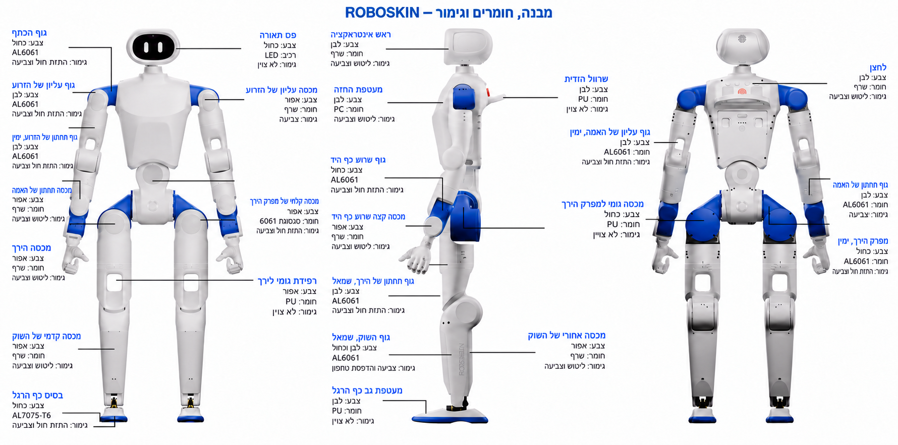

עברית · [English](README.en.md)

# חומרת ROBOSKIN

[הפרויקט המשולב](../README.md)

[תמונה בגודל מלא](assets/images/robot-overview.png) · [מקרא מלא של 26 ההערות](../docs/robot_overview.md) · **[כל קובצי ה־PCB לפי לוח](02_PCB/README.md)**. האיור הוא עיבוד חזותי מתורגם של סקירת חומרת הבסיס; שרטוטי החלקים הם המקור למידות הייצור.

חומרת רובוט דמוי אדם המבוססת על RoboParty RP1, עם קובצי עבודה בשמות אנגליים, מספרי חלקים ROBOSKIN ותרגום הטקסט הסיני הניתן לחילוץ לעברית. טקסט בתוך תמונות, קווי מתאר וגרפיקת Gerber מחייב בדיקת מקור גרפי נפרדת ואינו מוצג כתרגום מושלם. המקורות נשמרים בנפרד לצורך עקיבות ורישוי.

| תחום | מסמכים |
| --- | --- |
| ארכיטקטורה | [מערכת החומרה](00_Docs/ROBOSKIN_Hardware_Architecture.pdf) |
| מכניקה | [מודלים, שרטוטים וייצור](01_Mechanic/README.md) |
| מעגלים מודפסים | [רכיבים, Gerber וקואורדינטות](02_PCB/README.md) |
| צמות | [רשימות, שרטוטים והרכבה](03_Harness/README.md) |
| רובוט שלם | [רשימות חומרים לפי תצורה](04_BOM/README.md) |
| העור האלקטרוני | [תכנון, תוכנה ותוספות חומרה](../README.md) |

בסיס התכנון שנבחר הוא 24 דרגות חופש עם חמש דרגות חופש בכל זרוע וראש בקרת תנועה. גם קובצי חלופת שבע דרגות החופש נשמרים ומסומנים בנפרד.

דוגמת שינוי השם שביקשת: [ROBOSKIN.0001_forearm_lower_body.pdf](01_Mechanic/02_Manufacturing/01_CNC/7DOF/ROBOSKIN.0001_forearm_lower_body.pdf). החלק הזה שייך לחלופת 7DOF; מספרו נשמר כדוגמת הרישום הראשונה ואינו משנה את בחירת תצורת 5DOF.

מפת השמות ומספרי המקור נמצאת ב[מרשם החלקים](provenance/part_registry.csv). רשומות המקור נשמרות לצורך עקיבות, ואינן שמות העבודה.

ארכיוני SolidWorks המקוריים נשמרים מחוץ לעץ העבודה המתורגם. המרה של הפניות מכלול, שרטוטים ומאפיינים פנימיים מחייבת את [הליך ה־CAD](skin_integration.md). ההליך טרם הורץ בתוכנת SolidWorks.

שמות קבצים ותרגום אינם אישור ייצור. שרטוטים, גרסאות, מחברים ונתוני בדיקה חייבים להיבדק כסט תואם לפני שחרור לייצור.

זכויות המקור של RoboParty נשמרות. תכנון החומרה כפוף ל־CERN-OHL-W-2.0; מסמכי ההסבר ל־CC-BY-SA-4.0; חומרי צד שלישי לתנאיהם המקוריים. [תחולת הרישיונות](LICENSES.md).

[מיפוי שילוב העור והיקף האימות](skin_integration.md) · [רישום מקור ומלאי](provenance/README.md)

